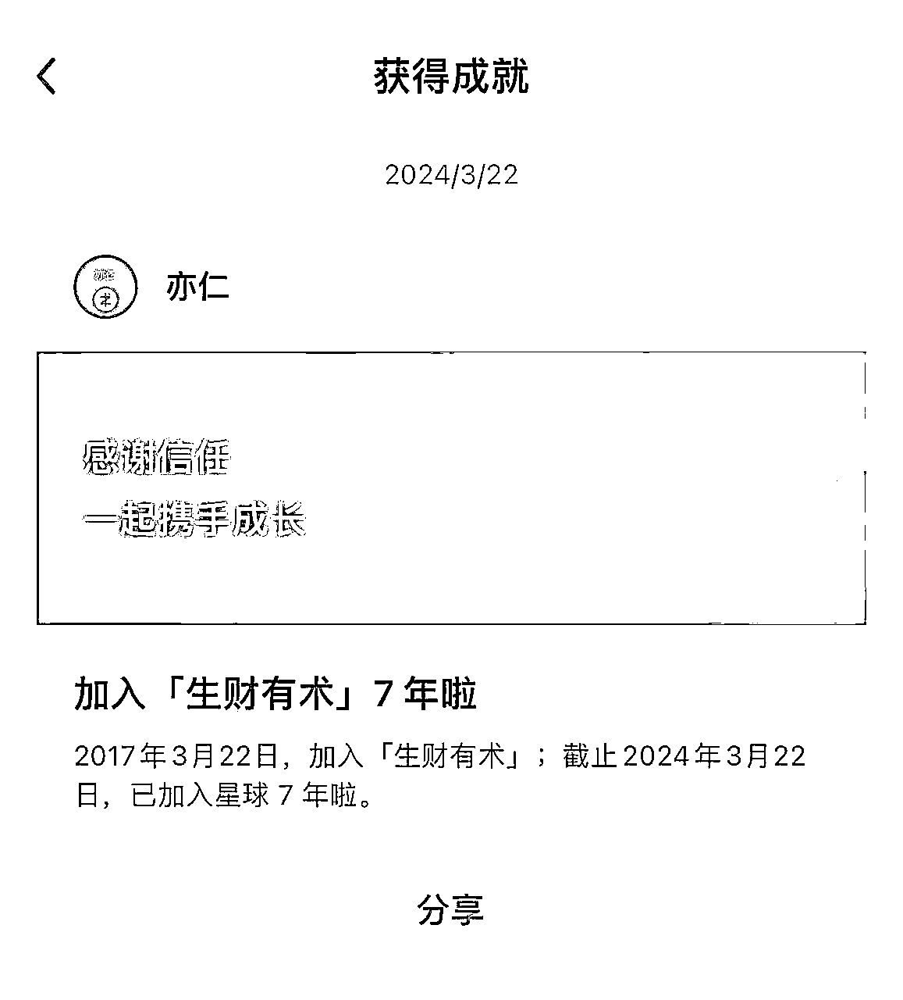
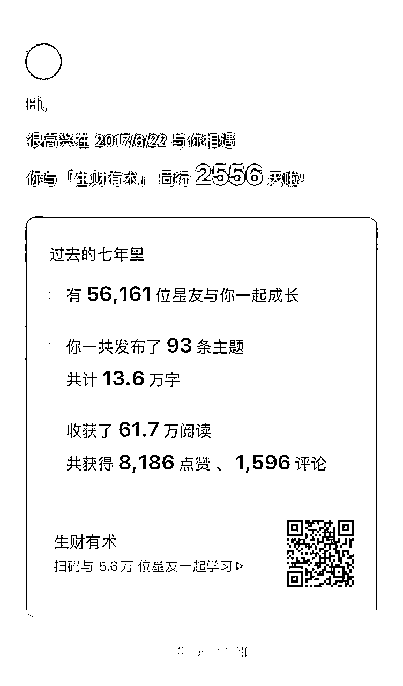
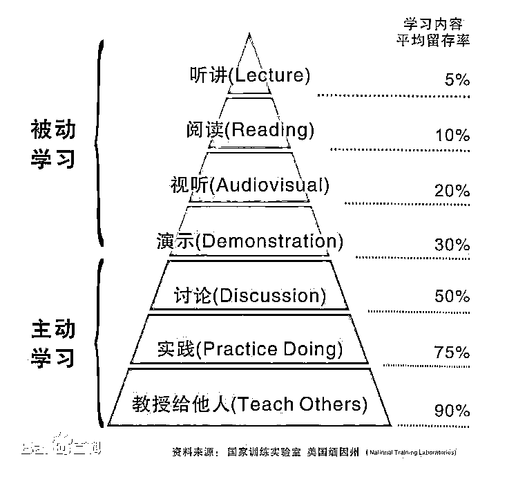

# 坚持写作1600天后，我才敢说：写作和赚钱的真正关系，和你想的不一样

先说个小事：今天是我加入生财有术满7周年的日子。生财7期老圈友，星球编号20。李笑来老师有句话说，7年就是一辈子，赶在这个节点，我想聊聊一个我从未在星球认真聊过的话题——写作和赚钱的关系。

我是程序员出身，早年看同事写技术博客，心里还嗤之以鼻：这不是爱出风头吗？2020年5月，我想通了一些事，决定日更公众号。到现在，已经1600多天。

这1600多天给我带来了什么？

- 从最初憋一篇文章要四五个小时，到现在每天10到30分钟完成千字文；
- 从主题模糊、逻辑混乱，到文章里能有自己的思考，被不少大佬推荐、转发，还在一个细分领域写出过10w+（不是靠系统推，是被大家主动转载）；
- 我建立了自己的写作系统，而不是靠灵感硬写；
- 靠广告、带货、课程、社群，变现了7位数；2021年生财拉新那天，我靠公众号一天邀请了468位朋友加入生财，拿了个第一；
- 公众号的关注量、个人思维、心态、影响力，也都在不知不觉中上了一个台阶。

所以，写作到底能不能赚钱？当然能。但如果你以为这就是大佬们天天劝你写作的原因，那就想浅了。

市面上很多写作课都在说“0基础、XX天精通”，拿“涨粉快、赚得多”当卖点。说实话，冲着钱去写作，没什么不对，我也不觉得丢人，我自己最早就是这么想的。

但为什么亦仁、曹大、冯大、池大这样的大佬，也反复建议大家多写作？他们总不至于指望每个人都去日更涨粉接广告吧？

他们真正想让你练的，其实是写作背后那些“看不见的能力”。这些能力，甚至比涨粉和赚钱本身更重要，是赚钱的前提条件。

赚钱需要的能力，远看五花八门：做淘宝客要懂引流、搞新媒体要有网感、做知乎好物要会选品。但这些都属于细分能力。再往下挖，你会发现所有赚钱的事都需要四个基础能力：

1. 学习能力：遇到新知识、新问题，能快速搞懂、解决；
2. 思考能力：不被表面带跑，能深入原理，多角度分析，验证假设；
3. 用户视角：能发现用户真实的需求，而不是自嗨；
4. 传递感知：能让用户清楚感受到产品的价值，愿意买单。

这四个能力，才是所有细分能力的地基。地基不稳的人做事，就像变形金刚在沙漠里偏偏只有陆战形态，很难适配；地基扎实的人，到哪儿都能进化出合适的本事。

我有个朋友，文笔不错，做知乎好物却失败了，他自己说是不会选品、不懂平台。其实不是，是底层的学习能力和用户视角没跟上，所以一到陌生场景就卡壳。

而写作这件小事，恰好能同时锻炼这四种地基能力。对普通人来说，这也是成本最低、最顺手、最有效的训练方式。

具体怎么练？

**第一，写作练学习能力。**

写作本质上就是“教别人”。费曼学习法讲得很清楚：教是最好的学。你要是能把一个知识、一个概念、一个案例写清楚，让读者看懂，前提是你自己得先真懂。写的过程中你会发现哪里模糊、哪里缺料，于是去查资料、去请教、去补课。读者留言说“看不懂”，就是给你的及时反馈；读者说“学到了”，说明你真的会了。这种有反馈的学习，比一个人闷头看书效率高太多了。

**第二，写作练思考能力。**

写一篇文章，你得想清楚：这个主题到底是什么？为什么重要？它怎么解释？适用什么场景？和哪些事情有联系？这是李笑来老师提过的“概念八问”。把这些问题想明白了，文章才经得起看。做成一件赚钱的事也一样，想得越深入、越全面，才越可能做出正确的决定。反复写作，就是反复做深度思考练习。

**第三，写作练用户视角。**

写文章的时候，你必然要琢磨读者：他关心什么？他缺什么？他看完会有什么疑问？哪个点他没看懂？写着写着，你会发现“自嗨”的文章没人看，明明写了万字，阅读量可能还是个位数——因为文章解决的问题不是读者需要的问题。有读者说想做个读书网站，觉得市场巨大，但稍微用用户视角一算，哪里拉人、为什么来、为什么拼得过豆瓣？全是坑。写作逼着你不断换位思考，读者反馈再帮你校准，时间一长，你自然知道用户想要什么。

**第四，写作练传递感知。**

“产品好”和“让用户感觉到产品好”是两码事。一个包子铺贴“包子”，另一个贴“猪肉大葱现包现蒸”，后者更容易吸引人。写作就是练习这种“包装信息”的能力。你写一段介绍，看用户有没有反应；没反应就改；改完用户还不对，就再换。一次次调整，传递感知的能力就被磨出来了。连自己的想法都不能说清楚的人，怎么说服别人掏钱？

你看，写文章和做赚钱的事，背后需要的能力几乎是同一种。区别只是，写文章的“练习场”就在手边，随时随地都能练，练一次就等于积累一次复利。

所以，别再天真地以为“写作=涨粉=接广告=赚钱”。真正的逻辑是：写作帮你练成更厉害的人，而一个学习很快、思考透彻、懂用户、会表达的人，赚钱只是一个自然的结果。

如果今天你问我，7年写作给我最重要的收获是什么？不是那7位数，也不是公众号关注数，而是我把这四块地基，一点一点打深了。

现在，你想不想也试试？

你有没有想过，一个人拼命练习写作，表面上是跟文字较劲，实际上是在悄悄打磨一种更值钱的本事——让别人精准感知你价值的能力。

说白了，当你通过写作，能把一个产品的价值、一个观点的分量、一个方案的好处，清晰地传递到别人脑子里，那赚钱就变成了一件顺理成章的事。因为商业的本质，不就是“价值被看见”吗？

所以，练写作，就是在练赚钱的内功。

这门内功里，藏着四样核心装备：学习能力、思考能力、用户视角、传递感知。别小看这四样，它们可不是只为了写文章用的——你做任何行业、任何岗位，想快速上手一件事，靠的都是它们打底。地基越扎实，你越能在不同领域长出细分技能，把事情做成。事情一旦做成了，钱只是附带的奖励。

有朋友可能会抬杠：我又不写深度文，我就想写那种大白话、不用动脑的爆款，然后涨粉、接广告、赚钱。这种文章总不需要什么学习能力、思考能力吧？

这还真是一个普遍误解。

你去看那些真正的爆款作者——

有人擅长写人物，有人偏爱讲故事，有人专攻商业，有人死磕成长。他们的文章读起来轻轻松松，似乎不用带脑子。但文章的骨架，其实全是严密的思考和逻辑。

这些人是把深度思考藏在了你不见的地方。比如有人完全抛弃说理，用身边朋友的经历替代论证，再加上文字节奏感，读起来爽，传播也快；有人则用硬核推理加各种类比，带着读者从陌生走向熟悉，读完整个人恍然大悟；还有人用观点当主线，塞满案例细节，隔几句甩一个金句，把枯燥的道理打碎，包装成有故事感的传播品；更有人讲商业模式、讲底层方法，但全用商业案例引路，配上金句和严谨推导，把视角拉到普通人能用的高度。

你看，形式可以千变万化，但内核永远逻辑严密。

甚至连那些撩拨情绪的文章，用什么故事、从哪个角度切入、想激起什么情绪，背后都是精心设计的逻辑，一点不乱。我甚至能猜到，这类爆款的第一稿，一定满是“因为所以”“由此构成”“被影响”“本质是”这种干巴巴的句式。然后初稿之后再加二稿、三稿，不断加入案例、金句、开头、结尾、故事，把枯燥的骨架用流畅的语言包起来，再调顺序、顺句子，反复打磨无数遍，最后才变成你眼中那篇“不用思考就能看懂”的爆文。

而且，想让更多人喜欢你的文章，你就得理解更庞大的用户群体心里想要什么，这恰恰对用户视角提出了更高要求。

所以，那些看似轻松好读的爆款，其实比烧脑文更费功夫、打磨更多轮、难度更大，对学习能力、思考能力的考验也更强。

市面上确实有各种写作课，教你怎么写金句、怎么设计开头结尾、怎么讲故事、怎么促转发。我以前也傻傻地报过一堆课，以为学会这些技巧就能写出爆款。后来发现，这根本走不通。

原因很简单：写作的灵魂是思考。你得先有能力把一个道理、观点、事情想得清清楚楚，逻辑顺得明明白白，在这个基础上，才谈得上选择某种风格去包装。如果自己脑子里都是浆糊，逻辑一塌糊涂，直接往上套金句、套开头、套故事、套金字塔原理，读者只会觉得莫名其妙。

所以不管专业文还是传播文，底层永远需要清晰的逻辑，再叠加心理学、传播学、营销学的知识，文章质量才能更上一层。

而这些，全都由那四个基础能力支撑着。

有人说，学习能力、思考能力太虚了，不如10w+、流量、影响力来得实在。可你细品一下，那些10w+、那些大影响力，哪个不是作者把学习能力、思考能力、用户视角、传递感知练到足够强之后，自然长出来的果实？我从来没见过一个这四项能力稀烂的人，能写出爆款、收获关注、接到广告。

如果你正在写作，或者打算开始写，这一点真的值得反复琢磨。

再往深一层，怎么才能持续写下去，而不是三天打鱼两天晒网？

很多人觉得前面这些谈的都是鸡汤，没给干货。但我想说，恰恰是这些“鸡汤”，比所有干货重要一万倍。因为决定你能否长期写下去的核心，从来不是框架、选题、素材这些技巧，而是你心里对“写作到底为了什么”的答案。

人做任何事，心里都揣着一个预期。预期没被满足，就没有正反馈，自然坚持不下去。

为什么那么多人写着写着就放弃了？因为他们最初的预期是“写几天、写几个月就能涨粉赚钱”。可现实中，这个预期能实现吗？根本不能。那些宣传“轻松靠写作月入十万”的课程和案例，大概率是幸存者偏差。你被急于求成的心蒙住了眼，才愿意相信这种鬼话。

于是写几天没涨粉，写几个月没赚到钱，挫败感涌上来，就放弃了。

而前面那些“鸡汤”，就是为了帮你扳正这个跑偏的预期。

如果你写作的预期，不再是“快速涨粉赚钱”，而是“通过写作锻炼学习能力、思考能力、用户视角、传递感知”这些赚钱的基础能力，并且你心里笃定，这些能力强了，未来一定能持续赚到更多钱，那么你每写下一篇，都是在朝“更值钱的自己”靠近一步。

这样一来，每篇文章都是正反馈。

有了正反馈，怎么可能坚持不下来？

所以，持续写作的真正内核是——

你清楚自己为什么动笔；你明白每写一篇，自己都会得到某种看不见但实实在在的收获；你相信自己虽然现在写得还不够好，但只要持续认真写、持续复盘改进，那些底层能力一定会慢慢变强，而一旦变强，涨粉、广告、影响力、流量，都会自动找上门；你想通了这些，就会变得乐观、有毅力、有勇气、有耐心，不再在意别人的嘲讽打击；你心里只剩下“如何做到、如何做好”，然后埋头去干，遇到问题就解决问题，一步步翻过障碍，直到抵达目标；你还会从心底涌出源源不断的能量，主动想去多写。

因为你知道，只要一直在写，就在一直进步。未来等你的是星辰大海，而不仅仅是涨粉和广告费。

这也是我自己能坚持日更一千三百多天的最大动力。

最后，把这门课的重点收个尾：

第一，写作确实能帮你赚到钱，但短期绝无可能。

第二，写作真正锻造的是四种底层赚钱能力。你变得值钱了，钱就会顺着你的价值流过来。只是这需要比较长的时间。

第三，任何有真价值的技能，都必须经过长期、大量、重复、枯燥的练习，这是世界的客观规律，谁也绕不过去。

第四，想持续写作，一定要先想清楚：你到底为什么而写？想从中获得什么？

电影《闻香识女人》里有段台词特别扎心：“如今我走到人生的十字路口，我知道哪条路是对的，毫无例外，我都知道。但我从不走，为什么？因为他妈的太苦了。”

持续写作，就是那条又对又苦的路。所以大多数人选择不走。但恰恰是那些难走的路，才藏着更大的价值，才能把人磨得更强。

一个人如果想得到从未拥有的东西，就必须去做从未做过的事。

尤其是那些难的。

祝你今年在赚钱这件事上，也能突飞猛进，冲出一条自己的路。