# 带团队一年半：从孤家寡人到40+人、月入数十万，我把这套"师带徒裂变"完整拆给你看

> 来源：原文链接

这套玩法，最适合正在单干、想带队伍的人；尤其是已经有个人品牌、想把业务做成盘子的朋友。

全文8000多字，是我一年半的真实复盘。会分五个部分讲：

一、从1人到40+人的完整发展轨迹
二、"收徒"背后的深层逻辑
三、从0到100人的分步搭建流程
四、这套模式最容易翻车的3个坑
五、这套模式的下一步走向

下面开始。

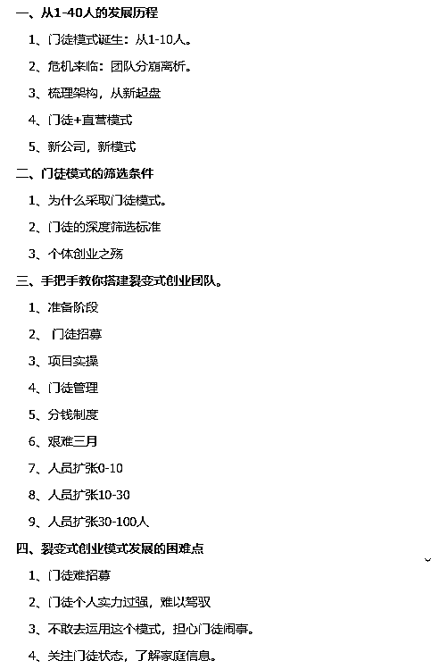

（内容目录截图）

## 一、从孤家寡人到两支队伍：1→10→40的真实轨迹

先说现状：我现在一北一南两摊业务。北方在秦皇岛，30多人，主要做私域；南方在杭州，10多人，做📕方向的培训和个人品牌孵化。两边都靠"师带徒+裂变"来运转。

### 1. 起点：第一批学徒，从1到10

2022年7月，我萌生了"收徒做项目"的念头。

那时候我身份是创业博主，公号粉丝2万多，私域好友2万多。

这个念头怎么来的？2021到2022年，我做拼多多电商，前前后后铺了将近3000家店铺。结果平台风控，整盘生意说没就没。

我从湖南回到秦皇岛，但真闲不下来。偶然刷到抖音的图文引流玩法，就让一个徒弟先去线上测。

结果才几天，一条内容就爆了。

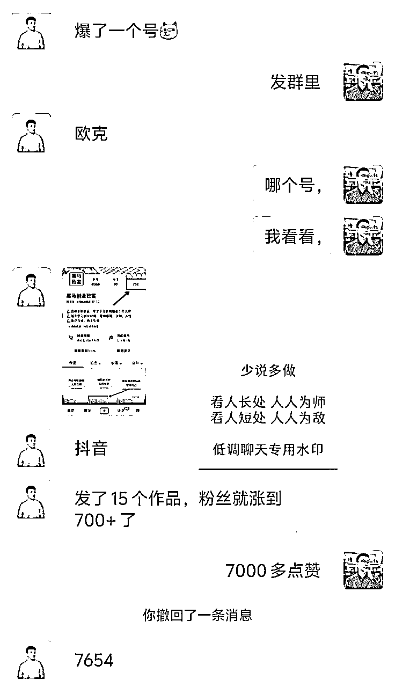

我马上意识到机会来了，跟他说："你直接来秦皇岛，跟我一起干。"

那会儿场地已经租下来了，但里面空无一人。我原本是想等模式跑通再招兵买马，后来换了个思路：不如先收几个学徒，小范围验证一下。

于是我从2万多关注者里挑了4个人，都是以前付费学过、对我极其信任的老学员。我把他们请到秦皇岛，一起打磨内容打法。

那段时间我们疯狂做内容，抖音、📕、视频号都被我们打出来了。

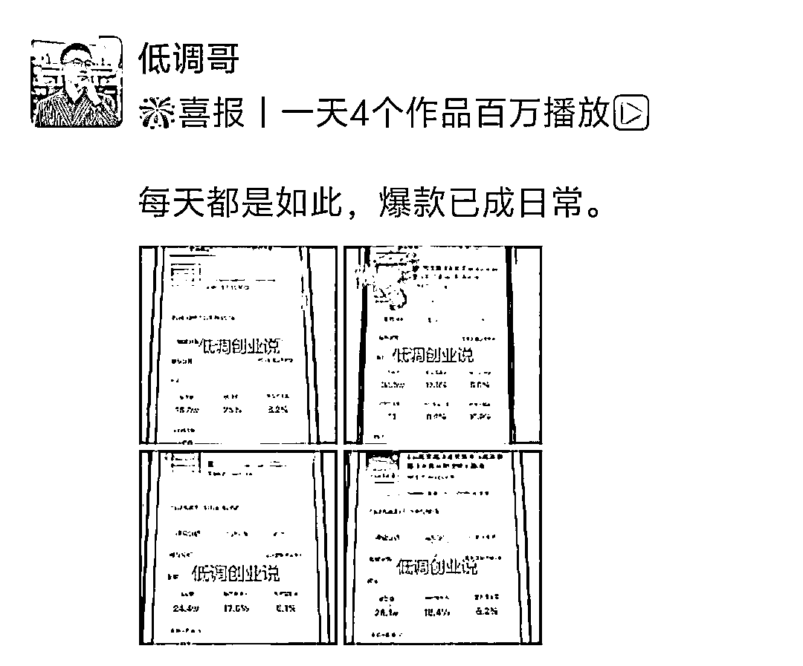

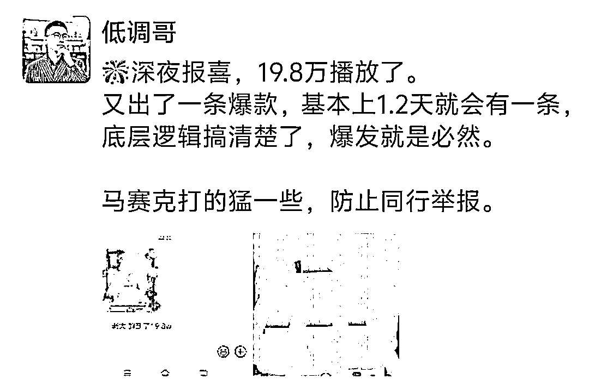

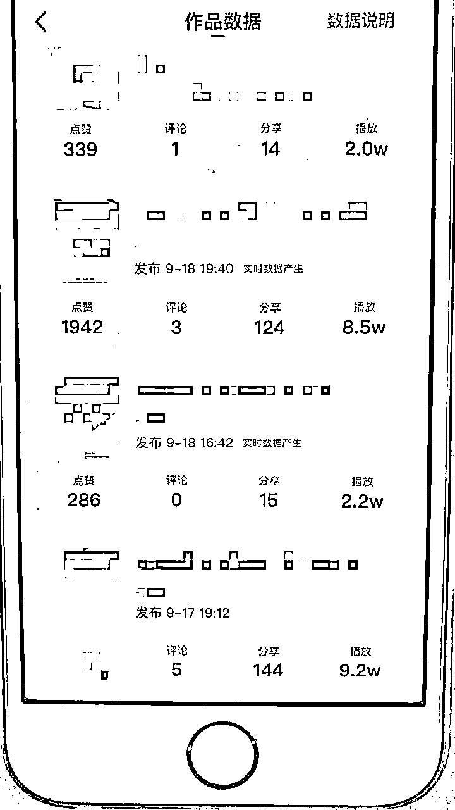

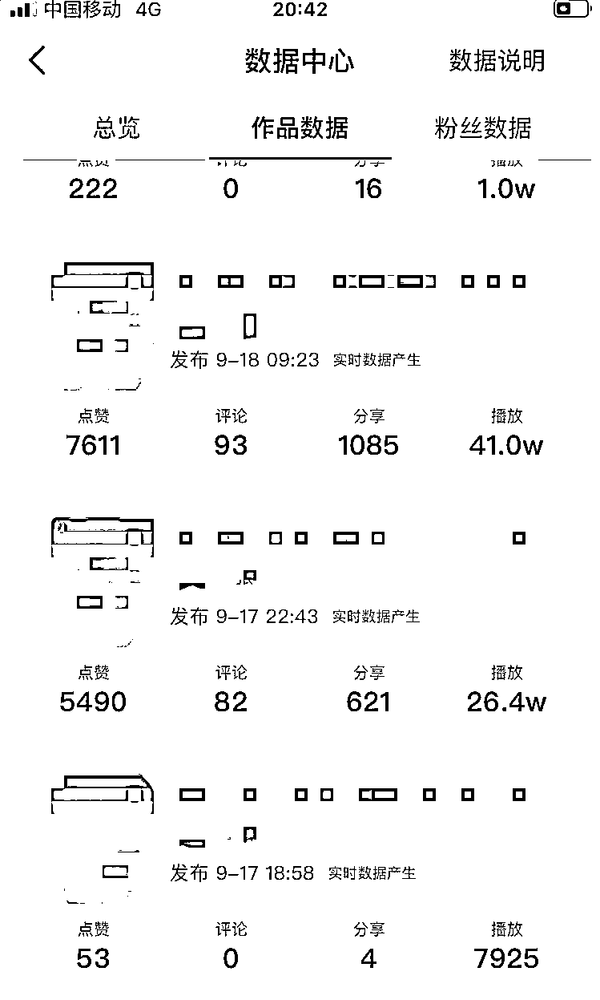

抖音

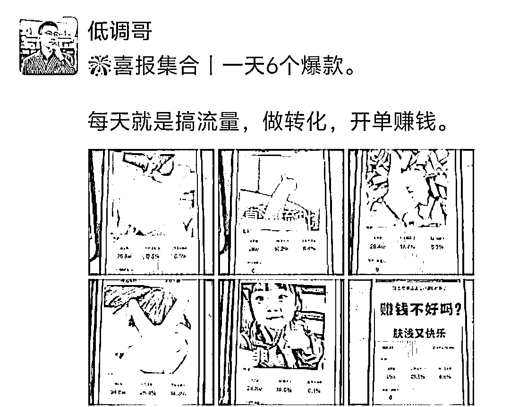

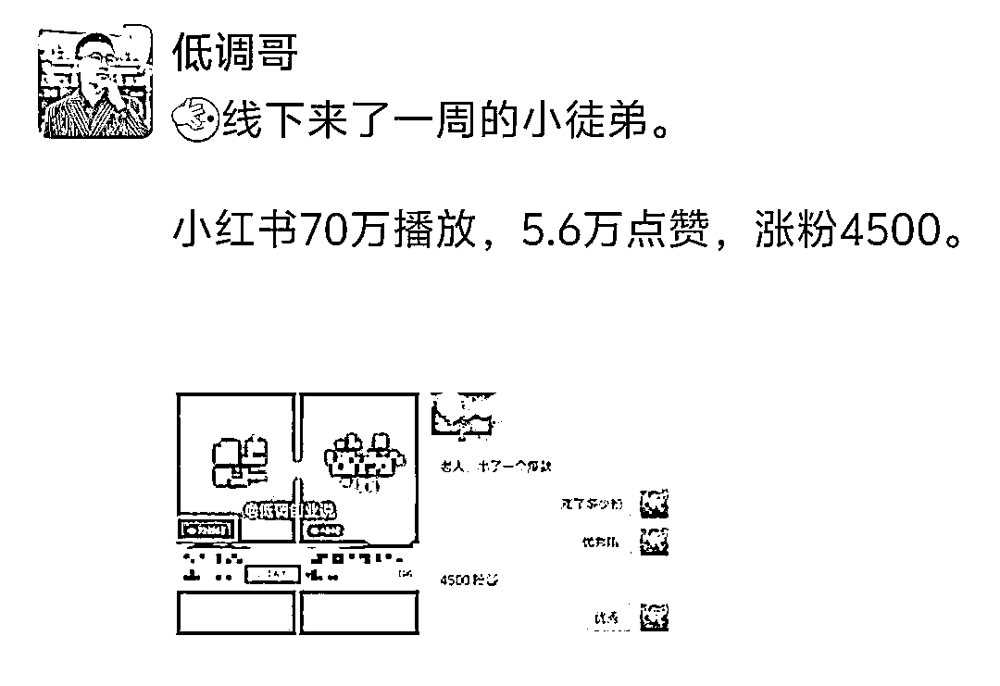

📕

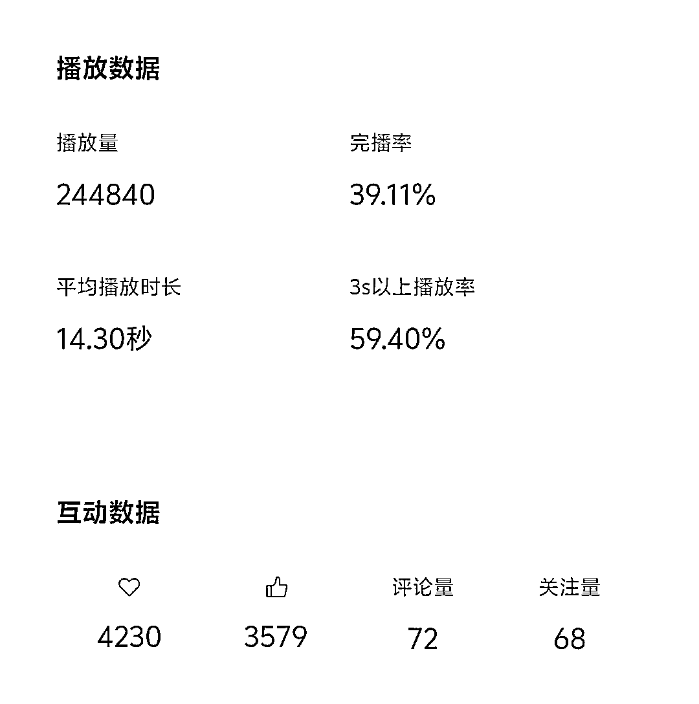

视频号

队伍就这样一点点滚起来，从最初1个人，慢慢到了10个人。

### 2. 危机：半年不到，团队散了大半

所有采用小分队作战的组织，跑到半年左右几乎都会撞上一次危机。大多数团队，就是死在这个坎上的。

不是赚不到钱，而是重复太磨人。

那段时间，学徒们确实跟着我赚到了钱。

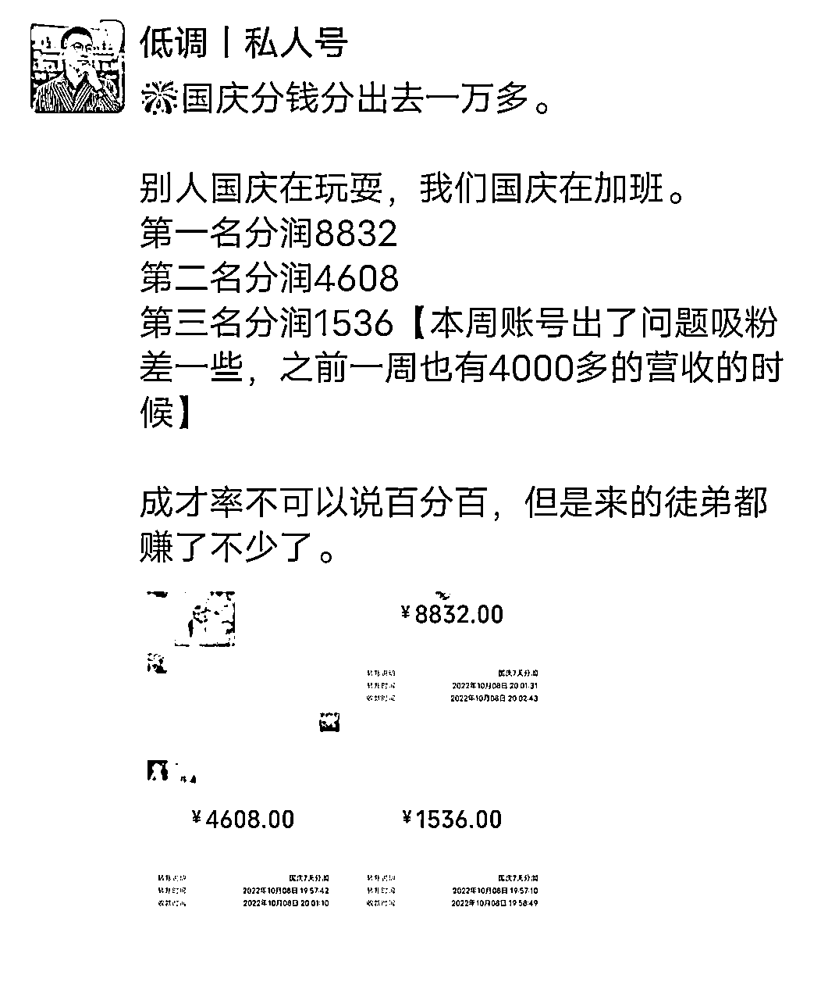

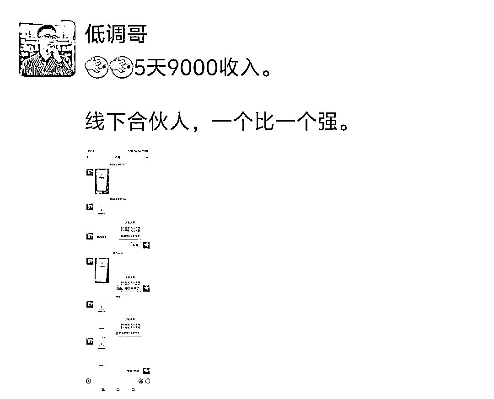

（收入截图我就不多放了，免得有营销嫌疑）

可每天从早上9点半忙到晚上10点、11点，每周只休一天，很多时候一天都不休。钱挣到了，但是人垮了。

更要命的是，流量总有波动，搞客户越来越难。

于是有人开始提离开，一个带一个，最早那批人，最后只剩第一个跟我的人。

### 3. 二次起盘：换一套架构，重新来过

说实话，大多数同类团队到这一步就散伙了。

4月到7月，那是我最灰暗的90天。学徒一个个离开，业务停摆，租的房子也快到期。我一度怀疑自己是不是不行。

但创业这么多年，我从来没认过输。咬着牙，我重新设计了一套打法，我叫它"项目流水线"：

1. 找项目：靠人脉资源，从身边挑出靠谱的好项目；
2. 试项目：丢给小分队去快速验证；
3. 放大：验证通过的，立刻转自营、全力做大规模；
4. 招加盟：已经稳定盈利的项目，对外开放招商和线下培训；
5. 开分部：持续赚钱的项目，交给小分队负责人去独立运作。

拿着新框架，我重新招了7个人，又找了身边朋友的3个项目来做深度测试。

大约一个季度后，家电类目跑通了。

然后我让学徒分组PK，赛马机制跑起来，用90天从0做到了月入10万+。

### 4. 进阶：给学徒配人，跑"师徒+直营"双轨

之前学徒为什么走？一个人干久了，累是必然。

想让学徒赚更多、又不那么疲，最好的办法就是：给他配员工。

去年12月起，我们进入了一个新阶段。我帮学徒招员工，让他们从一线执行退到二线管理。小组制：学徒当组长，员工当组员，组与组之间互相竞赛。

秦皇岛这套模式现在已经跑得非常顺，员工加到了20多人。

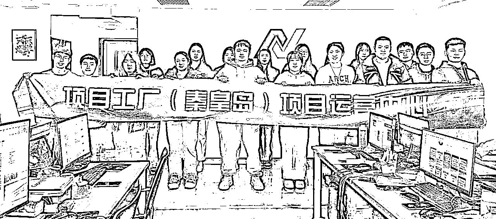

### 5. 扩张：把整套打法搬到杭州

北方稳下来之后，我给自己选了条更难的路：去杭州再开一摊。

杭州这边是和我的一个学徒合作。她之前一直在做📕的个人IP孵化，去年业绩接近一百万。

我把整套打法完整地复制给她，让她也去收徒带人。我自己也带了一批学徒过去，模式原样复制。

现在杭州那边也有10多人了。

核心逻辑就四步：

第一步，教方法论——把流量玩法教给学徒；
第二步，做内容——学徒按SOP持续生产内容、获取流量；
第三步，成交——流量导进🛰️，完成转化；
第四步，分钱——不同产品对应不同提成，没有保底工资，全是提成。

接下来我们会切更多细分项目，逐步把学徒培养成项目负责人，然后给他们配员工。

杭州成本太高的话，有些项目直接放回秦皇岛落地。

现在的分工很明确：秦皇岛是项目试验田，专门负责测试和孵化；杭州是品牌运营总部，负责对接资源、放大IP影响力。

## 二、收徒不是招人，是在"选人"

前面是故事，下面才是真正的干货。

### 1. 为什么是"师徒"而不是"伙计"

我做的本质上是师承制。师徒关系比纯雇佣多了一层感情绑定，也多了一个"我认你、你服我"的契约。

伙计是拿钱干活、随走随散；徒弟是认可你这个人、愿意跟着你学。这层关系，比什么KPI都牢靠。

虽然我们年纪差不了几岁，但我需要他们发自内心信任我、认同我。

### 2. 三道闸门：付费、到岗、面谈

我的筛选动作是三位一体：先付费、再到线下面谈、最后还有线上面试。价格是9980。

付费，是用钱投票——说明他认你这个人，也有决心做这件事。

到岗，是愿意真人过来。疫情最凶的时候，我的学徒照样飞秦皇岛，隔离、核酸、办手续全扛过来了。这种诚意，靠线上聊天是验证不出来的。我一直觉得，纯远程协作很难出结果，基本是个伪命题。

### 3. 八个硬门槛

①年龄30岁以下，男女不限；
②必须全职、常驻秦皇岛或杭州，兼职和远程免谈；
③有互联网项目的基础经验；
④身体条件要好，没有重大疾病，体重超过200斤不考虑；
⑤能吃得起苦，每天在公司的时长是12小时（早9点到晚9点），受不了别来；
⑥执行力必须强，玻璃心、脆弱的人不要，公司不哄孩子；
⑦性格要温和，自我中心、爱讲歪理的人不收；
⑧财务状况要健康，有严重负债的不要，心态容易崩。

另外，生活自理，吃住自己安排。

国内把师承关系玩得最明白的，一个是德云社，一个是东北民间艺术团。这两个组织，值得所有想带徒弟的人反复研究。

### 4. 关于"没有底薪"的争议

很多人说这是"付费打工"，是换着花样压榨。圈子里对这个话题吵过很多轮。

我的看法始终如一：这就是一道过滤阀。我们重质不重量。一个优秀的学徒，一个人就能扛起一个百万级的项目。

门槛越高，进来的人越强。

我的发心，是把他培养成项目负责人，年入百万；
他的初心，是少走弯路，用三年时间快速成长起来。

### 5. 个人创业最扎心的真相

现在个人创业真的越来越难，因为商业已经从游击战打成了阵地战。

创业里有很多"暗知识"，只能口口相传。你回想一下自己公司是怎么做起来的——是不是某个大哥给了你管理框架，或者你问了好几个大哥，才把能力凑齐？

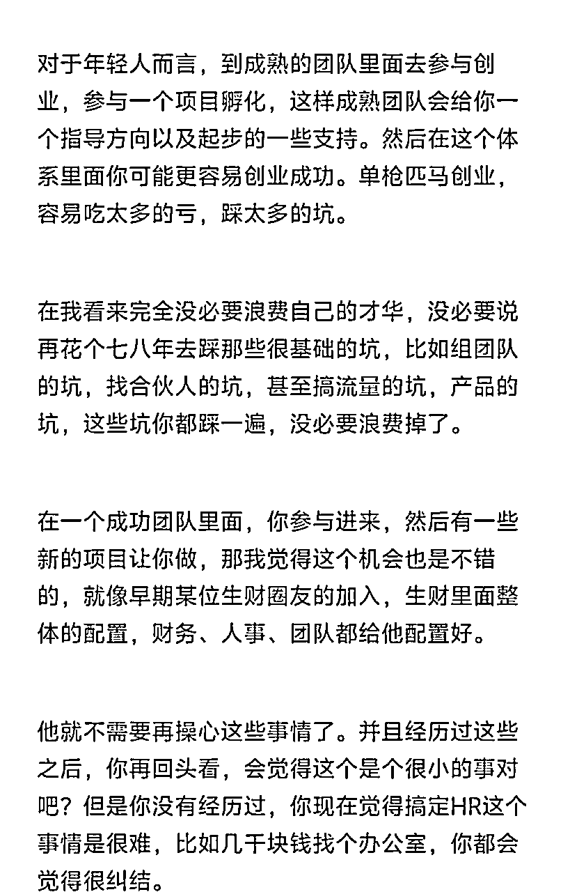

所以我能吸引来的，不是单纯为了赚钱才来的人，而是真心想学本事的。他们看的是未来，是学会一家公司怎么管、怎么运转。

如果你还在单打独斗，真心建议你找个大哥跟一跟，不要一个人当犟种。

不公司化，很难做出来大结果；想公司化，那一路上全是坑。这些内容，书本上学不到，加个付费社群也学不到。

古代拜师学艺，前三年是白给师傅干活的。哪一个成功的人不是一路踩着荆棘过来的？别只盯着眼前那点钱。

今年我们团队年入50万以上的学徒，至少有5个。秦皇岛的两个项目主管，一个是01年的，一个是02年的。

## 三、照做就行：从0到100人的完整搭建手册

### 第一步：动手前，先备齐三样

①一个已经赚钱的业务：月利润2万左右就行，最好有点小壁垒，没有也行。但一定要能复制、合规、正面。
②一个场地：前期100平够用。
③一个基本盘：有人认可你。哪怕你不做IP，只要朋友圈经营得好，有人愿意信你、支持你，就够了。

这三样，缺一个都跑不起来。

### 第二步：招募怎么搞

第1步，写一篇自我介绍。注册一个公号，认真写一篇自己的创业经历，让人充分了解你。文章里最好提一下现在在做的项目，这种文章发出去，反响通常不会差。

第2步，持续更新进展。在朋友圈同步创业动态，或者建一个"见证群"，让潜在的人天天看到你在干什么。

第3步，发招募帖。前面都是铺垫，这篇才是主角。

帖子结构：
我是谁
我在做什么
我打算做什么
我需要什么样的人
筛选条件是什么

关于收费，给你三个方案：

丨押金制：先交XXXX，多久没结果就退；出了结果，每个月返一部分，比如收1万，每月退1000。
丨直接收费：根据你的受众体量定价，建议别低于5000。
丨分期制：先付一部分，等他赚钱了再补尾款。

第4步，用直播收口。直播是最直接的表达方式，面对面把事讲清楚，比写十篇文章都管用。

人到了之后怎么接风、怎么安置，这是做人的基本礼数，成年人都懂。

### 第三步：实操期的两个要点

第一个，心态。你可能会紧张，不知道怎么和学徒相处，不知道怎么派活。记住：你们是师徒关系，按徒弟的标准要求他就行。他愿意来，说明你有他认可的价值，认真教就完了。

第二个，SOP。必须有完整的培训体系，最好把流程固化下来。来一个教一个太慢，复杂的环节录成视频，新人照着练就行。

### 第四步：管理靠制度，不靠感情

我身边很多朋友照搬这套打法，为什么跑偏了？无一例外，死在管理上。

觉得徒弟来了，告诉他要做什么就行了。不抓纪律、不抓考勤，慢慢大家都懈怠了。

我们公司到现在战斗力在线，就是因为第一天就立好规矩：

①每天写小结：当天做了什么、有什么思考，全部写下来；
②打卡纪律：不迟到、不早退，有事提前请假；
③每周例会：固定时间开，推进本周的任务；
④"罚款"制：不写小结、迟到、违反规定，自己主动掏钱进团队基金，用于团建。

现在我可以每天中午才到公司。就算一个月不去秦皇岛，公司照样转——框架和监管做扎实了，你就可以脱身。

线下是一个场。什么样的氛围，养什么样的人。一个懒散的团队，是没有战斗力的。

### 第五步：分钱要快，也要准

分钱按周，不按月。尤其是前期，必须让学徒不断看到希望。

公平是底线：所有人一个标准；
但也要有阶梯：设计晋升路径，能干的人可以往上升。

### 第六步：最难的90天

前90天，决定这套模式能不能成立。

头30天，是培训期。核心验证一件事：你的方法有效，能做出成果。

第二个30天，是培养期。哪些人能跑出来，你心里大概有数了，集中资源培养标杆；基础差的人，重点盯基本功。

第三个30天，是发展期。标杆立住了，业务成型了，所有人都看到了方向。

### 第七步：从0到10人，最简单的一段

就一个字：晒。

晒标杆、晒案例、晒业务，不断记录身边人的成长和变化，让更多人看到、想加入。

一般第二次招募，就能到10人。

### 第八步：从10到30人，最难关卡

这个阶段必须转自营。

为什么？因为学徒哪怕走了，业务不能停；新学徒来了，可以直接接过他留下的员工。

而且师带徒会把利润分出去很大一块，自营能守住利润。

但自营之前，要备好九样东西：

①核心学徒3人以上（业绩要突出）；
②能容纳30人的场地；
③设备：手机、电脑、桌椅板凳；
④零基础可上手的SOP：录成视频、做成图文；
⑤财务把控：所有进账，必须从你这里走；
⑥薪资框架：提前定好。三线城市是福地，3000+月薪随便招人，最难招的是中层；
⑦专职HR：想快速上人，必须有HR。我们现在的HR效率很高，十多天面试了100多个人；

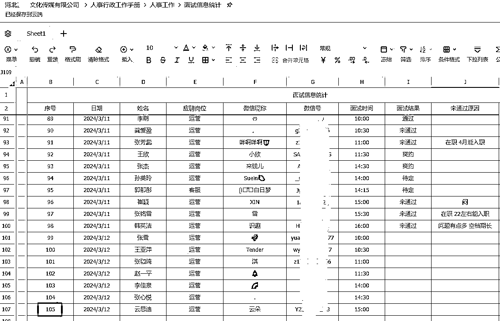

⑧分组：HR和学徒一起面试，员工分给学徒，集中培训；
⑨员工严选：员工不是靠"培养"，是靠"筛选"。不合适就劝退。我们故意多招人，就是为了筛。大概90天，30人就能稳下来。

### 第九步：从30到100人，复制、复制、再复制

①复刻打法：开一个新项目，从老学徒里挑1到2人负责。测试成功后，按10到30人的流程再走一遍。

②项目选择：去年我在这踩了大坑。试了一堆项目，失败了一大半。

后来我给自己做了一张项目评估表，每上一个新项目都要过一遍深度流程，绝不允许拍脑袋决策。

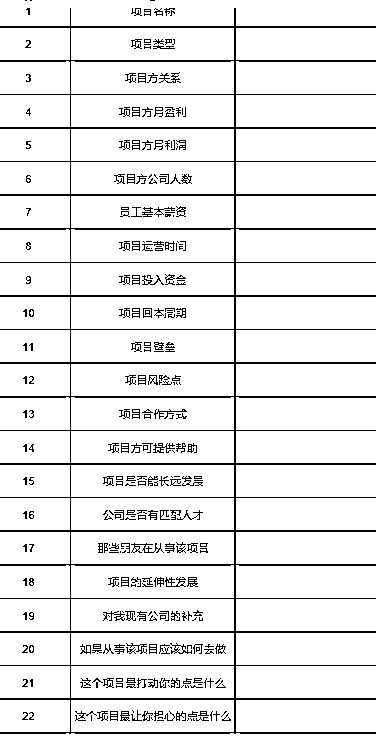

原则就两条：看得懂，有积累。我在秦皇岛只做私域，在杭州只做培训和个人IP，全是我最熟的领域。

③公司文化：团队过了30人，文化必须立起来。你不主动定，团队就会乱。我们今年开年就把公司文化写好了，学的是海参哥的版本，极度简单，极度好用。

④员工体系：日常管理用积分体系，日常工作行为换积分，积分换假期、换现金。晋升走两条路：专业路线和管理路线。

⑤监管体系：财务、人事、行政都要配到位，还必须有一个绝对靠谱的自己人盯着财务。人多不代表利润高，随时要盯项目波动。

到这个阶段，师带徒的威力才真正爆发：

业务上，学徒自己开拓；
管理上，学徒自己盯人；
财务上，你牢牢攥在手里。

秦皇岛现在已经进入这个状态，我不需要深度参与。每个月回去算算账、分分钱——这件事我也准备交给核心人负责了。

自动运转，还在高速增长。

## 四、最容易翻车的三个坑

### 坑一：招不到学徒

很多人喜欢这套模式，但就是招不到合适的人。

招人这件事，一半靠筛，一半靠养。没有人天生完全匹配。

所以别总想着"伯乐相马"，等一个完美的人出现。多给人成长空间和时间，比挑选更重要。

### 坑二：学徒太强，管不住

这个问题我遇到了不止一次，尤其是00后，个性非常强。

我的处理方式是：先想清楚底线在哪里，哪些事绝不能碰；再想清楚可以妥协的点在哪里，哪些事可以松。

想明白了，你就轻松了。

眼睛要容得下沙子。能力强的人一定有性格；小绵羊没性格，但也打不开新局面。

### 坑三：怕学徒闹事，不敢用

我有朋友确实在这上面栽过，但根子是他不会管。

在线上就要严格把关，不合适的人一个都不要放进来。

如果你只收钱、什么人都收，那不是收徒，那是招商。

## 五、这套模式接下来怎么走

说实话，这套打法的天花板不在于模式，而在于人。

项目可以换、流程可以迭代，但"找对人、立对规矩、分对钱"这三件事，永远不会变。

今年我会继续在杭州和秦皇岛两条线同时复制这套体系，把更多学徒推上项目负责人的位置。

如果你也想从单干走向带队伍，就从第一个学徒开始试。

如果你把门徒这件事当成一个单纯的赚钱生意去做，迟早会翻车。

## 关于门徒，你得先做好这几件事

**先摸清他的家庭底牌和情绪状态**

人来了是真心想跟你干，但家里的支持往往决定他能不能坚持。我的习惯是，每一个新门徒上来，我都会聊聊家庭状况，家里人是支持还是反对。

逢年过节，我会主动给他的父母准备一些礼物，让家里安心，也让他没后顾之忧。

除了外部环境，更要盯他的心理波动。情绪一上来，如果不及时疏导，很容易就散了。所以沟通要在点上，而不是等出问题才补救。

**疲劳期来了怎么办，三个月是分水岭**

别以为有钱赚就不会累。绝大多数人三个月左右必进入倦怠期，不是钱的问题，是人做事做久了，真的需要喘口气。

这时候硬拉着只会适得其反。我会安排团建，带他们出去散心，随便喝个酒，放松一下。

同时要做心理上的疏导，更重要的是给他一个新目标。很多时候人累，就是因为没盼头了，目标太低或者没有目标。

这也是我为什么要做【PRE*】门徒+自营的组合。让门徒在冲刺的同时，有员工可以分担业务，他就能抽身休息，不至于被耗空。

另外要清楚，不同阶段的人才价值不一样。对于那些真的想走、劝也劝不住的人，别硬留。留下来只会拖垮团队氛围，甚至带走一帮人，对大家都没好处。放手是最好的选择。

**哪些老板和项目，真的适合玩门徒模式**

最吃香的是有IP影响力的博主。无论是去带销售、拉流量，还是亲自操盘项目，都是门徒模式的绝佳场景。

第二类是手里有稳定项目、想做到低成本扩张的老板。尤其是以流量为核心的团队，匹配度极高。

平台型团队也不是完全不能做，只是波动风险太大，一波平台崩盘就全完了。

# 裂变式发展，我的总结和思考

**做模式，别死磕做公司**

做公司越做越累，做模式越做越轻。

低调摸索了一年半，我才走出了一套属于自己的发展打法。

**1.0阶段：IP+项目+门徒**

用IP去挖掘身边能落地的项目，再招募合适的门徒来实操验证，跑通了就快速放大复制。

这个阶段最难的两件事：

①找到对的人
要执行力在线、认同感强、抗压能扛事、思维还在线。招了这么多人，真正复合这些条件的少得可怜。千金难买一将难求。2-3个这样的门徒就能把一个项目打通。

②选对项目
去年测了无数项目，翻车居多。我后来专门做了个项目评估表，现在所有项目都要先理性分析再研发。

人对了，项目对了，才能互相成就。

目前我聚焦的三条主线：
私域屯量线：长期沉淀私域，做成管道型收入；
积累沉淀线：找那种能持续积累、越做越值钱的项目；
IP培训线：围绕IP做课程研发，不断扩充IP私域。

**2.0阶段：项目+门徒+直营**

和外面常见的门徒机制最大的不同，是我给每个门徒配员工。

做项目疲劳是必然，随着门徒能力起来，他会开始招人做业务放大，从执行者变成管理者，而他的收入也会直线上升。

这个阶段，门徒拿大头，我拿小头。

这套打法圈内很少有人敢玩，因为对管理能力和业务理解要求极高。

**3.0阶段：加盟+分公司**

这一步暂时还没启动，但思路已经有了。等模式完全成熟后，就做复制，项目工厂化输出。未来杭州之外的新公司，可以和有想法的人一起合作。

**自动管理，结果为王**

我一直推的是小组制，重心放在带门徒上。管理思路就是自动化。

公司架构搭好后，它应该自己转起来，不是我去救火。我不做微观管理。

结果导向很简单，这个员工不合适，亏的是门徒自己的钱，他自然会优化掉。因为他比我更懂业务，知道要什么样的人。我只需要引导他怎么管好团队。

我信奉无为而治，不多干预，看结果。你管好门徒和财务，给他们更大的舞台就够了。

**为什么我坚信这条路**

因为我看到了两个活生生的案例：螃蟹王国和海参。他们直接点醒了我。

我们公司做到50-100人规模，月营收破百万只是时间问题。

一个公式：三个优秀门徒+一个好项目=30人团队。

这套模式最牛的地方在于可复制性。它实现了自动化的可控扩张。

很多人赚不到钱，核心原因就是时间和精力被锁死，一个人只能做好一件事。而裂变模式是无限复制、无限上量。

100人团队=1000万利润
1000人团队=1亿利润

这不是鸡汤，是一个在大多数行业都成立的规律。

海参能在短时间内做到千人规模，靠的就是背后的门徒阿米巴体系，所以远甩了那些只做自营的博主。

现在是阵地战时代，不是游击战。阵地越大，壁垒越高，复制力和组织的机动性，才是红利市场的核心武器。

希望这篇文章能给还在迷茫的老板们一点启发，有问题评论区聊，我尽量回复。后续也会根据大家提问出答疑贴。

拓展阅读【龙珠文章】

①商业顶层设计：从百万到千万:
https://wx.zsxq.com/dweb2/index/topic_detail/412511251481528

②如何做个高效率且赚钱的 IP？
https://wx.zsxq.com/dweb2/index/topic_detail/415581554228228

③极简致富创业思考（看懂少走10年弯路）
https://wx.zsxq.com/dweb2/index/topic_detail/585244142288214

④5人团队20万起盘一年翻15倍，每月持续盈利30万+背后的项目操盘拆解。
https://wx.zsxq.com/dweb2/index/topic_detail/418524181584588

⑤资深创业老司机传授抱大腿方法论
https://wx.zsxq.com/dweb2/index/topic_detail/582282125424214