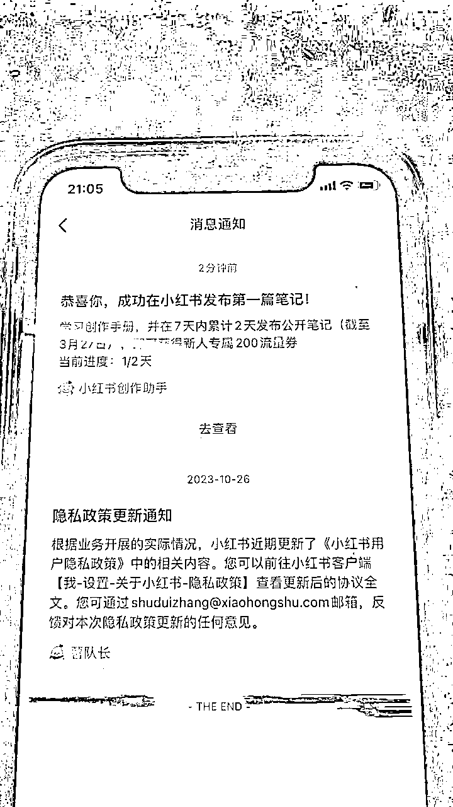
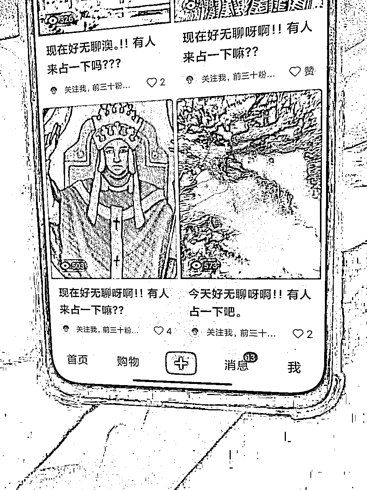
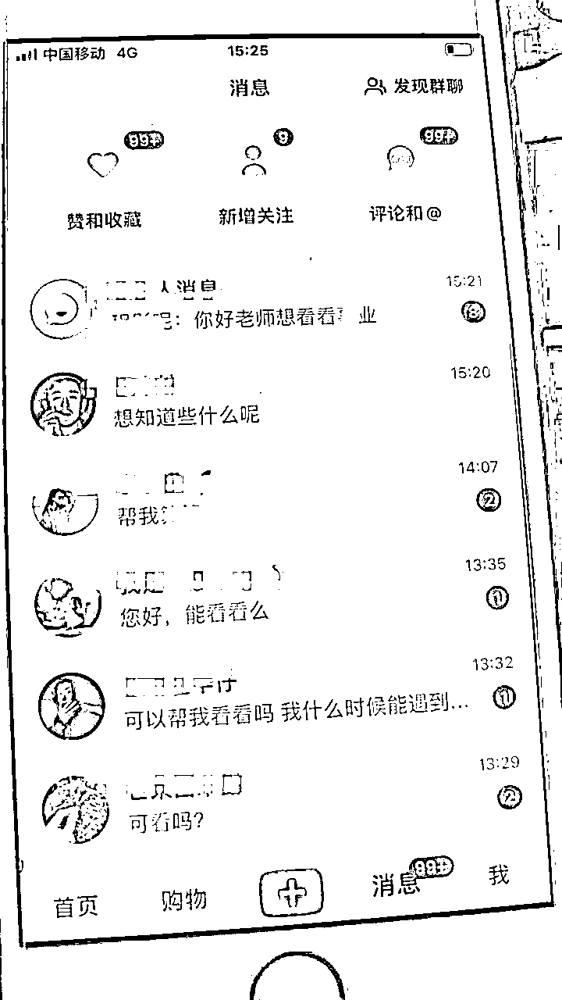
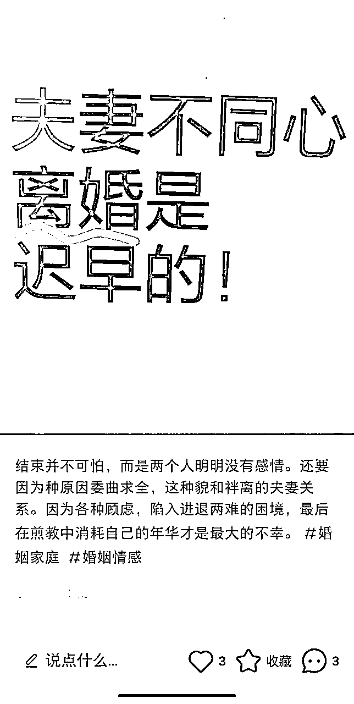
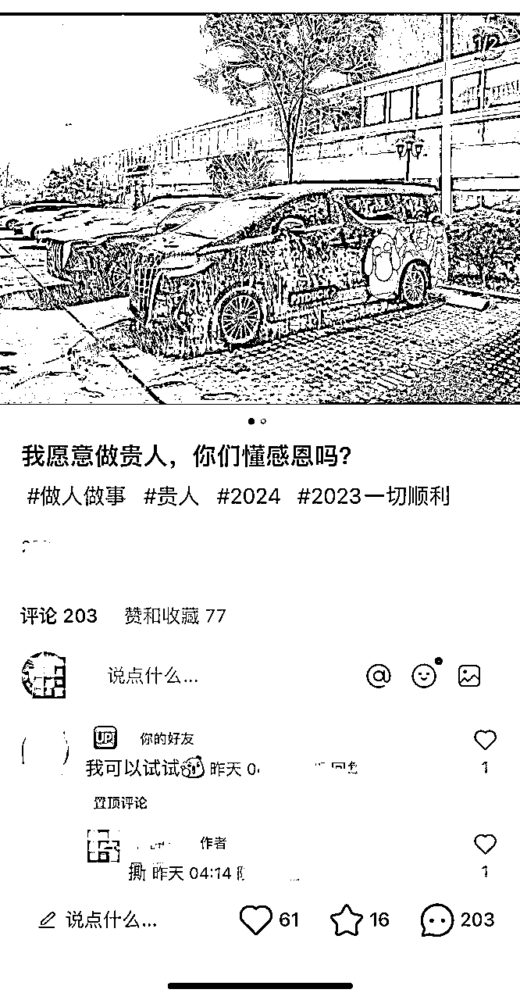
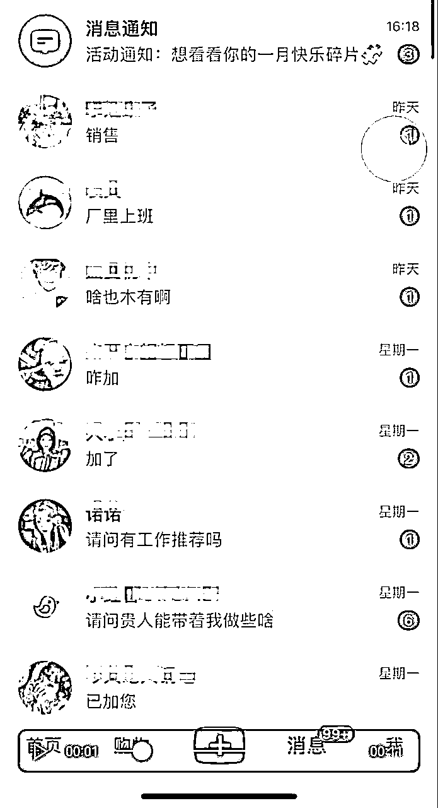
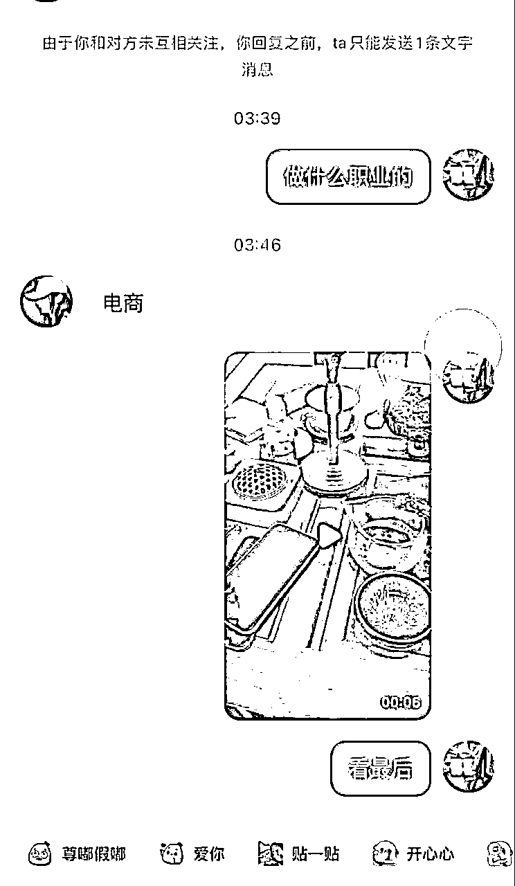
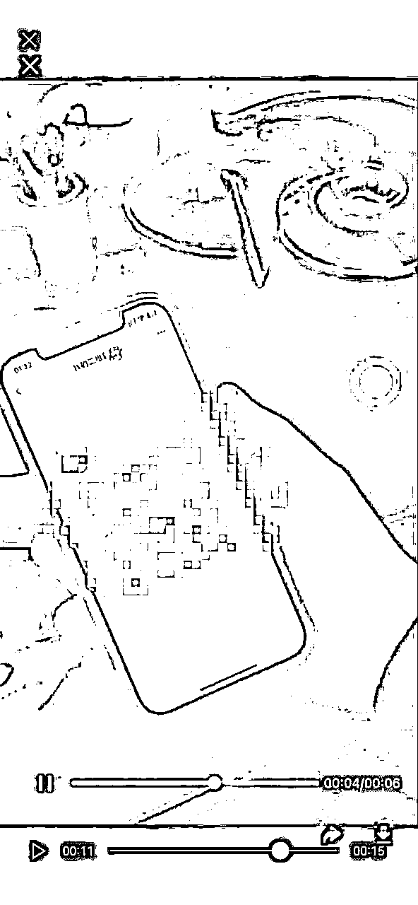

# 小红书全域引流实操全攻略，从0到放量

说实话，现在做获客，小红书是启动最快、最省钱的赛道之一。各个平台都有自己的红利周期，小红书的特点就是投入门槛低、反馈速度快，十几分钟就能涨十几个粉丝，按粉丝变现来算，几百块的收益十分钟就能到手。

为什么这么有底气？因为小红书的调性很特殊。平台规则严、玩法细，但用户质量是实打实的，女性用户占比高达64%，而且消费能力普遍在线。唯一的限制就是年龄层比较集中，40岁以上的用户比例相对有限。

小红书引流的底层逻辑其实就三件事：

1，设备 网络 账号
2，素材 标题文案
3，引流防封

一：设备网络账号

先说基础配置，小红书对设备、网络、账号三者的校验很严格，缺一不可。尤其是账号，账号质量决定上限。

前期准备一套干净的设备就行，iOS安卓都可用。网络方面建议用全国IP跳频的流量卡，能最大程度避免IP被污染的问题。这三点搞定，后面基本不会卡在起步环节。

小红书有个很香的点，不像其他平台需要长期养号，周期被大幅压缩，玩法灵活度很高。我们实操中一部手机一天可轮换10个账号，每个账号都能产生独立产值。对比抖音快手的实名、养号、养权重逻辑，这里省下的就是时间成本和人力成本。*补充一下，养号是否必须因人而异，稳妥做法是先放空1-2天再操作*。

关于账号成本，目前一个账号成本在5块钱左右，市面上有拦截接码和地推两种来源，地推号目前稳定性最好。放24小时后，基本就能出现“恭喜加热”的信号。

小红书的规则比任何平台都更看重账号健康度，首先是能否出恭喜，其次是作品是否能被加热。账号为王，私域老号权重最高。一个号能正常出恭喜、作品能加热，就说明这号可用。

二：模板文案

基础环境搭建完，就要进入内容环节了。小红书非常吃标题和封面文案。

引流打法主要分两种思路：短期的爆粉流和长期的长尾流。以国学赛道为例：

封面可以是头像、风景照，或者手写打印的内容标题搭配固定话术。这类就是典型的快流模板，适合追求速度进粉，账号状态正常可加热，可直接一比一复刻标题文案。现在市面上的放粉团队，一个号出10几个粉很正常，百台设备一天可多轮轮换。素材和文案提前备好后，整个流程就能SOP化。

这种模式账号存活周期短，属于典型的废号流玩法，节奏快、产出快、转化也快。

而长尾型的模板更适合做精细化运营，人群客单价更高。国学赛道分支众多，这里只是举例参考。模板本身更新很快，生命周期一般很短，有效期一过就要换新。对标方法很简单：在平台搜索目标赛道关键词，看最新最热的内容，对标账号评论区用户留言，就能判断当前模板是否精准，然后直接复制迭代。

三：引流规避

很多同行最怕的就是小红书私信引流被封。这里分享一个实操技巧，以兼职粉引流为例：

这个模板单号评论200条，私信100条。

平台不封号的核心逻辑是让系统判定你们是正常社交关系，而不是营销行为。别一上来就甩联系方式，否则直接被判定营销号。

顺带聊的过程中，还能顺手做一次人群调研，更利于后续成交，一举两得。

安全甩联系方式的办法是用视频展示。先拍摄一段无关内容，最后把二维码或手写微信号放在画面里，这样可以绕开关键词检测，即便被举报也很难判定。

拍个几秒的短视频，把联系方式放在结尾，用户自己看得到。这样操作，封号率能控制在10%以内。

总结就是，设备网络账号打底，模板文案做量，引流环节做规避。把这三层吃透反复实战，你就能在小红书建立起自己的稳定流量系统，成为这个赛道的引流专家。