# 学会找爆款文案/选题的方法
作者：龙哥

爆款文案找不到？这套全网通用实操方法请直接抄

做自媒体的人，估计都听过一句话：不会写就抄爆款、跟热点。可真轮到自己去抄的时候，很多人又懵了——抄作业也得先找到那份好作业啊？

更扎心的是：你其实早就刷到过无数爆款，只是没认出它们。

先别急着搞原创，因为你得先搞清楚一件事：那些能被称作“爆款”的内容，早就经历过市场和用户的层层检验，是大众用点赞投出来的票。它代表的不是运气，而是当下真实存在的趋势。

为什么不建议新手一上来就原创？原因很简单。第一，你的自媒体功底、文案底子和爆款感知力都不够厚；第二，达芬奇这种天才画鸡蛋也是从临摹起步的，做内容讲究的是先“有”再“优”；第三，你还不知道爆款长什么样，怎么总结出它背后的爆款公式？

那么，到底什么才算爆款？下面这组图应该能让你瞬间找到感觉。

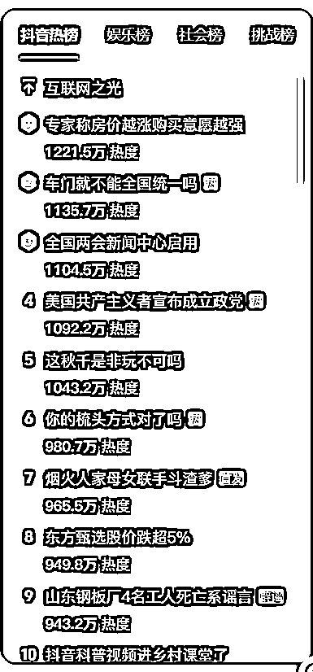

这里有个常见误区：热点每隔几小时就换一茬，你是追不完的。正确思路是：先定下账号的垂直方向，再去锁定你能模仿的对标账号。

如果你是纯新手、一个粉丝都没有，就从5万粉丝以下的账号里，找那些点赞特别高的内容来研究。至于百万粉丝的大博主发了10万赞的内容，看看就好，别去追——人家的起点和流量池，跟你根本不在一个维度。

还有一个反常识的真相：每天被你刷到的高赞内容，其实就是最现成的爆款素材库。因为一个视频如果不火，几乎没有机会出现在你的推荐页里。反过来说，小账号本来就很难被大众看到，所以你刷来刷去都是大热门，这太正常了，不值得焦虑。谁不是从零开始的呢？况且，很多博主能火，并不是因为自媒体捧红了他们；他们在没有自媒体的时候就已经能力很强了，自媒体只是放大器。

我们要做的，不是一口吃成胖子，而是选好赛道、打好地基，然后靠日积月累，从零到一，慢慢形成自己的素材库和内容判断体系。

平台那么多，盯住抖音和📕这两个就够了，爆款案例取之不尽。

接下来直接上干货：具体怎么找？

先看抖音的“巨量算数”（网址：https://trendinsight.oceanengine.com/arithmetic-index）。用法有四个方向：

第一，盯紧热门内容，紧跟最新热点。注意，热点必须和你的内容强相关；如果硬塞一个无关话题，对账号没有多大意义。

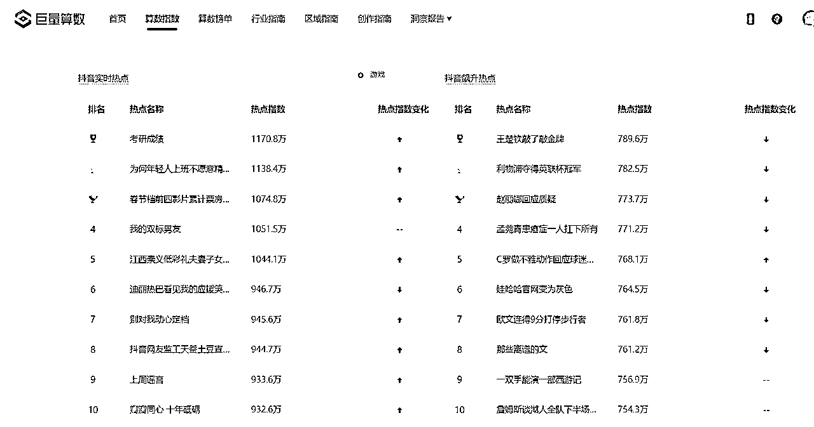

第二，按行业划分去观察各赛道正在火什么。

第三，解决选题纠结症。不知道选什么内容？去“创作指南”的【垂直领域】找灵感，再结合热门关键词定话题。记住，爆款话题的背后，往往对应着一群人的情感、需求和共鸣点。二次元、鬼畜、种花、认知思维，你选什么？赚钱、英语、情感、职场，都是热门话题，你又适合哪一个？

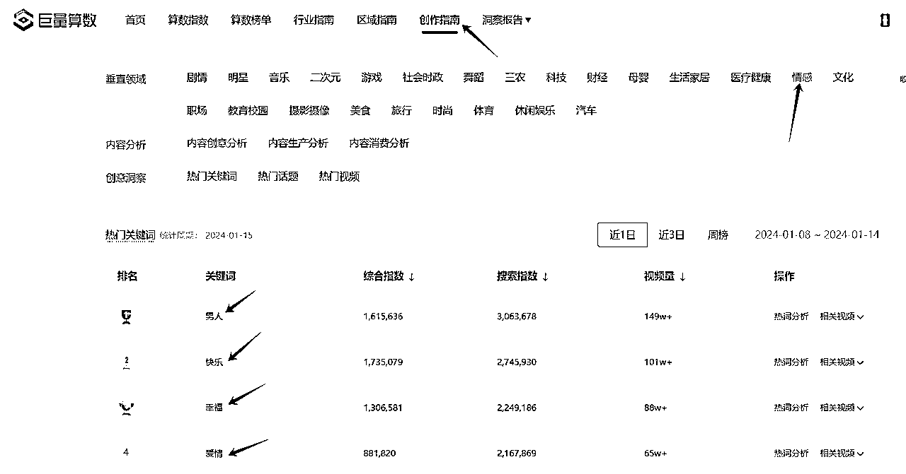
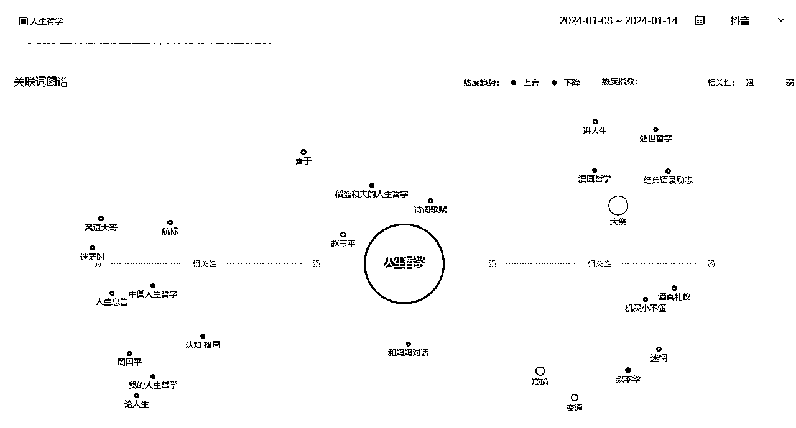

第四，锁定对标账号。比如你想做“女性成长”，直接搜这个话题，会有大量相关账号冒出来。

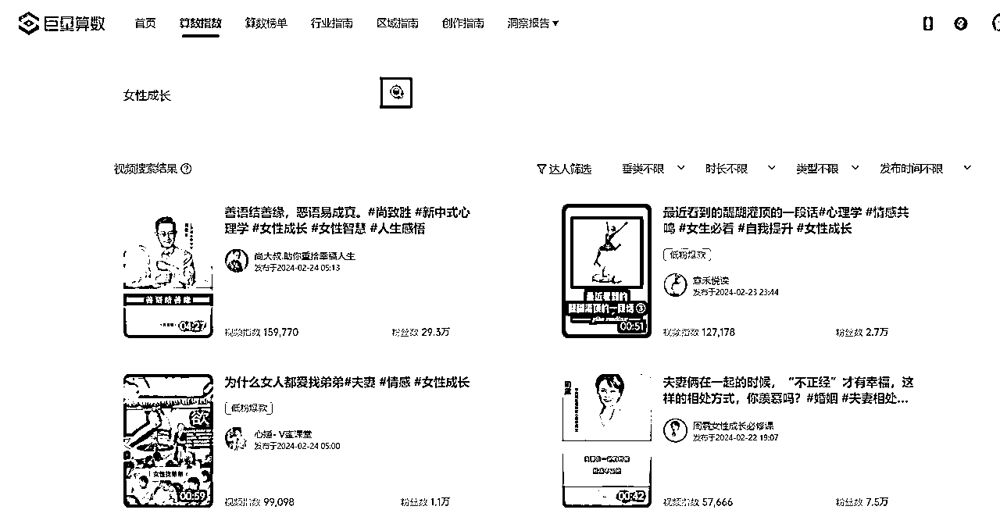

注意：把视频时长筛选在15到60秒之间，这个区间的内容对新手最有参考价值。

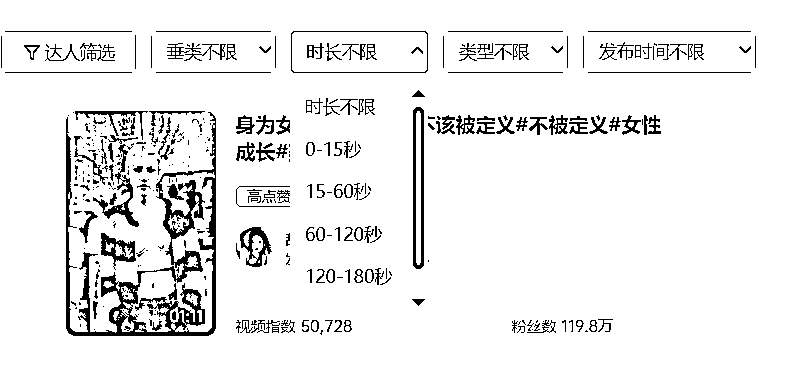

然后重点又来了：优先选择“低粉爆款”作为模仿对象。为什么？因为大博主无论发什么，都自带粉丝基础和数据光环；而低粉账号的爆款，才是靠内容本身硬生生杀出来的，参考价值高得多。再从中筛选出和你的账号内容方向一致的，认真拆解。

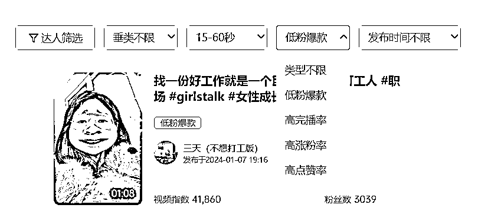

再来说抖音第二个神器——热点宝（https://douhot.douyin.com/welcome）。它可以帮你发现：和你的账号相似的内容里，有哪些热点可以关联、可以蹭。

第一个功能：实时热点，第一时间捕捉当下最热事件。

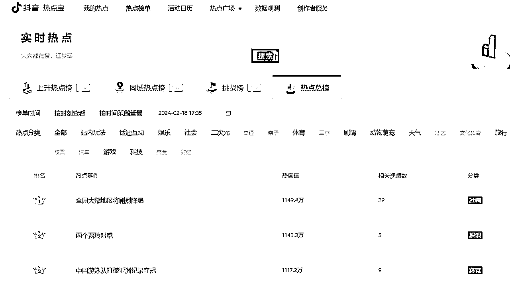

第二个功能：热词趋势，跟着搜索词的上涨趋势去做选题，流量自然来。

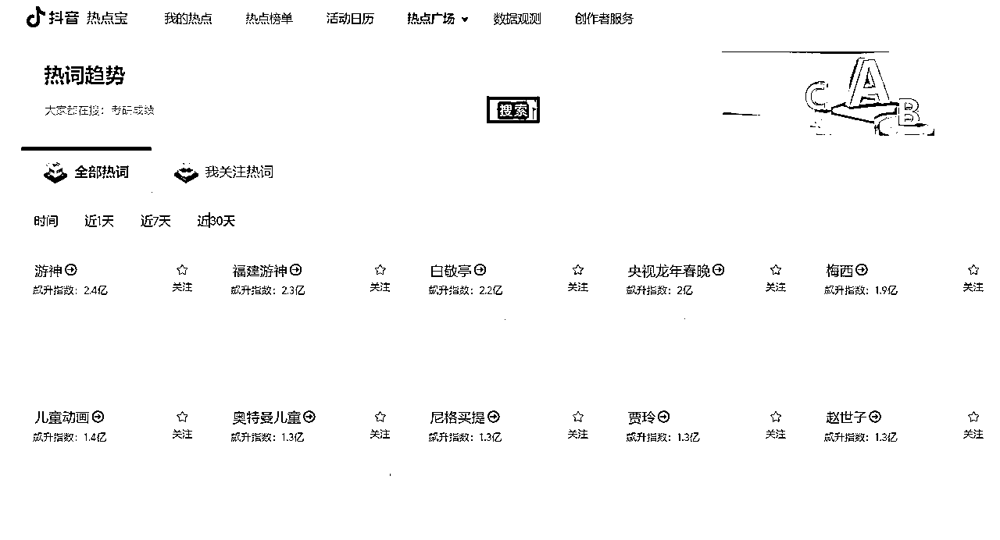

第三个功能：活动日历，平台节点、官方活动提前看到，方便提前布局内容。

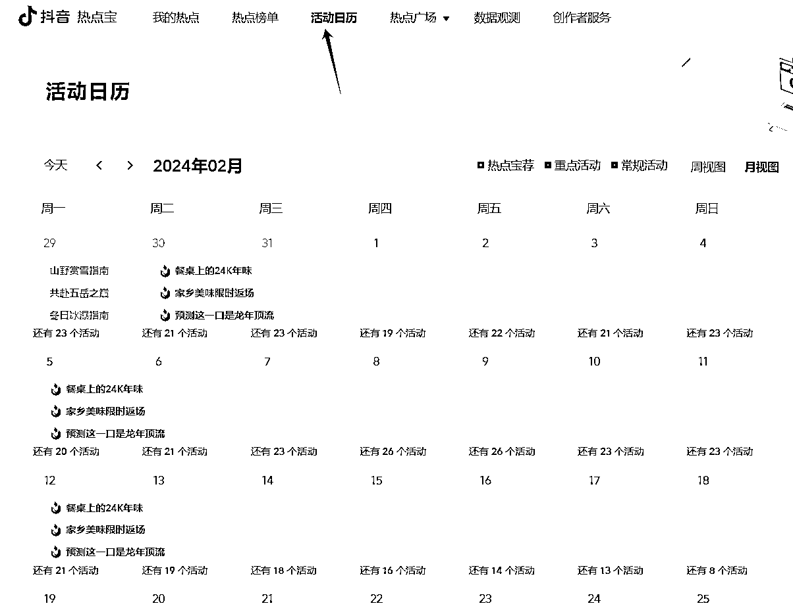

第四个功能，也是我想重点讲的：找对标账号的“冷启动作品”。

什么叫冷启动作品？就是账号在基础流量几乎为零的时候，靠哪条内容撬动了整个账号，把数据从很差一步步拉到很火的那条视频。

操作方法是：连续翻看对标账号发的所有内容，数一数它到底发到第几条才开始爆的，真正爆起来的是哪一条——那条就是它的冷启动作品。

这个冷启动作品，最适合拿来当你的前几条发布内容。怎么做？把原视频的文案下载下来，开头第一句原样保留，其余部分丢给AI改头换面，再发布到自己的账号上。

当然，受限于博主不同、剪辑风格有差异、热点也有时效性，你发出去大概率成不了爆款，但数据一般不会差到哪去，至少能给你一个宝贵的正反馈。这也顺便解决了“账号前三条到底发什么”这个世纪难题。

AI改写这里推荐用Kimi（https://kimi.moonshot.cn/），不用魔法，直接能用。

等账号发出前几条、有了一点基础流量之后，日常经营文案又该怎么找呢？

分享一个“九宫格选题法”：在推荐页随意滑动，一屏内容里，只选那个流量最大的视频。

比如下面这三个不同账号的推荐页，第一个就选2602赞的那个，第二个选8368赞的那个，第三个同样选点赞最多的那条。

再进阶一步：等你自己的账号发了10到20条内容之后，挑出自己点赞最高的一篇文案，让AI帮你改写一遍，再重新发一次。重复这个动作，直到这条内容播放量跌破200为止。这样坚持，账号很快就能跑起来。

说完了抖音，再看📕怎么找爆款。

最基础的方法：关键词搜索。比如你搜“女性”，“女性”就是核心关键词，后面那些灰色的字，就是SEO长尾词。

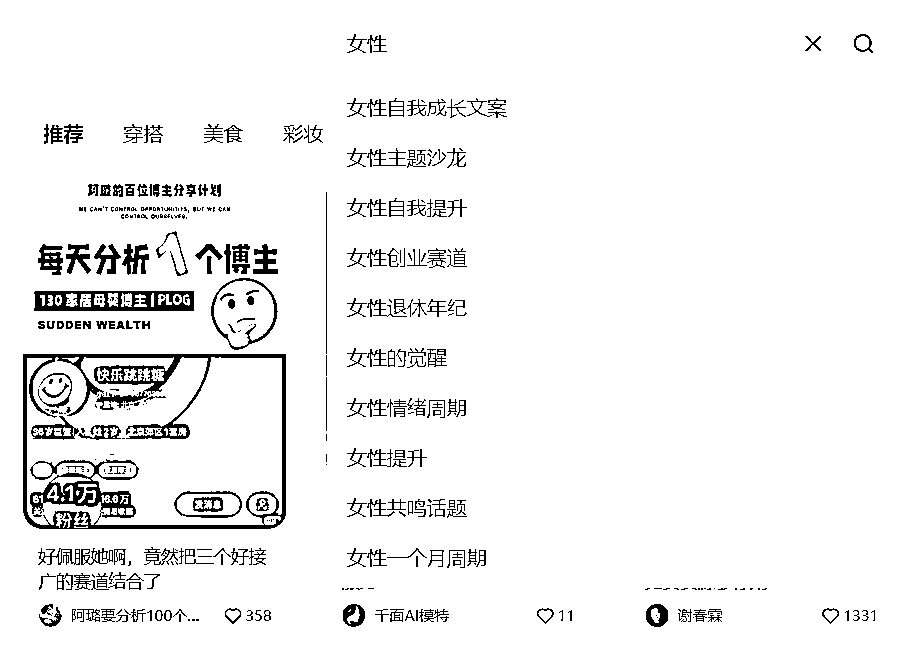

搜出来的结果，别急着看前面，要看点赞数，挑那些点赞高的内容做参考。可以直接用📕网页版操作：https://www.xiaohongshu.com/。

最后提醒一句：不是所有爆款都适合做成视频口播。举个例子，打开这篇笔记（http://xhslink.com/hPJ2eC），里面全是零散的短句，直接拿来当口播文案会非常别扭。

遇到这种情况怎么办？要么果断放弃，要么用Kimi组合改写。具体做法是：给AI一个清晰的提问框架，让它把这些零散句子重新整合成一篇完整的文案，再根据你自己的内容风格做微调，就能得到一份全新可用的口播稿。

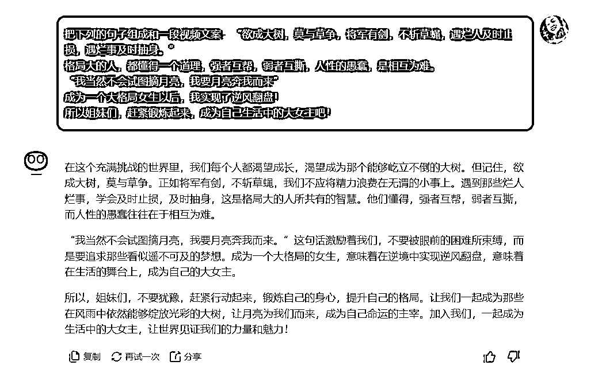

一句话总结：爆款不是玄学，是可复用的方法论。找对平台、跟对话题、拆解对标账号，再让AI帮你重组改写，普通人也能持续产出有流量的内容。

这套方法来自博主阿甜的原创整理，原文链接放在这里，需要深入研究的可以去看看：