# 打造你的爆款感知素材库，从收集到复用到变现

> 来源：[https://vow6kdbiak.feishu.cn/docx/KcbNdxvEMoycd4xu7Rjc6UsLngd](https://vow6kdbiak.feishu.cn/docx/KcbNdxvEMoycd4xu7Rjc6UsLngd)

# 素材库实操展示

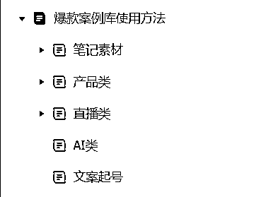

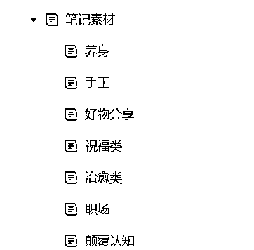

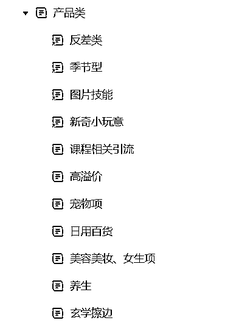

# 🧨 我的素材库入口

# 🎇 为什么我要做这套素材库

## 我在收集什么

身为一名职业自媒体人，嗅到内容、做出内容、读懂市场风向和爆款规律、搞清周期与呈现方式，是个体创作者必须长在身上的本事！可问题是，到底该盯哪些内容？怎么把它们沉淀成自己的资料库，本质上就是一个需要时间积累、靠不断发现来完善的过程。

记住一点，网上不缺素材，缺的是捕捉素材的嗅觉！而这份嗅觉，来自长时间浸淫互联网所养成的直觉与灵感。归根结底，还是【长期主义】的胜利。

## 库里都放了什么

### 🧡 好物分享 · 人物出镜版

混剪式的好物种草，几乎是新手入行的第一站。分享、安利、推荐，本就是我们日常的生活方式。

所以我单独把它拎出来做成一个大类。未来无论是以人设运营还是直接挂车变现，都能快速上手。

人物出镜的玩法千变万化，如何找到契合自己的表达方式？我把自己看过的案例做了整理和二次归类。有的是一对夫妻坐着聊问题的问答体，有的是边洗碗边聊的日常体……这些都是创作者在用的呈现手法！

他们往往会塑造固定的记忆点，比如：

每次露脸都穿同一件上衣

每次开场都用同一个动作

封面风格统一、字幕配乐高度一致等等！

基于此，我又对人物出镜的风格进行了细分归类：

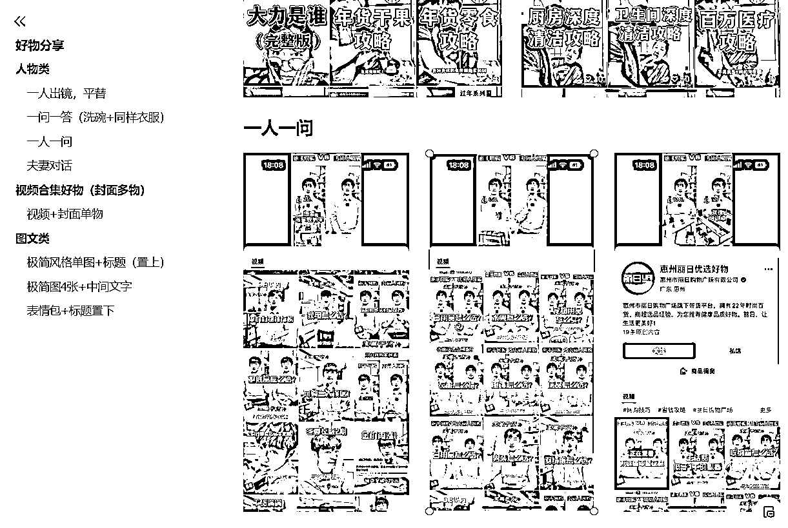

### 🎀 好物分享 · 产品直出版

好物分享只是大盘里的一个赛道，呈现形式却多到数不清！尤其是纯产品展示，也要玩出差异化，这就是我们说的【独特性】。

到底有哪些玩法？它们分别是怎么做的？我们能抄到什么？自己会不会做？为什么会做、为什么不做？这其实是一场和自己的深度对话，也能帮你更快定位自己在自媒体这条路上能吃哪碗饭。

所以我把所有能借鉴的图文模板都按组归纳了。单品特写、4宫格拼图、6宫格、9宫格……文字的颜色、字体风格一目了然。当然，素材的收集要跟着你的规划走，去找你喜欢的、能驾驭的、想做的，这样才不会做着做着就累了。把它当成日常刷内容，顺手把爆款案例捡起来，多舒服！

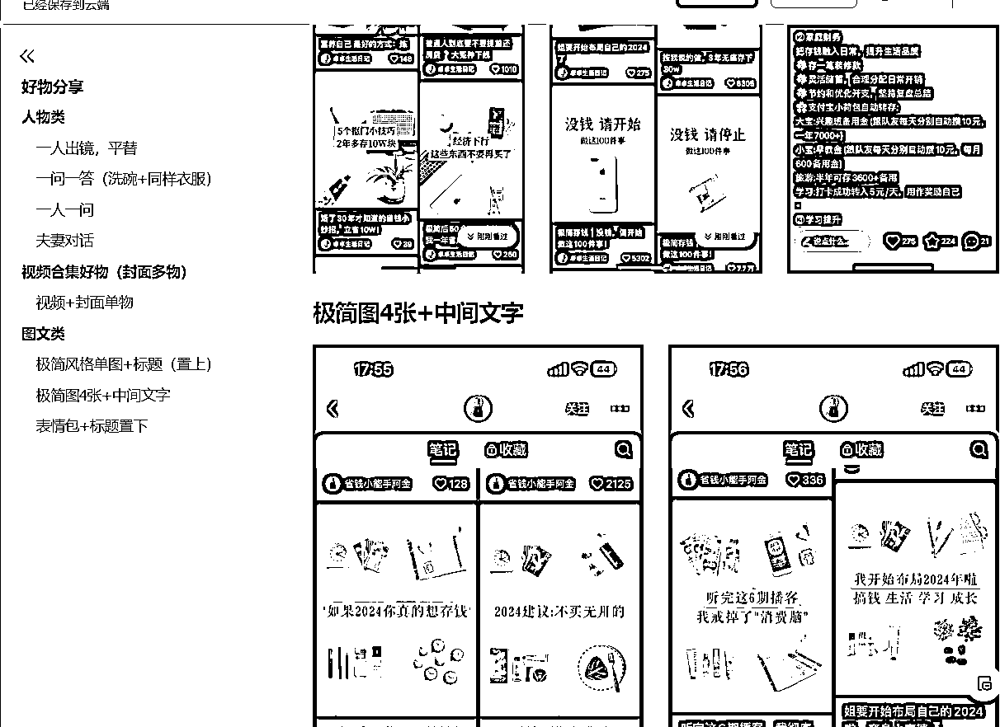

### 💜 产品类 · 电商带货系列

这一块主要收录的是以卖货为目的的账号。我观察的是他们怎么做的，以及他们在推什么品。

现在视频号、抖音、小红书的通用逻辑都是用内容带挂车或直接电商成交。

但万变不离其宗，都绕不开内容本身。

最省事的做法不是自己绞尽脑汁，而是直接对标模仿他们的内容！毕竟他们背后是团队作战，有KPI压力、有库存和资金压力，比我们更在乎数据和利润。直接参考他们的打法就稳了。

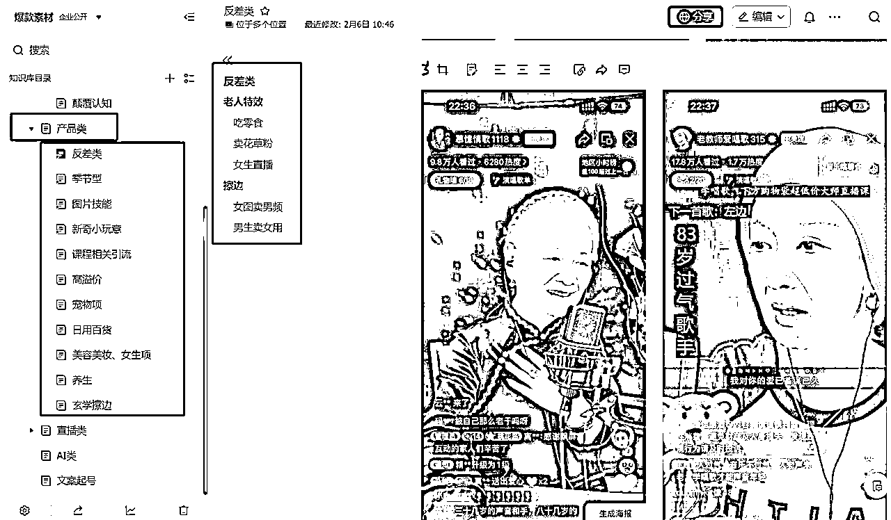

其中也包含一部分虚拟产品，比如图集、壁纸之类的。

这里的关键在于，图片本身是否贴合平台调性和目标用户。

我们的任务就是持续收集素材、拆解内容、感知爆款、动手实践、多做反复做，找到一个自己能【拿下】的赛道。

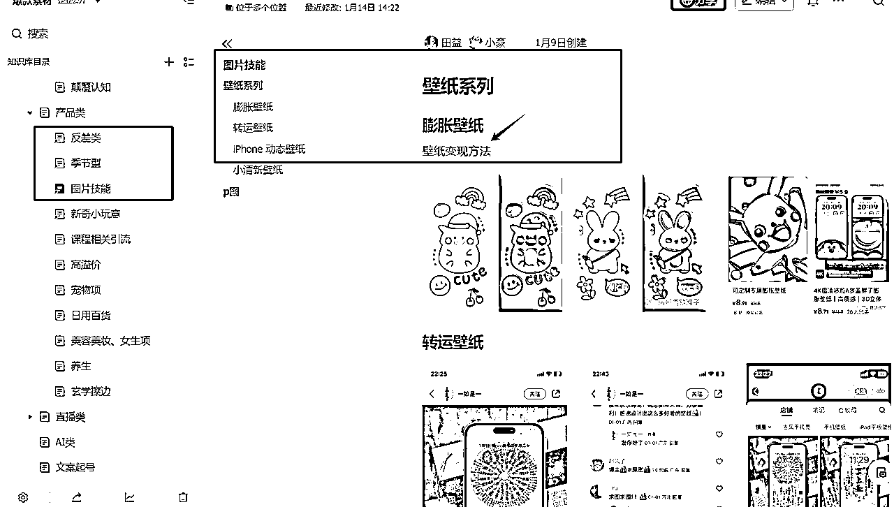

# 💌 如何搭建自己的素材库

上面是我个人的案例拆解，接下来带你一起搭一套属于自己的素材库！

## 我用的是【飞书】

下面是我自己的知识库界面。

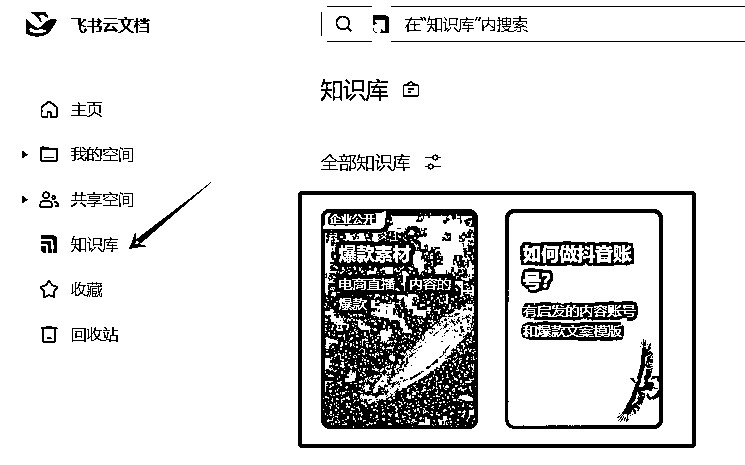

## 先建一个知识库

点右上角的【新建知识库】

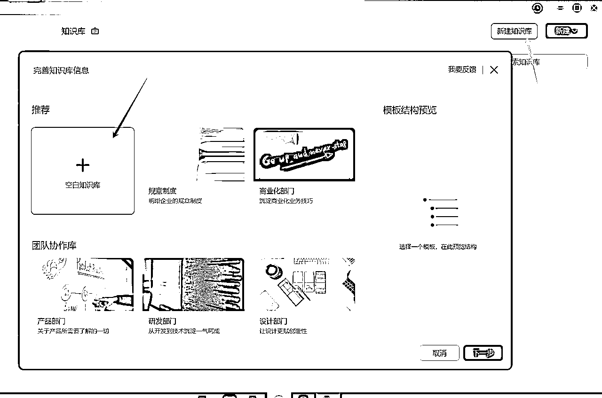

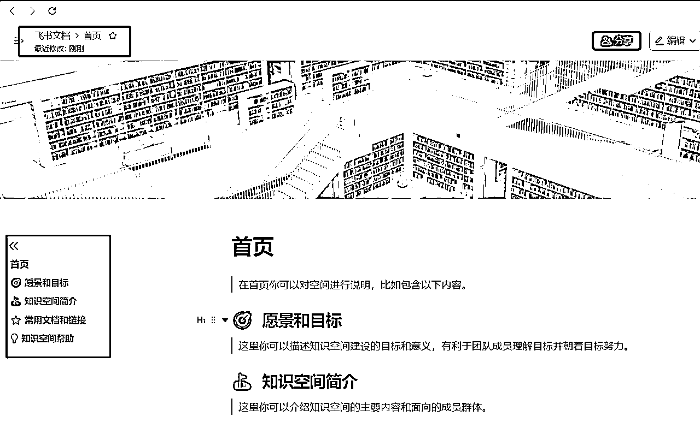

## 新建或迁入文档

如果你已有外部文档想放进来，可以直接迁入到【知识库】。

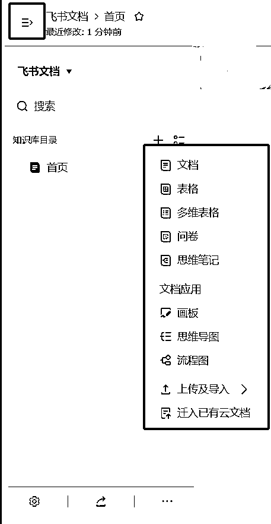

也可以直接在知识库里新建文档再编写！

点首页的【添加文档】就是一级分类。

从某个一级分类文档里再点添加，就是二级分类。

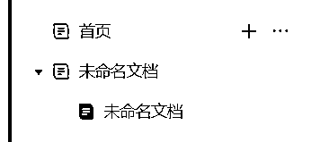

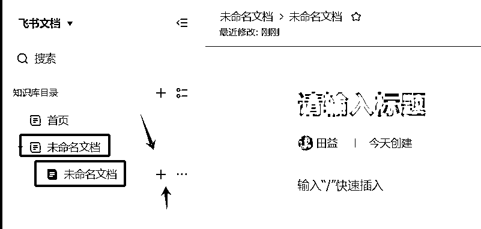

## 分层归纳有什么用

左边是所有一级大类，一眼看全貌。

右边是打开了【笔记素材】这个一级分类后看到的二级分组，可以快速定位细分主题。

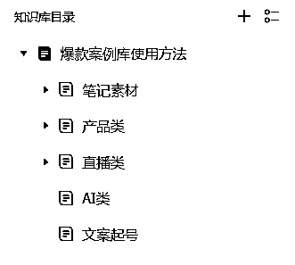

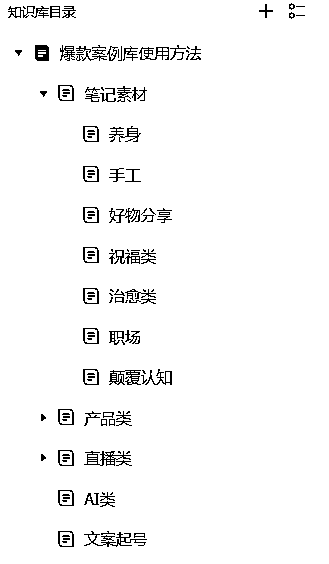

## 用标题做分组

在文档内部，快速使用一级、二级标题，层次更清晰。

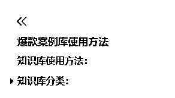

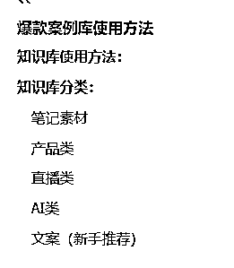

## 标题分级快捷键

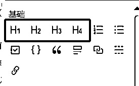

# H1

## H2

### H3

左侧红框是分级标题写完后的效果，右侧是H1-H3的大小对比。

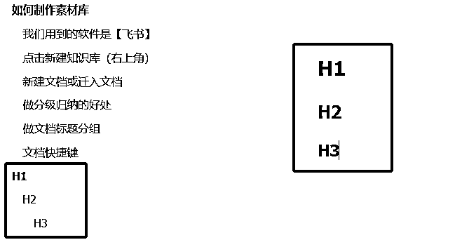

如果每次都要手动调标题级别很麻烦，建议用快捷键：

#### Shift + 一个井号 + 空格 = 一级标题

#### Shift + 连按两个井号 + 空格 = 二级标题

这样排版会快很多！

## 分享时记得做保护

分享是快乐的事，被盗图盗文、Ctrl+C整个搬走就难受了。所以在分享文档时，别忘了去【分享】里的【权限设置】，把下载、复制权限关掉。

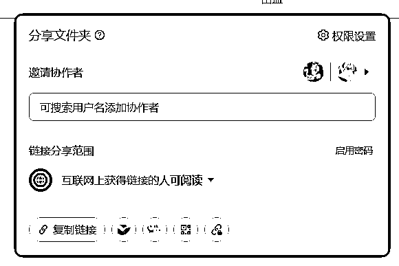

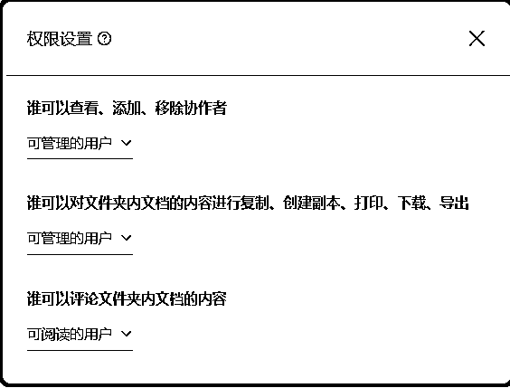

### 批量设置权限更省事

一个个文件去改权限太累，可以直接以整个文件夹为单位统一设置，文件夹下所有文件都会同步生效！

今天的分享就到这里，希望你也能早日搭好自己的素材库！如果这篇对你有启发，就点个赞给我一个反馈吧！我是阿甜，会持续分享好用的工具和AI+自媒体的新打法！