# ('AI励志短视频，跑车游艇豪宅全新赛道', (2, 20))

最近刷短视频时，我注意到一类特别“燃”的励志内容：豪车、游艇、别墅轮番出镜，配上慷慨激昂的文案和解说，像是一片刚被开发出来的新赛道。

既然发现了新模式，自然得研究一下怎么上手。仔细看会发现，这个玩法并不复杂，核心就三块：素材、文案、配音。只要会基础剪辑，基本都能做。

先说说素材哪里找。免版权素材网站 Pexels（https://www.pexels.com/）可以直接用，想找跑车画面，就用关键词搜，下载就完事。

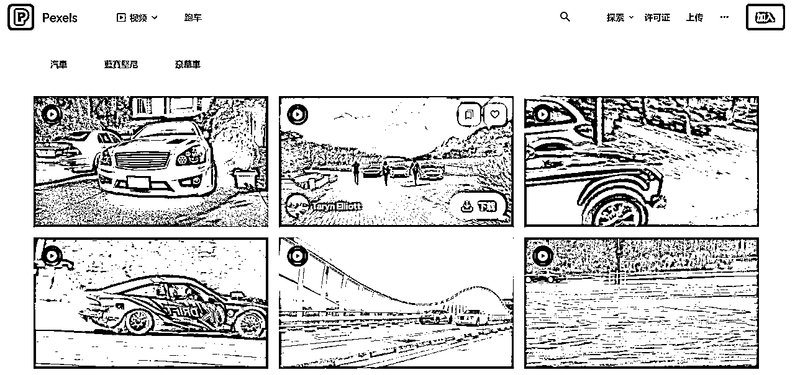

但公开的无版权素材有个问题：用的人多了，很容易和别人“撞车”。想降低重复率，也可以从 YouTube 找些跑车实拍内容搬运回国内平台，整体会更有新鲜感。

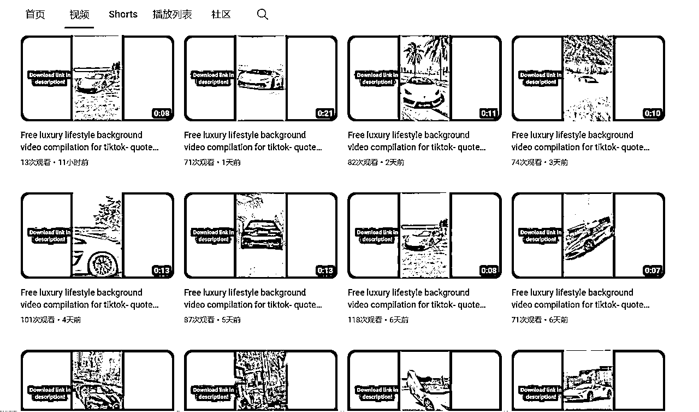

文案环节不用费脑，直接交给 ChatGPT 搞定。

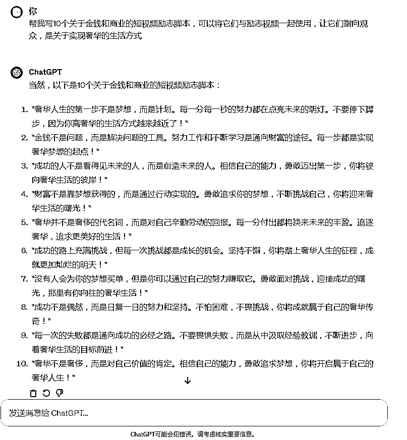

剪辑和配音用剪映就能一步到位。把下载好的素材拖进来，放到轨道上。

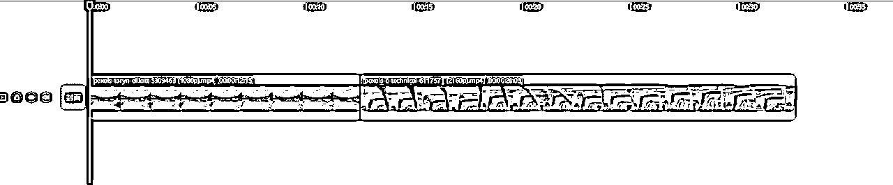

第一步先改画面比例，调整为 9:16 的竖屏格式。

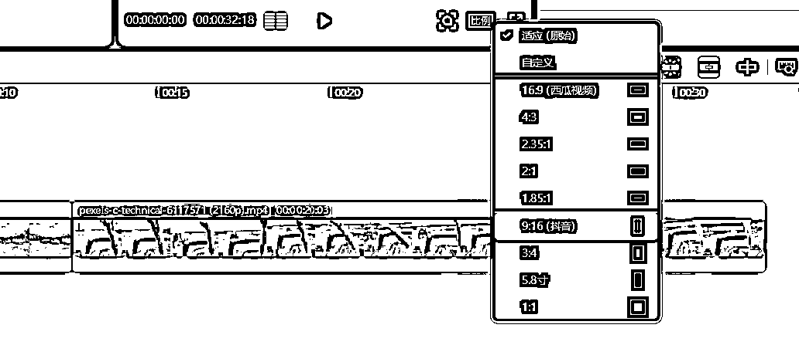

调完比例后，画面大概率会不匹配，这时拉着视频四角向外扩大，铺满屏幕即可。

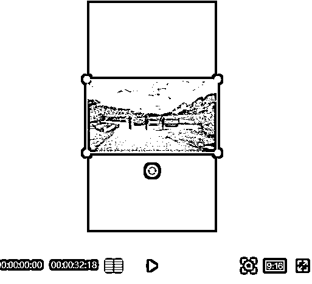

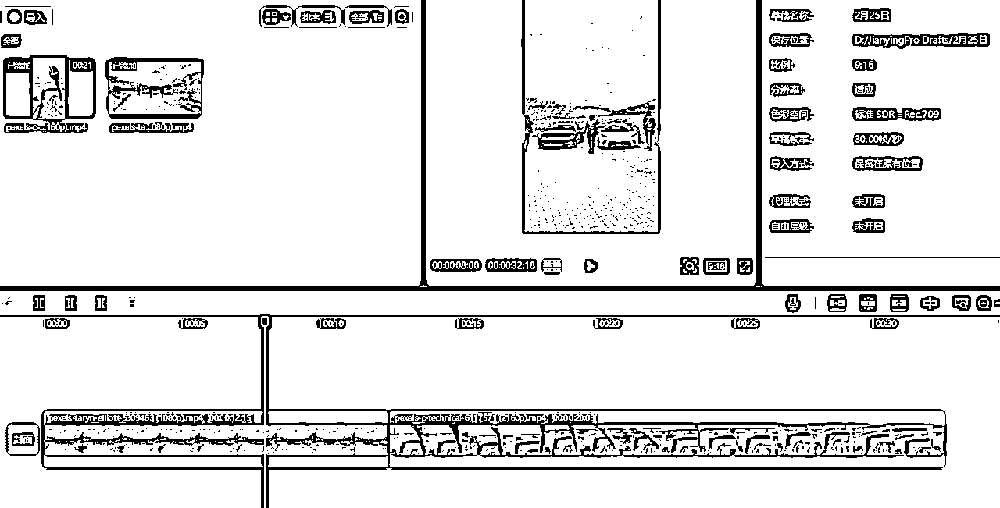

第二步处理时长。选中素材向左拖，就能缩短播放时长。我因为用的片段不多就没调，成品总时长最好控制在 1 分钟以内。

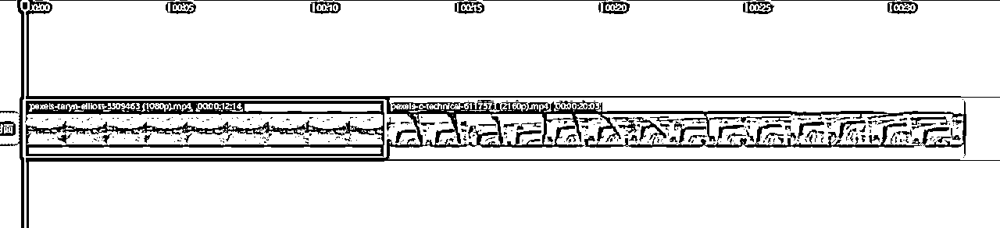

第三步做整体调色，营造出深沉、有感染力的氛围。饱和度大概调到 -50，亮度调到 1。

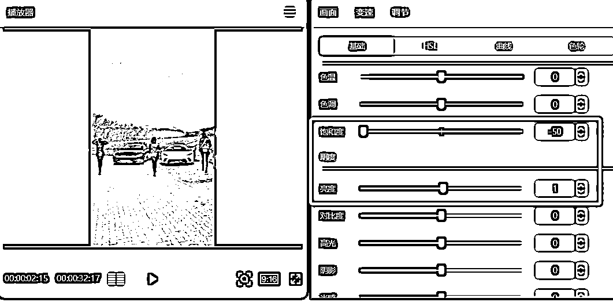

第四步加转场。选一种转场效果，拖到两段视频衔接的位置就行。

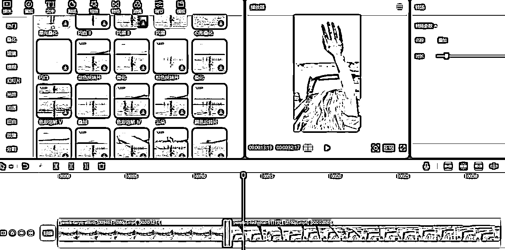

第五步把文案做成字幕，逐段放进轨道，跟视频画面对齐。

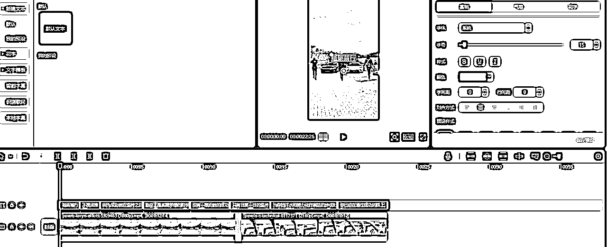

第六步配解说。全选字幕内容，点“朗读”，选好音色后直接生成配音。

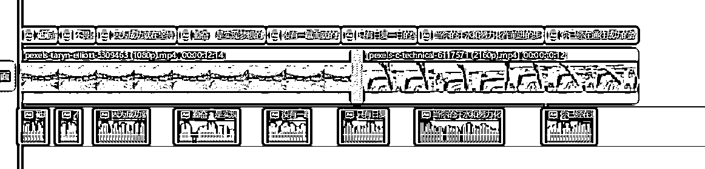

到这一步，励志短视频就完整成型了。日后想更新内容也不用重新剪，右键选择“替换片段”就能换素材，再同步更新文案和配音即可。

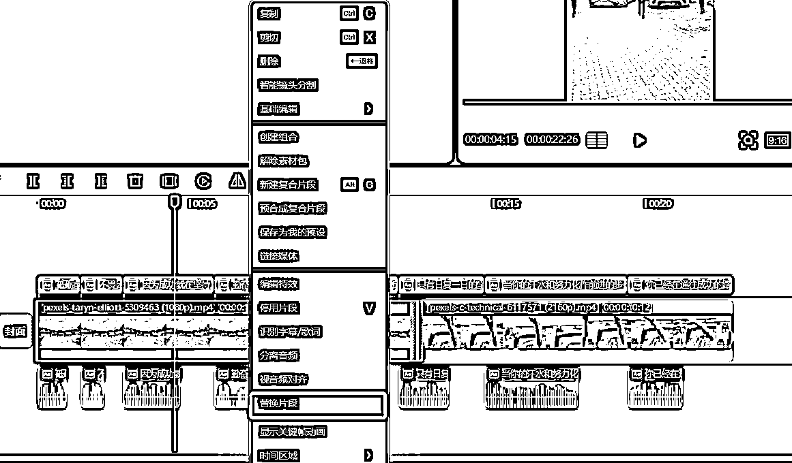