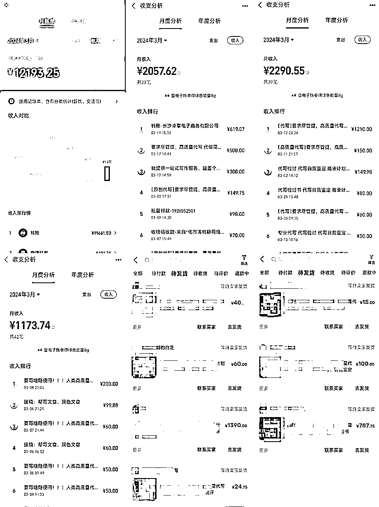
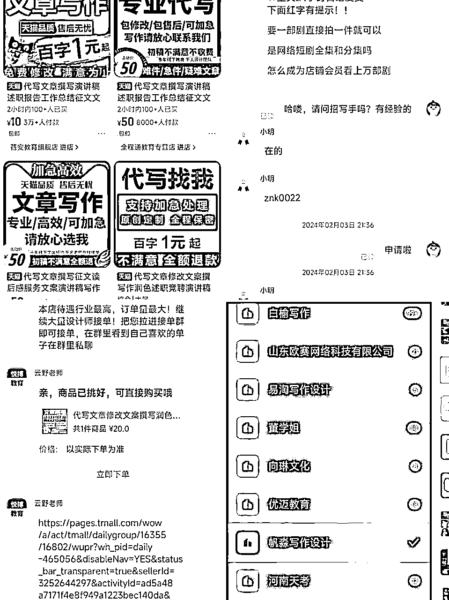
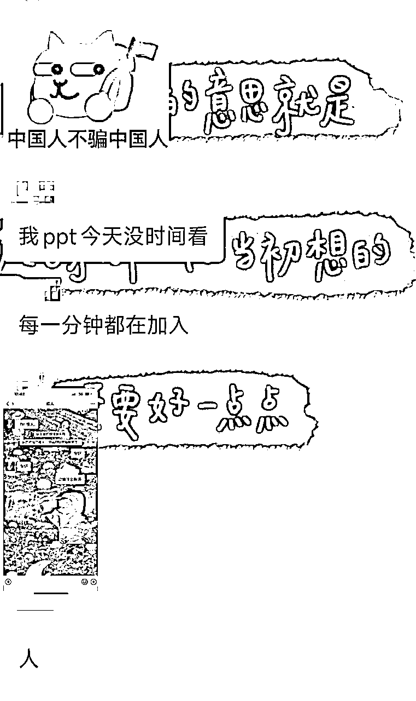
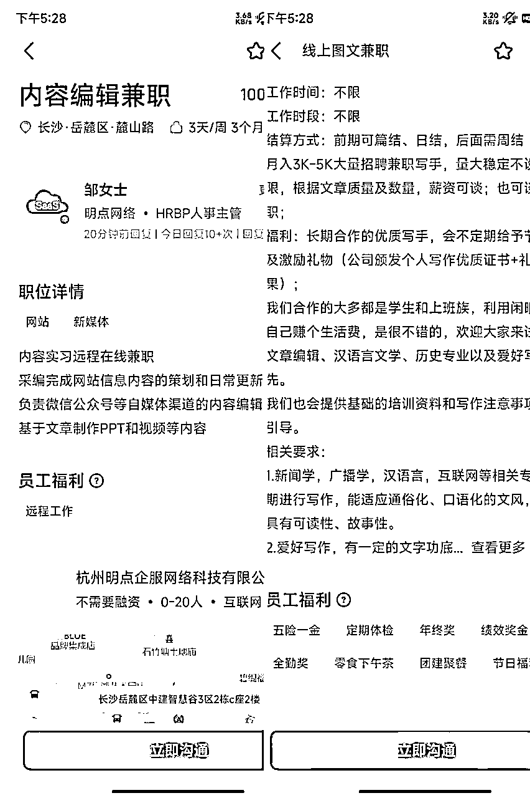

# 从负债20万到月入2万+：我用AI写作一个月翻身的实战复盘

在赚钱待满一年了，我也就发过一条风向标和一篇帖子。一直觉得自己没什么拿得出手的成绩，所以很少开口。上周发了那篇关于AI写作的风向标，没想到意外中标后，收到一堆点赞和夸奖，属实有点受宠若惊。

上回我聊过，为了扩张生意去贷款结果翻车，之后只能拆东墙补西墙，一年时间把负债滚到了20万。今年过完年，我直接把目标定成清债。2月18号接下人生第一单，到现在一个月出头，节奏算是不错。

说实话这段时间太赶了，我压根没空细算具体赚了多少钱。只知道这个月我还了1万9的贷款，给团队的主持发了6000工资，加上房租、社保等杂费，支出大概在3万左右。最重要的成绩是：这个月没有逾期，没再拆借，账面上虽然没剩下钱，但已经站稳了。

很多人看过风向标都知道，我现在的核心业务就是AI写作。不是说这3万全靠AI写作赚来的，但大概有80%的收入都来自这块。自从风向标发出来后，加我的人多了起来，也有人直问我每天要投入多久才能做到这个体量。我只能实话实说，如果是自己单干，AI写作就是纯体力活。我现在是全职在做，除了睡觉，其他时间基本都在接单、写稿、回消息。说它是体力活一点不夸张，真正需要动脑的部分都交给了GPT，剩下的就是执行，肯干就能拿到钱，多干多得。

AI写作变现其实就两条路，一条是自己接单自己写，另一条是做中介拿单分发给写手赚差价。接下来我把自己的实操路径拆开讲。

# 一、AI写作到底在做什么

说直白点就是：拿单 - 用GPT生成 - 交付。整个流程里要解决的核心就两个问题，单子从哪来，文案怎么出。

当初我选这个方向，是因为我急需一笔稳定可控的现金流来还债。它的好处是投入时间和收入直接挂钩，天花板也比我想象的高。而且学会了之后，自己写头条、写👸号爆文也顺手了，是一项能赚钱还能长期用到的硬技能。

# 二、我这一个月都在哪找单

目前我摸索到的来单渠道主要有这几个

## 淘宝写手店

在淘宝搜“代写”，会出来一堆写手店铺。直接私聊客服说想应聘，他们一般会让你先刷一单，然后拉你进内部接单群，刷单的钱会退回来。淘宝店的单子量非常大，但客单价普遍偏低。进群后先看公告里的结算方式，月结的我个人建议别碰。我在淘宝拿的单都能正常结，但价格确实不高。

## 🐧群

搜“文章写作兼职群”之类的关键词就能加进去接单。这里有个小偏门，如果想接论文单，可以去搜民办高校的在校生群。民办学校的学生消费能力相对高，而且论文要求普遍更简单一些。

## 闲鱼

这才是我的主阵地。从我在闲鱼上架产品开始，就基本不用去淘宝店接单了。一个身份证能注册3个号，也就是3个店铺。我现在就运营着3个闲鱼号，支付宝流水里能看到大部分收入都来自闲鱼写作，还有一部分款项还在结算中。

闲鱼操作很简单，就是上架产品。直接搜代写，看同行在卖什么，把他们的商品图和标题文案照搬过来就行。千万别自己瞎写文案，我之前有个号就是因为自创了一条文案被封了7天，解封后流量大跌。所以抄同行是最稳妥的。

闲鱼的好处是客户会沉淀到私域，容易产生复购。我现在做了一个月，有时候光靠老客户回单一天就能有几百块，再坚持几个月，回单量只会更多。

## 📕

📕也是不错的引流地，因为很多人写稿前会先去📕找资料和灵感。唯一的坑是引流容易被封。相对来说闲鱼要友好得多。

当然📕也能安全引流，比如开聚光灯，甚至评论区置顶🛰️号都不算违规。

## Boss直聘

Boss上有很多公司招线上文章编辑，也能接单。我自己还没操作过，但之前有圈友分享过专门派助理在Boss上扫单，每月收入也很可观。我自己搜过，相关岗位确实不少。

# 三、写作本身怎么做的

星球里关于AI写作的技术帖已经很多了，我自己也只是半吊子水平就不班门弄斧了。有兴趣的可以自己去搜。

很多人担心自己写不好，我也一样。我现在接的多是小单，比如读后感、演讲稿之类，几十块一篇，但用GPT生成非常快上手。

当然也有高价单，比如论文。论文一篇几百到几千不等，截止到现在我接了4篇，最低一篇600多。并且我接的论文基本都不自己写，全是用的成稿。

举个例子，前几天我接了一单800的论文，题目是跨境电商公司的精准营销策略。我先去成稿网站搜到一篇类似的，花20块买下来，参照客户需求改改内容，再花50块找人排好格式，一个小时不到总成本70块，到手800。这种单利润极高。

# 四、一个月做下来的真实感受

这个月终于没有拆东墙补西墙了，再坚持下去，今年清负债很有希望。

说实心话真的很累，除了睡觉就是写稿回消息，倦怠感很强。但赚钱一旦上瘾就停不下来。特别是看到身边的人都在拼命赚钱，每天和新认识的朋友对一下今天的收入，就又有动力了。我还认识了几个“病友”，都是负债中奋斗的人，我们互相打气，比以前更坚定。

每天睁眼就是稿件和消息，根本没空emo，反而特别充实。沉迷赚钱，可能就是我现在最快乐的状态。

如果你也是负债在战斗，欢迎来交流打卡。希望能认识更多日入更高的大佬，每天刺激刺激我。