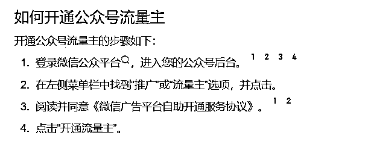
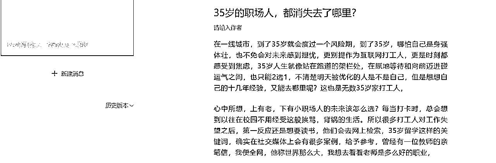
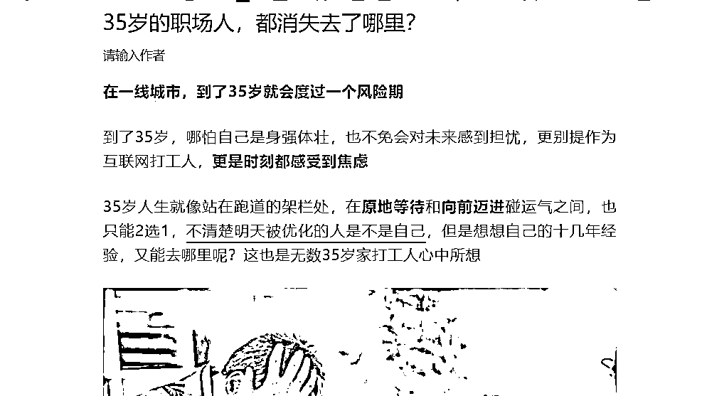
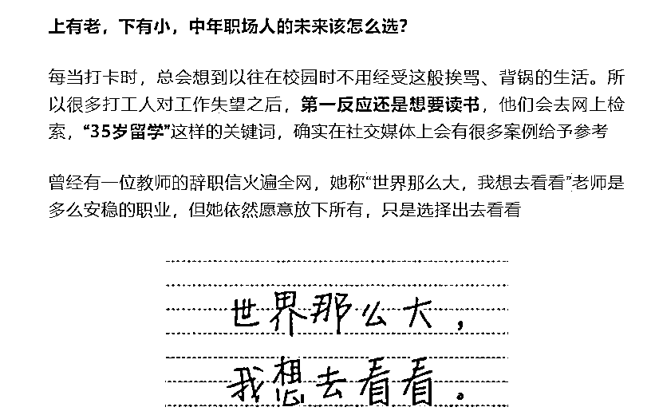
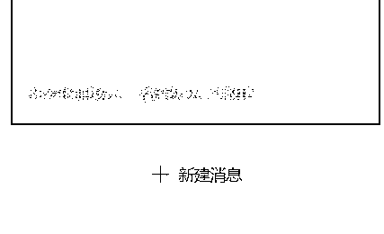

# 保姆级省流极速👸号爆文0-1上手攻略，无ai，新人基础提速版（含口述10分钟出文教学）
作者：龙哥

很多新人做🛰️公号，最卡住的往往不是文笔，而是“总觉得没准备好”。一听说要学这学那，干脆一直拖。这篇内容专门给这类朋友一条极简路线：不需要AI，靠基础操作和口述方式，把启动门槛降到最低。

先聊最现实的收益来源。平台作者靠广告分成赚钱，用户点开正文里或页面底部的推广位（最多三处），账号就会产生收入。浏览的人越多，广告被点按的几率越大。粉丝满五百后，就能解锁这个收益通道。

开号这一步，不必给自己太大压力。想减轻焦虑，可以同时备好几个账号，借兄弟姐妹或亲友的身份信息都行，这种做法最为保险。这里要特别强调：五百粉只用于开启分成，一百粉则只能带货。别傻等自然涨粉，花四五十元处理一下，这笔钱值得花。

有了号之后，先确定自己要做哪个方向。近期要高频地刷内容，打开官方管理后台反复浏览，找出真正让你有表达欲的类别。看到同类的推送就多点开，系统自然会给你的推荐越来越准。人工多翻翻并不麻烦，不少资深玩家至今也保留这套动作。至于次幂那种付费数据分析产品，新手暂时不必考虑。

口述式创作与手写本质上是一回事，只不过把敲键盘换成开口说话，时间能省下不少。它很像“参考范文”：他人的稿子只是参照，绝不照抄。比如范本里写“某天天气晴好，母亲领我去看动物，头一回见到脖子那么长的家伙，特别兴奋”；换成你，可以讲“生日那天母亲兑现承诺，领我去了一趟动物公园，太阳暖烘烘地照在身上，我还亲手拿树叶喂了一只高个子的长脖子动物”。范文只是参考线，你说出口的才是改造版。

口述前的准备更简单：一台手机就够。我个人偏爱讯飞的那款语音笔记应用，闲鱼上买账号很划算，重点用它自带的语音转写速记功能。刚开始谁也不熟练，我曾经为了写四千字以上的长稿件，每天逼自己口述好几遍，慢慢就练出了感觉。不给自己一点压力，永远不知道自己能说得多顺畅。

具体领域千差万别，没法逐个演示，但底层逻辑一致。我拿猎聘上那篇讨论“35岁以上职场人出路”的稿子当样本，视频里记录了未经剪接的完整口述全程，你可以对照着看。熟练以后，十分钟内说出一篇初稿并不难，任何人都能靠这种模式产出不同类别的内容，特别适合刚起步的人。

稿子完成后，进后台选“图文推送”，把内容贴进去做简单润色。找图可以紧扣主题，我常去搜索引擎挑不露正脸或生活感强一些的图片。基础做法已经够用，想更精细，还能选用135、秀米或96这类排版工具。

发布前务必勾选“声明原创”，这直接影响后续收入。

正文最好写到九百字以上，基本能拿到两处广告位；广告位多了，被大家点按到的几率也要大一些。篇幅不足时，能插入过去稿件的超链接来补足长度。要是字数已过一千却只有一个广告位，把图片删掉几张，并将段落拆得更碎。

想发布第二条推送，直接按下后台的“新建”按钮即可。

到这里，从零基础到推送出稿的核心步骤就齐了，剩下交给时间。期待这次三月行动里，每个人都能摸索出适合个人节奏的路径——手动打字也好，语音口述也好，借助AI也好，先动起来就是胜利。这份精简版有意略去大量细节，配合完整行动指南使用会更全面。读到这里觉得有收获的话，记得点个赞再走。