# 5分钟制作漫画小说短视频，小说推文项目，全流程手把手教学

> 来源：[https://dik4wr1hyrw.feishu.cn/docx/MJoqduZwQoIWZcxnQQjcp60UnKd](https://dik4wr1hyrw.feishu.cn/docx/MJoqduZwQoIWZcxnQQjcp60UnKd)

说到以漫画形式演绎小说的短视频，我们先来看看头部账号的表现，互动数据都很亮眼，这类内容确实在爆发。

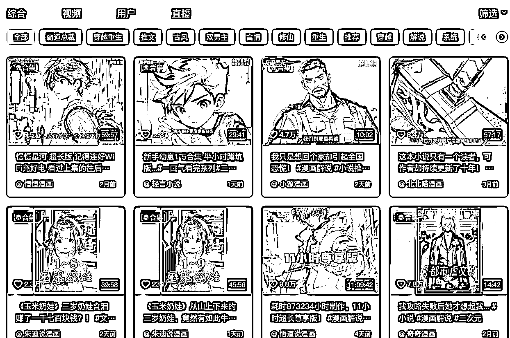

做这类视频的初衷是给小说导流，但爆款作品大多受版权保护，所以获取正规授权这一步不能省，幸好主流平台已经开放了创作者授权通道。

## 热门平台版权授权地址

七猫达人授权地址https://kol.wtzw.com/login

起点达人授权地址https://koc.yuewen.com/user/login

番茄达人授权地址https://kol.fanqieopen.com/page/

QQ阅读达人授权地址https://kol.yuewen.com/#/user/login

## 获取版权授权

以七猫达人为例进行演示，完成后扫码签署推广合作协议。

协议生效后即可开始投放内容，若想投放具体作品则需要提交关键词申请。

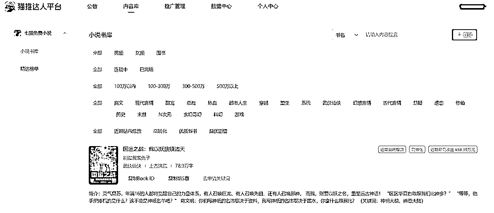

## 小说文案

### 官方文案

平台方提供的推广用语

### ChatGPT文案改写

每部作品在素材库里都有简介，我们可以用ChatGPT二次创作文案。

prompt：你现在是一位短视频内容创作者，需要做小说解说相关内容，帮我修改下文案，要求与原文意思不变，但要在开头3句话吸引人眼球，让观看者有看下去的欲望，原文如下：

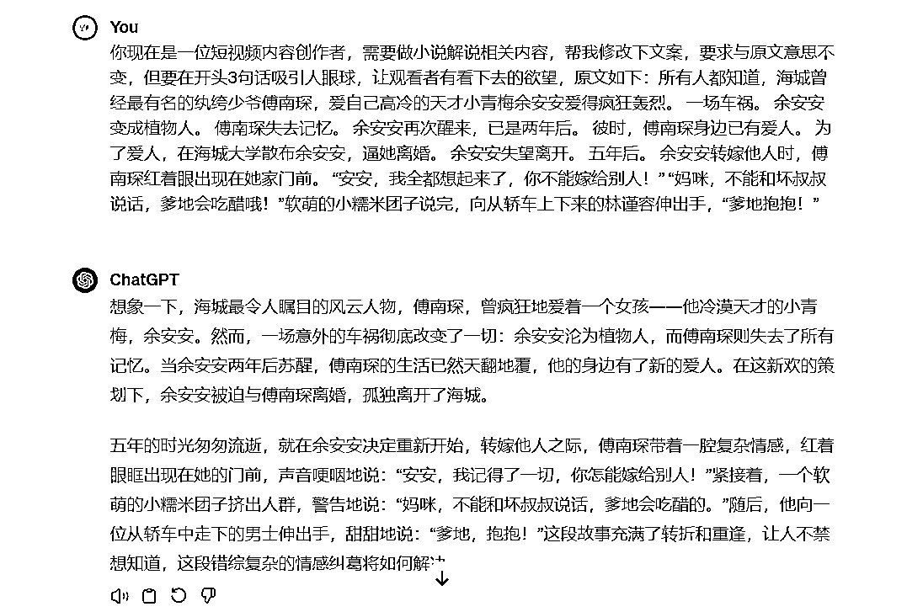

## 文案配音

文案定稿后就需要语音，配音有两种思路，一是直接用剪映内置，第二是借助第三方配音工具，我这里选用了腾讯智影来完成配音，把刚改好的文案复制进去即可。

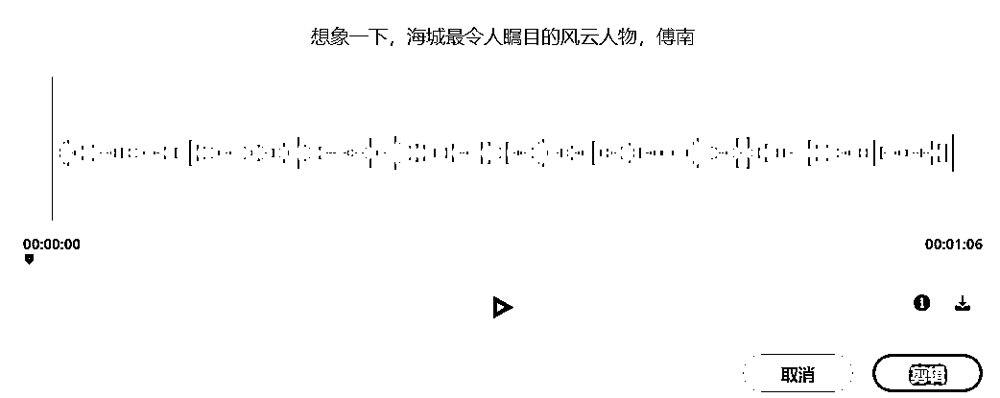

## 生成漫画画面

很多人第一反应会想到Midjourney、Stable Diffusion这类绘图工具，但它们目前很难做到角色形象贯穿始终。接下来介绍两个更易上手、成本更低的方案，一个是国内的腾讯智影，一个是海外的Comicai。

### 腾讯智影

进入腾讯智影，可用手机号或微信扫码登录，注册即送1000金币。

登录后点进动态漫画，填写基础信息。

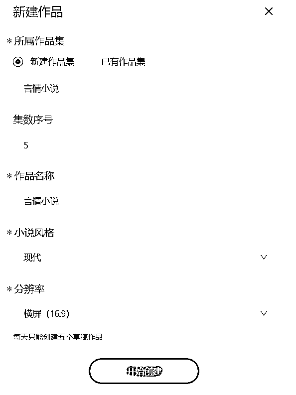

把小说的章节内容复制进故事区，点击应用文案来生成角色。

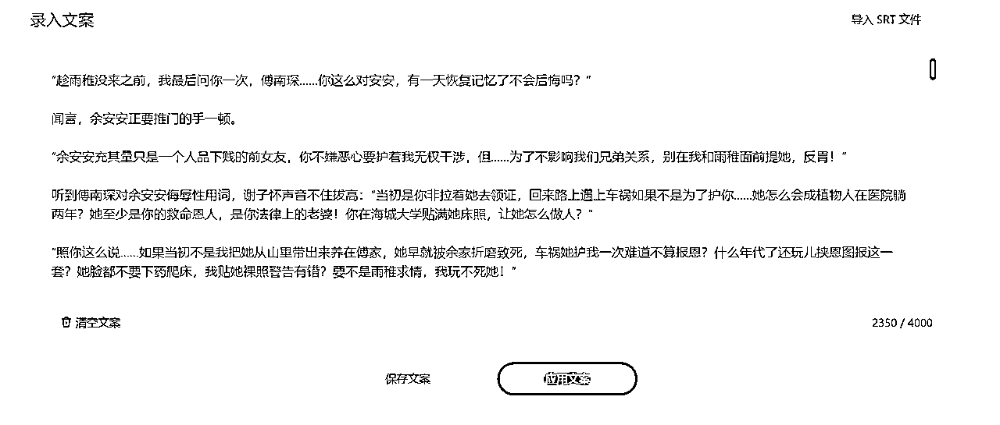

在腾讯智影里设定主角形象，不满意可重新生成，也能新增人物。

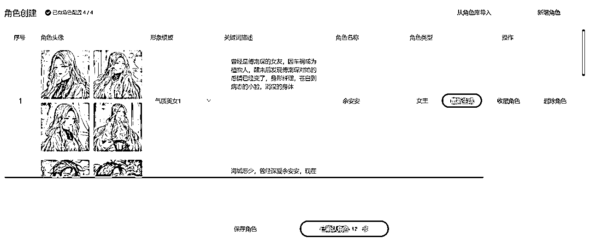

随后系统会自动产出分镜，还能匹配语音、配乐、字幕等，后续剪辑的步骤被大幅简化。

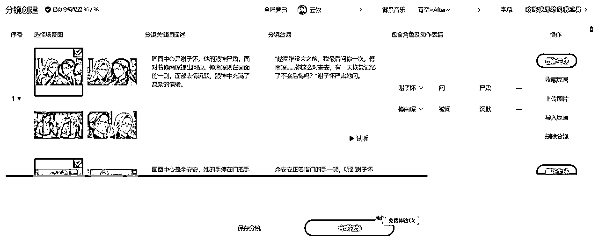

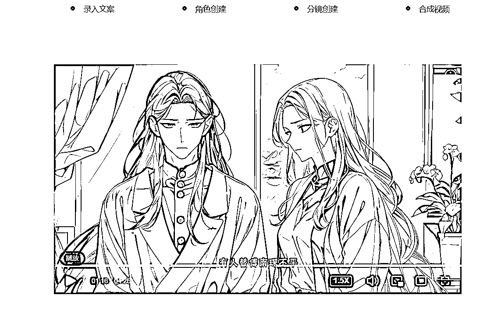

腾讯智影的漫画视频合成可免费试用一次，若不想付费可换用Comicai。

### Comicai

打开Comicai官网，可用谷歌或海外社交账号登录，注册送1200积分，每日签到再送99积分，语言看不懂可切成繁体中文。

点击开始创作，选择漫画风格，共12种风格。内容是言情类型，就选言情动漫风格。

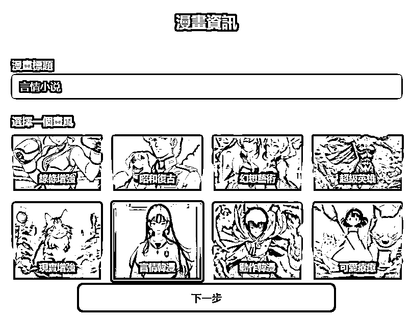

把章节内容复制到故事栏，点击下一步。

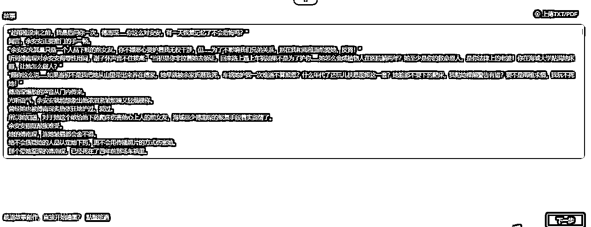

Comicai会自动创建人物设定，如不满意可用关键词调整，也可追加新人物，再点下一步。

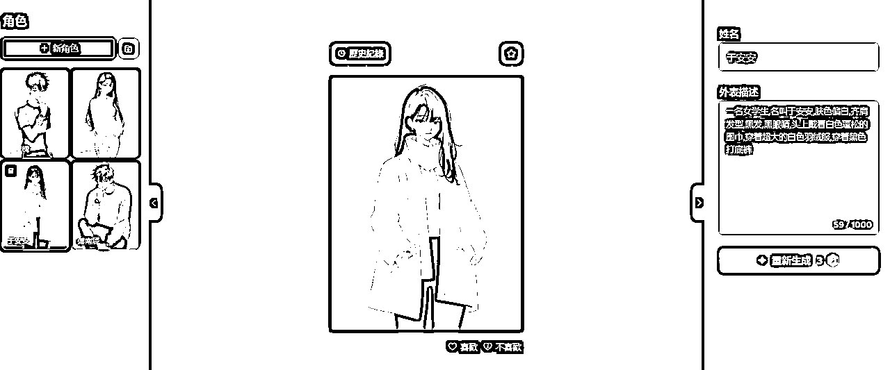

到这里，整部漫画的所有画面已生成完毕，且角色形象保持一致。

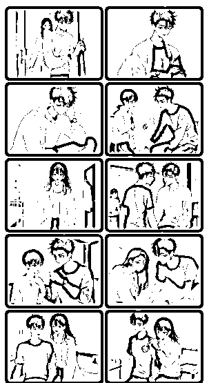

注意一点，不要点右上角的下载按钮，需右键图片审查元素，通过链接保存图片。

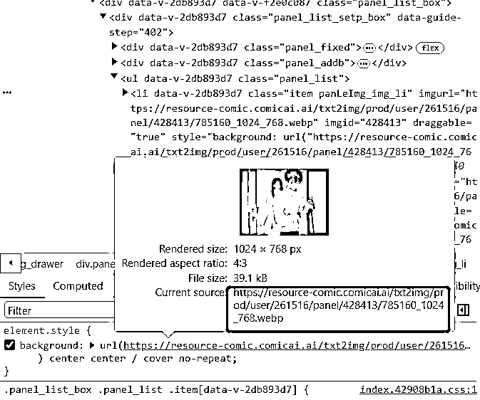

## 漫画小说短视频

文案、语音、画面都已齐备，可以开始剪辑短视频了。

打开剪映，将漫画画面与配音素材导入轨道，并进行字幕自动识别。

字幕识别完成后调整字体样式和字号，让呈现更美观。

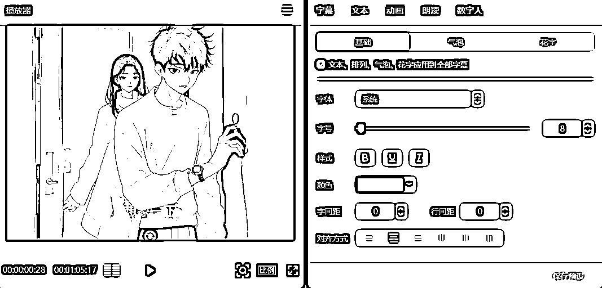

接下来可以给视频加点特效，比如星光特效等。

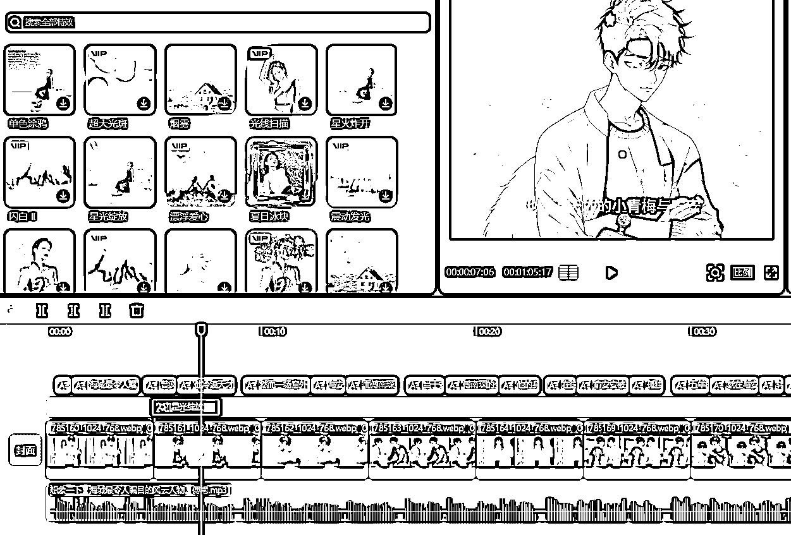

这类视频常出现左右平移的镜头感，可用关键帧实现：先把时间轴拖到开头设置关键帧并移动画面，再拖到结尾设置关键帧并移动画面，即可完成位移。

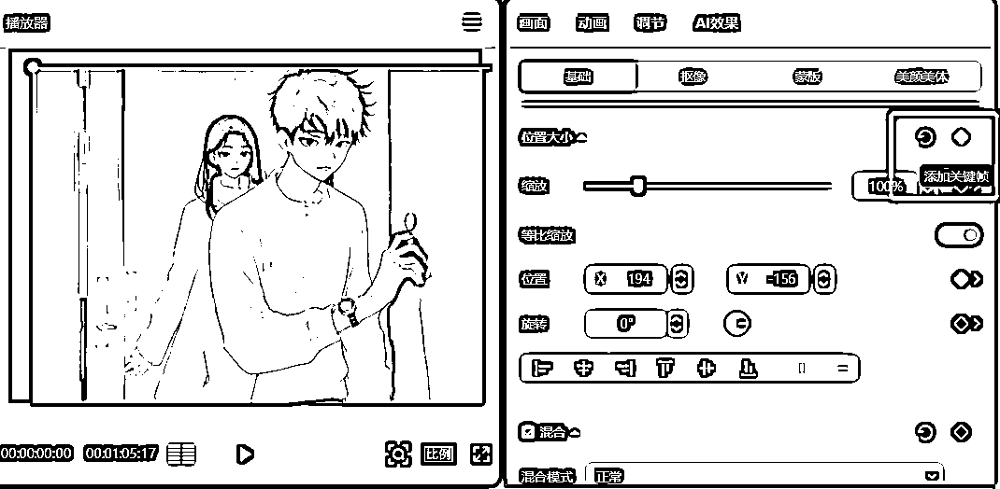

最后加上作品名称，这是引流的关键，同时注明内容纯属虚构，画面由AI生成，避免限流风险。

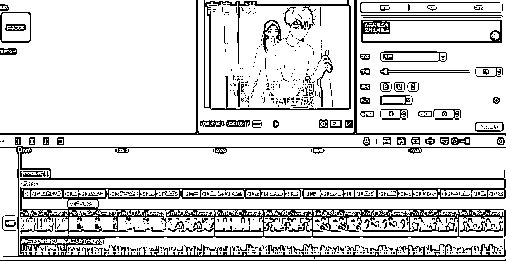

至此，一条完整的漫画小说短视频就制作完成，可以分发到各大平台了。

## 如何获利？

做漫画小说短视频的最终目的是变现，最直接的方式是小说分成。将视频链接回传至七猫推广后台，只要用户通过链接开通会员，就能获得分成收益。

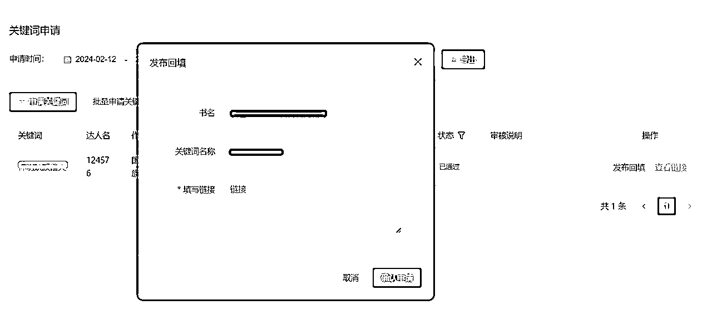