# ChatGPT+Canva可画，批量做📕正念语录账号，5分钟生成300条图文

最近刷📕的时候，我刷到一堆正念语录账号，点进一个热门帖子，好家伙——点赞已经十几万，评论接近两万，发布记录显示是今年年初的内容。不管从哪个角度看，这种账号都太值得研究了。

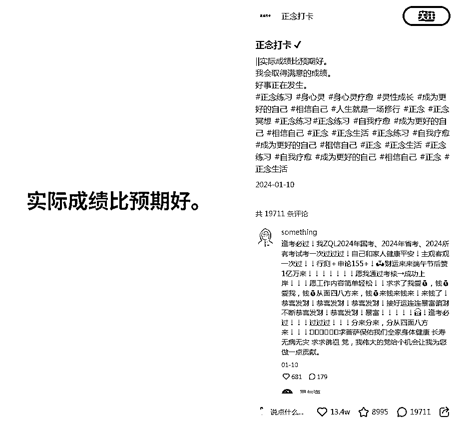

之前我分享过用ChatGPT加Canva批量做语录短视频，这次琢磨着，图文版应该也完全可行。说干就干，马上来测试一把。

# 第一步：找对标账号，攒语录素材

先锁定几个同类型的对标账号，把里面的正念语录全部收集起来。随手搜一下，发现热门的帖子点赞量都是四位数起步，甚至大几千上万。

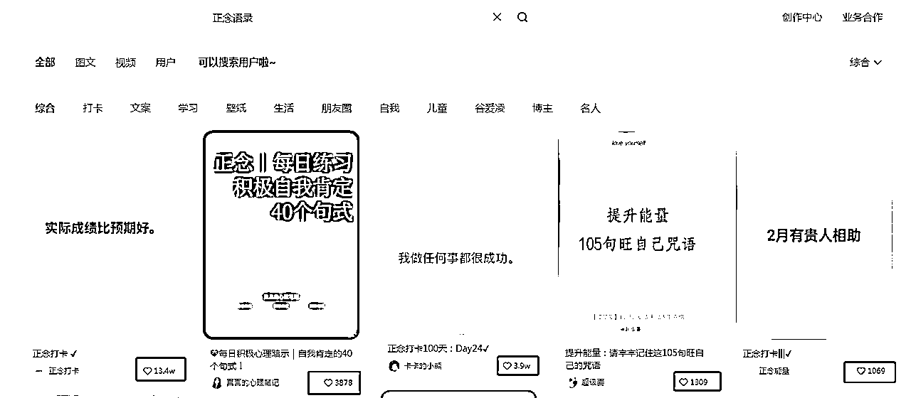

把每一条语录单独复制到表格里，等数据收集得差不多了，再整合到一起，交给ChatGPT去拆解爆款密码。

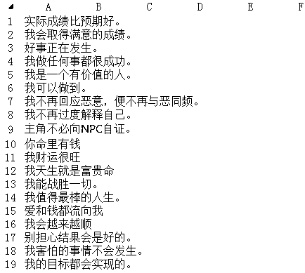

# 第二步：让ChatGPT来“解剖”爆款

把整理好的语录一股脑发给ChatGPT，让它分析这些内容为什么能火。

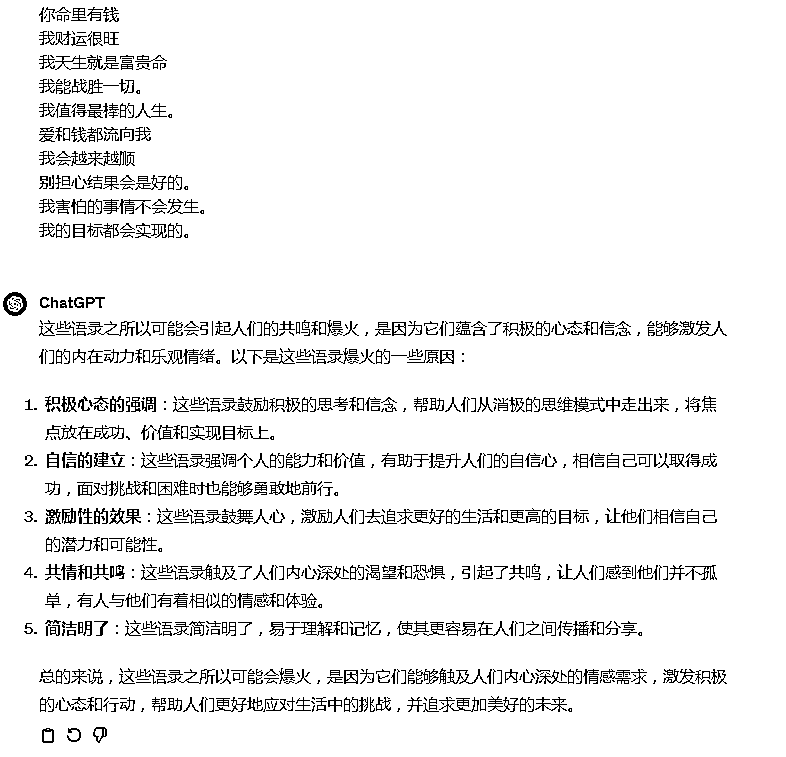

分析结果相当靠谱，细节也给得很足。这一步其实是为了让ChatGPT精准抓住我们的需求。分析到位之后，直接让它开写50条新的正念语录。

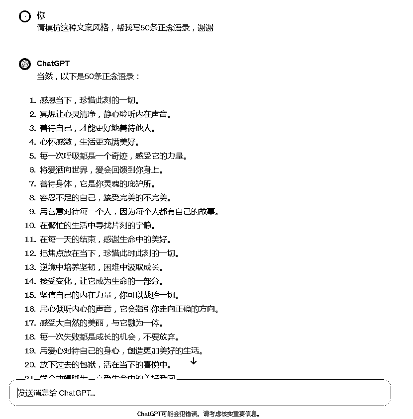

它写得非常麻利，一口气就出了50条。但我们的目标可是300条，所以要分批让它产出，不然一次字数太多容易出幺蛾子。

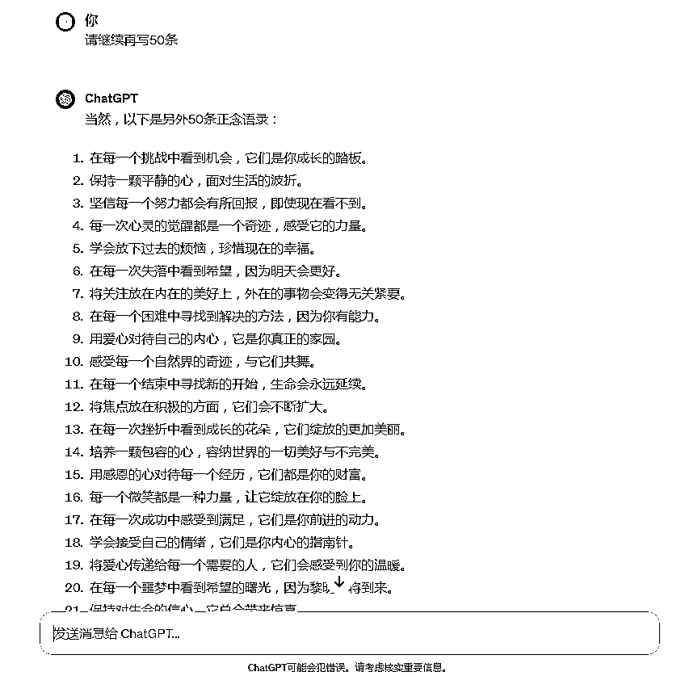

最后再跟它确认一句“到300条了吗”，如果不够，它会自动补全直到满额。

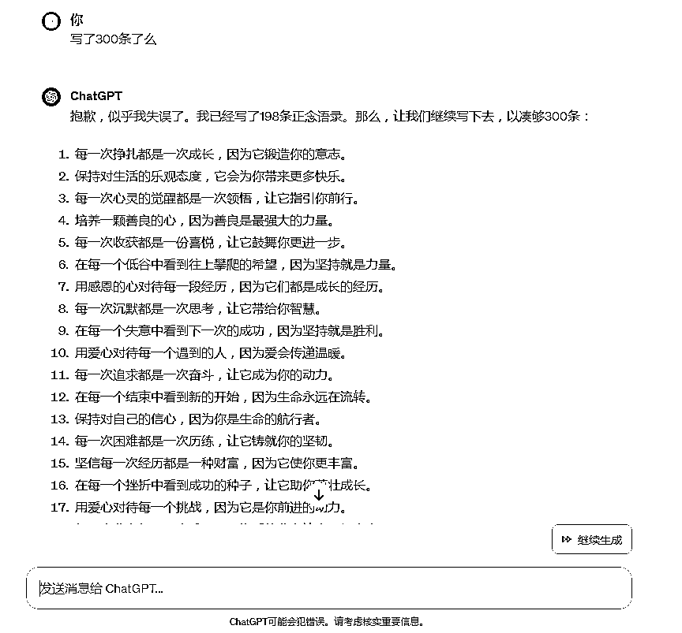

300条正念语录全部搞定，先存进表格里，后面批量做图的时候会直接调用。

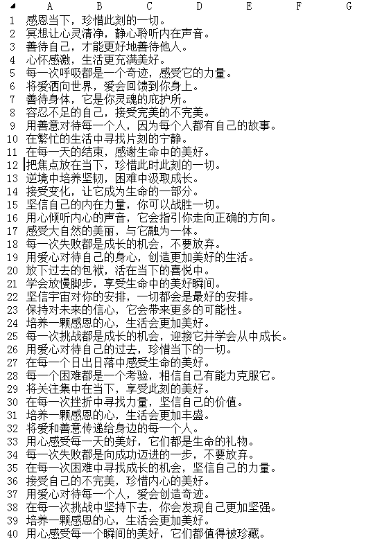

# 第三步：Canva可画排版

打开Canva可画，新建自定义尺寸，设置成1242×1660像素——这是📕封面的标准规格。

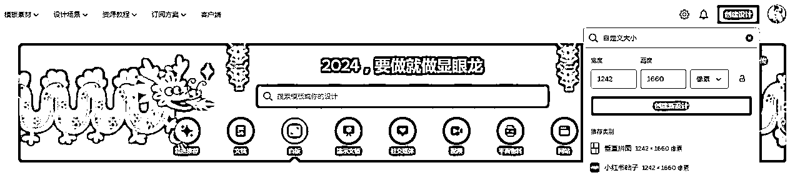

再扒一眼对标账号的帖子，基本都走同一套风格：背景中央有个圆圈，颜色由内向外慢慢晕开，整体氛围很冥想、很治愈。试着在Canva内部搜索“黄色圆圈”，出来的素材一般般。转头去Pinterest（https://www.pinterest.com/）找，搜“yellow circle”，出来的高质量图片一抓一大把。

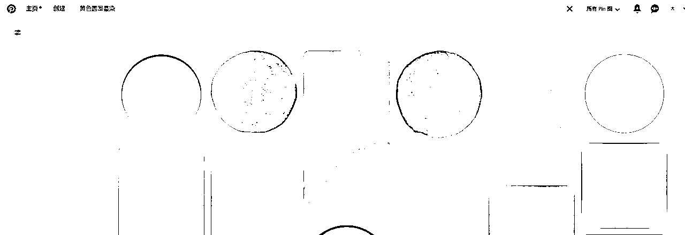

找到满意的图后，直接复制粘贴到Canva画布上，右键选中图片，把它设为背景。

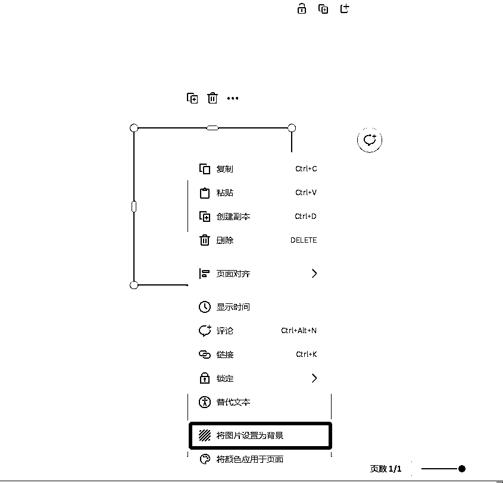

背景布置完成，接下来就是添加文字。把写好的语录作为副标题，放到背景图的中间位置——这个版式也是从对标账号那儿对标来的。

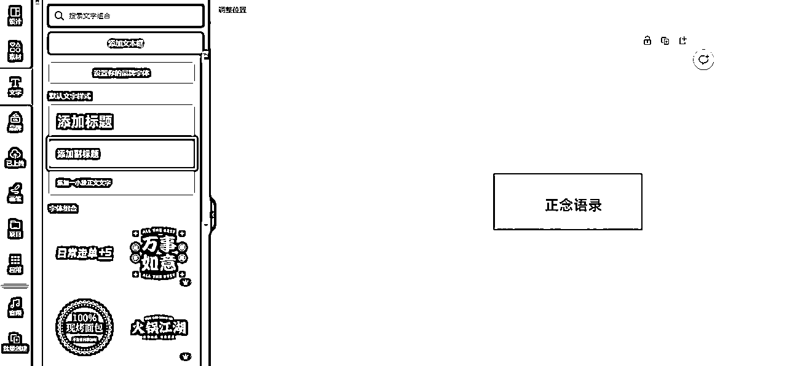

# 第四步：批量产出300条图文

基础模板已经搭好，下面开始批量操作。回到Canva的批量创建功能，把刚存的表格文件上传上去。

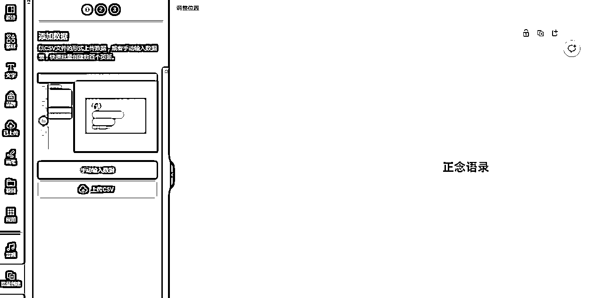

上传完成后，右键点击并关联数据。

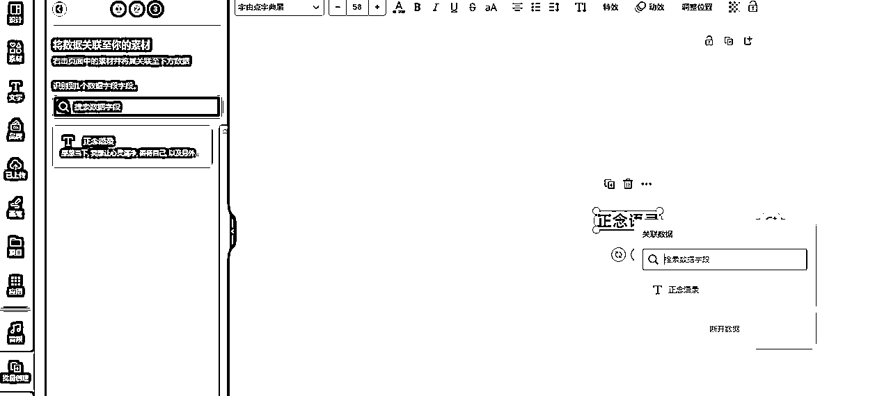

关联设置弄好，系统会直接显示可生成的总数，我这里总共生成了299条正念语录。

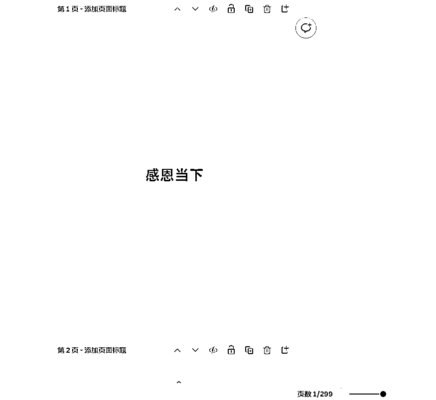

最后导出图片，格式选PNG，搞定收工。到此为止，300条正念语录图文全部制作完成。

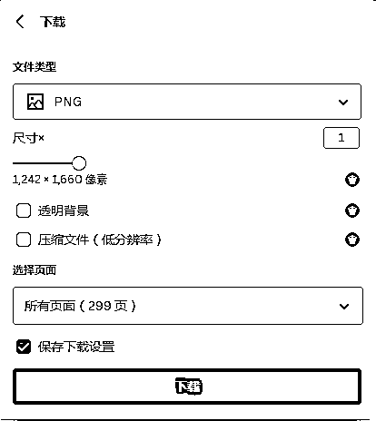

# 关于变现这回事

做📕账号，最终目的当然是为了赚钱。这类正念账号的变现路径相对固定，主要就是接广告。

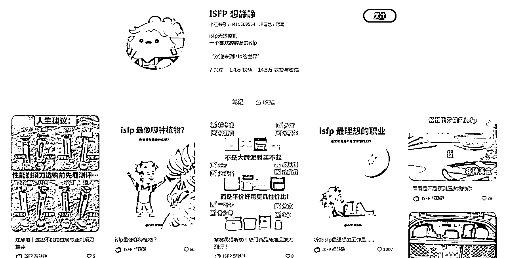