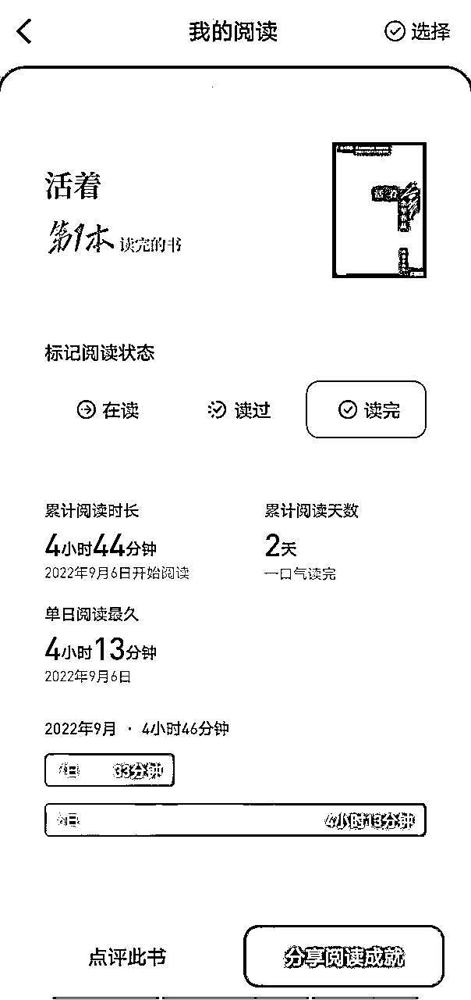
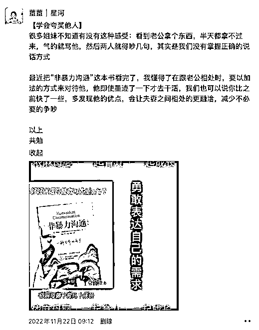
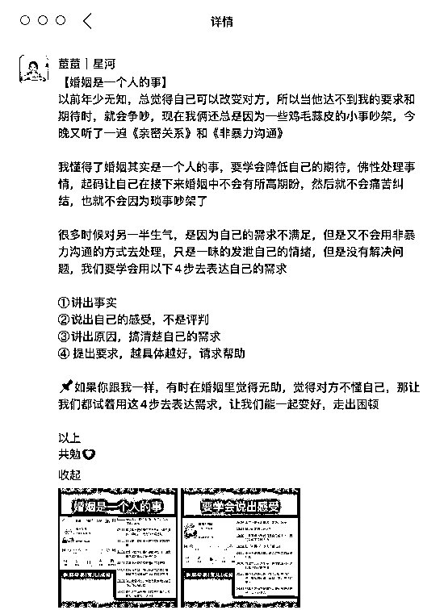
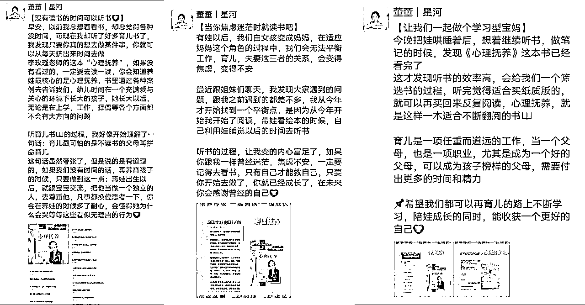
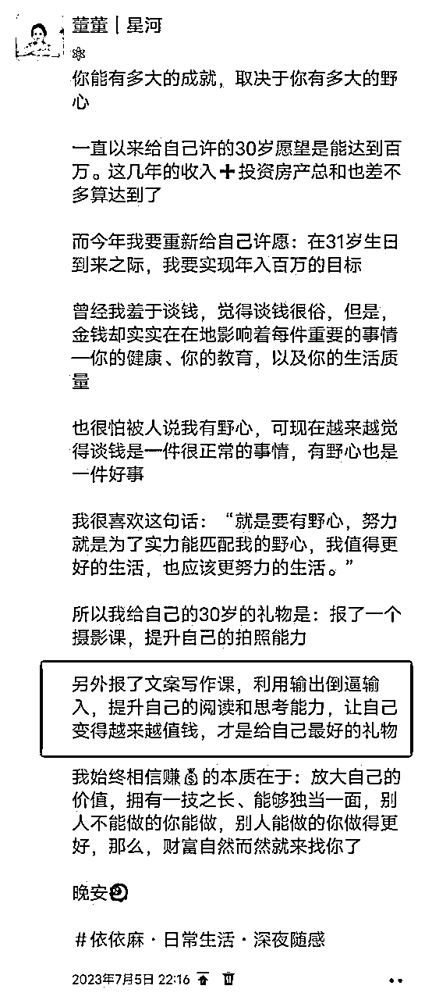
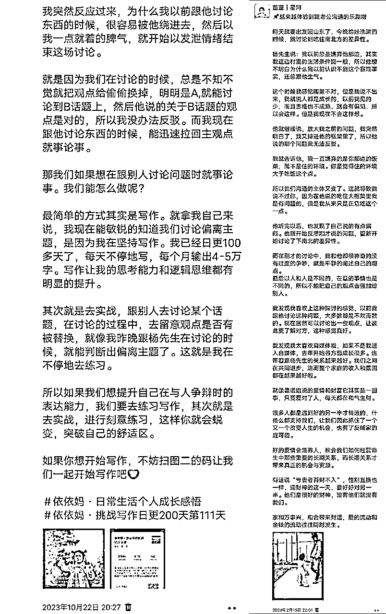

# 带娃上班北漂，我靠一本本书把自己捞了出来，还赚到人生第一个五位数
作者：龙哥

见字如面，我是龙哥，一个白天写代码、晚上带娃的北漂妈妈。2022年之后，书成了我生活里的避难所和加油站，我不仅把自己从内耗里拽了出来，还意外靠内容赚了超过一万块。

毕业那年我以为这辈子不会再碰书了。可孩子出生后，某种东西被唤醒了。一年下来我听读了几十本，在自我修复的旅途上越走越稳。

下面是我的真实轨迹，假如你也在迷茫，不妨学我一样去书里翻翻答案。

一、觉醒，从那个午后开始

2022年2月，为了给淘客账号导流，我开始在一个红色图标的种草社区发笔记。运气不错，4月底号刚做起来，赶上电商大促，一篇内容意外爆了，带来了三百多名精准用户。那也是我头一回体会到流量带来的甜头，之后每月都有三千左右进账。

可惜爆文只有那一篇，后续发文全沉了底。我那时不懂数据本来就会起伏，只觉得是方法不对。于是到处报班学运营，吞了两颗速成丸，加起来花了一万多，什么也没改变。

9月为了继续精进，我又进了某付费群。群里的人和我明显不同，他们不急不躁，聊得最多的是读书、写作、打磨基本功，并非一夜爆红。群主常讲，人要有终身成长的意识，不会写就练，不会拍就多按快门，更要让阅读变成习惯。那时的我只惦记引流那点事，这些话基本左耳进右耳出。

有个下午我记得很清楚，九月初阳光很亮，我居家办公，午休醒来想偷懒。见群里姐妹聊起余华那部关于福贵的书，我也好奇，就下了一个阅读类软件，想着听两分钟不合适就退。谁知道听着听着就陷了进去，一个下午全用来听那个动荡年代里的故事。那天平常得不能再平常，却成了我和阅读的正式相识。

从那个故事里走出来后，我心里那根紧绷的弦松了。看到种草平台的数据没那么焦虑了。回头看看自己，远程工作稳定，队友靠谱，孩子健康，这些已经值得感恩。心态一好，做事反而顺了。

二、大量阅读，像海绵一样吸水

那次经历像触发了某个开关，我发现自己不那么毛躁了。有位爱讲成长理念的作家说过，人生大多数难题都能在书里找到答案。我渐渐相信，并在婚姻、育儿和自我成长上找到了很多线索。我有了好多头一回：头一回装听书软件，头一回买纸质的实体书，头一回睡前不刷手机而是翻几页。

那三个月，听书软件成了我打开最勤的App。早上睁眼听，晚上哄睡听，核酸排队也听，所有碎片时间都被书占满了。育儿、婚姻、成长三类内容几乎被我听了遍，还记了大量笔记，也发过不少动态。

读那本讲沟通方式的书时，我学着表达自己的感受和看到的事实，而不是一味指责。队友渐渐愿意多聊几句，家里的紧张感块块脱落。

后来看那本讲伴侣相处的经典，我渐渐明白婚姻说到底是你自己的功课，不是一方养家另一方貌美，而是彼此旗鼓相当，你厉害，我同样不差。

那阵子我开始用电子阅读App，出门聚餐别人聊天，我故意落在后面多读几页。有一回边走边读，直接撞上电线杆，疼得龇牙，但缓过来又接着看。当时在读一位研究青少年心理的学者的书，我边读边在社交平台疯夸，恨不得按头推荐给所有家长。书里那句话让我记到现在：育儿最怕的不是孩子难带，而是大人自己不读书却拼命逼孩子。

也是在那个故事里我学到了平等，孩子不是一个物件，是有独立人格的个体。你自己先立得住，再去爱别人，才有底气被尊重。

读到这些育儿书，我会忍不住想：要是怀孕时甚至更早就开始读，或许产后不会陷进那么深的情绪黑洞。

那会儿我快回去上班时，突然跟队友说离婚吧。总觉得自己和他无话可说，他一张嘴我就冷言冷语，婆婆说话我也装聋。我们甚至聊过孩子归谁，我还问过老爷子的看法。老人家说了很多，最后一句是：如果确定非离不可，就回来，爸妈养你。这句话成了我当时最深的依靠。

那个阶段全家人都小心翼翼，没人敢在我面前多说话。我也不清楚自己怎会变成那样。可能是还没当好妈妈，可能和婆婆磨合不顺，也可能因为远嫁带来的漂泊感，总感觉融进他们家会对不起娘家。心里结打不开，就只好用冷漠保护自己。好在阅读把我接住了，2023年我啃下了七十多本，很多疙瘩都慢慢解开了。

三、靠书写和分享，赚到人生第一个五位数

日本有位经营之圣说过，读书和赚钱是很顶级的修行，前者让人不惑，后者让人不屈。

我反复跟队友讲，2023是最苦也最值的一年。我换到了一群高能量的朋友身边，他们写字、阅读、做自己的品牌，不内耗，知道缺什么就去补什么。有人因为我解答了一个小问题，就发红包感谢，还主动找我买课。那些认可一点点把我填满，我终于敢大大方方给自己标价。

那一年我还结识了很多厉害的人，白姐、蓝姐、靠谱姐，但要说最关键的那位，还是带我走进写作世界的老师。

事情要从去年六月说起。当时我在电子书城里翻到他写的一本讲写作的书，读完就摸进了他的官方账号，正巧看到他在招年度写作训练营。我想都没想就报了名，还把它当成自己的三十岁生日礼物。

进了那个写作圈子后，我开始逼自己每天写一段。从去年7月连三百字社交动态都要憋半小时，到今年2月能写出五六千字的分享稿；从说话没逻辑、常被队友带偏，到后来能一眼看到他偷换概念，讨论完还能达成共识。这些变化，全是从动笔开始的。

我之所以会走上写作，全因为这位老师用那本书点醒了我，让我把写作当成一项生存必备技能。后来他推出十年会员制产品，可以学他所有的课，定价一万。我毫不犹豫地闭眼入了，觉得能和某位老师绑定十年，太值了。去年9月正式开卖时，我还带动四位姐妹一起加入，头一回带万元级产品，光佣金就让单月收入破了五位数。

今年他又发起了一个共读活动，一年精读十本书，由他全程带队领读。我有预感，明年会比今年再好上一些。

有位研究思维习惯的心理学家写过一句：人和人之间真正的分水岭并非天赋，而是心智模式。想搞钱，先搞脑。思维的高度决定人生的天花板，而阅读就是最便宜的思维升级课。

那个在直播间侃侃而谈的主播也提过，对知识的渴求是刻在基因里的事。读书就像渴了喝水、饿了吃饭，正当且自然。书不一定直接给出答案，但能让你不再被问题纠缠。

如果你此刻也有点焦虑、有点丧，不妨和我一样拿起书。答案也许不会立刻出现，但你会在书页之间慢慢找到自己的节奏。另外，我能进那个搞钱圈，多亏了靠谱姐引路，也想在这里说声谢谢。想让我列书单的朋友，随时来问我，咱们一起把日子越过越通透。