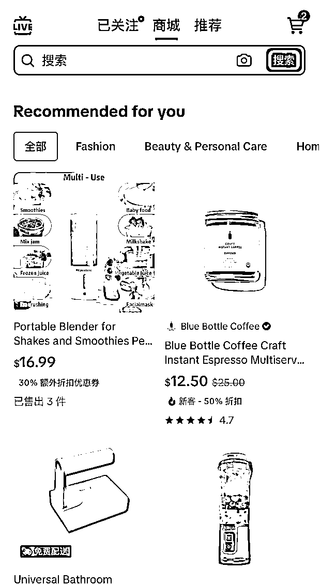
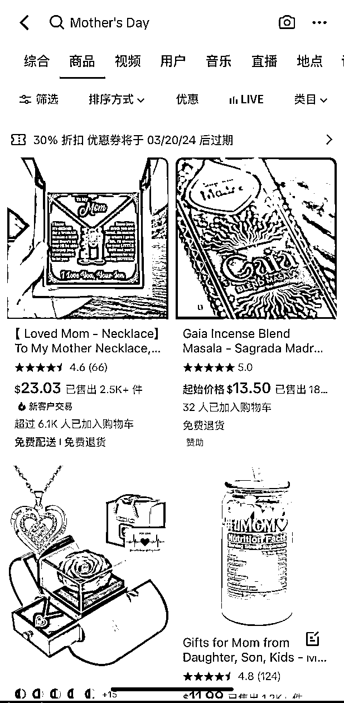
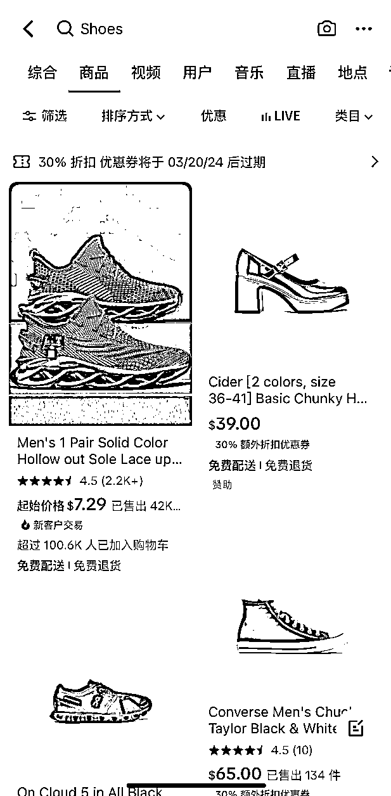
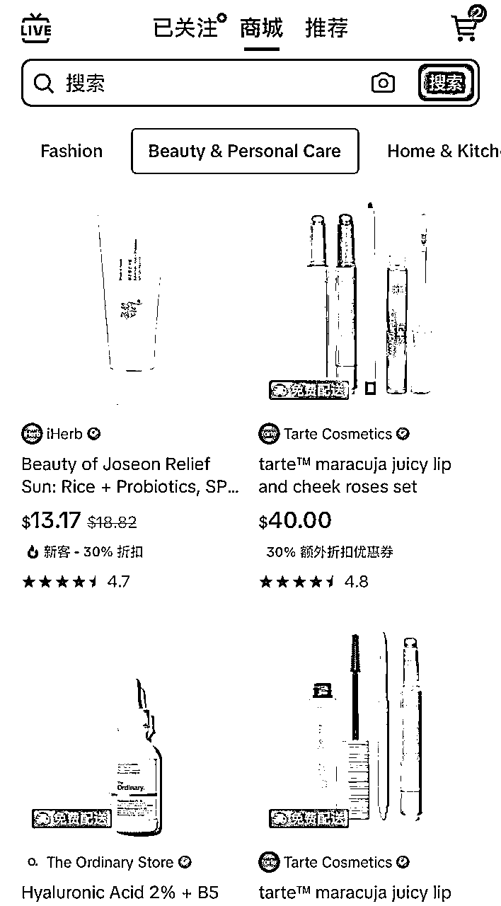

# TikTok美区重磅！PSA商品购物广告即将上线，新的流量红利来了
作者：龙哥

最近，TikTok美区又传新消息：Product Shopping Ads（产品购物广告，简称PSA）马上要在美国上线了。这对于想做TikTok Shop的商家来说，意味着一个全新的曝光渠道即将打开。

PSA到底是什么？说白了，它是TikTok Shop体系里专门在购物商城展示商品的一种广告形式。此前已经在印度尼西亚、马来西亚、菲律宾、新加坡、泰国、越南等市场上线，买家可以通过TikTok购物中心的推荐位或搜索结果发现商品。作为LSA、VSA之后推出的全新电商广告产品，PSA既可以在Seller Center卖家中心创建，也能通过TTAM广告平台进行管理。它的投放位置覆盖购物商城中的“推荐和搜索”频道，以及TikTok综合搜索区域，广告会自动从商品详情页（PDP）抓取图片和描述，生成一张完整的商品卡片。用户点击后直接跳到对应的PDP，可以很顺畅地完成购买。

在后台操作上，商家主要通过卖家中心完成广告创建和账户管理，整个流程相对简化。PSA最大的特点是不用额外制作创意素材，而是直接调用商品原有的图片和信息，系统还会利用动态商品优化和机器学习持续提升广告表现、人群定向和转化效率，从而帮助广告主优化ROAS。实际使用的时候，卖家需要先在卖家中心管理好广告账户，比如充值余额、创建广告活动，然后选择投放全部商品还是指定商品，再根据营销目标设定出价策略。需要注意的是，现阶段这个功能需要联系直客经理开通，可以私信皮皮建联。

再来看流量入口。第一个入口在TikTok综合搜索页面：用户搜索某个关键词时，搜索结果的商品页卡上方会带上广告角标，点击后进入商品PDP。不过目前美国区的这个入口还在实验阶段，暂时没有完全开放。

第二个入口在TikTok Shop Center Tab购物商城推荐页面：用户在推荐信息流里刷到带广告角标的商品卡片，点击就可以直达商品PDP。

第三个入口在TikTok Search Center Tab购物商城搜索页面：用户搜索关键词时，同样会看到带广告角标的商品卡片，点击后进入PDP完成后续转化。

为什么说PSA值得重点关注？三个核心优势非常明显。

一是流量池刚刚起盘，竞争压力相对小。商城推荐+搜索形成的增量流量池，天然聚集了一批有购买意愿的用户，人群质量更高。同时系统基于智能推荐自动生成创意，能够根据每个用户的偏好推荐合适的商品，实现真正的个性化触达。

二是投放门槛低，操作简单快捷。只需要确认推广商品、设置投放时间和预算、确定出价方式，三步就能在TTAM里对TikTok Shop中的全部或部分商品进行投流，不需要广告主单独准备创意素材，确实节省了不少人力和沟通成本。

三是效果方面有验证，TTAM创编能力同步增强。从Beta测试数据来看，PSA的ROAS达成率超过80%的广告占比高于75%，说明它能够比较稳定地帮助广告主实现营销目标。加上支持多种优化目标和定向方式，可以覆盖更多维度的投放诉求。

那么哪些卖家适合尝试PSA？

如果你在TikTok商城已经积累了搜索数据、有历史销量，想继续深挖商城流量变现，那PSA很适合做精细化运营。

如果你还没投过Shop Ads，想快速测一测商品和流量反馈，PSA的低门槛也能让你很快上手。

如果你没有精力或者不想自己做创意和定向优化，那就直接交给PSA，系统会用商品素材自动生成广告，省心又高效。

如果你已经在LSA或VSA上拿到了不错的转化，也可以用PSA来放大优势品类的生意规模。

关于推荐机制，PSA会根据商品的eCPM来决定是否向用户推荐商品。影响eCPM排序的因素主要包括：用户购买意向与产品相关性、用户历史行为（查看、点击、购买、加购等）、广告组出价和预算、商品标题、PDP的点击率和转化率等。商家可以从这几个方向去优化：结合市场热点和购买趋势优化商品列表，把相关的搜索热词加到商品标题里，多增加一些商品来积累数据，或者针对效果好的Campaign提升预算，这些都能帮助提高PSA的量级和表现。

投放上，可以先用50美元/天的Minimum ROAS出价做测试，或者按平均每付费转化单价（CPP）的20到50倍来设置预算。建议至少创建一个Campaign，选择All Products + Minimum ROAS，让机器学习和智能推荐引擎充分跑起来。如果还有重点产品，也可以额外添加一个Specific Product Campaign，用来单独推广畅销款、爆款或促销款。另外要注意，当预算使用率超过80%且效果满意时，可以适当增加预算，但加完预算后ROAS可能会有一个短暂的回落，之后再逐步恢复。

一句话总结：现在TikTok美国站已经可以投放商品卡了，而且投放门槛比之前更低，算是难得的红利窗口期。想要抢跑这波流量，可以尽快对接直客经理提报，或者找皮皮帮忙建联。需要开TikTok广告账户的，也欢迎联系皮皮下户。

建联：17684058749