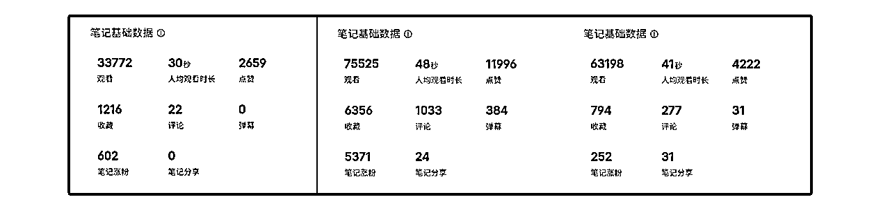
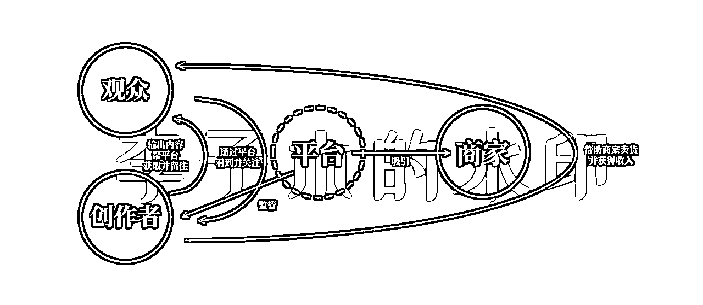
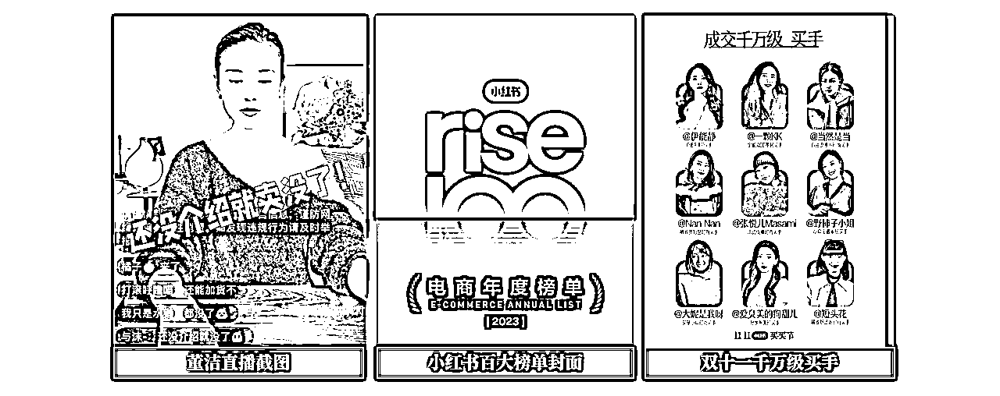
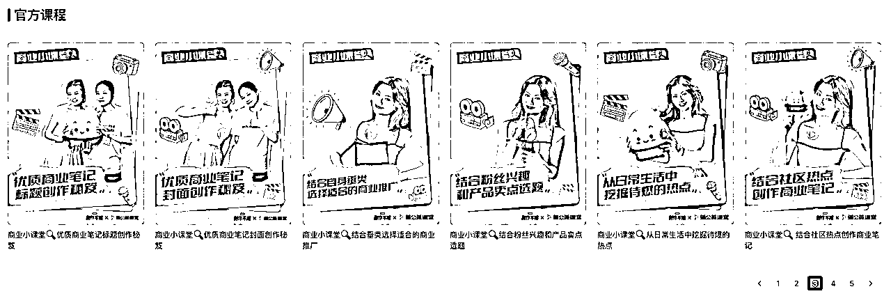
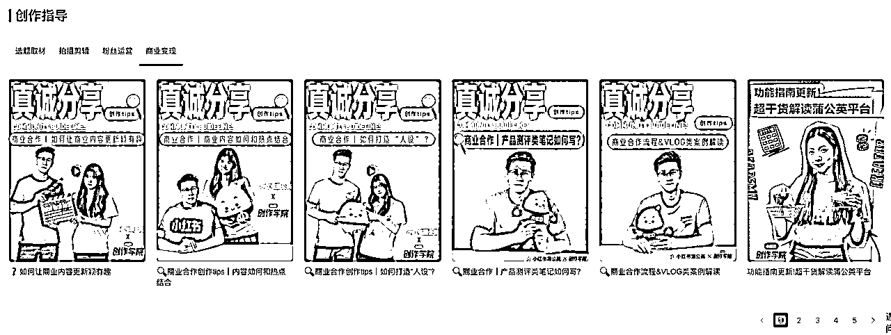
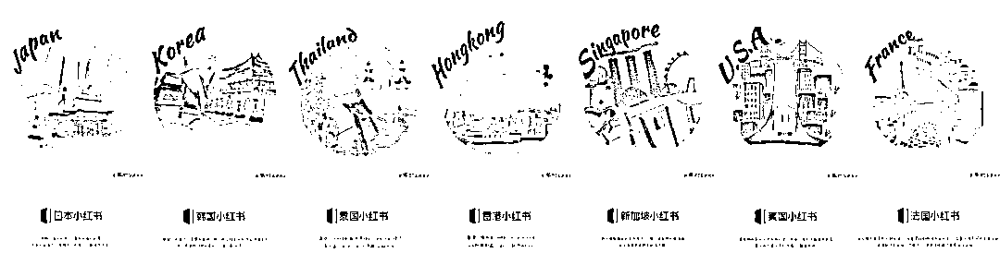
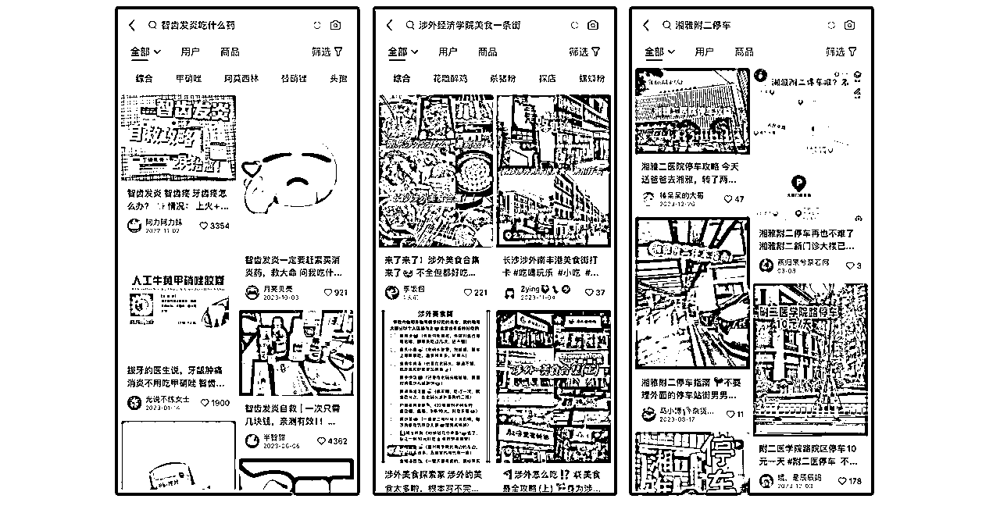
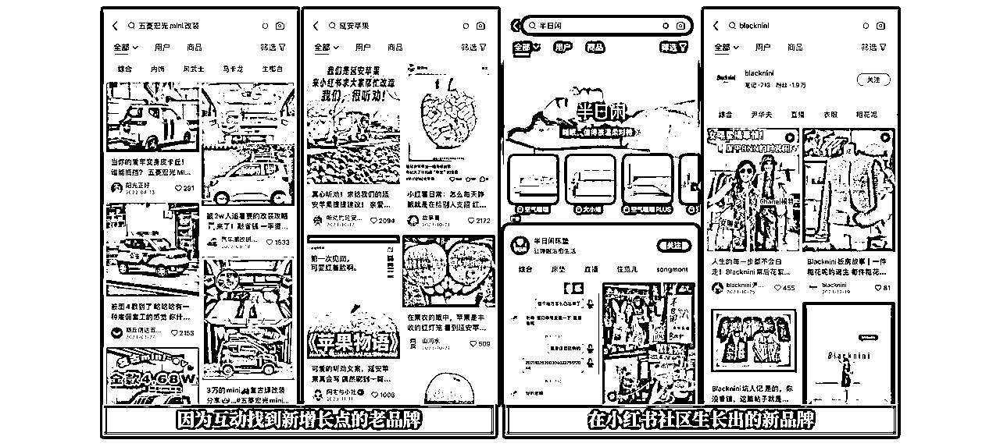

# 2024年小红书怎么玩？从流量到变现的7个关键判断

> 来源：[https://m08zlw24sg0.feishu.cn/docx/Sd8Tdoh8votCXAxJSXUciolsnlb](https://m08zlw24sg0.feishu.cn/docx/Sd8Tdoh8votCXAxJSXUciolsnlb)

想在小红书拿到流量、沉淀影响力、最终实现变现，关键还是先搞懂这个生态的底层逻辑，以及自己在里面扮演什么角色。只有摸清规则，才能持续稳定地吃到结果。

我研究小红书已经一年多，实操过一周同城引流600+的交友号，做过千万播放的爆款模型，也带过千粉账号变现过万。这些成绩在圈子里不算顶尖，但足够让我判断：2024年，小红书依然是普通人和个体内容创业者最值得all in的平台之一。

为了更清晰地判断趋势，我结合公开资料和自己10年营销与自媒体运营的经验，把小红书的现状和走向梳理了一下，总结出2024年运营可参考的7个方向，欢迎交流补充。

# 零、说到底小红书就是个平台

无论社区氛围多么新颖，小红书的本质还是一个平台。平台的核心就两件事：做大流量和做商业化。

做为用户的小红书里，创作者和观众是两大主体，我们属于创作者一方，在生态中的位置和价值流转大致是这样的：

创作者是连接流量与商业化的关键节点，平台和创作者的利益交换围绕流量和变现展开：

*   流量层面，
平台借创作者的内容吸新用户、用内容留存用户。创作者则靠笔记吸粉、积累影响力。

*   商业层面，
平台引导创作者做好物分享、攻略分享等形式帮助商家售卖，实现商业化。创作者通过带货或种草获得收入。

接下来围绕2024年的流量与商业化展开，同时结合抖音、视频号的夹击，小红书如何靠差异化突围。

*   本文框架：
流量-破圈与人群聚焦
商业-商业化加速与创新
不同-平台差异化
启示-2024年运营启示

# 一、破圈进行时，但人群仍在聚焦

品牌推广通常分两步走：

*   第一步，商业模式没跑通时，品牌会小步快跑做增长，流量有保质期，三个月前的粉做转化成本不比新粉低；
*   第二步，模式验证成功后，才会加大投放，因为能把流量接住变现。

2023年小红书买手迎来爆发，单场GMV破亿，百大买手榜单出炉，带货表现亮眼。

基于此，我判断平台会在获客上加码。结果12月，小红书官宣联手龙年春晚，搭建《大家的春晚》直播间，总曝光10亿，互动1.7亿+，#大家的春节#话题阅读量近13亿。

春晚是顶级流量场，能快速扩散品牌声量。春节后，小红书又和8家全国连锁品牌联动，覆盖356城4万门店送奶茶，参与人数3500万。

能看到的是，小红书在破圈的同时，始终锚定年轻人。

流量破圈后，曾经的“流量洼地”涌入更多竞争者，商家也进来分蛋糕。这时候平台好不好做，要看月活是否增长、使用时长是否提升、能否满足新涌入创作者的流量需求。

身边越来越多人在说2024年要做小红书账号，现实问题也随之而来：平台能否承载这波增量？

我没找到23年Q3之后月活的最新数据，当时公布的是2.6亿，和抖音7亿多的体量相比，仍有很大空间。但大体量意味着人群泛化，各个年龄层都会涌入，这可能和社区调性有所冲突。

流量规模与社区质感，成为当下的矛盾点。

从CEO星矢十周年分享、COO柯南在极客公园的访谈来看，小红书更倾向守护社区质感。

所以可以推断，破圈会进行，但节奏不会太猛，流量正在变贵，爆款难度在提升。

同时，小红书的内容权重远大于账号权重，几十粉丝的新号能拿到万赞爆款，十几万粉的老号也可能只有十几赞。新人仍有机会吃到流量。

但人均流量减少、爆款率下降、账号权重弱，也意味着账号本身贬值。如果还在靠接广告变现，压力会越来越大。品牌投放看重数据稳定性，而在流量稀缺且权重弱的环境下稳定发力更难。

平台规则也比较隐晦，限流、删文、封号时常发生。真正能赚钱的创作者，已经不盯粉丝数和赞数，而是看GMV和引流效果。

2024年做小红书，别盯着涨粉和接广，去卖货、去引流、去做能直接变现的事，同步把用户沉淀到私域。

# 二、商业化在提速，也在求变

打开创作者中心，会发现创作服务中心的30门课程里，13门和商业种草相关，置顶的还是商业合作中心上线通知。

可见平台近期依然在主推商业种草。

小红书的商业种草具体指什么？

合作中心目前主推三种形式：

*   博主合作，相当于广告植入，品牌发布需求和预算，博主预约合作，按篇结算；
*   买手合作，即带货合作，含笔记带货和直播带货，平台更推直播带货。博主可自主选品，品牌也可定向邀约，佣金比例不同；
*   探店合作，属于本地生活探索，发布探店内容可获得流量扶持和佣金分成。

现有功能是已发生的态势，未来的走向可以从高层表态里窥见。我梳理了星矢和COO十周年的讲话，发现平台在商业化上想做的是：

### 1、业态多元化

小红书对种草的定义是：用优质内容触达用户、影响用户。相较抖音、B站，小红书做内容电商有基因：2013年1.0版就是7国购物攻略文档，本身就和电商强关联。

之后演变为海外购物分享社区。可见从诞生之初就和生活方式分享、商业购物绑定。

12月22日小红书will商业大会提出“万物皆可种草”，把种草边界拉大到服务、体验、虚拟内容甚至个人IP种草。

有点像当年的“万能淘宝”，但淘宝电商属性强，在本地生活、虚拟内容、个人IP、大宗交易上相对弱势。小红书的内容电商能否突破这个局限，正在探索中，已有初步成效。

对平台而言，商业需要样板。想做成一个业态，就要把从业者聚拢、形成规模、跑出GMV。所以平台会重点孵化非消费品类。

这个过程会逐步推进：

*   先是加速消费品种草的成熟，夯实商业化基本盘。2024年买手直播仍会被鼓励，只是竞争激烈，需要更快入场；
*   再孵化新行业。小红书给自己的商业差异点定义为“特色人群、高质量种草”。所以能可视化呈现、品质感强的年轻人向新行业更有机会，比如新国风原创服饰、定制宠物毛毡等，可参考ins同类社区；
*   随后是本地生活的商业化探索。抖音早两年布局本地生活，但小红书探店内容早有热度，生活方式博主天然具备探店优势，这个赛道值得关注；
*   虚拟内容目前虽有卖资料、卖壁纸变现，但官方扶持还不明显，可能等前几类跑通后再跟进；
个人IP种草则先放一放，放到去中心化部分再讨论。

### 2、搜索商业化

柯南在极客公园访谈中提到，70%月活用户在小红书有搜索行为，30%用户打开的第一件事就是搜索，新用户也常因搜索而来。

为了留住新用户，搜索的优化势在必行。未来搜索排名可能向两点倾斜：

01、带货能力会成为搜索排名更重要的权重，这是商业价值；
02、内容真实性与差异化也会影响排名，这是用户价值。

所以做内容带货要重视搜索：

*   标题、开头、话题、封面文字要布局垂直细分关键词；
*   优化种草笔记的带货数据指标；
*   内容更生活化、更有真人感和细节，比如：

### 3、互动与复购

柯南还提到要帮助商家做长期经营。从品牌角度看，长期经营包含形象树立、用户互动、体验复购，其中互动与复购最关键。

互动层面小红书已出样板：五菱宏光mini爆改、延安苹果听劝……

复购层面仍有短板：

*   高客单或小工作室希望把客户导到私域，避免高额佣金；
*   服装饮料等快消品用户习惯比价复购，低客单不符平台定位。

所以这一块我并不看好。

整体而言，小红书商业化在加速，但步调保持谨慎。去年8月星矢内部分享提出，商业价值不靠效率，而是靠liberal arts，让艺术创造更大的商业价值。品质感、高客单，仍是未来追求。

# 三、差异化：小红书凭什么不一样

小红书公众号的简介只有九个字：真实、向上、多元，这基本就是官方对社区气质的总结。

2023年度趋势报告里提到：这些趋势不是意见领袖教育出来的，也不是昙花一现，而是多元用户互相激发探索热情，逐渐变成生活方式。

多元背后，是坚定的

### 1、去中心化

判断依据有三：

*   体感上，账号权重在各平台里最低，素人爆款概率最高；
*   头部达人数量和粉丝量相对较少；
*   平台不造神，而是把机会分散给一群人。买手标杆从董洁到伊能静、章小蕙，再到百大买手榜，始终是多点开花。

柯南也说过，小红书要长成大社区，但由无数小社群、小圈层构成。小圈层意味着不需要大IP。

内容平台需要标杆，但小红书不希望被某个标杆绑架，而是可随时替换，避免博主流失导致流量流失。

平台与创作者的博弈一直存在。大家涌入是因为氛围和内容，一旦供给方失去动力，新人又被别的平台吸引，就会流失。

所以对“IP种草”我持保留态度：平台欢迎IP来，但不会放任IP做大。

这对普通人反而是利好，不需要成为国民大IP，1000个铁粉就能实现职业自由。

去中心化决定了平台会持续放量给新号，让新人快速尝到甜头。判断上，新人未来很长一段时间都有机会。

再强调一次，在小红书，别以养号接广告为目标，以卖货、引流为目标，把钱和人抓在手里才是正道。

### 2、积极生活

平台的内容切口是生活方式分享，因为贴近生活，商业化更容易。

小红书自称“温暖的小社区”，社区主流情绪是：珍惜当下、努力生活。哪怕看似躺平的“97年早退休”内容，内核也是在寻找更好的自我。

因此更受欢迎的是温暖、积极、分享美好细节的内容，而非冲突负面。创作时要把握这个调性。

# 四、总结：2024年小红书仍然值得做

综合梳理，2024年运营可参考的7个方向：

### 1、新号入局仍有机会，并且会持续一段时间
视频和直播分流明显，但不同于其他平台，小红书图文仍是特色，低粉爆款多、创作成本低，新人入局门槛友好。

### 2、别追涨粉，做离钱更近的事
不要想着涨多少粉、接多少广告，而是去卖货、去引流、去做能直接变现和沉淀私域的事。

### 3、直播带货值得尝试

### 4、可视化、品质感的个人品牌适合以小红书为主阵地

### 5、重视搜索流量，做好关键词布局

### 6、关注本地化、探店方向的动作

### 7、内容调性保持温暖、细节、生活化

宏观方法论看多了，落到细节还是会迷茫。后续我会不定期拆解近期数据表现好的博主和爆款标题，帮助把握微观执行。感兴趣可以持续关注，一起变现。

参考内容：《小红书电商2023年度榜单发布 ！》《小红书“制造”千万级买手》《小红书2023年度趋势报告》《小红书COO柯南：好社区长出了好商业，社区与商业不对立、不矛盾》《小红书CEO星矢十周年分享：科技为笔人文精神为墨，创造广阔而温暖的社区》