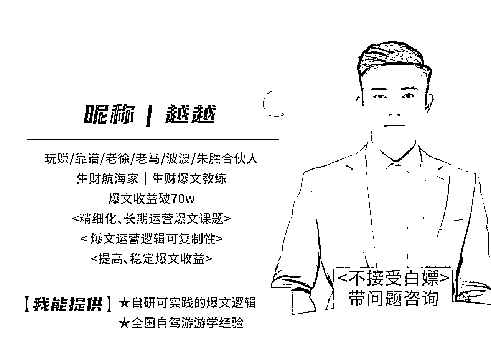
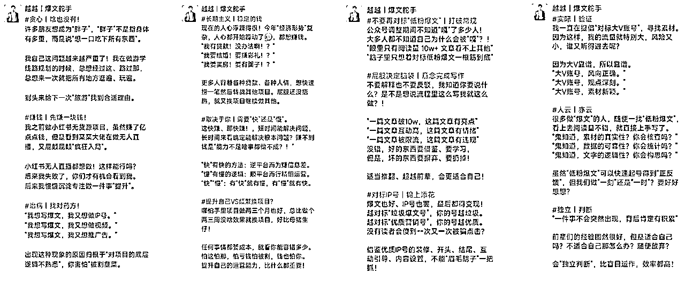
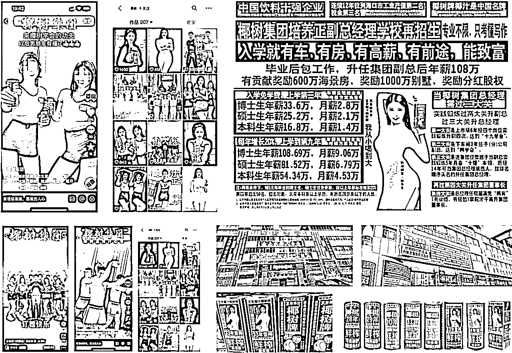
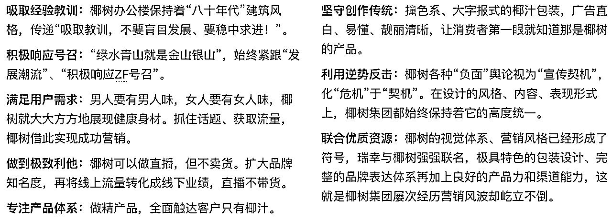
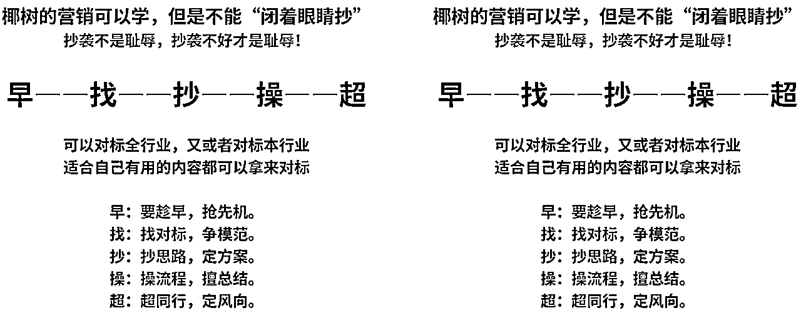
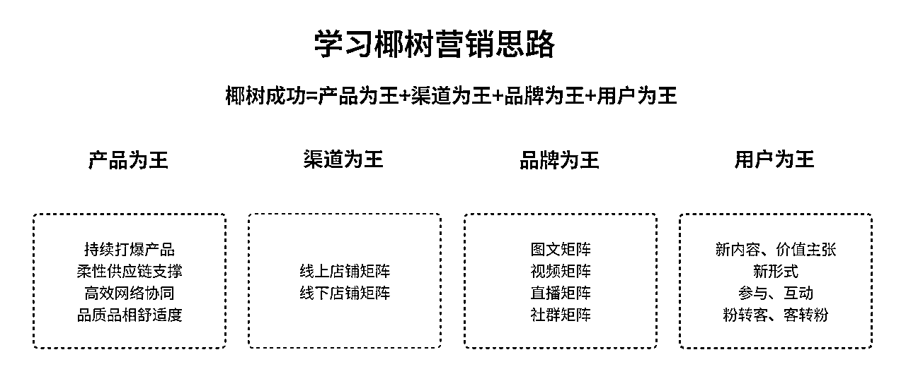
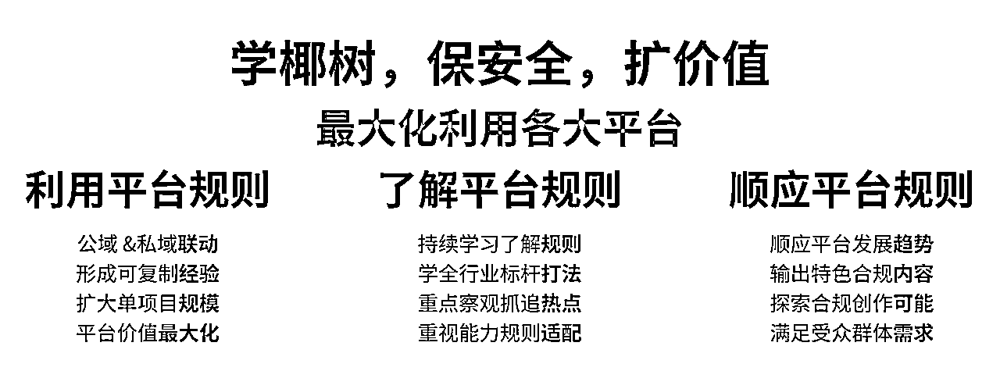
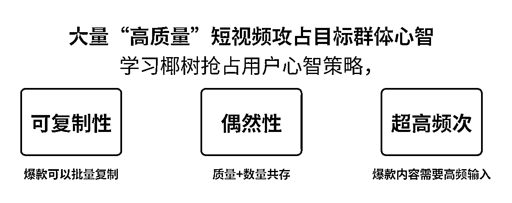

# 观椰树“性感美女”，看爆文“项目操作”，学项目心法
作者：龙哥

# 一、前言

本文收录于《专辑》下半部分，内核包含：

1.  副业视角拆解椰树营销思路
2.  副业在项目推进中如何打开局面
3.  副业在项目推进中提升效率
4.  副业在项目推进中的经验技巧

《专辑》上半部分链接：

该专辑仍在持续更新，欢迎关注越越获取后续资料。

引用说明：文中部分内容来自《答疑文档》、《平台公开资料》、《线下聚会交流复盘》

## 1、我是越越

### 我的目的

把“爆文逻辑”拆解总结，沉淀为可复制、可放大、可复利的实操理论，

并把该逻辑迁移到其他赛道，提升转化效率，降低新坑试错成本。

### 共同问题

副业从业者进入新赛道，均需学习新知识并重复旧动作，最终发现大量操作徒劳无功。

细究会发现流程与逻辑在不同赛道间高度共通，仅细节、受众、渠道存在差异。

对待项目的态度与手法因人而异，于是容易走向两极：

*   过度钻研新项目，反而拖慢变现速度；
*   过度轻视新项目，反而拉高项目成本；

平衡这两种极端很难，也是多数人放弃的核心原因：

通俗说有人太较真，有人太敷衍，最后都陷入混乱。

### 因人而异

阅读效果因人而异！本文基于笔者对爆文项目的实战经验归纳。文中方法论不适合急于套现的人，但我相信内容能解决大部分人的困惑。

## 3、阅读建议

*   文中图文并茂，建议PC端阅读，理解更顺畅；
*   本文讲方法论，不给具体操作SOP，价值有限请见谅；
*   重点内容以红色加粗呈现，可直接浏览标注处把握要点：

# 二、看“椰树营销”中的底层逻辑

资料显示椰树去年全年销售额50亿元；年销量70万吨，同比增10.26%；上缴税金6.82亿元，同比增15.39%。

## 记忆锚点

*   白嫩、从小饮用、身形诱人的擦边文案
*   前凸后翘S线条、大胸、反手持椰汁的女性包装
*   简约不失质感，撞色系、大字报风格
*   “男人要有男人味，女人要有女人味”的土味直播间

观感不精致、显得土味，但业绩摆在眼前足以自证。

对手在升维，椰树在降维。椰树通过一系列花哨打法，守住了【低人设】优势，将自身品牌降维打击，把行业上限封顶，再借助原料与供应链优势肃清竞争者。

品类即品牌？行业头部凭借低利润率与低售价制造门槛，让后来者难以为继，薄利走量吃下品类大部分份额。品牌降维、封死利润上限，用供应链优势+规模效应+品牌力直接碾压对手。

## 优势破局

## 赶学帮超

# 三、副业人在“项目”中如何破局

## 1、副业人入局“项目”的三大瓶颈

想通过项目变现的副业人群不在少数，却普遍卡在几处现实难题。

据我了解不少新人入场，多被“可爱的收益图”吸引而下定决心。

以“👸号爆文”为例：

第一，平台项目趋于稳定，红利缩减。

像TX流量主，只要持续运营，爆文依然能产生收益，平台多采取默许态度，个人也能赚到可观金额。“很多人曾听闻爆文项目极易变现，随便发一篇即可获利”，过去如此，如今是否仍如此？

第二，项目发展失序，监管趋严。

此前有人抓住风口不择手段薅取收益，技术手段多违规。导致优质原创被搬运、洗稿、造谣、煽动等现象频发，平台不得不加强管理。

第三、收益波动大，转型困难。

见到他人赚钱自己不赚，心态易失衡。追问领域，恨不得立刻切换。

“日收入像过山车”，想换赛道却缺乏判断与定力，自嗨式困局不断循环。

你只顾埋头干，未察觉问题根源，问题反复出现。发现问题后又无解。

上述三类困境尚未遇到的人不必焦虑，终会遇到。笔者能做的就是把经验原原本本交付。

## 2、副业人开启变现要打通的环节

*   副业人做项目时的典型现象：

1.  收益不佳，对项目期望过高。
2.  同质化严重，人云亦云缺少个性。
3.  逻辑不清，静不下心思考与验证。

*   做“爆文项目”前最常被问的问题：

1.  该项目适合我吗？
2.  需要具备哪些技能？
3.  多久能变现、能变现多少？

过硬技能、缜密思维、稀缺资源往往与特定平台、领域、项目强绑定。一旦平台迭代、领域受限、项目关闭，能否继续？不得不更换平台、领域、项目，再次从零起步。

每个网赚项目背后都是一套完整的运营逻辑，逻辑可跨项目复用，掌握后才能掌握主动。

因此要获得副业自由与底气，建议同步做到以下三件事：

### 第一、有调整心态的能力

中途放弃的主要原因是：投入成本>回报。

时间、精力、金钱投入后得不到预期回报，久而久之便放弃，成果付诸东流。

先思考：

*   为何参与该项目？
*   是否必须参与该项目？

答案决定心态权重。

以下技巧可矫正心态，以“爆文项目”为例：

*   熟悉规律，归纳总结

1.  何为“扶持流量”？其特征是什么？
2.  何为“周期限流”？持续多久、影响几何？
3.  何为“系统检测”？如何规避？

规律需日常积累整理，无人会主动全盘托出，可带着合适问题请教靠谱前辈，合适问题的定义后续会讲。

*   过滤信息，降低期待

他人的收益图只是想让你看见。过度关注会加剧焦虑。

你自己的几元收益 vs 他人几千收益，心里落差可想而知。

闭眼聆听，调研行业均值，在均值之上再适度下调期待。

*   风险收益，重点了解

“参与”等于“赚钱”？赚钱带来喜悦，亏损带来崩溃。收益伴随风险，不可盲干。

风险收益可在平台规范中查找。

项目常见风险：违规删文、功能受限、收益被收、账号封禁等。

项目常见收益：流量主分成、广告位收益、私域导流等。

*   合理面对，不找借口

别归咎于运气，要看异常点与原因，别推卸责任，有空就复盘。

### 第二、有选择资源的自由

*   账号自由

掌握账号资源即可持续获利：

1.  拥有账号：个人与组织账号并行，组织账号可达50个，个人对应1个。
2.  运营账号：技术手段批量积累账号，以量取胜，平滑项目不稳定性。
3.  补充能力：账号违规封禁后能最短时间补位，实现无缝衔接。

*   素材自由

获取一手、独特、热门素材，抢占风口吃流量，但易陷入极端：

1.  低粉爆文：数据亮眼，有亮点但高手未必使用，低手盲目追随。
2.  大咖账号：大V素材有深度，适合有基础者，新人难驾驭。
3.  官方媒体：官媒素材常被课程列为新人禁忌，观点深刻方向正确的素材为何不可用？
4.  融合使用：换个思路，取两边之长，排列组合即成新素材。

*   资讯自由

官方在社区发布的资讯与平台运营、规则相关。知道的人与不知道的人形成信息差。

1.  提前获知资讯：相当于抢跑，并非内部渠道，而是利用时间差与信息差。
2.  提前学习规范：首件事看平台规范，后续常态化查阅，非等问题发生才临时翻看。
3.  获取官方资讯：🛰️开放社区、腾讯客服官网、运营规范等都是消除信息差的入口。

*   实现风向把握自由

风向由权威人士把控，便于全局调控。

1.  风格即领域：别犹豫，先行动。一个领域无人敢试，你试了就是风格，难被模仿。
2.  实践后才有选择：纠结是否适合，不下水怎知深浅，实践赋予选择权。
3.  炼就火眼金睛：听闻“某领域不赚钱，某领域收益高”，缺乏大数据支撑皆为空谈。
4.  直觉即风向标：相信潜意识的感觉，内心感受最真实。

### 第三、有积极上升的趋势

“积极上升”是褒义词，是宏大目标。想象下在副业中：

1.  持续投入，收益随之提升。
2.  突破模式，天花板被打破。
3.  积极社交，牛逼事被广泛传播。

副业人应更注重上升空间建设，感受到上升趋势，便会产生超越收益的精气神。

1.  复盘流程：整理合适问题，带着善意与困惑请教有成就的前辈，及时沉淀经验。
2.  筛选经验：别因不喜某人而全盘丢弃经验，提取适合自己的部分落地。
3.  解决问题：别因不熟而远离，能解决问题者即目标，共同成长。

篇幅有限，不再赘述。总之，多做对自己与他人有益的事。

# 四、副业人在“项目”中提质增效

“慢即是快”，每个动作做得精致，重复概率就低。怎么做？先审视自己。

抓住人性：明确我是谁？我能做什么？我该怎么做？我以后怎么做？

### 1、我是谁？

“我是谁”指你在项目中的角色。

项目中常见角色：

1.  提线木偶：前辈指示即照做，不做则赚不到钱。
2.  孤独行者：只信自己所见，排斥善意劝导，一意孤行。
3.  疯癫大侠：此地未学透又去彼地，搞得自己混乱。
4.  梦幻大师：异想天开，痴迷高收益未来，迷失自我。

大部分人属于循规蹈矩、平安顺遂的大老实人。项目变现需独立思考与判断。

### 2、我能做什么？

*   明确定位：
1.  项目定位：在哪个平台？做什么产品？达成何种效果？需向谁学习？
2.  目标客群：服务哪些客户？客户有何特征？如何满足需求？
3.  定位优势：项目新颖点？与他人差异？

*   明确能力：

坚持的动力是什么？能为客户提供何种价值？

兴趣爱好、职业技能、生活习惯都会影响坚持周期与变现效率。

兴趣是什么？时间投入多寡？职业相关性？领域认知？

想清楚才能持续。喜爱阅读可切书评。

总之，抓住自身擅长点，形成坚持动力且操作舒适。

*   明确预期收益：

选择合适期待可缓解焦虑。

1.  调研：收益晒图、群聊记录、复盘文章均含收益信息，可汇总整理。
2.  判断：关注数据趋势比关注总额更重要，看单价比看总额更有价值，不可复制。
3.  目标：选择均值并适度下调，形成合理期待。

### 3、我该做什么？

*   学习规范

查找、整理、研读平台规范，可少走弯路。

1.  重视规范：哪些行为禁止？哪些允许？哪些推荐？如何维权？
2.  学习案例：规范中含典型违规案例，任何时候以史为鉴。
3.  汇总问题：把棘手、新奇、罕见的违规案例归档，匹配规范条款。

*   学习操作

查找项目操作手册，学会发现问题、分析问题，才能对症解决。

1.  有序学习：按教学顺序阅读，适合零基础。
2.  针对学习：按需跳读，快速定位方案，适合有基础者。
3.  答疑学习：重点研读文档“答疑”部分，关注他人整理的百问百答。

*   实践操作

1.  检查物料：确认账号、软件、表格质量，降低问题概率。
2.  整理流程：在脑中复盘操作，标记易违规与易错点。
3.  预备方案：准备Plan B，应对意外。
4.  实操项目：结合文档与自身情况实践，首次实践需及时记录问题。

### 4、我以后怎么做？

把过程中积累的经验复制放大、再总结，项目才能做大做强。

*   回归现实

1.  Why？易被利益冲昏头、易冲动放弃，及时回归现实。
2.  How？把注意力拉回正常生活，客观分析得失。认真复盘、细化颗粒度，总结教训、复制经验。

*   复盘实践经验

区分偶然因素，失败后血淋淋解剖自己，能力自然提升。

1.  复盘高度：起点为项目初始阶段，需有可追溯的方案与预备方案。
2.  注重分析：复盘需含背景、细节、期望、论证假设的证据，避免低质问题。
3.  细化计划：吸取教训，保留经验，细化颗粒度，实操前制定三套预备方案。
4.  学会提问：若不知从何复盘，可用对话形式。

“有温度”提问示例：

*   “这一点能否再展开说明？还有哪些可能？”
*   “过去一段时间里，最有成就感的事是什么？”
*   “哪些地方未达满意，下次如何改进？”
*   “下一步计划如何实施？”

也可向靠谱前辈咨询，问题需含：背景、细节、期望、证据。

提问模板：
角色+问题发生时间+背景细节+影响+预期帮助+假设+证据...

*   迁移实践经验

抓住失败教训减少试错成本，运用成功经验提升成功率，迁移到其他项目。

对比差异、对比共性、提取特征融合、反馈调整、复盘。

### 抓住人性利用人性

引发愧疚、打击自信、剥夺成就、弱化价值、赞美捧杀

# 五、副业人在“项目”中的诀窍

1.  若一心只想变现，不建议做项目，无感情难以长久。
2.  选择一个合适的对标胜过追十个大流量号，持续模仿超越，别东一榔头西一棒槌。
3.  入场先跑通基础流程，赚到第一桶金，再考虑创新与批量复制。
4.  认真学习平台规范，比在群里问低质问题更有效。
5.  别贪多，嘴里食物未咽下又塞一口，易被噎住。
6.  只要不违法违规、不封号扣钱，就全力以赴，别因小波动神经质。
7.  前期熟悉项目比变现更重要，放低姿态，降低变现期待，先学好。
8.  保持乐观心态、降低收益期待，可把项目当游戏，有收益即额外福利。

很多新人抱怨想请教前辈却总是被冷处理，原因其实很简单。

当你开口就是一句“这个我不懂，能教教我吗”，对方第一反应往往是：问题边界在哪？有没有先自己查过？这份求助背后有没有走心的准备。提得太笼统、网上就能搜到答案、带着试试看的心态去提问，很容易就被一句“你先自己想想”挡回来。真正打动人的求助，从来不是空泛的求救，而是具体、可溯源、带着思考痕迹的提问。

与此同时，把每次做项目的卡点、思路转弯、以及最后怎么解决的，都写下来，这件事的价值被严重低估了。今天在项目 A 上卡住的点，可能三个月后在项目 B 里原形再现。你的笔记不是流水账，而是一张能反复复用的问题地图。记录得越细，提问就越有质量，前辈愿意回应的概率也就越高。