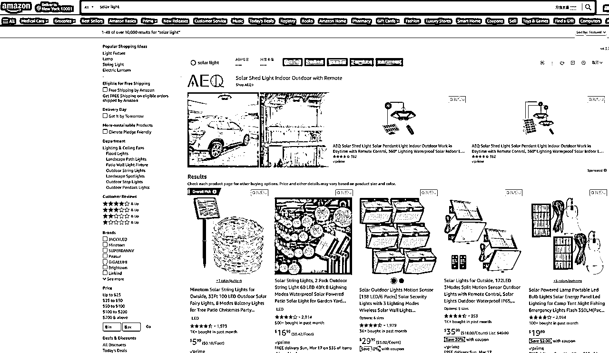
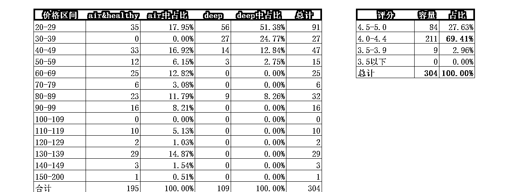
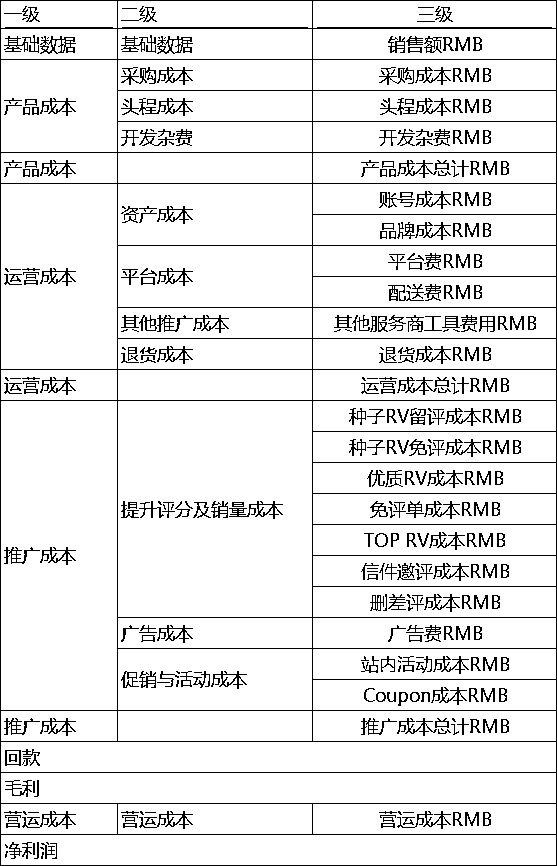
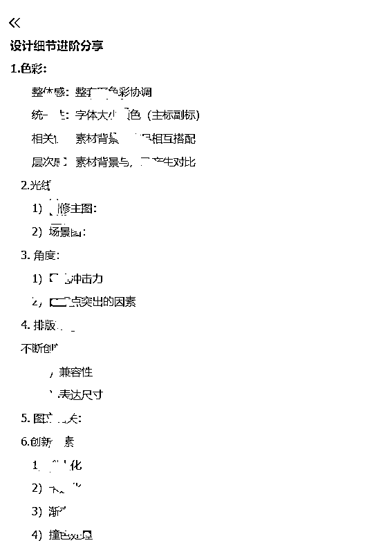
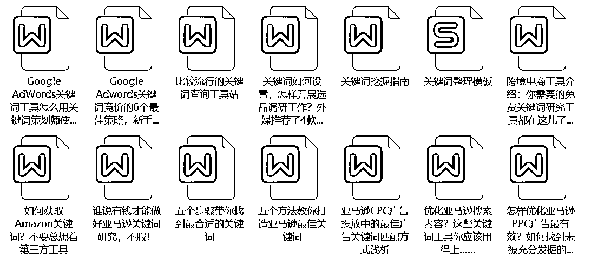

# 亚马逊转化谈到最后，都是在谈价格
作者：龙哥

我叫小紫，跨境这条路走了七年。

从零做到过千单爆款，曾经把转化率做到79.3%。

现在在帮多家深圳亿级体量的跨境团队做顾问。

会不定期把自己的实操经验沉淀下来分享给大家。

转化系列这是第三篇。

前面两期聊过主图和文案怎么去做，有朋友希望能单独开成课程，我抽空就会安排。

今天接着聊转化，最关键的那个变量——价格。它怎么影响买家决策，又该怎么定、怎么调。

* * *

# 一、价格是怎么影响转化的

举个例子，买家想买太阳能灯。

他先上亚马逊首页，敲下 solar light。

系统会把一批同类品按权重排出来展示。

权重是怎么算的，我之前的分享里说过。

搜索结果页就是一个天然的对比台。

所有相似品被摆在一起，买家一眼就能横向比。

这时候，传统的“按产品价值定价”就失效了。

线上买家没有价值锚点，只有参照锚点。

他会同时看首图、标题、评价、价格、促销，然后决定点不点你。

价格比市场均价高出50%以上的链接，流量基本倾不到你身上。

买家会觉得不值，点进来的欲望直接被削掉。

价格低得离谱同样危险。

它会打破市场价格体系，让人怀疑品质，还会把利润吃光。

做亚马逊定价一定要明白一个前提：

先看对手在卖什么价位，再想自己的产品值不值。

靠市场调研锚定一个合理区间，找到定位，才能把转化率拉到最高。

定价的本质是利润规划。

要搞清楚市场价格带，分清等级，给自己留出能赚钱的空间。

做生意不是做慈善，价格必须服务于利润。

# 二、做市场定价，这两件事绕不开

### 1）成本

没有成本的清晰，就没有价格的底气。

亚马逊的成本结构其实很透明，我整理成表格给你们看就明白了。

成本竞争力决定了你能不能打价格，也决定了你能打多久。

没有价格优势，就只能压缩广告预算。

中间只要多一个变量：退货率抬一点，广告费多花一点，前期活动亏一点……利润就没了。

新手判断一个品能不能做，先拿这个表粗算一遍，基本心里就有数。

成本优势不一定轻易拿到，但一旦拿到，成单率会明显不一样。

### 2）定位

为什么定位比价格更重要？

“性价比”从来都不是卖点，能让品爆的，是用户觉得你配得上这个价。

很多商家迷信价格内卷的螺旋打法，一味卷低价。

原材料一波动，别人比你更便宜，就彻底死掉。

而且用低价把用户引来，其实筛进来的是价格敏感人群，高价值用户反而会觉得你的品档次不够。

先做足功课：市场需求、竞品情况、用户画像。

知道你要打的人群是谁，产品的核心差异在哪，定价才有空间去做营销，而不是一上来就自降身价。

# 三、推广期怎么动态调价

定位不是一成不变的，需求变了，价格就要跟着复盘。

书上那些渗透定价、撇脂定价、锚定定价，在亚马逊上落地其实就三类打法。

### 1）高价打法

假设同行中位价是29.99。

高价思路是前期上34.99。

打法A：34.99 + 大额优惠券，30%以上比较有效。手动精准关键词出价抓高意向流量，广告费会比较高，需要你对账户把控力很强。留足操作空间就是为了这个。

打法B：42.99的高价 + 站外deal的高折扣码，配合激进广告快速拉起排名，等自然位起来后逐步降价，拿到红色降价标签，再正常跑广告，方便后续申秒杀。

高价策略有个前提：品质必须扛得住，否则差评会砸掉一切。必须搭配优惠券或会员折扣一起用。

### 2）中价打法

前期定价24.99，优惠券10-15%。

广告以手动精准为主，点击花费要根据每日出单情况动态控，必须盯着，不是一次性丢预算不管。

等基础销量起来后，再开手动词组，翻盘的机会就很大。

### 3）低价打法

低价最致命的问题是没利润，而且后期基本很难涨价。

价格极度敏感的市场一定要谨慎。

如果真的要测款，可以设20.99，毛利很薄，广告必须低成本跑，关键词出价压得很低，先用自动精准探词。

随着排名和销量起来，慢慢抬价。

除非你就是为了测款，卖完不做，不然不建议新品上来就自降身价。

定价一定要结合市场，但不是抄同行。

关键是选对价格策略，再匹配对应的运营动作。

* * *

到目前为止，转化系列已经讲了三期：

🎁 转化攻略系列汇总 🎁

评论区告诉我你最想听的转化话题，我会继续补全这个系列。

下面是我之前写的一些常被转发的文章，关注我的基本都看过，强烈建议收藏：

精细化运营法：

干货型：

职场经验型：

如果你觉得小紫这篇还算有料，欢迎来聊聊。