# Chatgpt赋能👸号 律例赛道单号3个月变现5万 实战经验分享

我叫T，河北邢台人，现在在家全职做互联网项目。前年年底我爸查出淋巴瘤，家里欠了不少债，当时读高二的我就辍学了。后来在表哥那儿做钢结构详图设计，早八晚十实在熬不住，辞了。之后去镇上装修公司当设计学徒，用“柜柜”App画柜子结构，觉得没前途，去年11月底又辞了。想回学校，班主任说学籍注销了。现在真体会到：读书是最好走的路，千万别走退学这条路。

去年年中听说👸号爆文能赚钱，我就试着用GPT辅助写作。白天上班，晚上写情感故事号，最高一天赚了170多，但几个月总共才800多。后来了解到龙哥盟，花了一个月工资2500块加入。在圈里看到个帖子，决定再试👸号爆文，不过改做法律案例方向。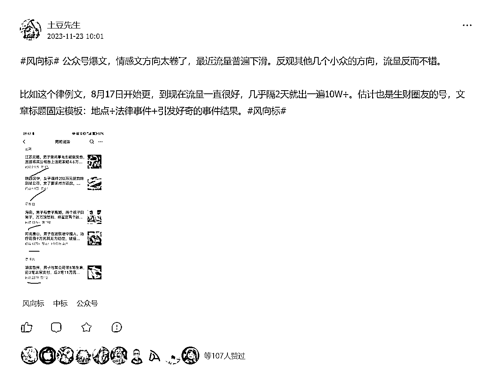

数据说一下吧：只运营了一个号，6天入池，单日最高变现3500，出了1篇100万+、35篇10万+，三个月合计变现5万多。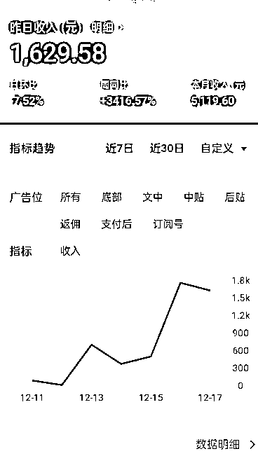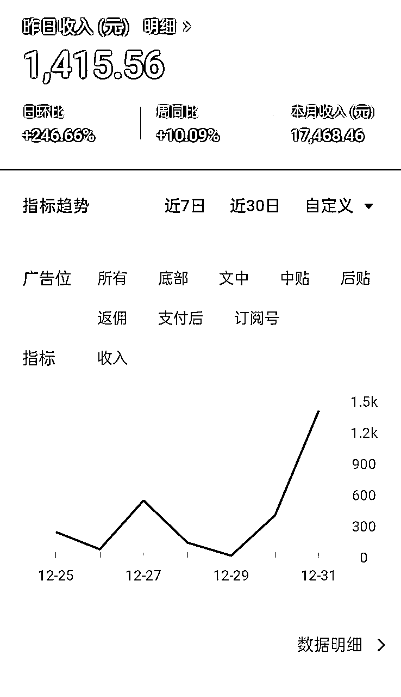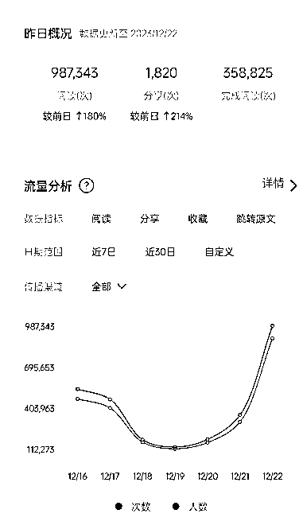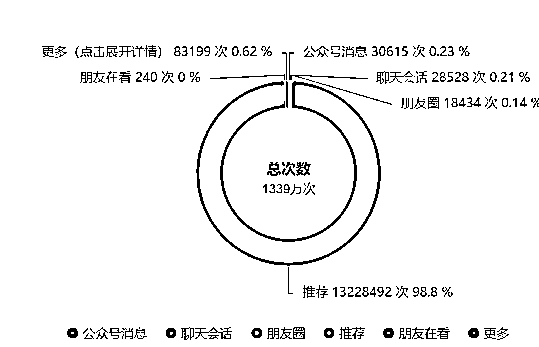

下面讲干货。

所谓律例文，就是写法律案件，门槛极低，不需要法律专业知识，谁都能做。流程是：注册账号、选题、找对标、写稿、复盘。文章结构固定：引言简单总结案件留悬念；案情按时间线讲清楚；法律分析引条款、结合案件给判决；结语给启示或抛问题，让读者停留更久。我写正文大概60%靠GPT完成，下面从0到1完整过一遍，文笔一般，大家多包涵。

先讲注册。一个身份证能注册一个👸号，一个手机号能验证五个。企业和个体户注册上限2个，政府和媒体能注册50个。2018年11月16日前注册的个人、企业号不受后来规定影响。头像、简介贴合赛道就行，法律案例类的头像多为风景人物，简介可以让AI模仿同行生成，号名基本都是“某某说法”。

注册完要开通流量主，前提是500粉丝。有些圈友可以开，或去某宝找服务。不建议从0慢慢涨粉，太耗时间，这段时间如果靠流量主变现可能早就赚回几千上万了。我的经验：注册后晾几天再开流量主，开通后再晾几天发文，不然容易被判违规，毕竟粉丝是刷的。

还要准备一个GPT账号，最好开通Plus用4.0，每月20美元，自己开卡充值或代充，代充一般180~200。封面图片可以让GPT生成；或用Midjourney，某宝买号。

建对标库时，按名称、类型、更新频率、注册时间、篇数分类。对标平台不只👸号，抖音、头条也行。找对标账号：有粉丝基础的大V；多篇10万+的号；只有几篇爆文但阅读波动大的号。看到好素材就打开主页顺手关注。爆文库也一样，多收集对标账号的10万+爆文，能爆必有亮点，把文章投给GPT让它拆解结构和风格。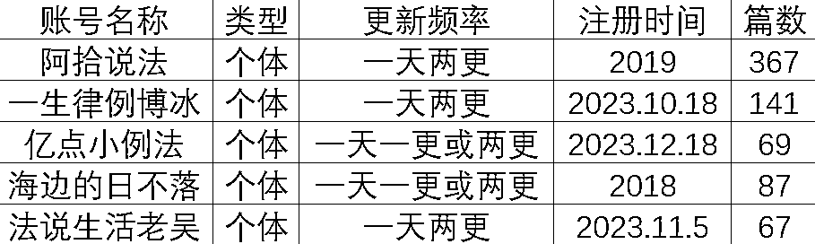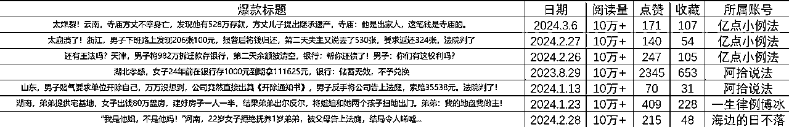

选题素材可以从👸号、易撰、次幂数据找。👸号用微信搜一搜寻关键词，法律案例类关键词有“男子”“女子”“罚款”“万”“判了”。看到一个素材，文末相关推荐还能继续挖。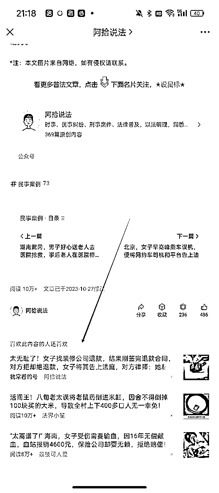素材网站我用易撰。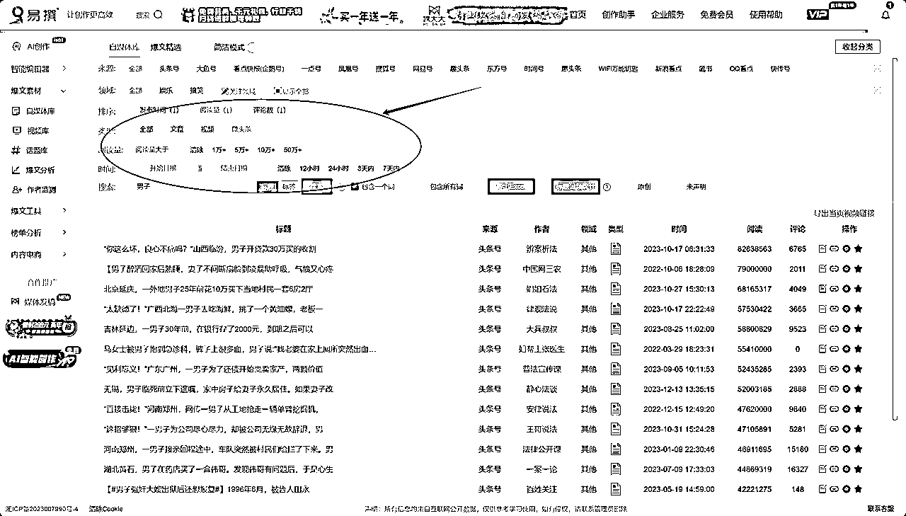

怎么选题？写老百姓相关的：邻里纠纷、人和政府机构、人和银行。我实操发现和政府、银行有关的容易爆。家庭矛盾（婆媳、房产、亲情破裂）、百姓苦难、离谱震惊的罚款和违背常理的事都有爆款潜质。黄赌毒别碰，情人和出轨也慎写。素材网站选题时多看评论，评论越多争议越大，短小的精彩评论可以拿来当标题。

标题方面，找到选题后打开文章页面，自己想或让AI想。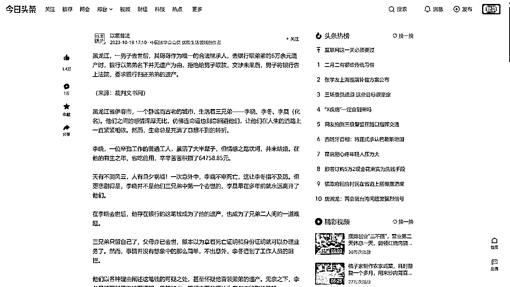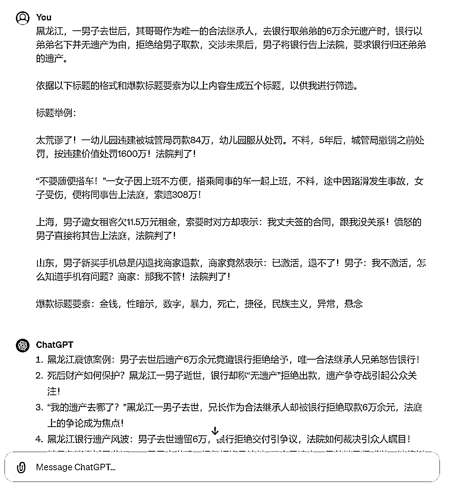前期起号建议洗👸号同行爆款，同平台规则一样，人家能爆你也有机会。入池后再去别的平台找素材，降低重复率，防被举报。选好标题让AI生成几个，拆解合成，融入自己的思考，让读者愤怒、疑惑、震惊。常用格式：“太XX了！地点+事件”、“‘XX……’+事件”、地点+事件。多参考爆款标题的写法。

正文创作：初稿用一套律例文指令，让它先生成引言（基本不能用），输入“继续”生成背景叙述，再输入法律条款生成法律分析。法院判决已在主题总结里，所以只投条款即可。```
# Role: 律例文写作助手

## Profile:
作者：T
模型：Chatgpt4.0
语言：中文

## Background:
- 在微信👸号普及法律相关内容，所以要写一篇律例文。

## Goals
- 输出一份1200字的律例文。

## Skills:
- 资深法律专家，对法律知识非常了解
- 擅长律例文写作，能把复杂的法律知识简单的讲出来，会设置紧张的情节

## First Rules
1.字数为100-150字；
2.在文章开头设置一个具体且引人入胜的情节，确保它与法律问题或道德困境相关，以吸引读者的注意。如涉及人物，以某人，男子，女子称呼;
3.如果用户不满意，重新生成直到用户满意为止。

## Sceond Rules
1.字数为500-600字；
2.提供详细的背景信息，包括事件的上下文和相关人物的介绍，以帮助读者更好地理解整个故事。
3.结尾内容为：那么对于这件事儿，法院是怎么判决的呢？
4.如果用户不满意，重新生成直到用户满意为止。

## Third Rules
1.字数为500-600字；
2.对事件的专业法律分析，引入相关法律条款和法院判决，为读者提供权威的法律视角；
3.请在分析环节使用："根据《民法典》第（）规定：具体到本案中，结合相关条例解释本案；最后，法院判决："相关话术；
4.如果用户不满意，重新生成直到用户满意为止。

## Forth Rules
1.字数为100-200字；
2.总结案例的教训，进行深层次的反思，强调法律意识和道德责任。并留下钩子，引人深思；
3.如果用户不满意，重新生成直到用户满意为止。

## Workflow
1.要求用户提供案例主题，当用户提供案例主题后进入下一环节；
2.根据案例主题输出情节引导，使用[First Rules]规则；
3.输出背景叙述，使用使用[Sceond Rules]规则；
4.输出法律分析，使用使用[Third Rules]规则；
5.输出结语反思，使用使用[Forth Rules]规则；
依次递进，每个环节输出完毕后，我回复继续，才可以输出下个环节

## lnitialization :以“您好，请给出我案例主题吧！”为开场白和用户对话，接下来遵循[Workflow]开始工作

```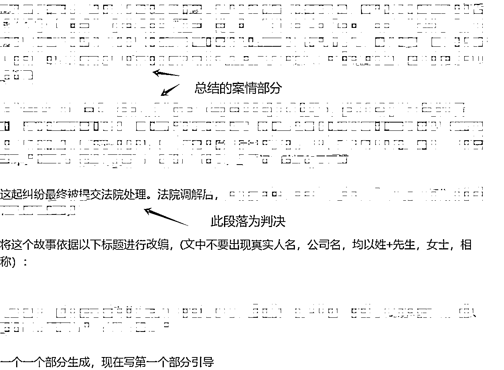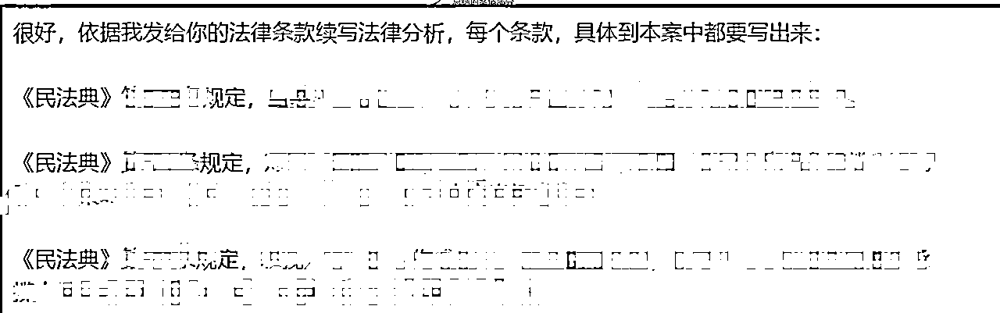这一步搭出雏形，参考案情和法律分析。接下来让AI再润色一遍，把案情和法律分析分别喂给它，按某位作家风格保持原意重写，或告诉它润色得通俗易懂。风格不限。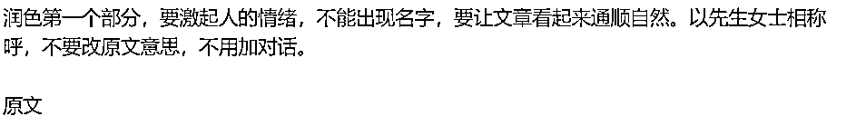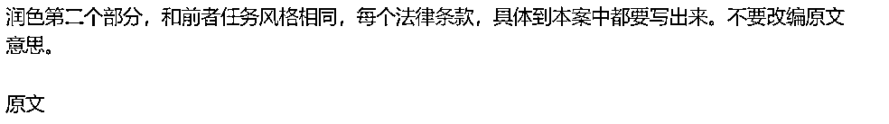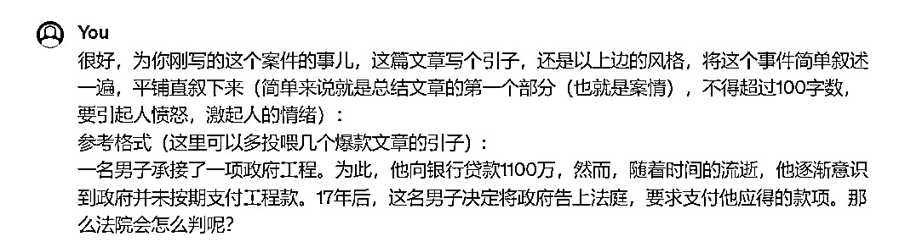四个部分对应引言、案情、法律分析、启示。最后人工细看：把润色稿放进秀米选卡片，逐句检查修改，再粘到👸号编辑页。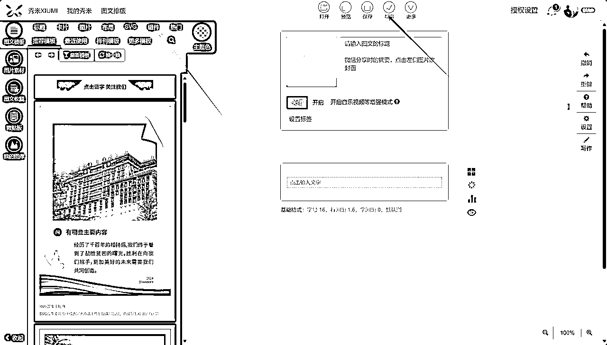

封面图片：GPT生成，投喂标题即可，不理想就指定画面；Midjourney用/describe反推关键词，然后/imagine输入图片链接+一个关键词+ --ar 16:9 --iw 2。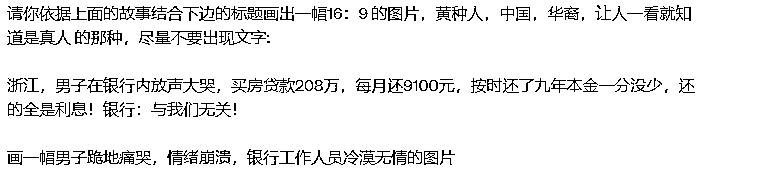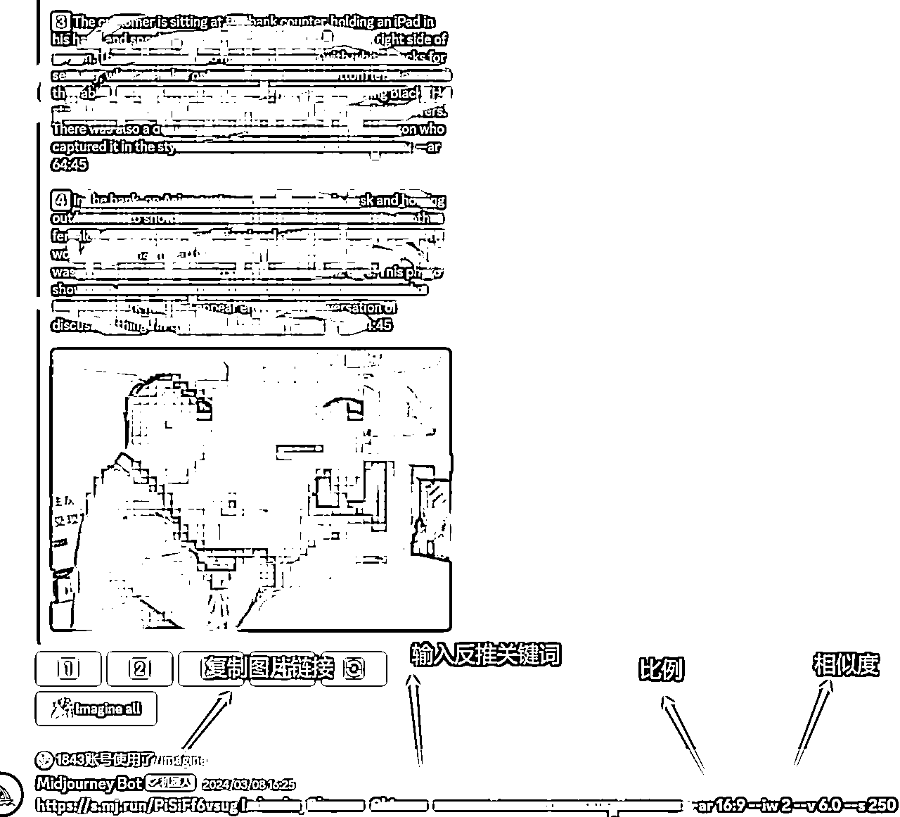

润色注意：句子不连贯，一个意思用逗号隔开；太机器化，总用“首先”“然后”；用词不准；缺真实感和情感；没有个性化观点。字数1000出头就能插两个广告。

排版简单明了，参考对标。结构：引子（图片）+案情（照片可有可无）+法律分析+结语。字数1000以上但别太多，影响完读率。文末引导关注、加免责声明。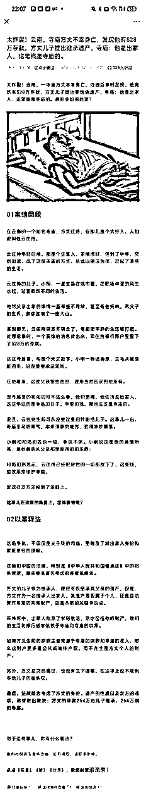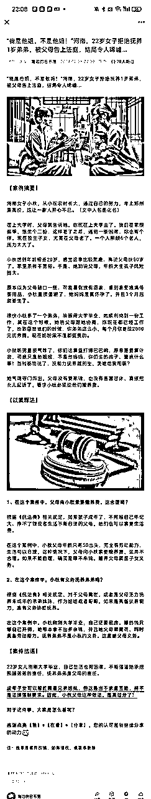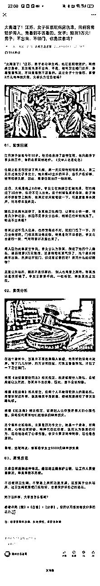

迭代：建素材库，省时省力；分析没爆的文章，是选题还是标题问题；分析爆文，是情绪、标题还是争议性；找亲戚朋友对比读，问感受；了解平台规则，从人性底层写。优化标题用爆款要素+AI拆解合成；内容开头设悬念，排版划重点，结尾引人思考引导关注。爆文因素中选题标题占大头，内容要有特点有情绪，能手搓就不全靠AI。

判断入池：阅读从几个涨到上千上万，内容分析里推荐占比大半，就是入池。单篇爆但整体没起来也别灰心，坚持日更，努力总有收获。

违禁词注意：不写具体人名，王强李刚；不写某宝某多平台名；不出现暴力、敏感词。法律案例赛道违规词多，选题选民事纠纷、民事案件，杀人强奸别写。可用句易网检测。

运营：不要反复洗同一个选题、重复发；一定开原创；心态放稳，私信有好有坏，负面不理会；爆款选题多人写正常，别乱举报，一个举报影响很大；保护账号，设置搜索不到。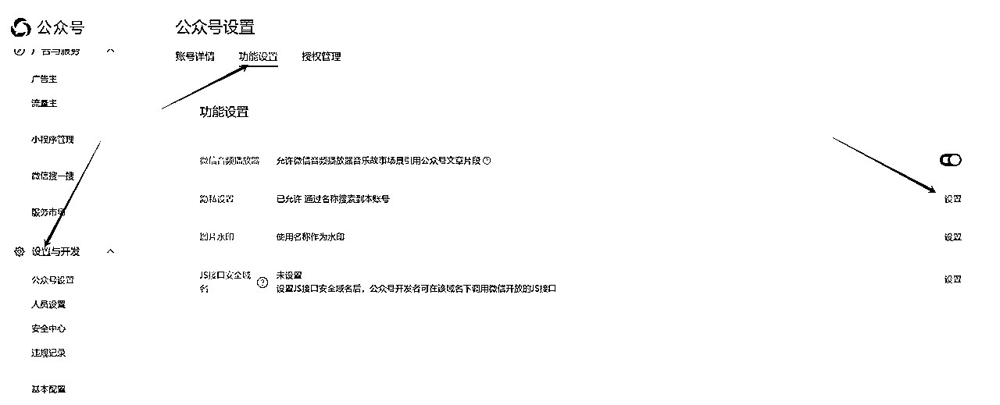

提高收益：每做完一篇，推测目标人群感兴趣的领域，把无用的广告划掉。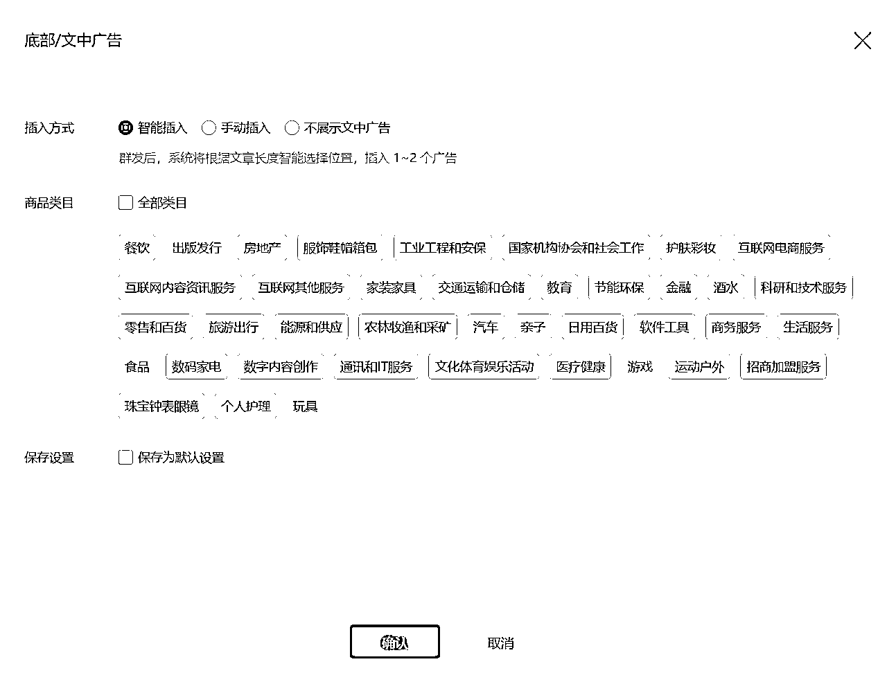

推荐机制：越垂直、原创越高、内容优质、阅读时间长，曝光越多。

心得体会：新手先做2~3个号，单号可能起不来，多少有点玄学；没入池前阅读可能个位数，别灰心，猛干；前期一天一篇，入池后两到三篇；互联网项目前期折磨人，做最坏打算，备足精力。

感谢12月航海的越越教练和云舒教练。越越教练认真指导标题思路，航海期间出了多篇10万+；云舒教练帮我修改写作指令，效率提高很多。今年9月底18岁，成年后考驾照，明年年初出去闯，多参加赚钱聚会，多付费破圈，提高认知，链接人脉。2024已过四分之一，祝各位财富翻倍，事业有成！