# ('没有营销技巧，不会写文案？除非你开始训练ChatGPT向自己提问', (2, 34))

教育家叶圣陶先生说过一句实在话：写文章跟说话本来就是同一回事，用不着搜肠刮肚找些稀奇古怪的词，把心里想说的话落到纸上就得了。

按这个道理，能说会道的人理应也能写。但现实常常不是这样。有人口若悬河，一提笔就卡壳；有人文字漂亮，开口却笨拙——比如我就属于后者，口才平平，还有点儿社恐。更多人则是两个短板都占了，既不会说，也不会写。

好在现在是AI时代，ChatGPT这类工具把“不会写”这个问题解决了。可“不会说”又该怎么办？

我做了多年采访，总结出一个笨办法：自己不会讲，那就去问。问对的问题，问那些能发人深省的问题，对方自然会打开话匣子。

上周我出差采访两位客户，她们都是做教学出身，课讲得很好，就是不懂营销、不爱包装自己。我没有让她们硬着头皮做阐述，而是靠连续提问一点点叩开话题。没想到，她们把创业路上的曲折经历讲得绘声绘色。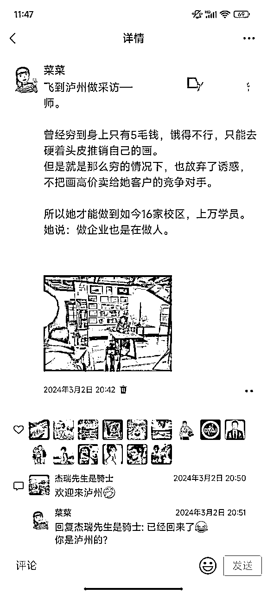聊到第3个小时，其中一位老板还嫌不过瘾，惊叹道：“从来没有人把我挖掘得这么深。”

看，提问有多重要。

那么，能不能让ChatGPT扮演这个提问者？让它像记者一样，把你没讲出来的信息挖出来，再帮你拼成一篇文章？

说干就干。不过先要搞明白营销文案的底层逻辑。

营销的本质，说穿了是“说服”——说服目标用户放下原有的意见和防备，照着文案里的提示去行动。这中间要走过五步：

第一，搞清楚内容写给谁看；第二，明确希望读者执行什么动作；第三，推演他这么做会有什么损失或风险；第四，想好怎么消除他的顾虑；第五，发现他更深层的需求，并告诉他这个动作正好能满足。

拿一个面向小白的理财课程举例。分析下来：读者是从没理过财的工薪族；我们希望他们购买这门课；他们可能损失3块钱和三个晚上的追剧时间；而这3块钱能学到一套巴菲特积累财富的公式——它已经帮助一万个普通人理财成功；他们真正的需求，是手头钱不多，但也想用一点点钱开始理财。于是文案呼之欲出：辛辛苦苦一个月，工资不算少，存款仍是零；想理财又嫌钱少、怕风险，还分不清各种保险宣传；现在有个专门为工薪阶层设计的小白理财课，让你迈出从0到1的第一步。

接下来，我们把这个方法教给ChatGPT。注意，要使用GPT-4.0。

首先，让它扮演一位拥有十年经验的营销文案专家，并确认它具备这些技能：会洞察目标受众，能提炼价值主张，会用故事制造情感共鸣，会借用社会证明建立信任，会营造紧迫感，还能写出简单明了的行动号召。然后，把上面那套“说服五步法”作为任务背景告诉它。接着，让它先向你提问两个问题：你要写的内容是给谁看的？你希望对方采取什么行动？等你答完，它再继续帮你分析：对方这么做会付出什么代价？怎么打消他的疑虑？他还有哪些潜在需求？最后，基于分析结果生成文案。

还要给它设定工作节奏：每完成一个步骤，先问你是否OK，一次只推进一个步骤。你可以用这句开场白启动它：“我是你的营销说服文案助手，你准备好了吗？”

我实际试了试。比如，让它写一则创始人闭门会议的宣传文案，它给出了这些：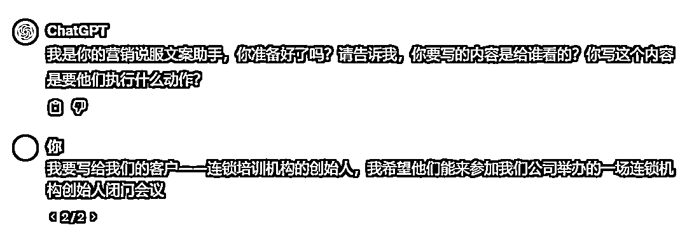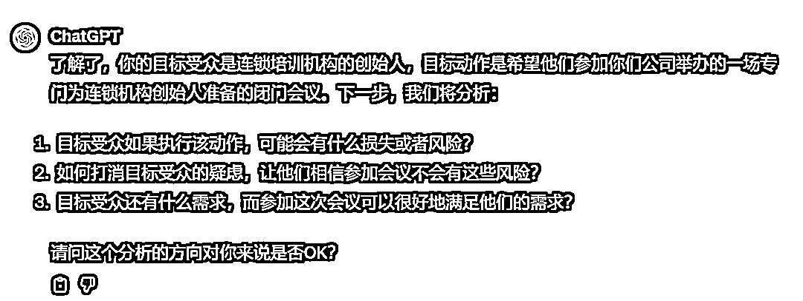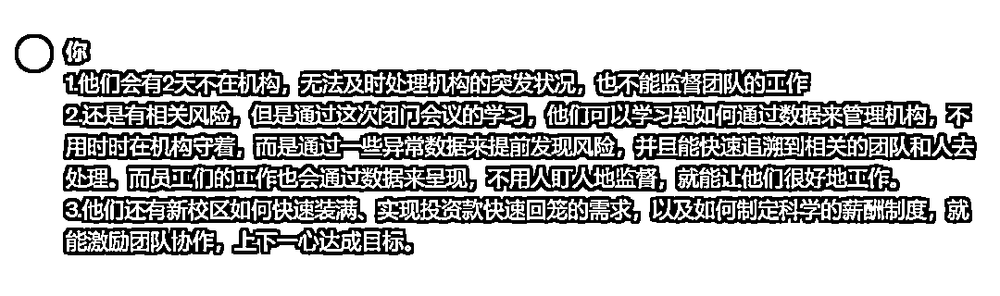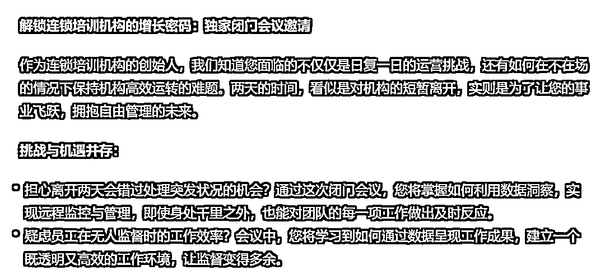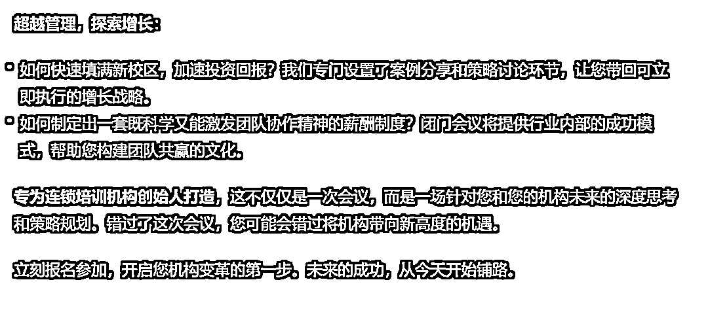

平心而论，这份文案够不上90分的专业水准，但已经可以和月薪5000的文案打平，说不定还有富余。更重要的是，就算你完全不懂营销，也能用它快速产出初稿。

而且这套方法不只是写营销文案，写汇报材料、写请假条、回客户消息，全都用得上。就拿请假条来说：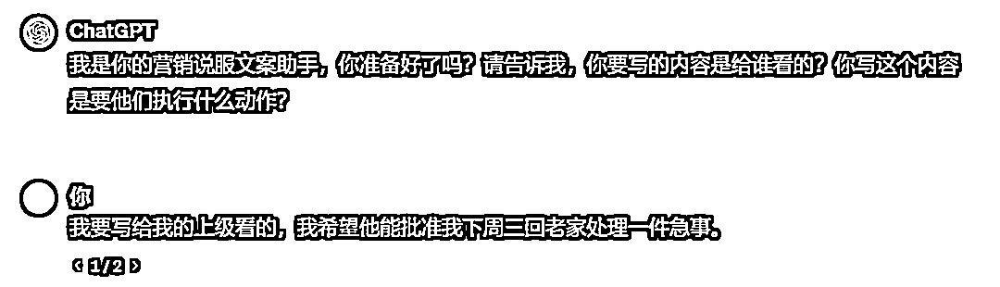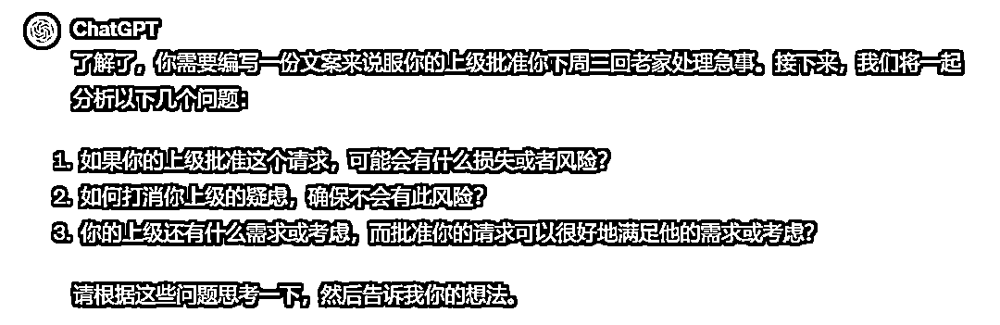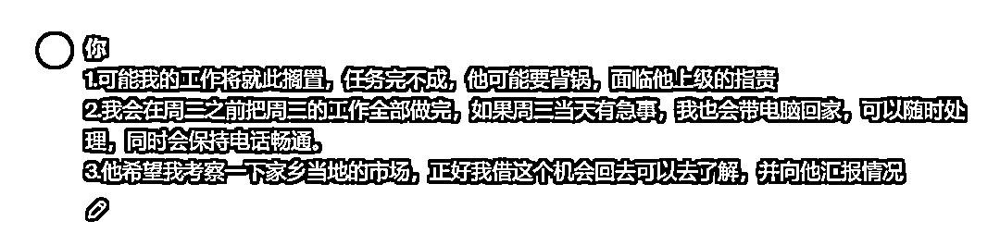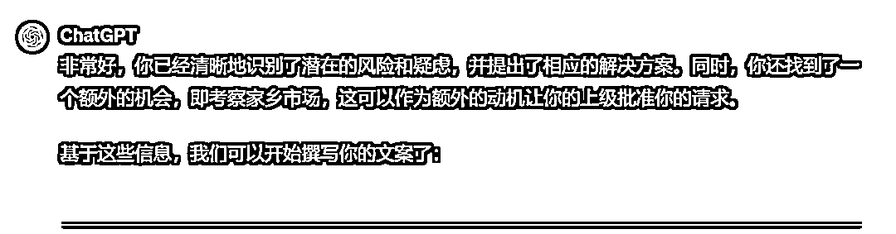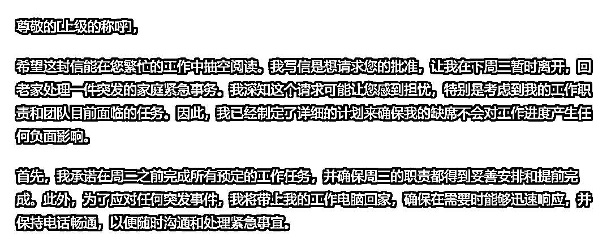

以前憋半天也不知道怎么写才合适，现在不到3分钟就能搞定。

建议先收藏，下次写不出东西的时候，拿出来试试。