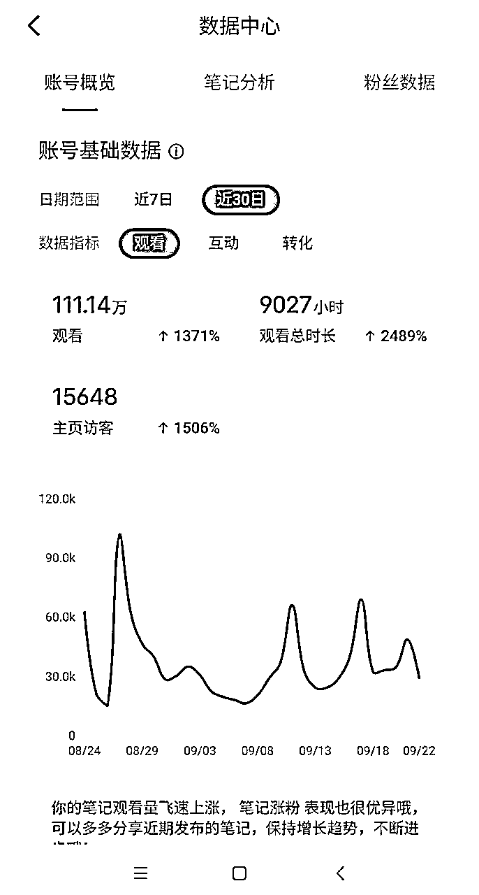
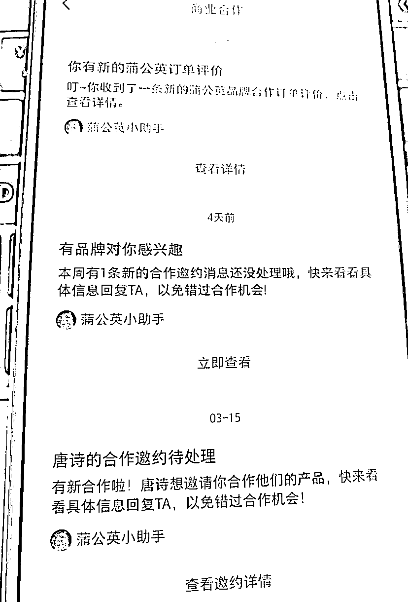
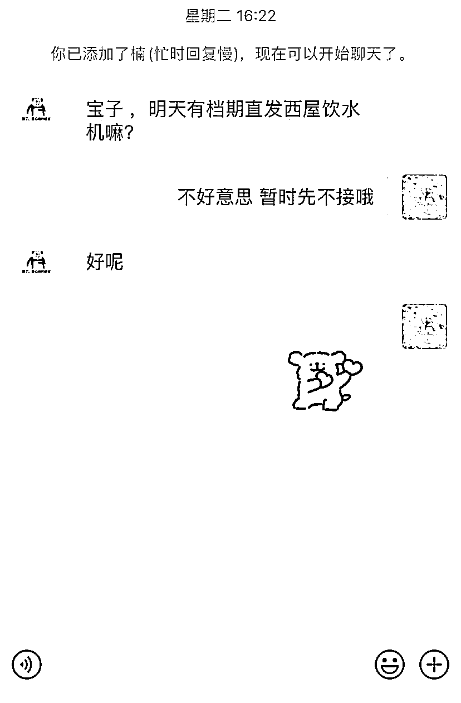
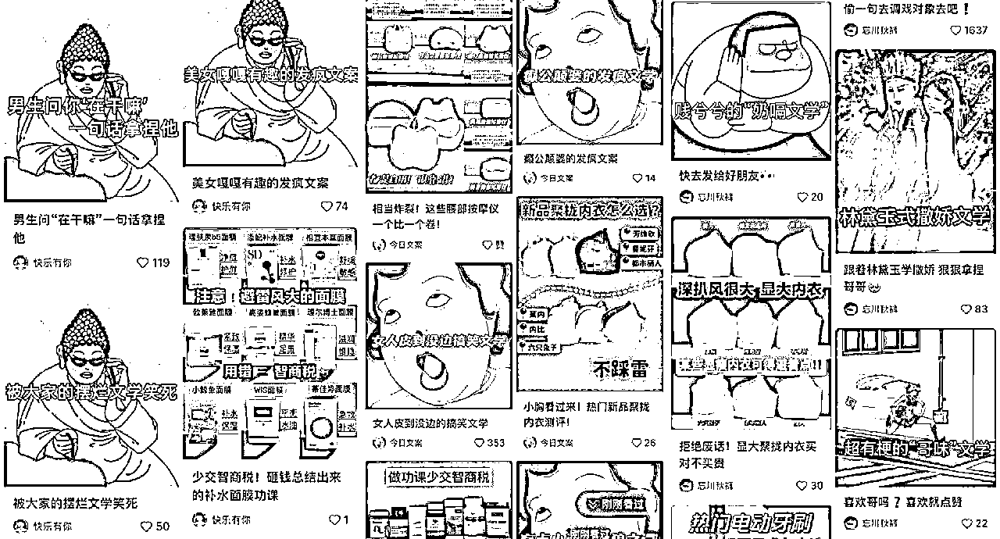
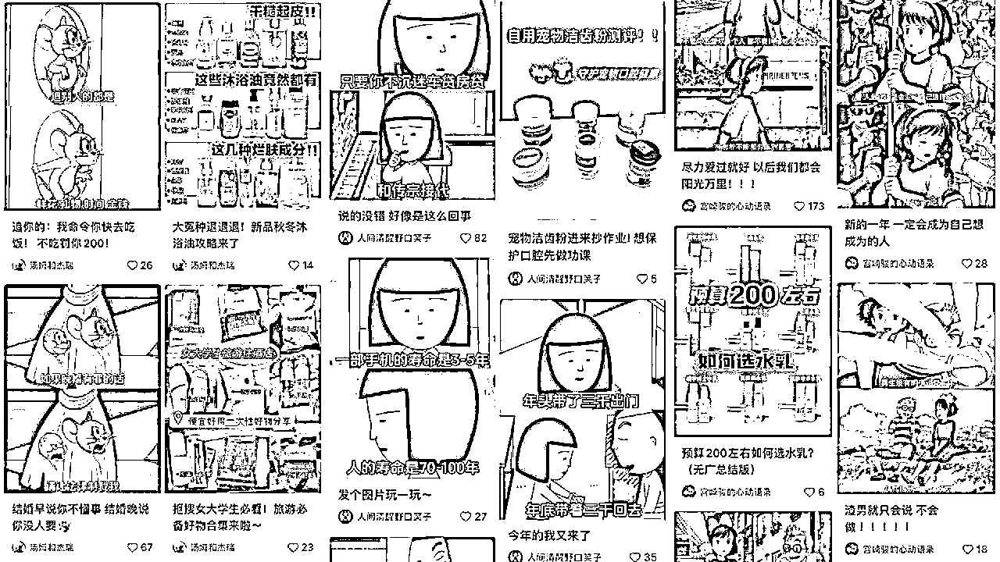
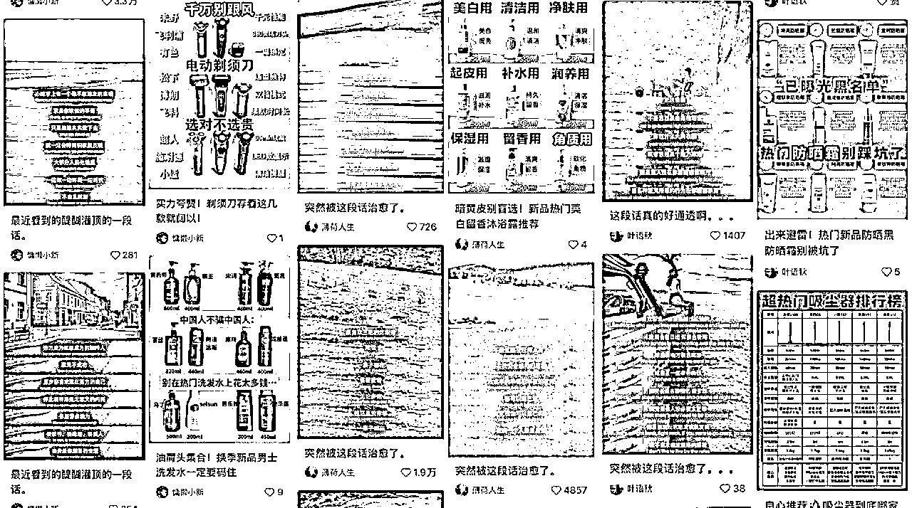
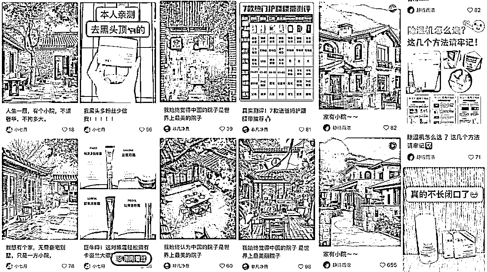
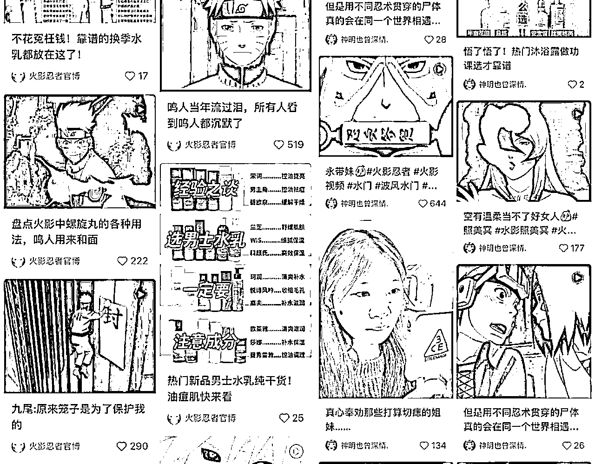
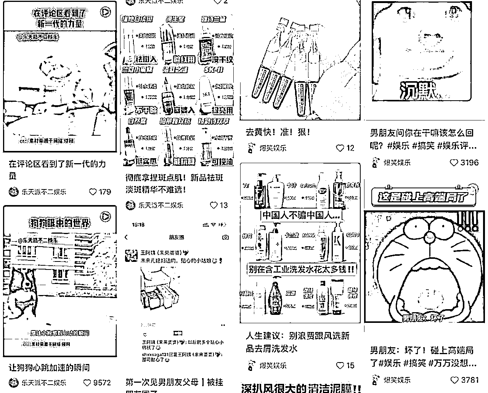
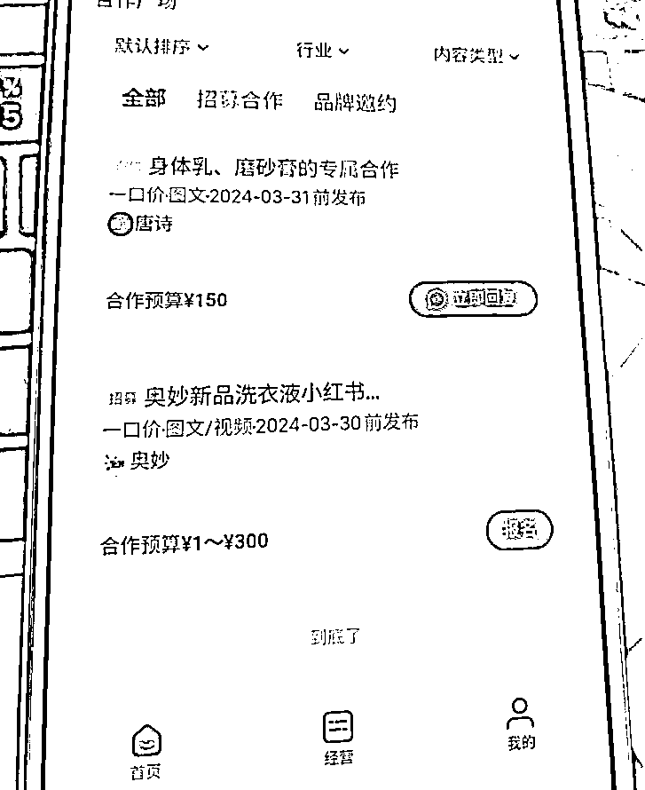

很多朋友问我，小红书广告号现在还值得做吗？我的答案是：值得，而且是个能长期细水长流的小生意。

我是去年9月才入局的，起步不算早，但到现在每个月依然能稳定收到广告邀约。这次小红书达人变现的航海活动，也让我更确信这个方向有搞头。今天就把自己跑通的经验整理出来，不吹不黑，赚大钱不敢说，但靠它每月添点零花钱是完全可行的。

**一、先搞明白：小红书广告号到底是什么**

简单说，小红书上的创作者基本都以开通蒲公英接广作为目标。要接到广告，账号得满足几个条件：

1、粉丝数量达到1000以上

2、笔记平均阅读量超过1000（部分广告主要求更高）

3、账号名下要有爆款内容

**二、入局前要准备的清单**

1、一部手机、一张电话卡、一个注册好的小红书账号，记住一机一卡一号的黄金法则

2、年满18周岁的实名认证信息，因为千粉以后开通蒲公英需要实名

3、每天能固定留给内容更新的时间

**三、为什么说这件事能长久干**

首先，投入的精力真的不多。只要锁定合适的内容方向，每天按部就班更新涨粉就行，几乎不用废太多脑子。

其次，广告主的投放逻辑在变。现在越来越多的品牌看到了小红书的价值，不光盯着大博主，更会大量铺向素人和中小博主，用数量换声量。

再有，广告投放有明确的高峰期。像双11这种大促节点，还有新年这类节日，广告主的预算会明显增加，平时则相对平淡。

**四、也要认清几个现实限制**

1、收入来源比较单—。如果广告主不投了，账号基本没有其他变现出口。

2、同类账号竞争激烈。做的人一多，就只能拼价格，要么返点给得更多，要么单价往下压。目前市场上每篇广告大概在150块，遇到强势的广告主可能会压到120，或者要求20%的返点。

3、单个账号的收入有天花板。接广太频繁容易废号，蒲公英平台有等级考核，从优秀掉到普通之后，广告邀约就会越来越少。再说广告主都会看数据下单，数据不好看也没人找你。如果能积累大量广告主资源，做到每天一个广，单账号的月收入就相当可观了。

**五、怎么挑内容赛道**

选赛道就看这几点：能不能出爆款、能不能稳定涨粉、产出效率高不高、数据是否稳定、有没有广告主愿意投。

**六、几个上手友好的赛道参考**

（1）表情包文案：一张有趣的表情包+一个抓眼球的标题

（2）动漫语录：经典动漫画面+人间清醒的句子

（3）治愈系文案：温暖人心的文字+舒服的配图

（4）AI治愈图视频：AI生成的画面或让图片动态化

（5）动漫剪辑：热门番剧的高光片段

（6）娱乐剪辑：也就是营销号玩法

其实还有很多低门槛的赛道，你只要刷一段时间同类账号，就能发现更多能接广的账号类型。

**七、接广全流程走一遍**

先开通蒲公英并完成实名。合作广场里会挂出招募信息，看到合适的“直发笔记”就可以报名。后台也可能主动推合作邀约，要及时加微信对接。

加上好友后，主动发账号主页链接给广告主或PR。

接下来就是常规的商务沟通：对方通常会问今天或明天有没有档期，确认档期后让对方在蒲公英平台下单，然后去后台确认，等对方发来笔记内容，在自己账号上发布，经过平台和广告主双重审核，就算完成一单。

**八、关于MCN机构**

粉丝过千后，会有不少MCN来私信你。一些机构手里确实有资源，刚开始会推几个广告，但后面基本就没什么动静了，很多人最后都选择退出。如果你自己能直接触达广告主，就没必要加MCN，因为机构要抽走广告费用的10%到20%，结算还得过他们的手。

**九、最后几点心得体会**

1、这个项目的命脉在于保持数据稳定，让蒲公英等级停在优秀档，才更容易接到广告。

2、广告主资源就是收入命脉。每个月接多少单，直接决定你能赚多少。如果长期接不到广，那更新就成了给平台做免费劳动力。

3、想放大收益就做矩阵号，争取直接对接广告主，一次投放就能把自己的几个号全带上。