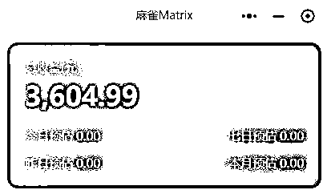
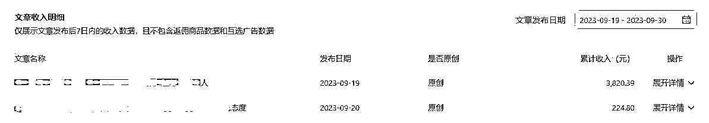
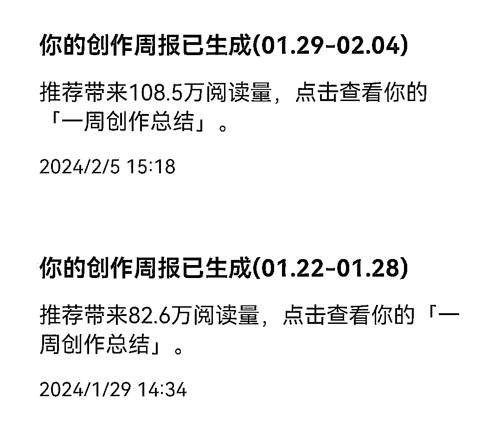
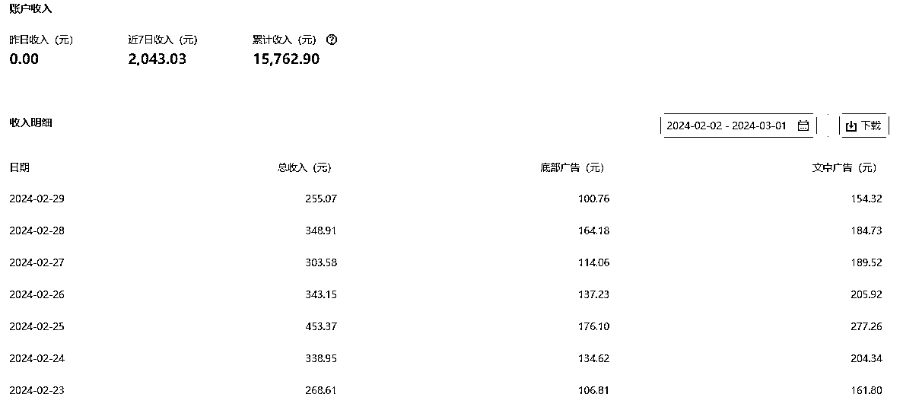
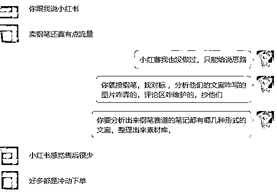
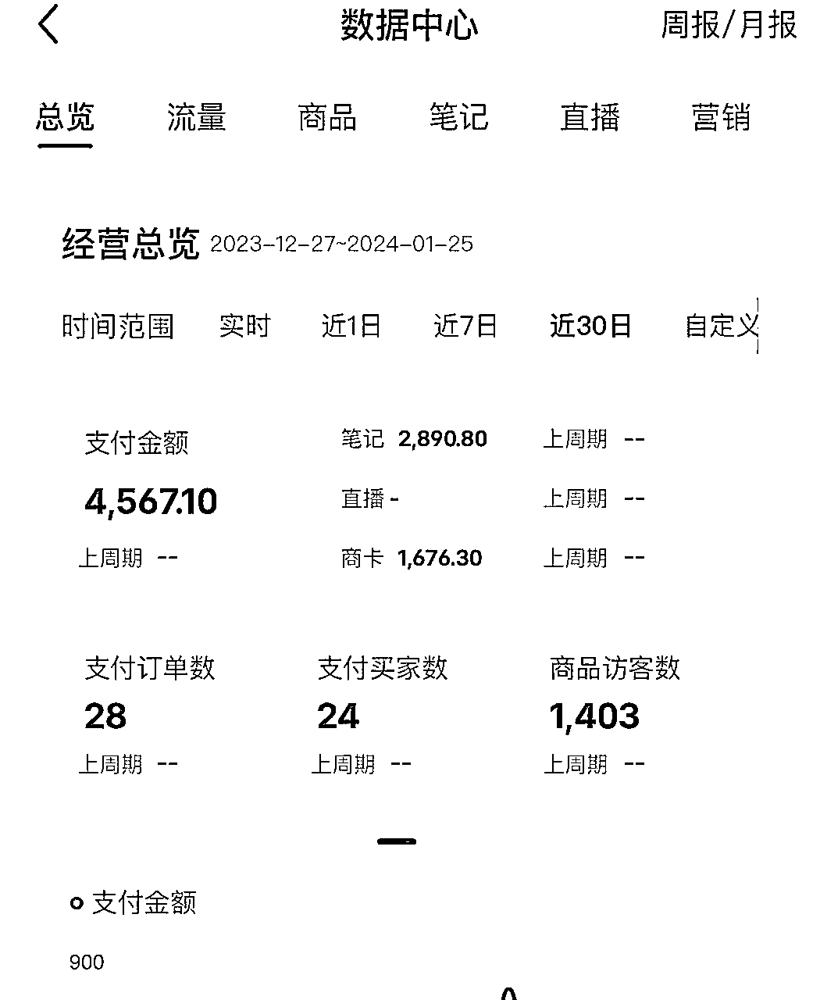
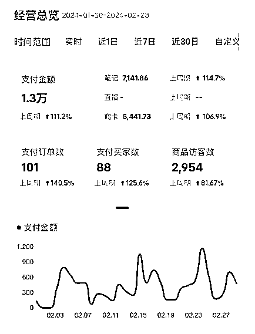

# 我加入赚钱2年，从一个什么都不懂的小白到也能帮助身边的人拿到一点成绩，并在赚钱赚到了10倍门票
作者：龙哥

在赚钱待了两年，我从一个完全不懂互联网项目的小白，到现在不仅帮身边人做出了一点小成绩，自己也把门票钱翻了十倍赚回来。这篇不是引流，纯粹是复盘。

先简单介绍下自己。我是龙哥，性格偏内向，不爱说话。进赚钱之前只跟着雪姨撸过货，偶尔赚点零花钱，对互联网各种玩法完全没概念。2022年4月，被雪姨拉进赚钱，一下就懵了——满屏的精华帖，眼花缭乱。每天刷各种赚钱项目，看得兴奋，但根本不知道自己能做什么，也不懂怎么利用这个宝藏库。对航海更是一头雾水。我做事比较随缘，执行力一般，没人按头催，就按自己的节奏慢慢磨。

第一次参加航海是6月份。雪姨建议我结合职业背景选shopee跨境电商或者Google插件开发。我好奇选了shopee。开店需要个体工商户执照，还要三个月其他平台的流水，我一样都没有，卡了很久。后来群里有人说淘宝花两百多能搞定，我就去办了，顺利开了台湾站，还买了件一键采集软件，每天从拼多多搬运商品到虾皮。选品基本靠感觉，航海手册也没细看，坚持一个月，零咨询，放弃。

这个项目让我对电商有了基本认知。回头看，做跨境要么有选品和运营能力再找货源，要么本身就是供应商，我两头都不占，赚不到钱很正常。那段时间我把赚钱里跨境电商的精华帖翻了不少，意识到光靠自己很难做起来。这次也让我看清短板，后来短视频带货、📕店铺航海，我都没碰。

第二个项目是短剧CPS。23年初，好几个圈友发帖说这在风口，我加了思蒙，进了他的陪跑训练营。他设了21天押金打卡，还给了一份SOP手册，跟赚钱航海差不多，照着做就能上手。加上直播讲剪辑去重技巧，群里有人分享经验打气，大家天天晒收入，氛围很燃。靠这个我赚了三千多，把门票钱赚回来了。后来行业越来越卷，我就没继续。

这个项目让我学会不少东西：抖音运营逻辑、赛马机制、剪映剪辑、去重方法、找爆款和分析拆解爆款。也搞懂了短剧链条上发行方、平台、代理各自的作用，认识了CPS这种模式，甚至觉得互联网项目都能用CPS放大——红包封面CPS、手游CPS、考研资料代理，都是同一套逻辑。

说到心态：新手做项目，没正反馈很难坚持。第一天发视频，第二天就想要流水，但抖音需要持续输出、复盘优化，可能要坚持一个月才出一个爆款。出爆款就能赚几千几万。创业和打工不一样，不是干一天拿一天工资。每天都有未知问题，能解决的人才能赚到钱。

第三个项目是👸号爆文，去年9月参加航海。我完全没有写作经验，之所以敢去，是因为ChatGPT出现了。很多人应该和我一样，想让AI写文章撸流量主收益。我当时就让AI洗稿爆款，运气不错，航海期间爆了一篇18万阅读，赚了3800多，还发了航海好事。但我不小心暴露了👸号——小程序流量主截图有个水印没打码。之后文章被人举报掉原创，账号再也起不来。

复盘时想，当时应该立刻改👸号名，但没做。更关键的是洗稿走不通。账号一有流量就暴露在同行面前，洗稿很容易被举报，而且大家都洗，同质化严重。长期洗稿，就算爆过，流量也会慢慢枯竭。爆文起号周期长，如果一个号更了30多天还没入池，就该注销重开。教练说过，但我心存侥幸，浪费了很多时间。

去年12月，我决定换赛道。开始学写作，手动拆解爆款，花心思调提示词，不再是简单的洗稿。我可以借用A文章的故事背景、B文章的结构、C文章的人物性格，组合成一个全新故事。这里只是简单说思路，实际稳定提示词要调试很久。我注册了新号，连续发到第21天，出了第一篇10W+。之后一天发三篇，几乎每天都有爆文，之前20天的文章也跟着有了流量。一星期后流量稳定下来，现在没有爆款时也能日均四五万浏览。虽然流量主收益不如以前，但还能做。晒下两个月的成果：

不知道从什么时候起，每次新航海开始，我都会把所有手册看一遍，看更新了什么。有些项目没做过，但能了解整个流程，以后需要就能快速上手。看得多了，也能给朋友一些建议。

几个月前，一个妈宝朋友问有没有赚钱项目。我详细问了他的情况，他说他哥哥卖钢笔，做了很多年，有稳定货源。我建议他做📕店铺，然后翻出赚钱的航海手册，帮他整理了一份SOP：怎么开店、怎么找对标、用什么分析工具、视频怎么做。结果他第一个月流水四千多，第二个月冲到1.3万，账号只有400粉丝。

最大的改变是赚钱认知的提升。以前看到一个项目，完全没有赚钱的概念，也不知道公域私域。现在看到一个项目，会去分析他赚的是什么钱。比如👸号流量主，赚的是平台的钱，平台的钱来自广告主。想写出爆文，就要研究平台算法、写作技巧，还要懂人性，给读者情绪价值。这些现在觉得是基本盘，但以前根本没意识。

另一个转变是从打工人心态到创业者心态。要接受失败，接受不确定性。事实上，不确定性才是真实世界。有时候全力以赴也赚不到什么钱，但经验会让我们下次少走弯路。比如我shopee时期办的执照，做👸号时直接能用了。现在还有人问我怎么注册执照。

做过足够多项目后，会发现很多事是相通的。无论爆文、短视频还是📕，无非都是找爆款、分析拆解爆款、发布、复盘、遇到问题解决问题。练习多了，就有网感，也能一眼看出项目靠不靠谱。就像写代码多了，看到某个功能模块就能猜到需要多少API接口、参数怎么设计。

很感谢赚钱让我成长。现在赚钱对我来说就是一个强大的项目资料库，看到互联网项目不知道玩法，进来找就行。既有实操手册，又能链接到专业的人。有什么新玩法，总有人第一时间发布。我也越来越离不开它。总结一下，这些项目加起来大概赚了2.5万，算下来差不多是10倍门票。最后感谢雪姨带我进来。