# 📕官方义乌线下沙龙，信息量有点大！
作者：龙哥

📕官方第一次跑到义乌开线下沙龙，直接把底牌亮了出来。整场听下来，信息量真的很大，全是干货。

开场先放了一段平台宣传片，画面里都是那些温暖、有趣、又容易爆的笔记。说实话，看完有点燃，恍惚间像是当年B站的《后浪》，让人觉得📕这个社区正在往上走，生机勃勃。

这场沙龙就是专门给义乌商家办的。官方的意思很明确：📕正在长大，缺口很大。义乌有这么多电商、供应链、生意人，别都挤在抖音拼多多里卷了，来📕试试。平台给流量、给矩阵、开白名单、送培训，甚至帮你用AI做内容。

为什么这么主动？因为📕的搜索用户、种草用户、高价值用户基数很大，但平台上的商品供给跟不上，商家数量也不够。说白了，这就是官方扶持期的红利。

对我来说，这也是个难得的学习机会。一方面想看看📕官方团队的精气神，拿自己和他们比一比，也检验下如果我去📕找工作，够不够格。毕竟我从深圳漂到上海，又从上海漂到义乌，打工人身份一直没丢。另一方面，更想听听平台接下来的新动向，尤其是我们做C端时接触不到的B端玩法。平台要赚钱，必须靠商家的产品来承接，所以这场讲的都是真话。B端的产品直接决定了📕能不能赚到钱，有了钱才有机会拿更多投资、出圈、往海外走。出海是他们一直惦记的事，现场也明确提了。

还有一点很关键：在我们常玩的这些平台里，📕是少数没有“墙”的。B站出海靠YT，抖音出海靠TK。Ins虽然和📕有点像，但搜索、图文、干货、攻略这些维度，📕优势更明显。所以对我们来说，聪明的做法就是跟着平台一起长大，而不是像抖音现在这样，卷到连狗都嫌。

这次沙龙的主题锁定在“家居+日用百货”。选这个赛道不是拍脑袋，家庭必需品、复购率高、义乌供应链又强，官方肯定是看了大量数据才定的。他们也说了，这是第一次来义乌做线下，可见对这里的商家抱了多大的期望。

聊生态的时候，官方也承认，很多老板是从抖音起家的，换到📕有点水土不服。我身边不少老板也抱怨，招了📕运营却没什么水花，更别说做到抖音那种24小时直播、店播、达播的规模了。但反过来想，正因为大家还没玩明白，📕的机会才更大。抖音现在已经卷成什么样了？狗路过都得多看两眼。

官方全程反复强调一个点：以“人”为出发点。直白说就是讲人话、做实事。📕用户喜欢什么，你就做什么。但也不是啥都做，不能什么都想要，既要又要还要，那是想peach。落到我们身上，就是找准目标人群，戳到他们的痛点，挖出真实需求，给出解决方案，把内容做好，把成交搞定。

关于种草触达，其实我们每天刷📕都在经历：先随意浏览首页推荐，再搜关键词，然后挑喜欢的笔记看反馈，最后影响买不买、买哪个品牌。这里就有个大问题，也是📕急着拉商家下场的原因：用户被种草了，转头跑到淘宝拼多多下单了。所以📕拼命搞电商闭环，让用户在这里被种草，然后直接在这里下单，把客户留在站内。就算你0元0粉无货源，也能来玩，但客户必须留下。这就是KFS种草：Kol内容种草、Feeds推荐流量、Search搜索承接。

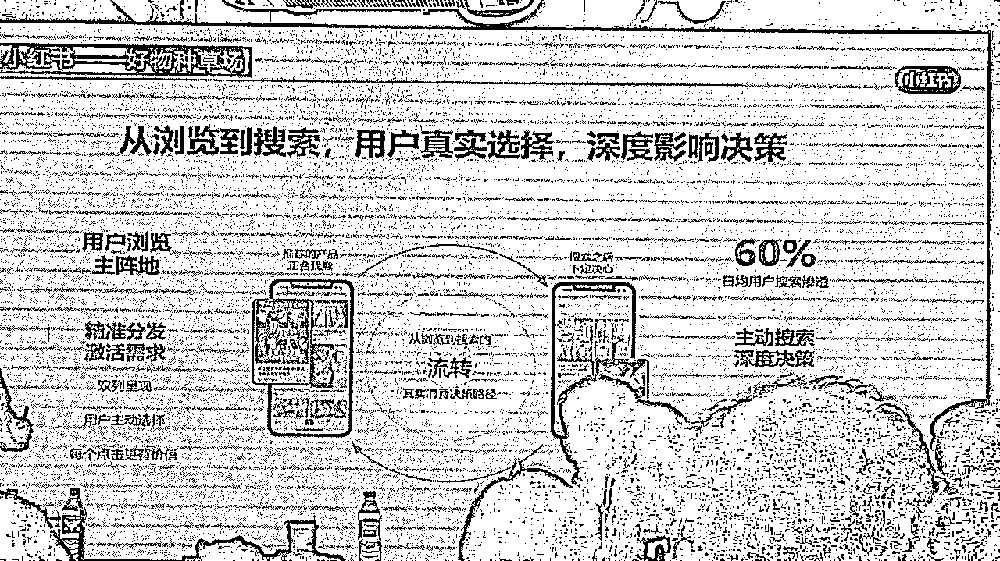

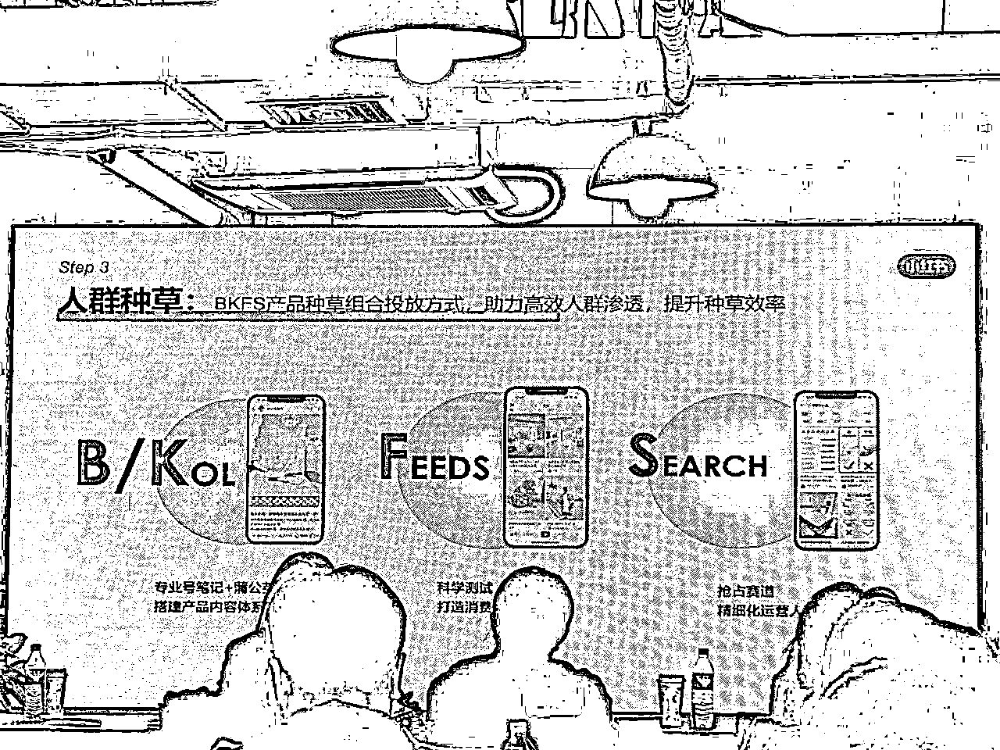

官方还展示了后台数据，完整演示了用户从被种草到下单的全过程。这也是他们反推给商家、指导大家怎么做内容的一部分依据。

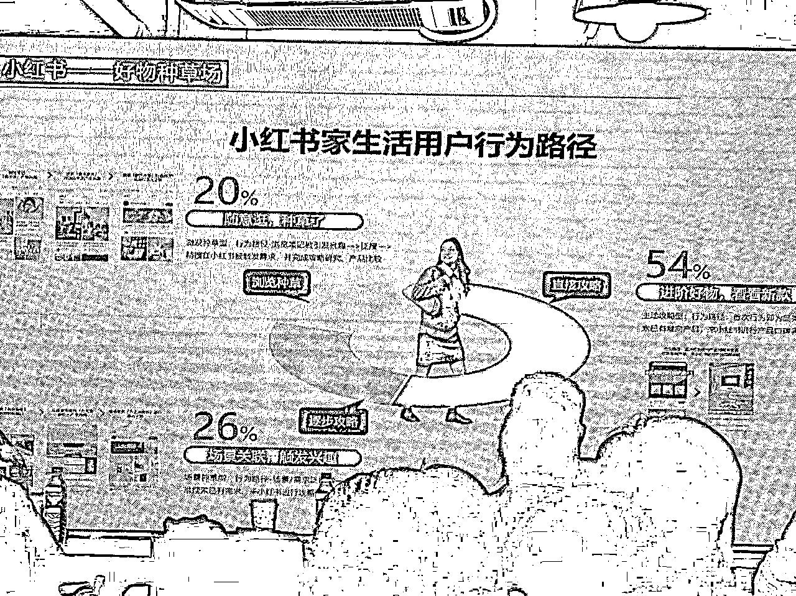

品牌种草案例环节，其实是给商家吃定心丸。官方拆解了一个品牌从策划到落地、跑通闭环的完整链路。既然能跑出一个成功案例，就说明这套玩法是可以复制的。毕竟流量攥在平台手里，官方小二还会给你开白名单，帮你设计封面、定标题关键词，让你在SEO搜索里占据优势。只要你有货，大家互利共赢。具体细节也讲得很清楚：

第一步，先做品类搜索，看用户常用什么关键词，再根据他们的点击行为，找到优化方向。

第二步，确定笔记方向，照着用户喜欢的内容去生产，投其所好。

第三步，做搜索SEO，抢占搜索位，再用瀑布流投放扩大曝光。

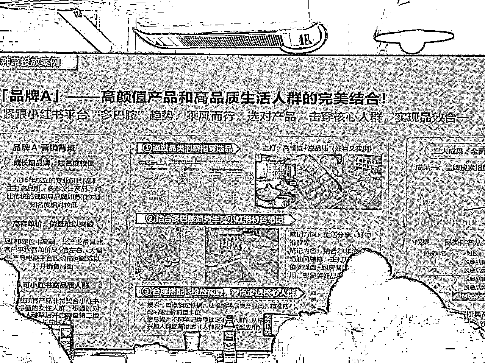

📕上带着购买目的来搜索的用户非常多，这些人天生就是潜在买家。关键词布局足够密，搜索加内容呈现，天然就是个“拔草场”。

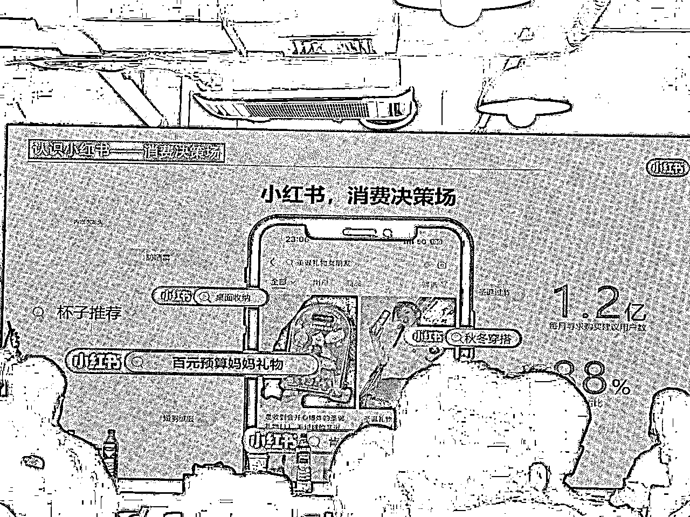

经营核心，官方总结得很干脆：笔记+买手+直播。看看现在的抖音，就能理解📕的打法。UGC负责内容；买手就是挂车精选联盟；直播则是给用户的一剂强心针，及时触达，临门一脚完成成交。

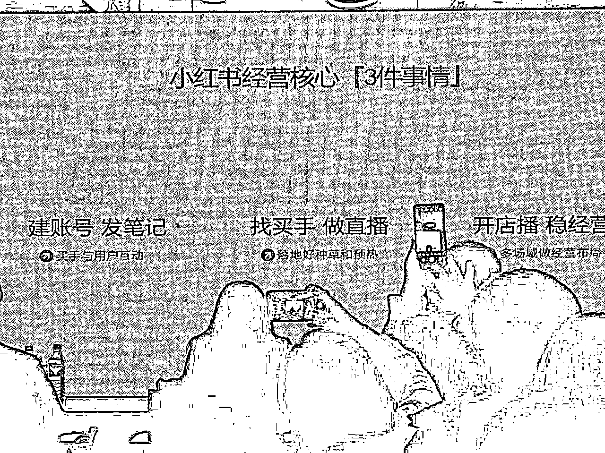

再说核心类目里的细分关键词。📕是搜索SEO主导的平台，以前大家有问题找百度，现在直接搜📕。用户搜什么，平台就知道他们关心什么、喜欢什么。人家都告诉你喜好了，你直接把东西备好就行。看笔记，我有内容，你去看；要产品，我有电商，你去买。

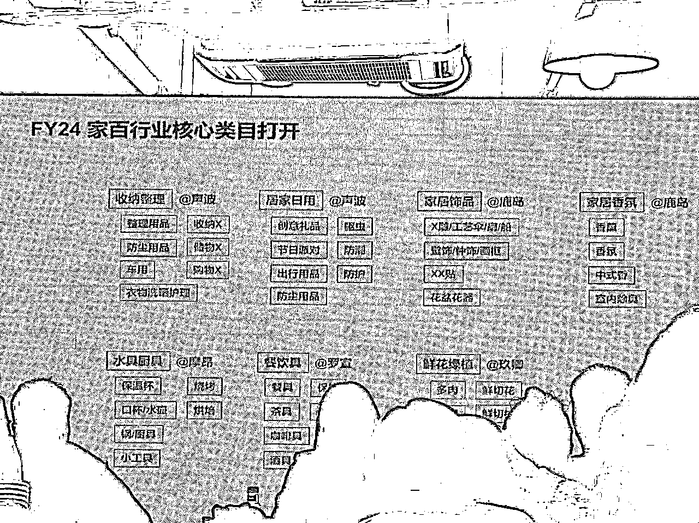

商家运营矩阵这套玩法，义乌老板们太熟了。拼多多店群、抖店矩阵都是这么跑的，大户全是矩阵操作。你搜一个关键词，出来我一条帖子，那我搞10个、100个号，光靠数量就能把关键词占满，是不是成交概率更大？就是这个道理。而且一个账号挂了没关系，还有几十个，再不行就再开几十个。打法就是这么野。

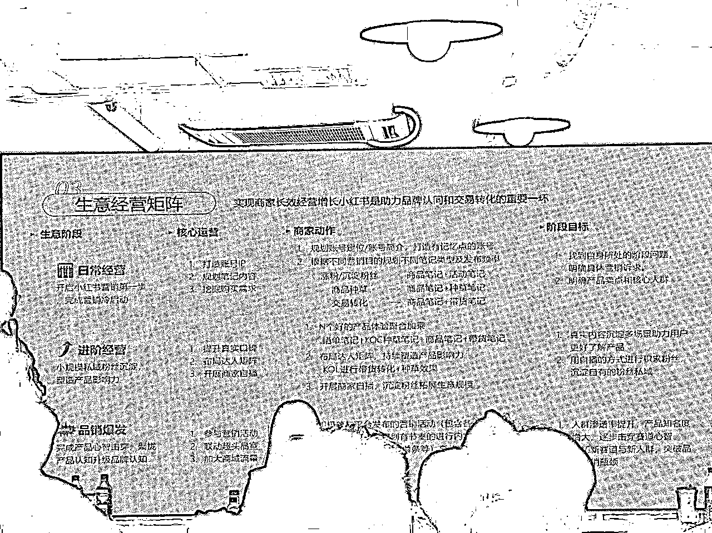

电商玩法跟抖音差不多，核心是“店+达人”合作。你的店要挂车、要卖货，自己力量不够，就找达人帮你带，人手不就多了？这等于组建了一支销售团队，店铺是龙头，达人是后面的销售大军。

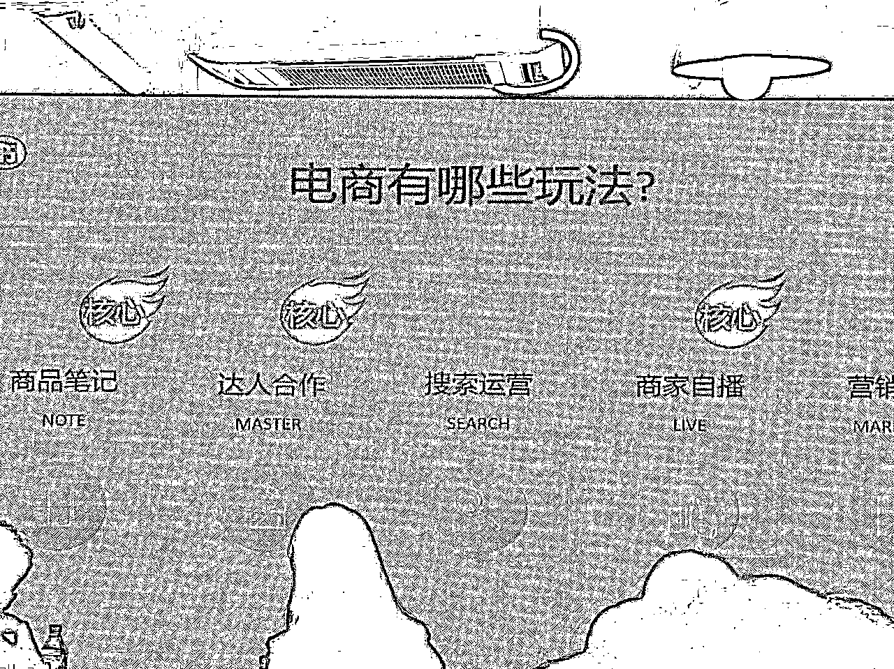

还有一个重磅：四月份📕要上线AIGC内容功能。这个很有意思。我们平时用的AI模型，靠投喂文案和图片训练，比如GPTs里的那些📕文案专家，也是喂了大量优秀案例才学会写笔记。可📕本身就是天然的投喂场，最懂自己内容和用户的就是它自己。所以📕亲自下场做AI，帮你把笔记生成好，这对商家来说又是一波趋势红利。不会写笔记？AI帮你。平台需要的就是笔记。当然问题也来了，AI生成的内容又简单又海量，以后刷到的内容，真实性恐怕要大打折扣。

📕笔记的形态比我们想的要丰富。有粉丝晒单，相当于买家秀，但以笔记形式出现，自带种草和商品链接，是个天然流量池。以后说不定会走“淘宝客”模式，有人通过链接下单，晒单的人就拿提成。还有商单，就是走蒲公英的报备笔记；带货笔记，买手挂车，千粉就能后台直接挂；再有就是店铺挂车，开了薯店的直接挂商品。

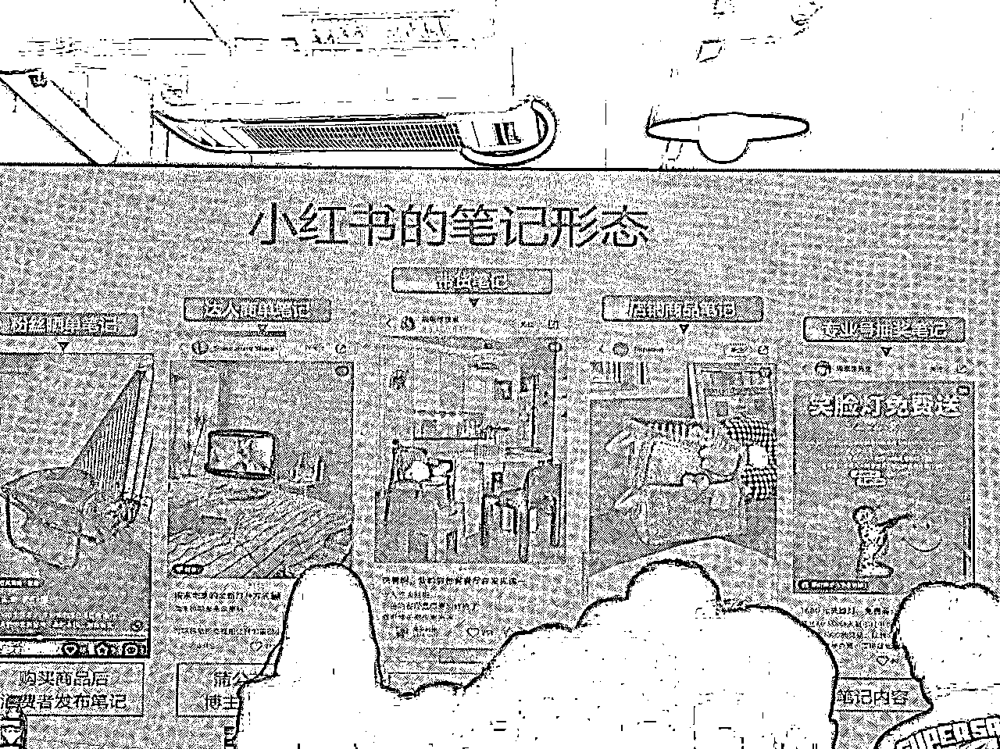

账号运营，不同阶段要用不同打法，官方给的方法当然更精细。笔记分活动、商品、种草三种状态，不能太硬广，得有种草感，但商单和活动也不能丢。

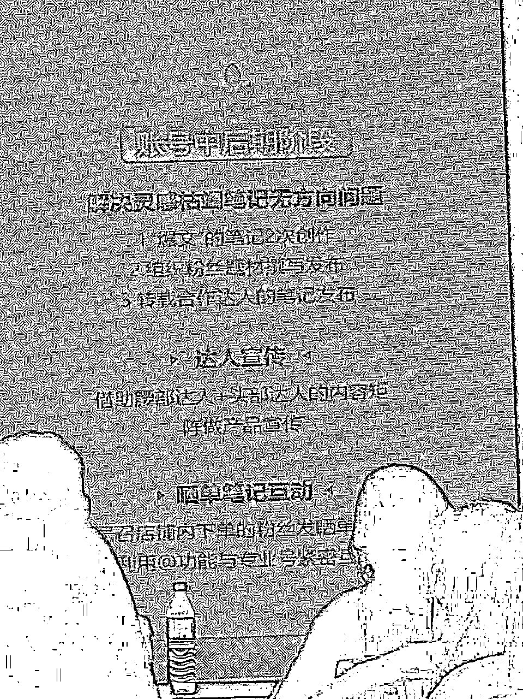

内容到底怎么做？绕不开人设、封面、笔记本身、赞藏和评论。笔记风格要保持统一，对IP来说，就是让用户先喜欢上你这个人，再转为粉丝，最后变现。而且人设的封面和内容也得跟品牌调性匹配——是高级感、日常风，还是多巴胺风，得提前想明白。

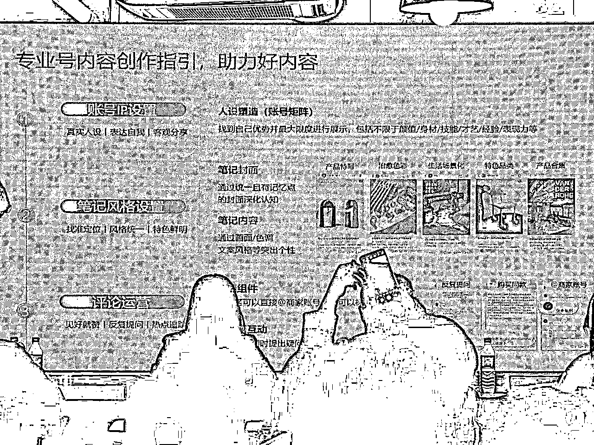

选题方法官方也拆得很细：开头语、标题、话题，每一层都有讲究。用户好奇、营销暗示、提问开头、生活带入、产品卖点、感叹效果、热点话题、人群痛点，这些都是直接能套的模板。

矩阵账号这块，沙龙上直接放了话：把过去店群铺货的打法搬到📕就行。跟做账号一个道理，搜到一个的概率，永远比不上一百个的概率。义乌商家是真够狠，现场填表，有人店铺数量直接过百。

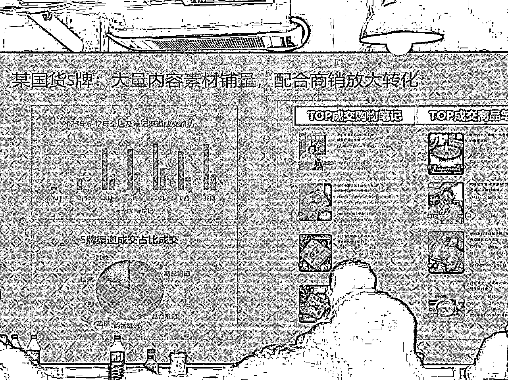

直播同样是重头戏。官方说得很直接：只要你开播，我就给流量，店播达播都行。之前玩抖音那套，在📕也能用，但“321上链接”那种少来。要以人为中心，设身处地为粉丝着想，他们会爱死你。但底层逻辑要记住：推流的核心是留得住人、转化得掉。所以直播运营做的所有动作都是为了留人，搞的一切减免活动都是为了把货卖出去。

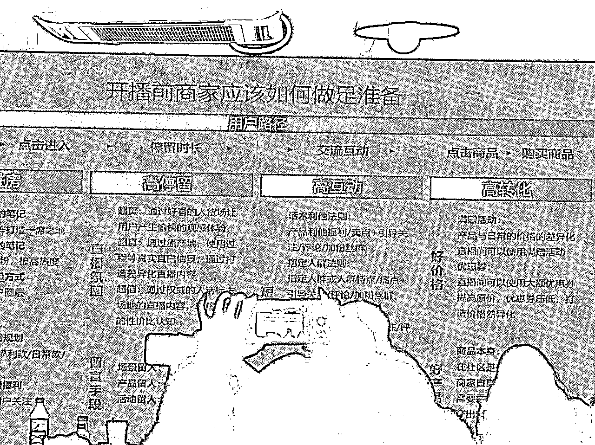

最后官方还讲了营销方式和电商闭环链路。

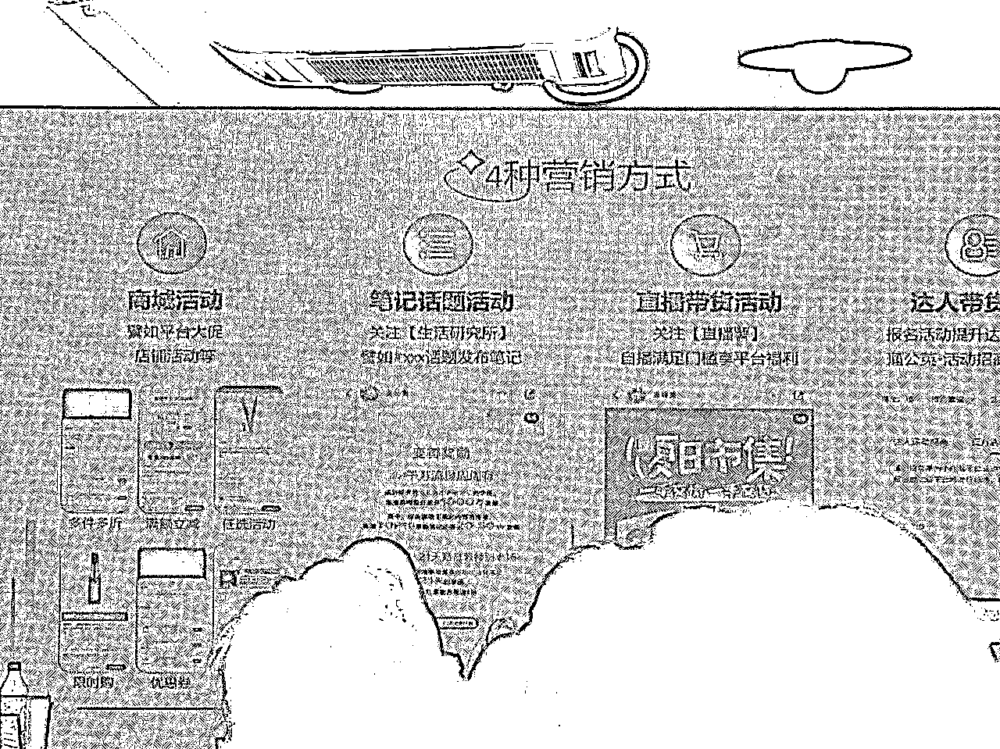

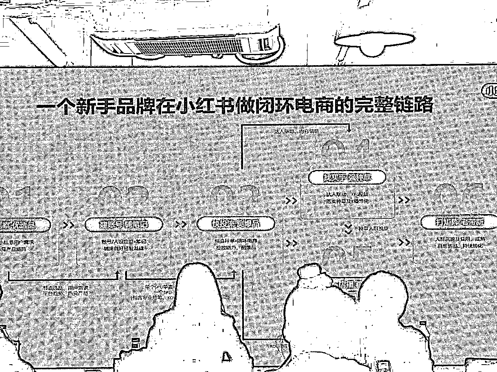

整场沙龙听下来，最大感受是：📕这次是铁了心拉义乌商家入局，流量、工具、AI、白名单统统安排上。平台还在上升期，早跟上的人大概率能吃到红利。接下来就看你是继续在抖音内卷，还是来📕抢滩登陆了。