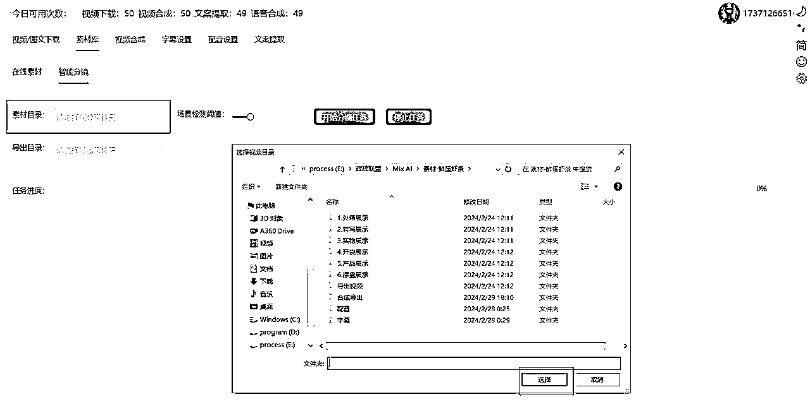
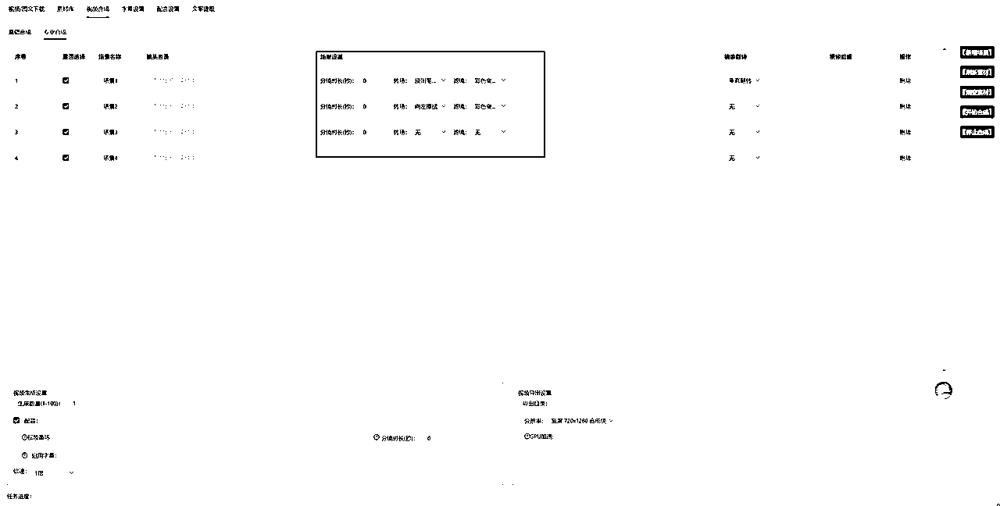
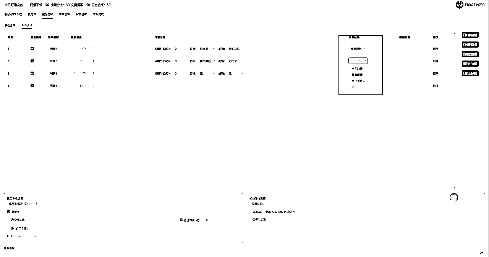
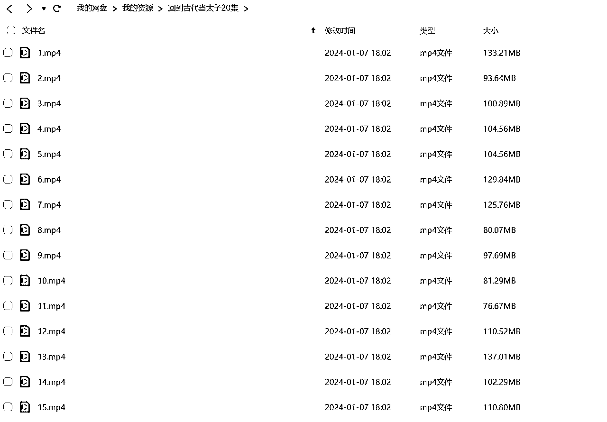

# 短剧批量混剪SOP，批量生产素材

短剧混剪怎么批量搞定？这份新整理的SOP流程，直接照着做

最近有个短剧运营客户找过来，他们公司直接向版权方买下短剧版权，再把授权分发出去给达人用，自己也做矩阵分发。这次想让我们针对短剧混剪场景定制一些功能。

说实话，我们的软件从来不限制具体场景，但之前更多被用于好物分享类短视频，因为这类内容对声画匹配要求不高。我们过去也没专门死磕“去重”这件事，一直坚信一个理念：混剪就是最高级的去重。只要素材库足够庞大，撞车的概率自然会降到最低。

可短剧偏偏是个例外。一部剧的镜头就那么多，你没法自己补拍，大家又都薅同一部剧，分分钟让内容重复度飙升。所以我们必须围绕去重做文章，让生成出来的成片每一条都尽量不一样。

我平时刷抖音也留意到，当前短剧混剪的主流玩法基本分成两条路线。

第一条是原片原声直接混。这种方式很生猛，把原片按场景拆成小段，再重新拼合成新视频。用剪映的智能分镜可以快速拆条，之后重新排列组合就出片。真正的难点，是怎么让整套拆拼流程批量跑起来。

第二条是配音+视频混剪，也就是常见的解说视频。先用GPT生成一份文案脚本，再用配音软件跑出解说音频，最后把原剧画面叠上去，一条解说视频就有了。这种视频的核心是解说，而短剧本身就是高能片段串烧，两者搭配起来效果相当不错。

结合我们Booms已有的功能，我把这两条路线各自梳理成了一份SOP。不过要让流程完整，还差两块拼图：一是批量智能分镜的素材处理能力，把第三方素材转化成可复用的素材库；二是增加合成视频的随机性，降低重复度。所以，我们推出了智能分镜和专业合成两个功能。

一、智能分镜：批量拆素材的神器
这个功能可以直接对本地视频做智能分镜，分镜文件保存在本地，之后随时可以作为二创素材使用。
操作并不复杂：先在素材目录里选择在线素材文件，再按需调整参数。记住关键点：场景检测阈值越大，分出来的场景越少；阈值越小，分出来的场景越多。默认参数就能得到不错的效果。

二、专业合成：让每段画面都听话
相比基础合成，专业合成可以对每个场景单独做精细设置，让最终视频的节奏和画面都更可控。

在场景设置里，你可以分别控制每个场景的分镜时长（单位秒）、转场效果和滤镜。转场默认是“无”，也可以一键选择随机转场；滤镜则能给当前场景叠加氛围，想统一风格很方便。

镜像翻转也很好用，它能对当前场景视频做水平翻转、垂直翻转，或者水平垂直双翻，等于在剪辑里又加了一重随机变量。

这样一来，生产路径就很清晰了：先用去水印下载功能把抖音素材下载下来，或者直接拿版权方给的素材；接着用智能分镜批量拆条；最后丢进批量合成。整套流程跑下来，素材和随机性都不缺。

比如这组案例，从抖音下载的素材经过智能分镜后，直接拉出了大概500多个分镜片段，素材库瞬间厚了起来。

这些分镜片段还能按场景分类，之后导入批量混剪里继续排列组合，新作品一条接一条地出。

三、官网下载：http://dis1.aimix.pro:82/index.html