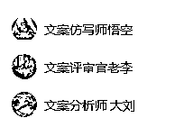
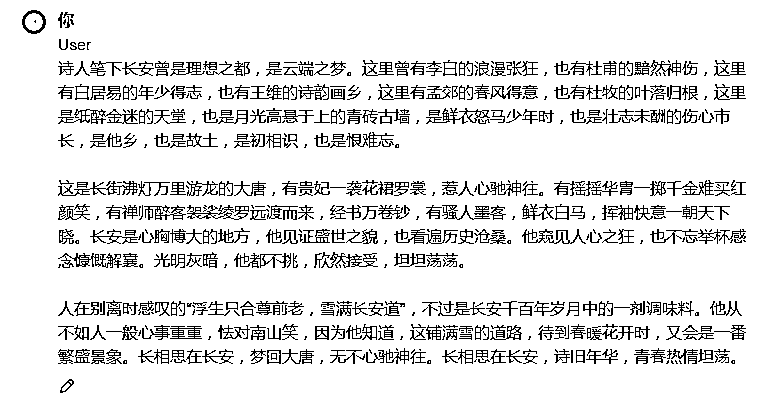
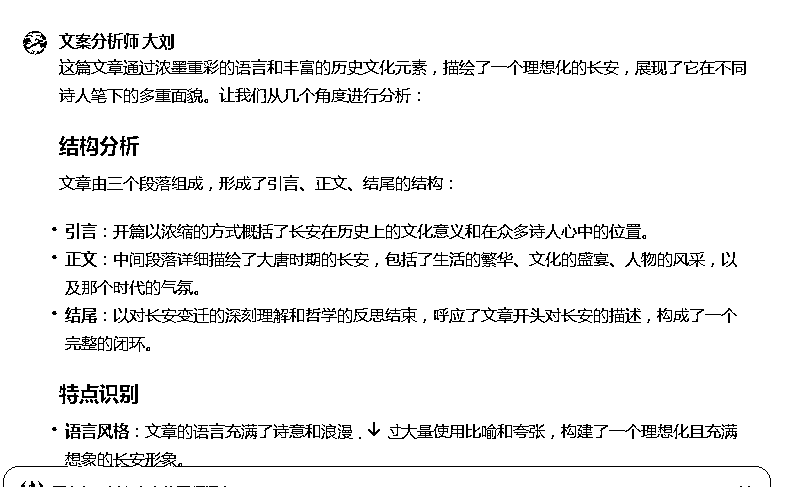
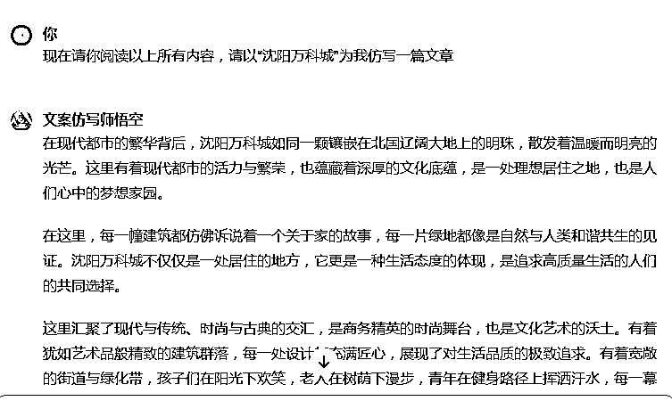
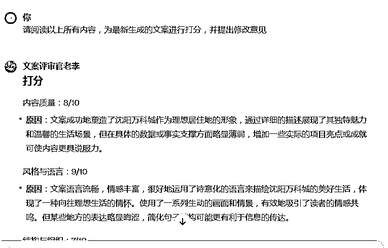
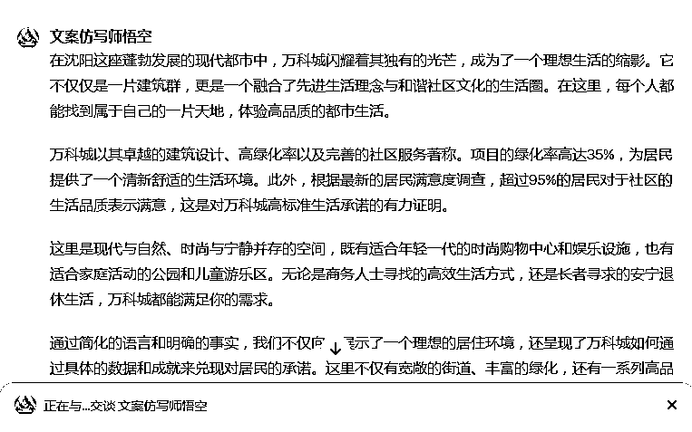

# 用一套AI人设，让“数字同事”24小时免费帮你冲业绩
作者：龙哥

最近我在给线下房产经纪人做AI实战辅导。现在做房产销售，基本都押宝在短视频获客上。可市场不景气，门店根本养不起专业的写手和剪辑团队。经纪人白天要带看、谈客，晚上回家还要扒对标账号、抄文案、拍素材，累到怀疑人生。

既然GPT能力已经这么强，我为什么不给他们配一套会写、会审、会改的AI团队呢？

想一下这个真实的使用场景：你看中了一个做探房类的爆款账号，想照着它的风格做一期同类内容。

一个人干，难。搭一个数字团队，分分钟搞定：

**分析师型数字员工**：负责拆解同款脚本的共性逻辑、话术套路和节奏感，提炼出一套可复用的仿写框架。
**仿写师型数字员工**：拿着原文和框架，直接产出风格高度相似的新稿。
**评审师型数字员工**：从结构、情绪、卖点、相似度等多个角度给新稿打分，并给出具体的优化方向。

下面是我搭建这支AI小队的完整操作路径：

1 我在GPT里分别建了3个独立的GPTs角色，对应上面三个数字岗位

2 最近董宇辉的小作文在全网刷屏，我找来一篇代表作，想借用这种调性来为“沈阳万科城”做一次项目推介。
先让“文案分析师”把这篇小作文的结构特点和语言风格拆干净

3 接着让“文案仿写师”基于拆解出的规律，套用到沈阳万科城上写一版新稿

4 再把这版稿子交给“文案评审官”，让他和原文做多维度对比打分，并指出问题点

5 最后让“文案仿写师”根据评审意见进行二轮打磨修改

来回跑几轮审改循环，最后出来的成品就是你能拿去直接用的高质量脚本。

学会了怎么养这批GPTs，基本等于拥有了一支不加班、不喊累的虚拟团队。写短视频脚本、写项目推介、写周报总结、写客户跟进话术，只要把流程交给它们就行，零成本全天候在线，这波操作不香吗？

关于如何从零创建GPTs，我之前也有过专门的拆解，有空可以去翻一下。

我是一个深耕AI赛道的90后创业者，过去累计卖出8000份+的AI实操课程。
受限于篇幅，每个GPT角色的具体提示词设计我就不再展开，有需要的朋友直接留言，我统一整理发给大家！