# 00后新手小白做📕境外游，2个月成交4位客户，利润8k+，拿到人生第一份副业收入。

大家好啊，我是阿钦，00年生人，汕头人。2023年10月10号我加入赚钱，到现在差不多四个月。目前主攻📕境外游，两个月拿到八千多块利润，成交四个客户。作为00后新手小白，这算是我人生的第一份副业收入。 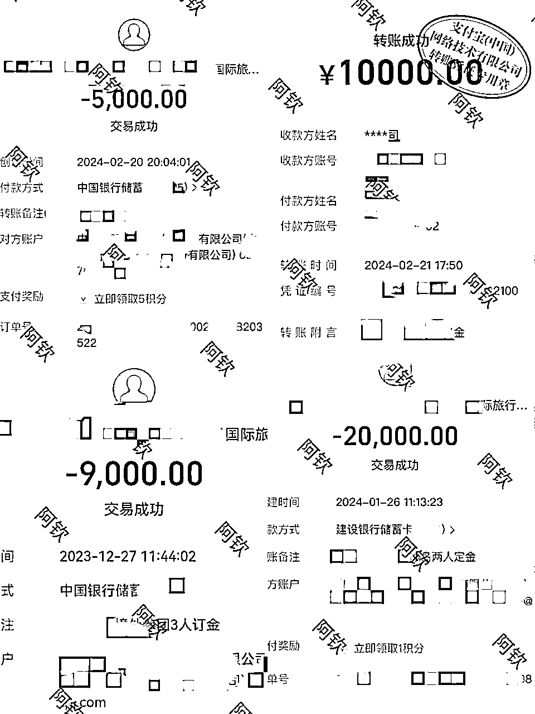

先聊聊我的黑历史。18年我读大学，网络工程专业，满脑子想创业。结果被一个直销师兄带偏，每天下课就跟着开会，像打了鸡血。那会儿哪懂什么“红利期”？只听师兄天天喊“财富自由”，四年下来专业荒废，亲戚朋友怎么劝都没用，我还坚信自己能成。毕业出来没干本行，找了一份文职，业余时间继续搞直销，又撑了一年多，依然一无所获。团队里很多人早就撤了，只有我傻傻坚持，直到被现实狠狠教育一顿才清醒。这几年最大的收获，大概是练了不少销售嘴皮子，可惜没赚到钱。

23年6月我决定退出，重新找出路。那段时间特别懊悔，如果当初好好念书，现在工资也不低。后来听到一档播客《搞钱女孩》，里面雪姨推荐了赚钱。我体验三天就果断付费。说实话，当时不敢告诉朋友，怕被说交智商税。但事实证明，这一步走对了。

给新人的几点忠告：
第一，精华帖一定要大量看。以前我觉得不少帖子没用，要么看不懂，要么觉得难操作，其实是看太少。认真读二三十篇，很多事就通了。里面的销售技巧、朋友圈玩法、📕规则，当时用不上，但会留在脑子里，以后操作时自然用得到。
第二，不知道做什么项目，就听赚钱直播。不一定马上找到答案，听多了自然有感觉。
第三，航海项目大胆报名。反正是押金制，完不成能退款。比如我报了📕境外游和RPA，RPA实在学不会，但不试怎么知道？龙哥说“试试看，成本不高”，特别对。
第四，主动靠近牛人，哪怕只是围观朋友圈。看到大佬们那么拼，自己也被带动起来。

老实说，一开始刷精华帖和直播，看别人赚钱太容易，我很焦虑。于是决定动手。我先试了AI简历代写，模板和定价都备好了，就是不敢挂到闲鱼。怕有人找我写不来，又觉得利润低，拖到最后没上线。后来又搞夜校，帖子发出去也有人问，但中途又打退堂鼓，把帖子删了。现在回想，都是卡在自己吓自己。成长路上需要人带，就像涛哥说的：没慧根，就得会跟人。

12月大航海，我报了📕境外游。刚好20号炮爷直播详解玩法，我研究了一下，翻了炮爷和超人的精华帖，还把他们过往朋友圈全看了一遍。发现这项目几个月前就拿了龙哥的微天使投资，老师们分享的价值观很打动我，是有实战经验的人。于是决定跟着干。龙哥那句话我也记住了：破圈，常常始于花掉以前不敢花的钱。 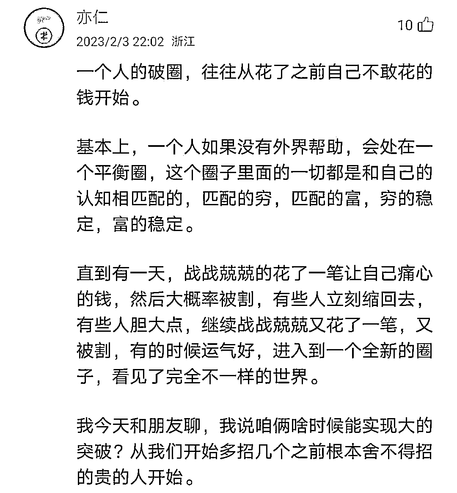

到现在实操两个月，成绩不算多，但有了正反馈。最高一篇笔记阅读4w+，成交4单，利润8k+，还有几个客户在聊。 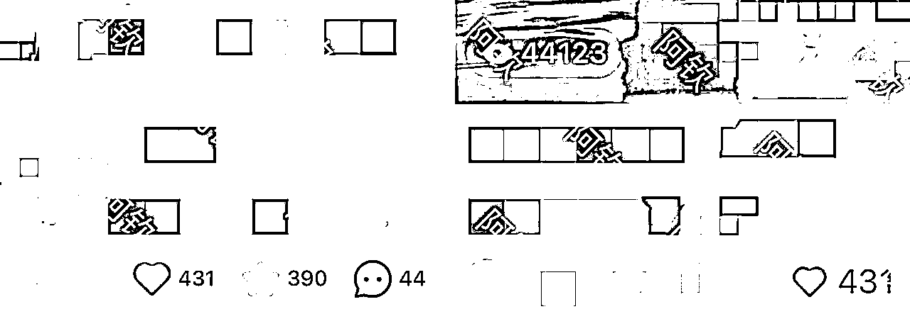 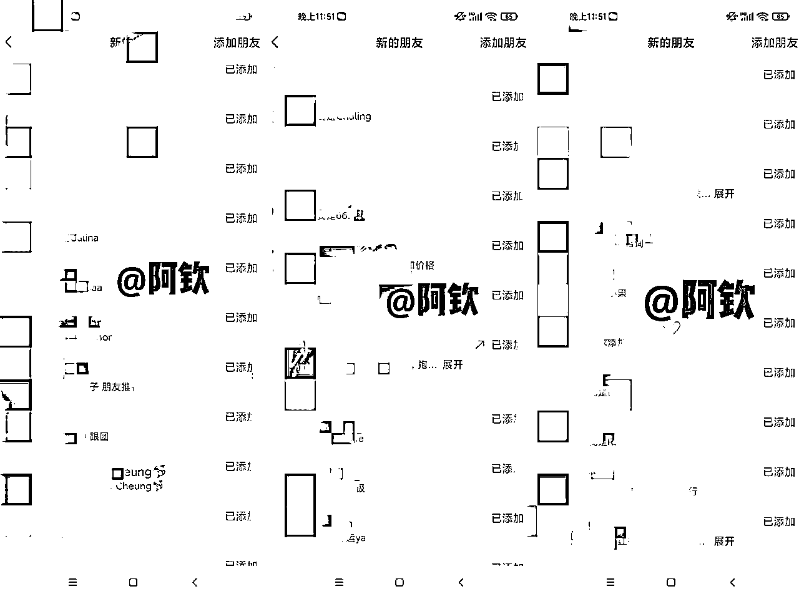 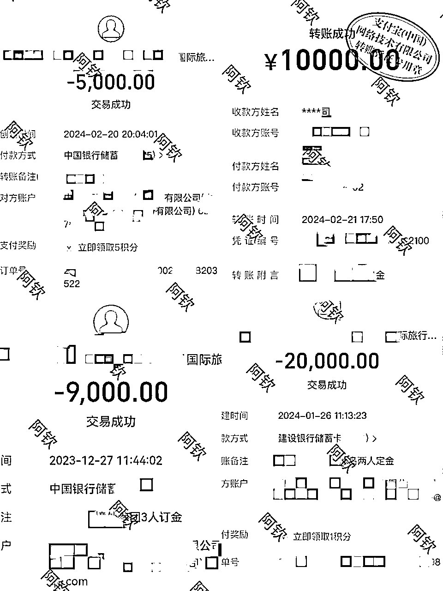

我是12月21号开始干的，基础烂到什么程度？📕都很少用。超人的SOP我认真看了五遍以上，大家直接照他的帖子做就行。附上链接： 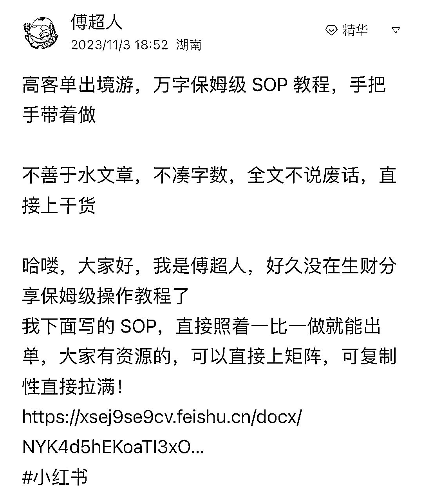

成长路径我用四个词总结：模仿、总结、实践、总结。

先模仿。生物进化里，模仿是生存率最高的学习方式，因为模仿对象已经用无数试错活下来了。第一步确定对象：找那些有成绩、有口碑、有输出的牛人，把他们👸号、朋友圈、精华帖至少过一遍。

模仿后要总结。乔布斯被苹果赶出去后也做复盘。总结分两块：认知和方法。认知层面，我以前不懂“红利期”，后来明白就是狼少肉多。境外游就是典型：传统旅行社不会📕获客，竞争对手少，需求又在涨，进场就能分口肉。方法层面，执行力就是对自己狠一点。 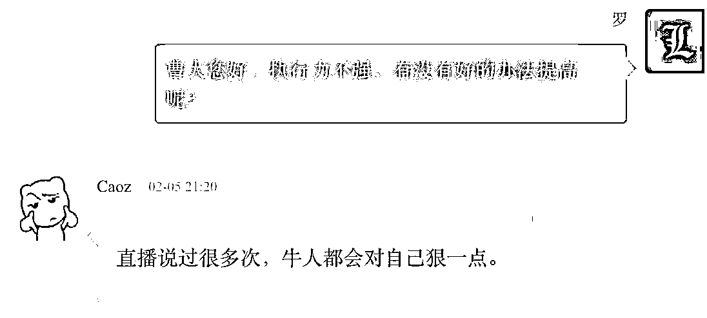 我20号听完直播，21号开始看sop和养号，24号发笔记，那几天从早到晚都在研究。执行力是做项目的基本功，以后做别的项目也能迁移。

实践出真知。最好的实践是像素级模仿：把📕上的爆款笔记认真看一遍，找3到5个对标账号，总结标题、封面、内容、钩子的共性。同行帮你验证过爆款，模仿到位就能快速出成绩。 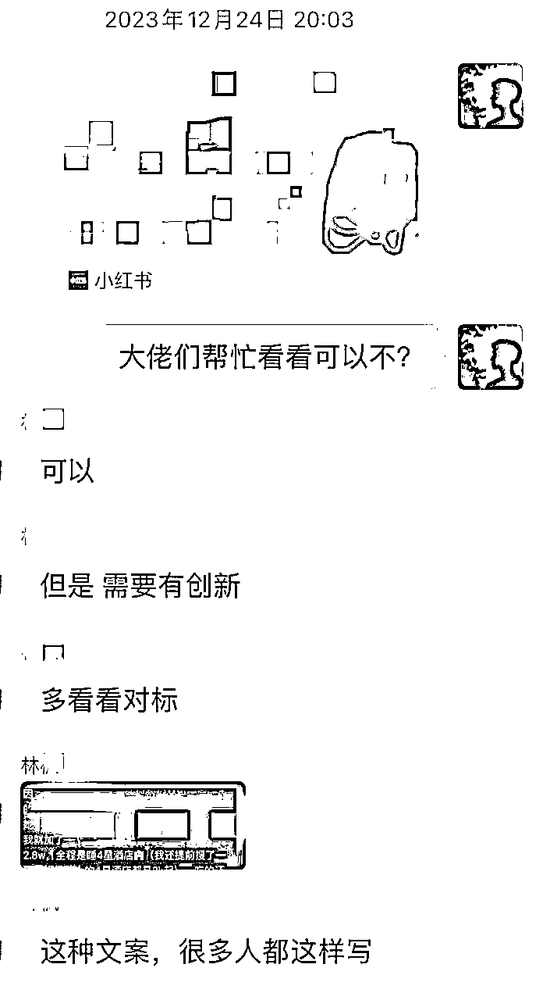 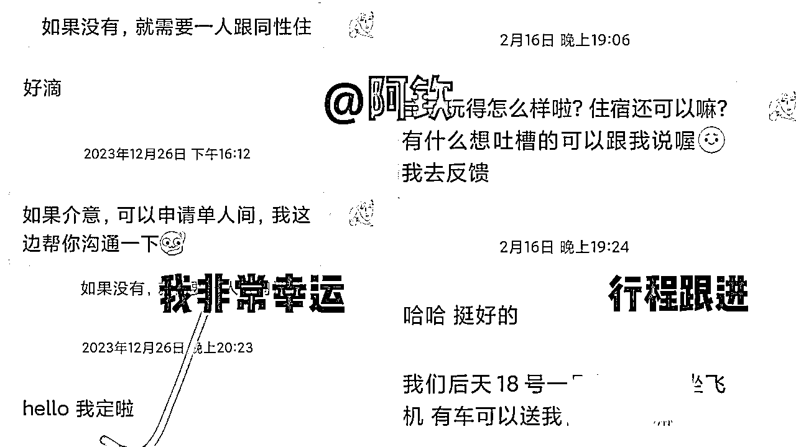

实践后还要总结：踩过什么坑？项目底层逻辑能不能迁移？能不能深耕？怎么提高转化率？让擅长引流的人引流，擅长销售的人销售，整体转化率会不会更高？没有模仿，容易走弯路；没有实践，就是空想家；没有总结，永远都是别人的经验。

再说🛰️成单。第一，搞清业务。客户问什么都要答得上，所以我在没客户之前，就把常见问题全背熟了。第二，学会问问题。用开放性问题让客户多表达，比如“您还有什么补充”“您看重旅行的哪方面”；试探性问题呢，比如“如果从深圳出发，有联运能接受吗”；引导性问题，客户说想看多国团，就问她“优先考虑哪个国家”，避免双方纠结。 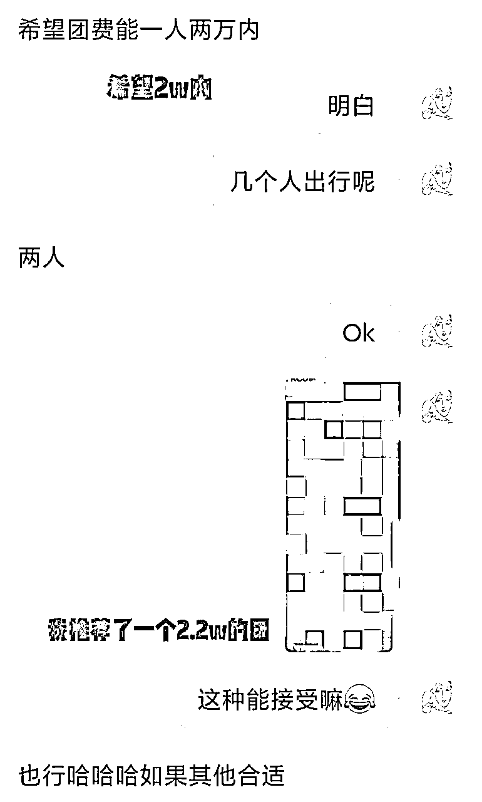

第三，专业且有温度。靠谱姐销冠手册里说，销售的本质是解决问题和情感愉悦，做到一个能成交，两个都做到就能裂变。专业解决理性，温度解决感性。温度方面，我会用“宝子”“亲爱的”，发可爱的表情包，站在客户角度共情。有个客户本来咨询欧洲游，后来给我转了整个部门的团建，34人，营业额9万多。 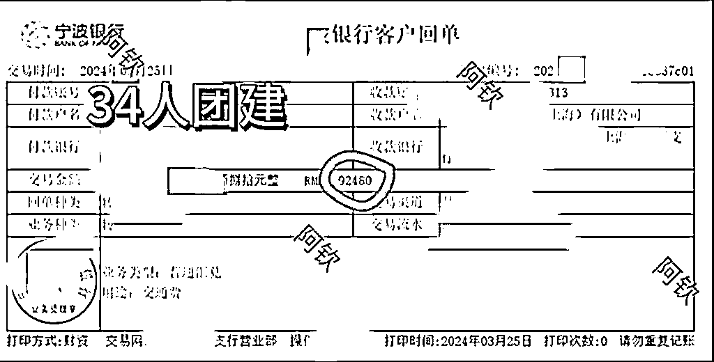 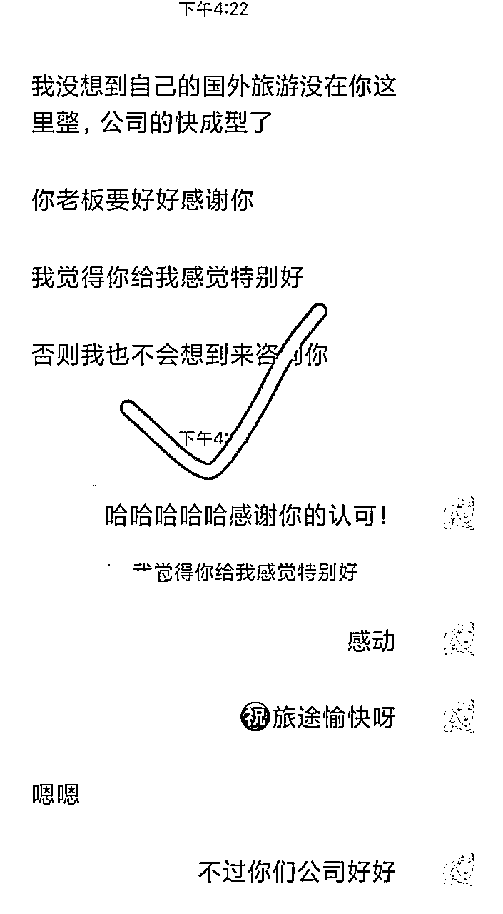 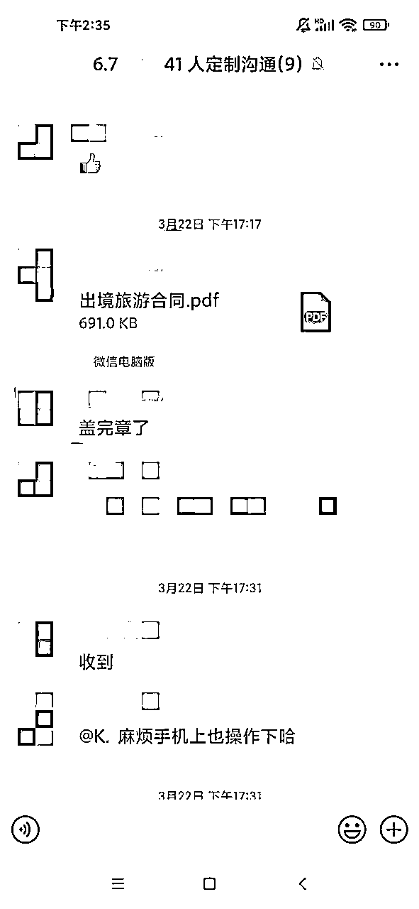 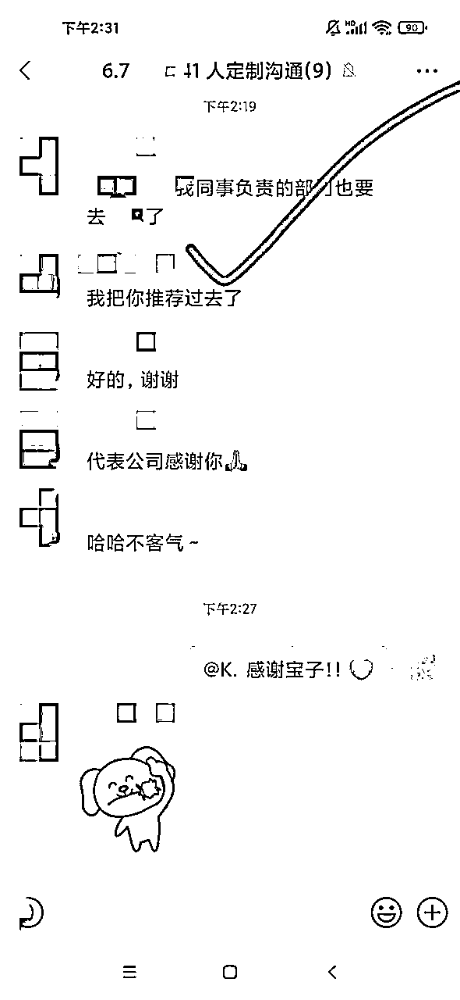

第四，逼单。常用三招：价格、位置、签证。价格上，限时优惠很管用，催客户锁优惠；位置就是“只剩两个名额”了，有同行在咨询，制造紧迫感；签证就提醒客户材料要截止了。当然如果客户担心退款，就告诉他出发前30天可以全款退。最顶级的销售是客户主动找你。

第五，朋友圈打造。客户加了你会看你朋友圈，所以要把信任感做足。我一般置顶退款截图、游客返图、客户对话。退款截图让人放心；游客返图显得自己是当地旅行社不是中间商；晒客户对话能解决很多疑虑。日常再发些团的海报和感悟。有个客户就是看到我发团，主动来问还有没有位置。

第六，常见问题。心态上，要靠执行力尽快拿到正反馈，正反馈会推着你跑。我遇到三个客户：A和B都定了新西兰，最后退了，一个家里有事，一个老公国企不能出境。C客户聊了两天多，每次五六个小时，她第一次出国，什么都要问，还要砍价一千多，送了一台WiFi还想要第二台。最后她愿意买，但同伴因为产品没在携程上架而不信任，单子黄了。我凌晨三点睡不着，爬起来复盘。 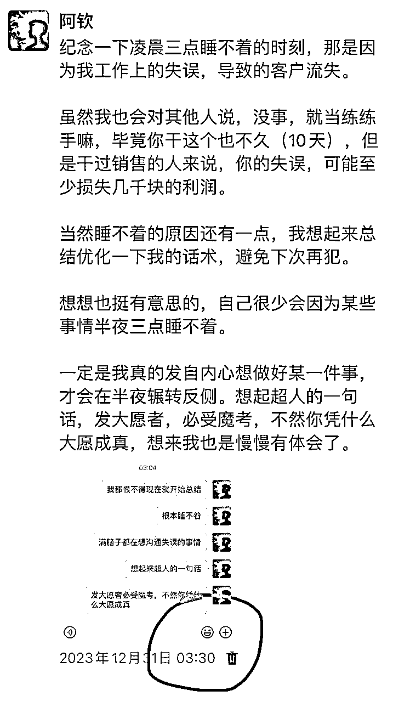

后来优化了话术。客户问“为什么不在携程上付款”时，我会说：我们是携程供应商，但有些团在携程上没上架，因为平台抽不到利润，所以才能给您便宜一千多。交易方面有营业执照，走对公转账，有记录，做十几年不会骗您，可以去国家文旅部官网查。遇到沟通失误，心态波动正常，调整好继续干，就当练手了。用力撞向世界，不管成败都是反馈。

关于价格。客户问能不能优惠，就说一手供应商，价格有优势，境外有问题随时协助。客户还价，可以说可以，因为利润空间有6%到10%。 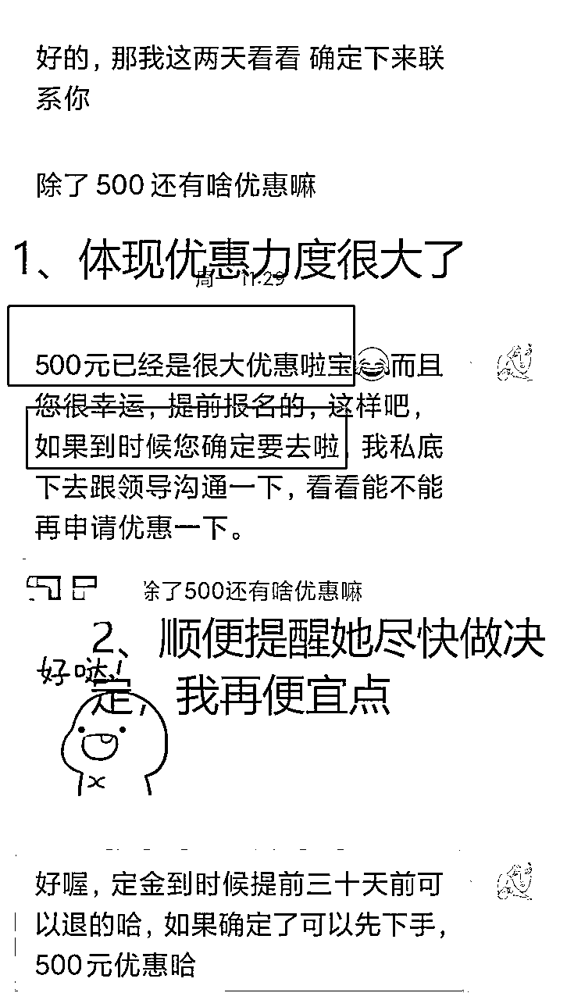 但谈判原则是：对方提要求，你也要提个要求，不能白白让步。比如“您9号前确定跟团，我再给您优惠”。

关于跟团人数。客户总期待15人，但精品团一般25人左右。要解释：15人以下旺季很难成团，25人已是精品，而且实际收客可能不到15。这种两万多的团，客人素质都很高，不用担心。

关于单人出行。很多单人客户不想补房差，要提前打预防针，一开始就先说明规则，免得后面麻烦。

以上就是我这四个月从小白到有点收获的全部心得。没有天赋，就选对人跟对人，再用执行力拿结果。希望我的经历能给你一点勇气。

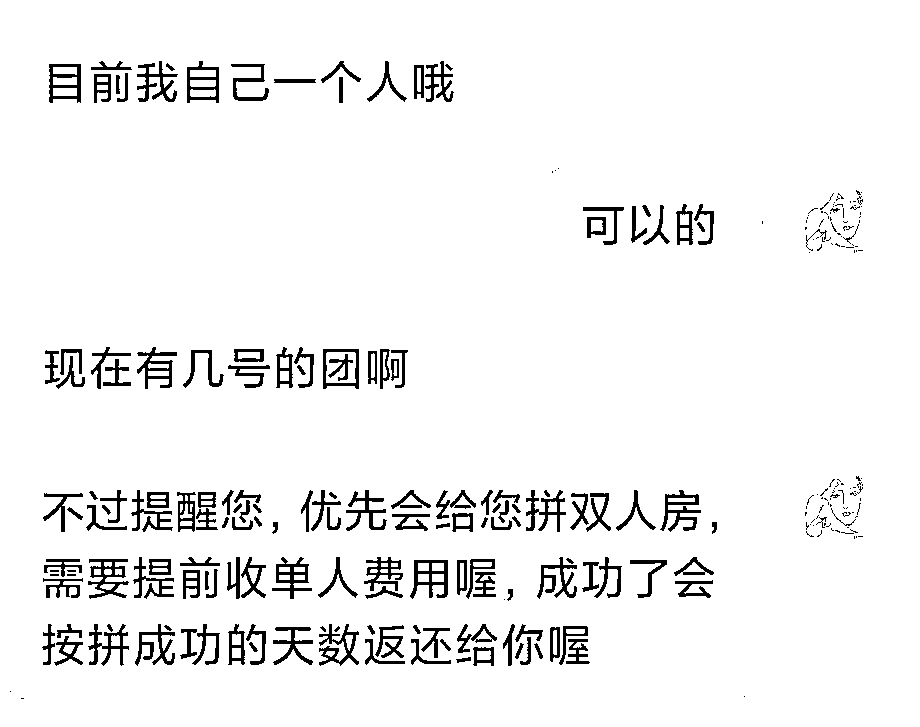

通过这个方式，可以先确认她是否能够接受房差问题，及时打消她的顾虑，也能让她更顺畅地做出选择。

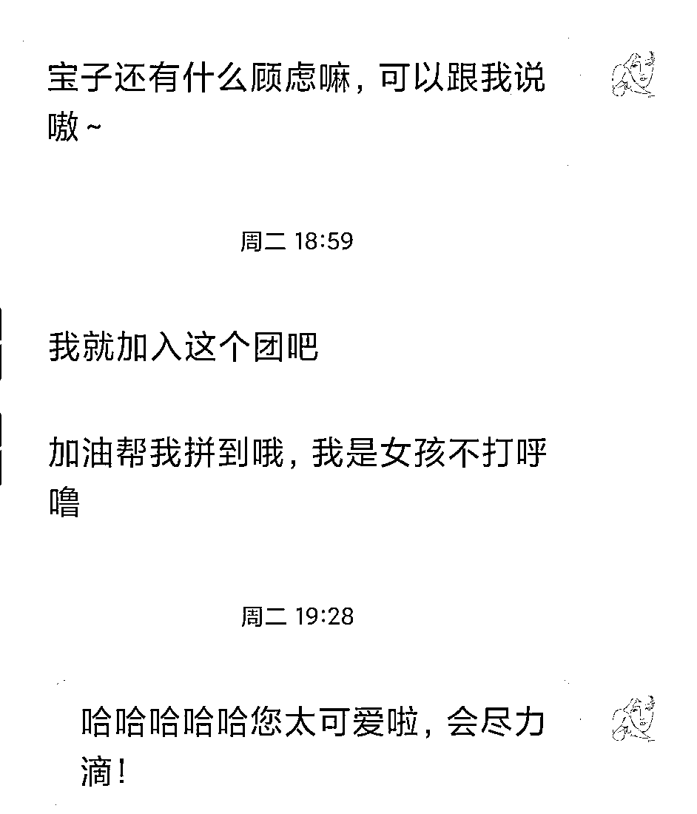

### 我的目标

随着2024年境外旅游市场逐步回暖，目前手上已经有几十位客户正在持续跟进。接下来，希望在3月份促成4个订单，半年实现2万元以上利润，全年争取突破5万元。

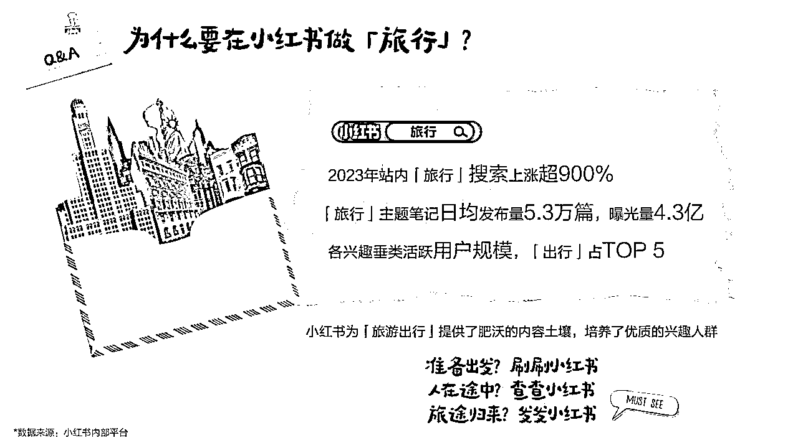

## 感谢语

特别感谢赚钱这个平台，让我看到了更大的世界，也有机会认识许多优秀的老师和伙伴。一路实践下来，不仅收获了成长，也获得了工作之外的额外收入。

2024年，我会继续沉下心来做事，把基础能力一步步练扎实。

也祝每一位刚加入赚钱的朋友，都能找到真正适合自己的方向，在实践中持续进步、不断成长！欢迎随时与我交流。