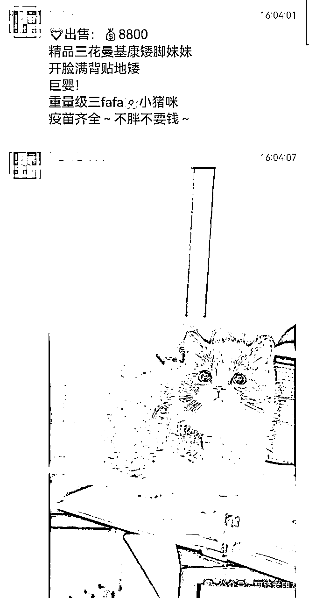
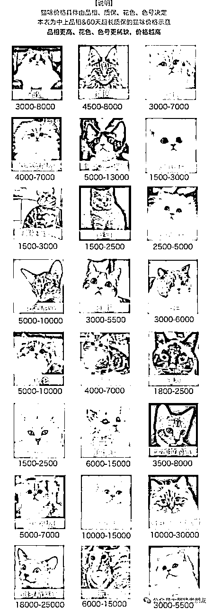
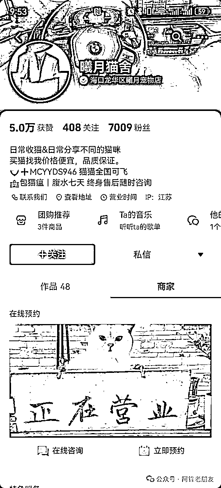
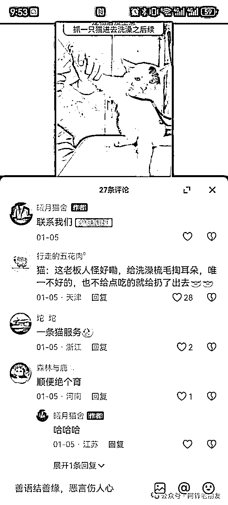
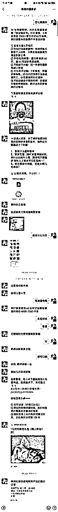

# 高客单活体猫生意：抖音引流+一件代发，单笔净赚五千多，一个月轻松七万起

上周专门开车去南沙面见赚钱圈里的杰哥，聊完才发现，原来做高价活体猫做成现金流机器，门槛没想象中那么高，路径却很清晰。

还没有试过单笔赚五千的，养猫这个赛道对普通人来说起步相对容易，一旦跑顺了，单人月入十万并不是夸张。杰哥十一月底入场，到手的第一个月大概出16单，第二个自然月就已经单人做到利润七万以上。

利润这么高？

举个很直观的例子，一只短腿猫如图所示，最终成交价是8800。

上游拿货价大约只在1300左右，中间差价基本全是自己赚，当然运输路上难免会出现死亡，这块算作损耗，算下来到手净利6000多是实打实的。

具体怎么玩？

下面把从抖音吸粉到后端成交发货的完整链路拆开讲，因为大家都知道活体猫利润惊人，但真正能摸到门的人很少。

分为五个部分来讲：

1. 猫的市场划分和消费逻辑
2. 货源怎么解决
3. 抖音如何吸粉
4. 线上成交和物流
5. 售后和风控要点

开始正文：

1. 猫的市场划分和消费逻辑。

宠物赛道现在非常大，尤其是近两年猫咪的热度已经超过狗狗。既然要做，就得先搞明白猫的品类。

还有一个核心真相，千金难买喜欢。只要客户看上眼了，价格再上去也不一定能拦住。

真的有人愿意花几千上万买只猫吗？

绝对有的。养猫的持续开销远比买猫贵，猫咪看个病住个院动辄几千，上品的肉食和用品更是长期开销。养猫人群的消费能力普遍很高。

要不要主攻高客单？

如果是工作室或个人操作，建议直接做高端。记住一句话：客单高事少，客单低事多。

高客单客户反而更好服务，不会斤斤计较。杰哥举过一个例子，客户刚提猫不到一个月就生病了，对方希望治疗而不是换猫，协议里明确写的是只换不治。

最后客户自费花了八千多治疗，也不闹，最后只要求换一只。最后给客户退了3000块补偿，虽然对半分钱，但客户体验还不错，后续也方便继续投放。

暴利程度到底如何？

前面那张图的价格已经很明显了，主打高端的话，平均成交价在8000上下，进货成本1500左右，算上运费和损耗，净赚五千以上是常态。

这个生意基本都是做一件代发，不囤货也不自养，不然很容易亏本，直接让上游发货即可。

2. 货源怎么解决。

刚开始做供应链，先从同行入手。广州线下同行一个个去聊，先跑通流程再谈价格优势。

在抖音和📕搜关键词，很容易找到大量同行，加30到50个，就能把货源基本盘搭起来。如果连同行都找不齐，那也不适合碰这个项目。

如何找到更有优势的上游？

有两条路：

1. 猫咪养殖基地集中在沈阳，东北区域最大。如果有资源，可以实地跑一趟，能长久解决货源。
2. 广州一年大概有两次猫展，届时优质商家会集中出现，全部加一遍，基本能谈下一件代发的稳定渠道。

要不要囤货？

建议别囤。实力足够再考虑小批量备货，如果自己本身也喜欢猫，可以顺手养几只。但别把想法理想化。

3. 抖音上怎么打粉。

这是核心，流量才是一切。涉及到投放，这里只说人人都能复制的做法，信息流成本不高，大约在60块左右。

抖音吸粉怎么做？

最简单的就是投豆荚，投自己主页流量，关键点一定要选达人相似。

具体做法是先锁定20到50个在抖音卖猫用品的博主，粉丝量10万以上，专门投放他们的粉丝池。

为什么要这么投？

因为我们从一开始就定位高端。盲投容易带来一批嫌贵的。已经养过猫的人群，才有升级换新的需求。

养猫会上瘾，已经有猫的人会想要一只更好看的。投这种人群，七八千甚至一万多一只的成交阻力会小很多。

这种打法正是切入小众高客单赛道的正确方式。投流成本大约50左右，豆荚成本会浮动，多跑几次就能控制住。

投什么素材？

非常简单，直接对标爆款：

引流到🛰️也很容易，开通蓝V后自带私信组件，开通即可，效果如下：

素材就是各种好看的猫视频，评论区引导购买方式，挂上联系方式后直接投放。

粗略算一下，第一单通常就能覆盖投流成本，后续基本都是纯利。

4. 线上怎么转化和发货。

这一块我就不展开太多，最好的老师是同行，至少加够100个同行，把话术拆解透你就懂了。

转化最好的同行聊天记录大概长这样：

里面包含了资料倒流、背书话术、价格锚点、确认需求和下单时间、测试付费意愿等，拆解后成交率不会低。

如果还是不懂，自己去假装买家加同行，多看几份就能悟出来。

发货环节？

一件代发即可。活体空运费用大约160左右，再加上拉拉到机场取货配送，总成本在300上下。

另外提醒一下，春秋季是最佳繁育季节，夏季高温易死亡，冬季寒冷繁育率低。一年四季都能做，只是存在淡旺季。

5. 售后和注意事项。

售后主要分两种：

1. 运输途中死亡。
只能算损耗，免费补一只。一般十单里出现一例，属于正常范围，不要过于计较，不然账号做不下去。
2. 收货后生病。
通常会给60天健康协议，期间承诺换只不承诺治疗，这点必须明确，不然治疗费用动辄上万，亏到怀疑人生。

成本1500一只，换一只成本才一千多，为什么要选择治疗？

遇到纠纷怎么处理？

提前签协议，发货前收50%定金，收货后再付尾款。协议里把所有可能情况写清楚。

协议模板直接在网上搜改一改就行，想要更专业的，直接去同行那里假装下单，对方会主动发协议给你。

说到底，每个项目拆开看都很简单，知道和做到是两回事，赚钱就是持续执行。

最后说明：以上内容是我看到和听到的复原推演，真实效果需要自己去实操验证。

感谢赚钱的交流平台，也感谢圈内朋友的分享，有在做这个赛道的可以多交流碰撞。