# 单月营收迈过20万，AI代写实战拆解，附实操变现路径

大家好，我是饭饭。

现在主要在电商和AI写作两条线探索。靠AI写作这条线带队做到累计营收破百，23年刚进赚钱圈时我还在卖手机壳，加入不到一年拿到龙珠成为航海家，很感谢这一路的陪伴和突破。

目前有两件事让我印象很深：

1. 上个月单月营收突破20万；
2. 紧接着上线了一个AI写作的报童专栏，3天订阅超2200，一周接近2900。

经历过6年实体店、负债转型线上，从拼多多卖手机壳到拥抱AI写作、搭建后端的写作团队，见证上千人通过这条赛道拿到自己的第一桶金。今天把一次深度复盘攒出来，给新手避坑，给在路上的朋友一些启发。祝大家龙年多赚钱，看到这篇都顺！

# 一、重新理解AI写作的市场

写作外包是老行当，也是经久不衰的赛道。每次技术浪潮都会孵化新的赚钱入口，蒸汽机、互联网都是例子。AI来了之后，文字工作的门槛被拉低，AI相当于全能的文字搭档，各种体裁基本都能上手。所以核心不是用AI提效，而是用AI去做变现。

给你几个直观的数据参考。上月我们团队做到单月营收超20万，过去被看轻的写作外包，现在在AI加持下供不应求。我一次直播分享AI写作，观看量冲到2288。

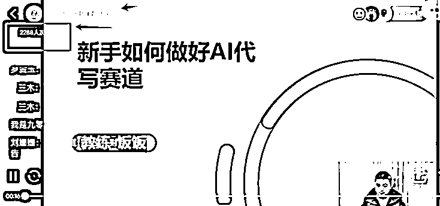

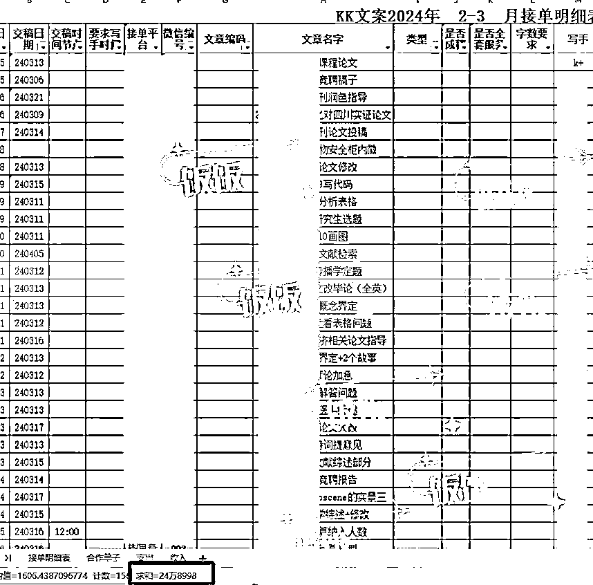

会有人担心：人都进来了，会不会内卷严重没得赚？

这里要说的是，AI写作的市场体量远超想象，赚钱圈的人都能分到一杯羹。

之前我发过《用写作店铺年入50w的拆解》，星球里也有圈友总结闲鱼、📕、拼多多、BOSS直聘等平台的打法。为免重复，今天重点聊思路和淘宝实操。我整理了一份《AI写作变现单月20w的方法论》，需要可加微信：F49091，备注圈友领取。

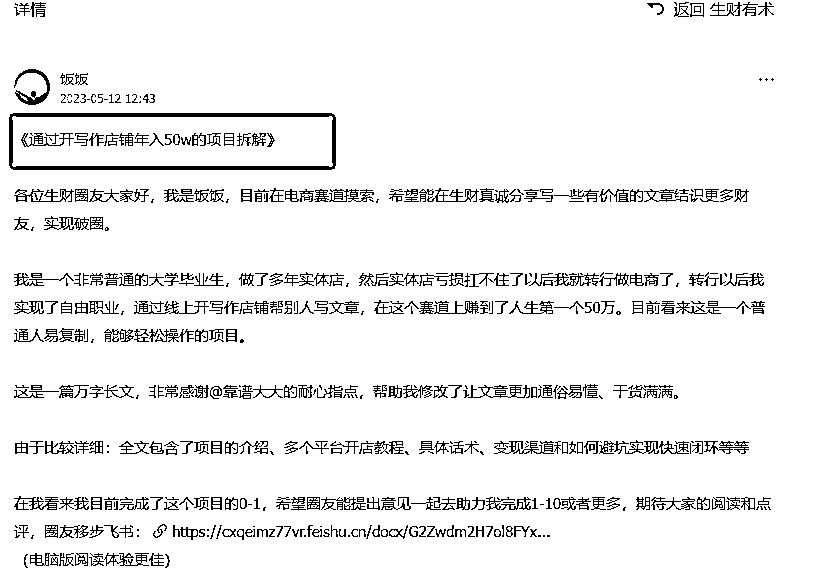

# 二、差异化打法怎么找？

做这件事，先自问三点：

1. 能写哪些内容？
2. 哪类内容更值钱？
3. 客户在哪？

看起来基础，但很多人卡在这里。我结合实操展开。

## 1. 内容边界有多大？

AI写作的覆盖面很广，实战中经常碰到的类型有：

1. 给学生、企业人、老师写演讲稿、通稿、读后感、征文、发言稿、总结报告；
2. 学生群体的情书、道歉信、感谢信、节日祝福、诗歌、作业；
3. 📕、闲鱼上的广告策划、软文、短视频文案、笔记文案；
4. BOSS直聘、📕上的详情页文案、剧本、脚本、影视解说。

这些单价相对低。溢价高的往往是学术类：论文、文献综述、开题、研究报告，以及商业类：回忆录、公文、会议纪要、思想汇报、商业计划书等。

这只是大类，真正的利润在细分赛道。

## 2. 哪类更赚钱？

实操会发现，执行力决定结果，必须做差异化。我总结了10个细分思路。

我个人比较爱闷头干，下单一种类型就会横向延展，往往会发现订单源源不断。

### 思路1
研究报告可拆成实验报告、课题研究、科研项目报告等。任意平台搜索这些关键词，需求和利润都很大。

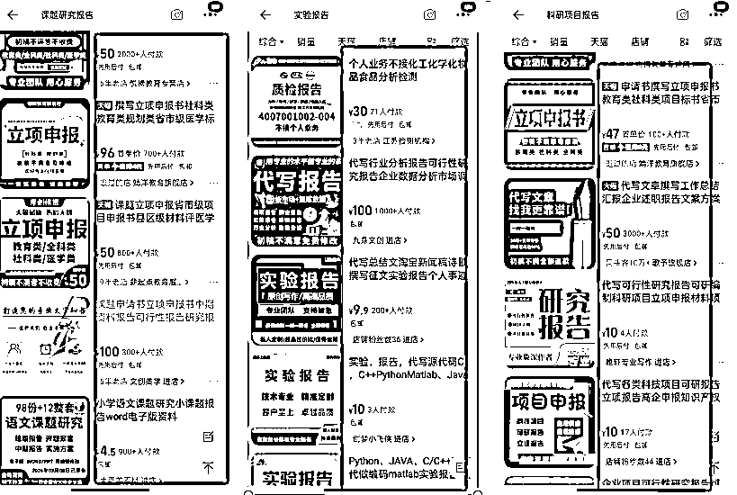

### 思路2
商业计划书可拆成融资、路演、立项、参赛、创业、可行性研究等。搜索量同样庞大。

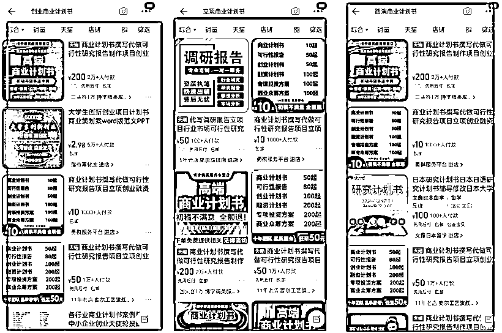

### 思路3
论文按学历分：本科、硕士、博士、函授本科、专科等。

### 思路4
论文按学科分：人文、社科、理工、医学等，再往下钻到具体专业。

### 思路5
教育类可细分为教育学、心理学、教育技术、教育管理、教育政策、教育测评等。

### 思路6
商科类包含市场营销、企业管理、金融财务、会计、经济学、供应链、创业创新管理、组织行为学等。

### 思路7
医学类涉及医学本身、生物医学、公共卫生、药学、护理、生物学、生物工程、医学影像等。

### 思路8
法学类包括法理学、民法、刑法、行政法、宪法、环境法、劳动法、知识产权等。

### 思路9
IT和计算机类论文涵盖计算机科学与工程、软件工程、信息技术、数据科学与分析、人工智能与机器学习、嵌入式系统与物联网、网络安全等。

### 思路10
人文类涵盖艺术史与美术理论、音乐学与音乐史、戏剧与表演、文化人类学、哲学与伦理、历史学、社会学、艺术设计与视觉艺术等。

以上只是实操中抽的一部分。能写的内容很多，核心是获取流量和承接订单的能力。

## 3. 客户去哪找？

有需求的平台就有市场，主要分两类：

被动接单。适合运营型圈友，去能拿到首单的平台直接成交，利润更高。目前能随时拿到首单的平台有淘宝、拼多多、闲鱼、📕、抖音、视频号、校园贴吧、校园表白墙等。

主动接单。去机构或文案公司接长期单。常见平台有天猫店、拼多多店、百度、抖音、BOSS直聘、智联招聘等。逻辑相同：投递简历，接单做单。

## 4. 上个月营收构成

上月业务量暴涨，人手跟不上，还在星球资源区找了合作。写作外包复购强，主要营收来自：

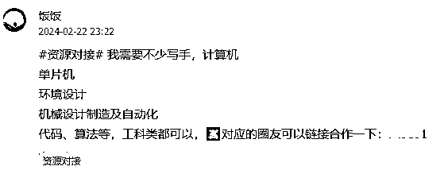

1. 研究生综述、期刊，客单价高，上月接约17单，占比最大；
2. 本科实证辅导、开题报告，2-3月是开题爆发期；
3. 课题报告、科研项目、期刊审稿意见回复，3月预计继续爆发；
4. 创业计划书、可研报告；
5. SPSS数据分析、遗传算法等工科单。

还有演讲稿、散文、教学设计、述职报告等小单。上月有星球大佬介绍上万的硕博大单，因后端资源不匹配没接成。

单量我一个人处理不了。现在我负责电商运营和谈单，线下合伙人负责团队排期和售后。要放大就得建工作室，哪怕很小也要分工，一个人天花板低。

# 三、入门打法：淘宝接单，日入百元起

淘宝在很多品类被冲击，但写作类目依然稳。按这个方法日入100+很容易，团队起步时就用了，现在很多朋友仍在做。

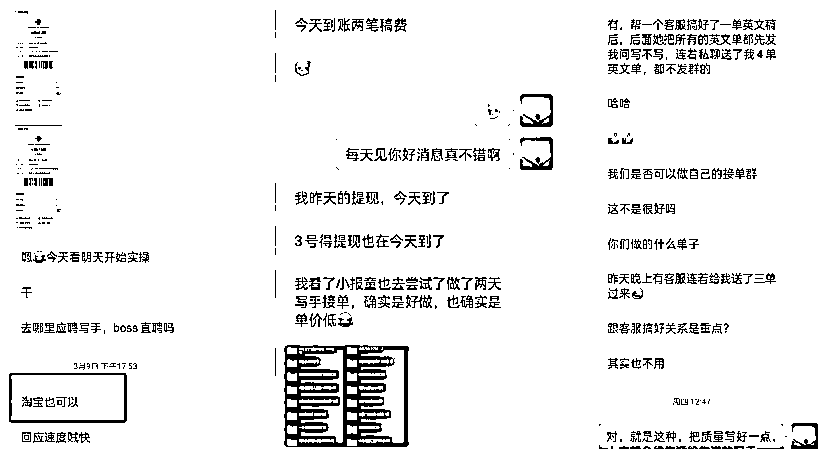

## 1. 打法逻辑

适合新手练手，也适合想做副业、没精力重运营的人。思路是：淘宝找靠谱店铺→应聘→进派单群→抢单→交付→结算。

关键是找靠谱店家、不被跑路。

## 2. 具体步骤

第1步
在淘宝搜“文章写作”“代笔”“商业计划书”“演讲稿”“读后感”等关键词。选店铺时看天猫标识和销量排名。

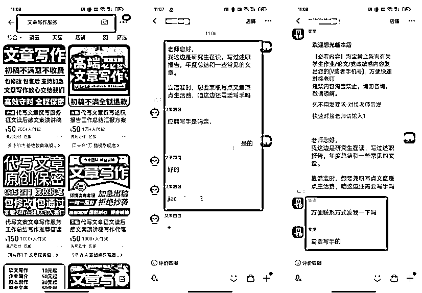

第2步
加客服微信，或把微信留给店家。沟通前准备自我介绍，提升合作率。模板可参考。

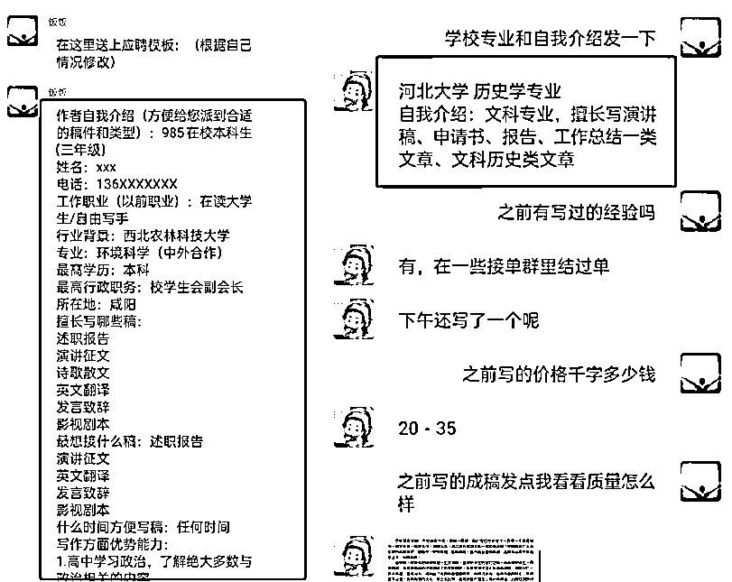

第3步
进入派单群，企业微信或QQ均可，直接抢单。

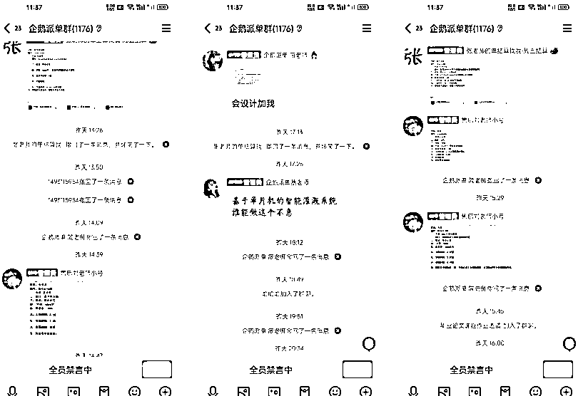

## 3. 筛单原则

1. 单价过低不接，如千字10元内；
2. 熟单不接，易出问题；
3. 参考资料过多的不接；
4. 设计类、实物类不接，如仿真、单片机等。

# 四、中阶打法：淘宝逛逛截流，零成本

若觉得接单价低、又不想开店，可做社区截流占据评论区，让商家帮你引流。淘宝评论区也是精准流量池，且风控比📕、抖音、闲鱼低，很多店没有关闭非主播评论的设置。

第1步
设置逛逛资料：淘宝→我的淘宝→视频→发布→补全关键信息。

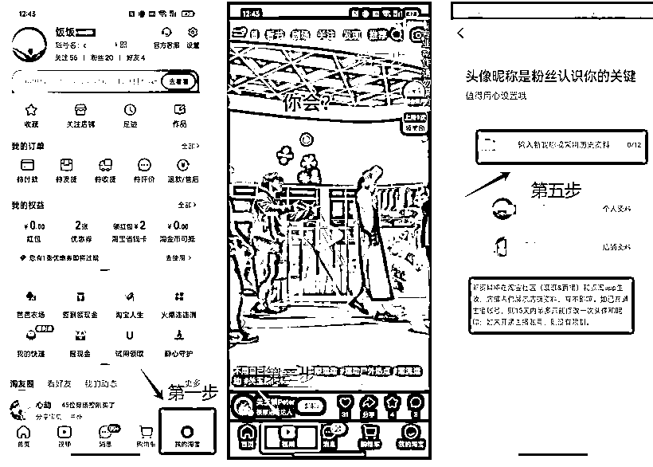

第2步
筛选评论活跃、问大家多的店铺，去留言引流。

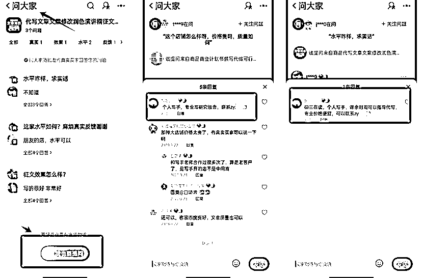

资料完善后可发作品视频，引导看主页加微信转化。案例如图。

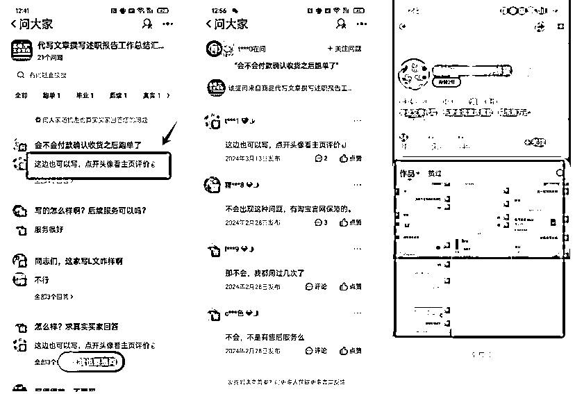

这个玩法窗口期短，越早上手越好。

# 五、高阶打法：淘宝开店，长期做

淘宝依旧是长青平台。天猫开店成本高，C店门槛低，保证金1000元，月入五位数常见。我身边不少朋友都在做。我们的C店虽然不如其他平台，但依然稳定。

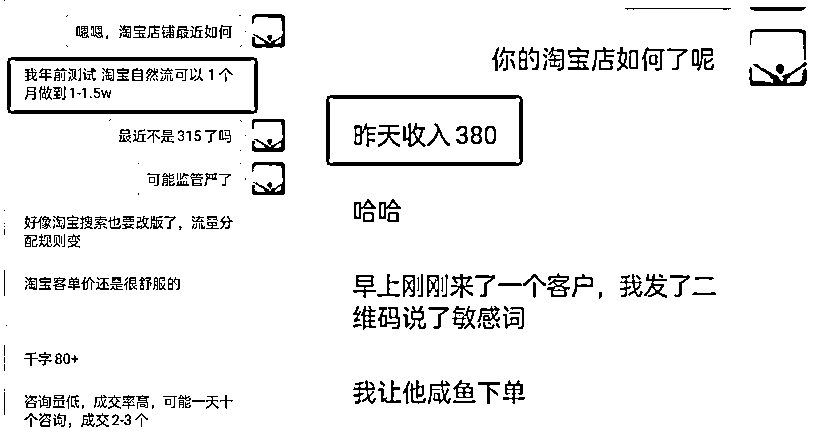

客源一直在线：

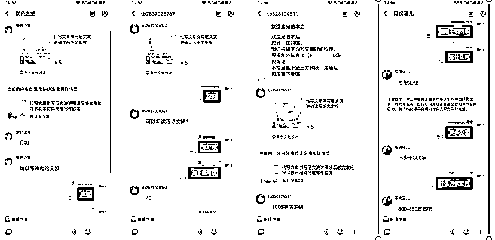

开店流程：

1. 官网注册
访问淘宝官网点免费注册。

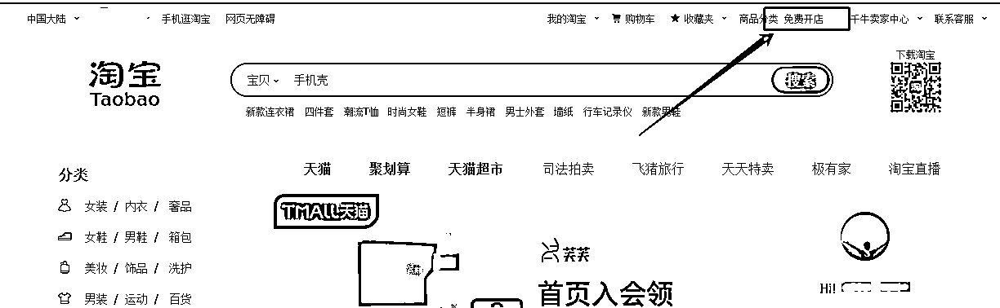

2. 选账号类型
个人或企业，建议个人店。

3. 完善资料
手机号、密码、验证码，已有账号可直接登录。

4. 实名认证
提交姓名、身份证、照片，绑定支付宝和银行卡。

5. 设置店铺
创建店铺、选类型、填名称简介、上LOGO。

6. 运营规则
设置发货、物流、售后，提交审核。

7. 上架产品
选对写作类目，注意标题规范，可参考我发的示例。

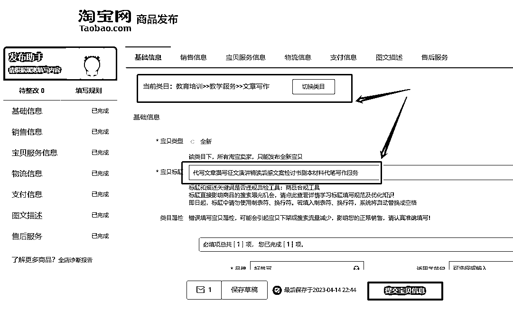

平台很多，选适合自己的即可，AI写作大有可为。

# 六、实操案例

## 1. 常用工具

工欲善其事必先利其器。免费够用即可。

常用的有ChatGPT、Claude、new bing、百度文心一言、讯飞星火、通义千问、智谱清言、KIMI Chat、AI导航等。可按场景选择，国产模型体验也不错。我们常用KIMI和智谱清言。

## 2. 用AI做开题报告

开题不查重，AI很合适。网上模板多，但很多人不会搜，AI辅助效率更高。

案例：文科题目“数字乡村建设对农村产业融合的影响机理与实证检验”。

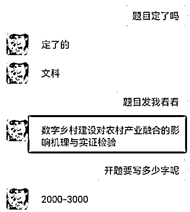

第1步：找文献

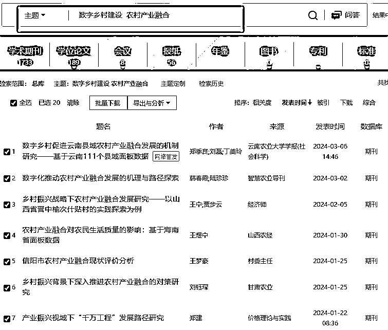

第2步：把题目和文献一起输入生成初稿

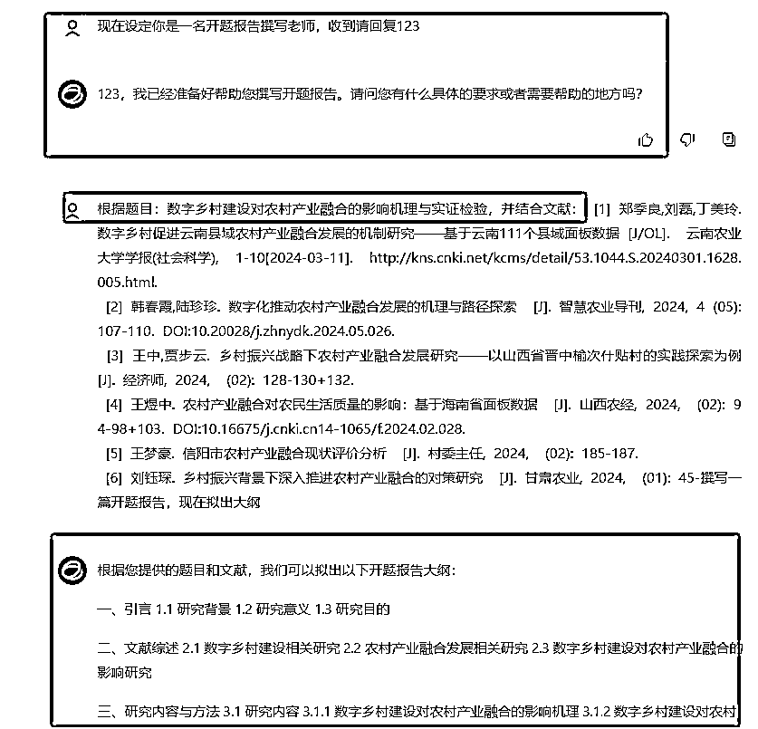

再按学校模板润色即可。

常用文献网站：知网、必应学术、万方、维普。

## 3. 用AI写学术论文

学术要严谨，用AI辅助要遵守规范，正确引用，避免抄袭。

以本科汉语言文学为例：题目《王安忆长恨歌人物形象探析》，8000字。

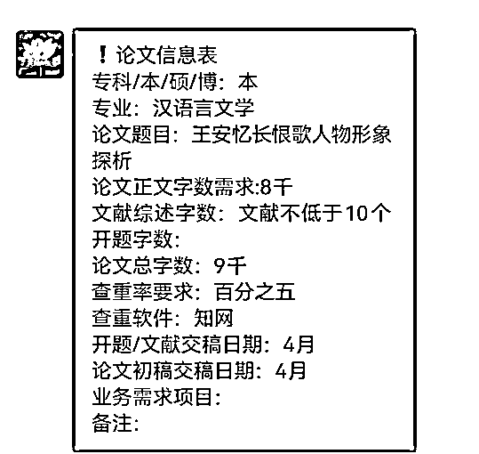

确定需求后，用智谱清言等模型生成框架，再人工校对补充。

最后说一句，选对方法、坚持执行，这条赛道机会很大。祝大家龙年赚钱，见帖皆喜。

AI写作的本质，其实就是把复杂的工作拆成可重复的指令流。掌握了这个拆解思路，论文、调研报告这类重活，就能从几个月的焦虑变成几天的冲刺。

先说学术论文怎么玩。

第一步是做料。先围绕核心关键词去文献库里把相关论文扒出来，下载整理好。这一堆材料就是后面AI不会跑偏的基础。

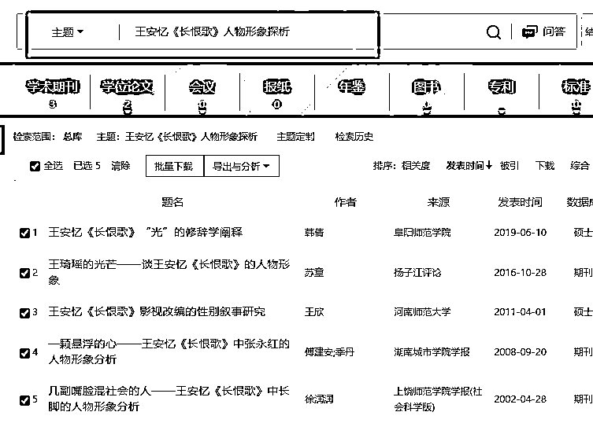

第二步是喂料建框架。给AI一个明确的角色定位，把论文的基本信息和你刚整理好的参考文献一起 toss 进去，让它先出一个大纲。

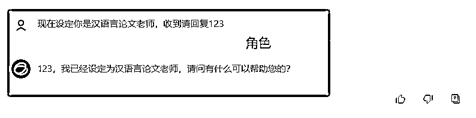

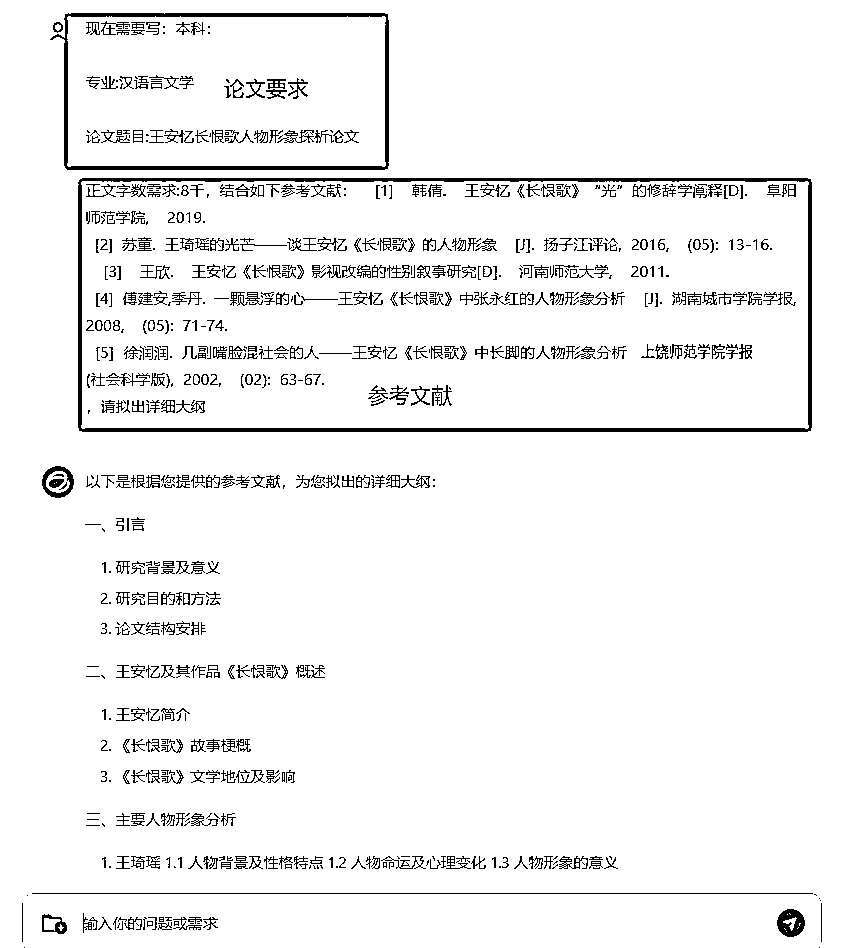

第三步才是动笔。拿着大纲按顺序逐段生成，出来的初稿质量往往已经可用。满意就收，不满意就继续追加指令微调。

篇幅原因，后续的精修步骤就不展开了。整体逻辑就是循环：建大纲 -> 生成 -> 人工润色 -> 按学校格式规范调整。这样一篇过审的初稿就能成型。

过去需要耗上几个月才能交差的论文，工具用顺手了，效率可以被压缩到极致。当然学术领域太分散，学历、专业、院校要求都不一样，核心能力始终是学会用AI做你的写作副驾驶，提升质量和速度。

这里给你一套可复用的指令模板，直接套用就能跑：

1. 主题和目标设定
指令：请以“[论文主题]”为题，围绕“[研究问题或领域]”展开撰写。
指令：本次写作的核心目标是探讨/分析/评价“[具体的研究目标]”。

2. 范围和重点
指令：重点聚焦于“[需要深入剖析的理论、事件或人物]”。
指令：内容需覆盖“[相关概念、历史脉络、理论框架]”。

3. 结构安排
指令：引言应包含研究背景、研究价值、研究目的与研究方法。
指令：正文需包含“[各章节主题]”，例如文献综述、理论剖析、案例分析、数据研讨等。
指令：结语要归纳研究成果，并说明其对学界和实践的意义。

4. 风格与引用
指令：写作风格请采用“[学术/正式]”。
指令：所有数据、观点、文献必须准确，并按“[指定引用格式]”如APA、MLA等规范标注。

5. 字数与格式
指令：全文控制在“[要求字数]”左右。
指令：包含标题、摘要、关键词、引言、正文、结论、参考文献等完整结构。

按这套流程走，AI基本能帮你解决论文写作80%的体力活。

## 4. 如何用AI写调研报告？

市场调研永远是刚需。客户想知道市场有多大、未来怎么走、对手是谁、怎么切入、用户反馈如何，这些问题决定了营销决策成败。需求大，痛点也大。

实操上，我们店铺经常接到代写调研报告的单子。流程跟论文类似，都是指令驱动。

案例如图：

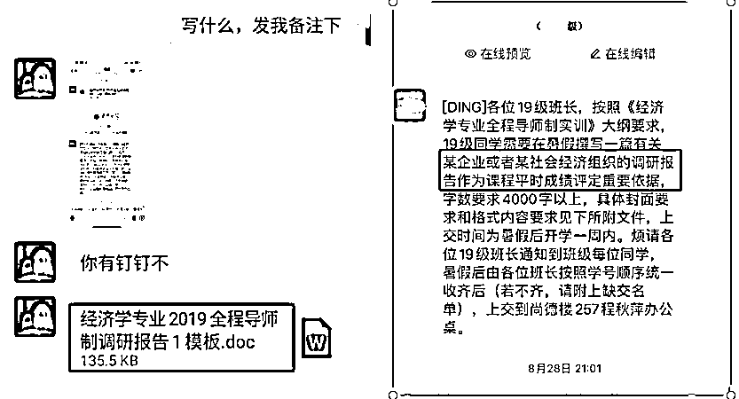

如何用AI写调研报告？

先把客户的要求整体喂给AI，拿到第一版的初步反馈。

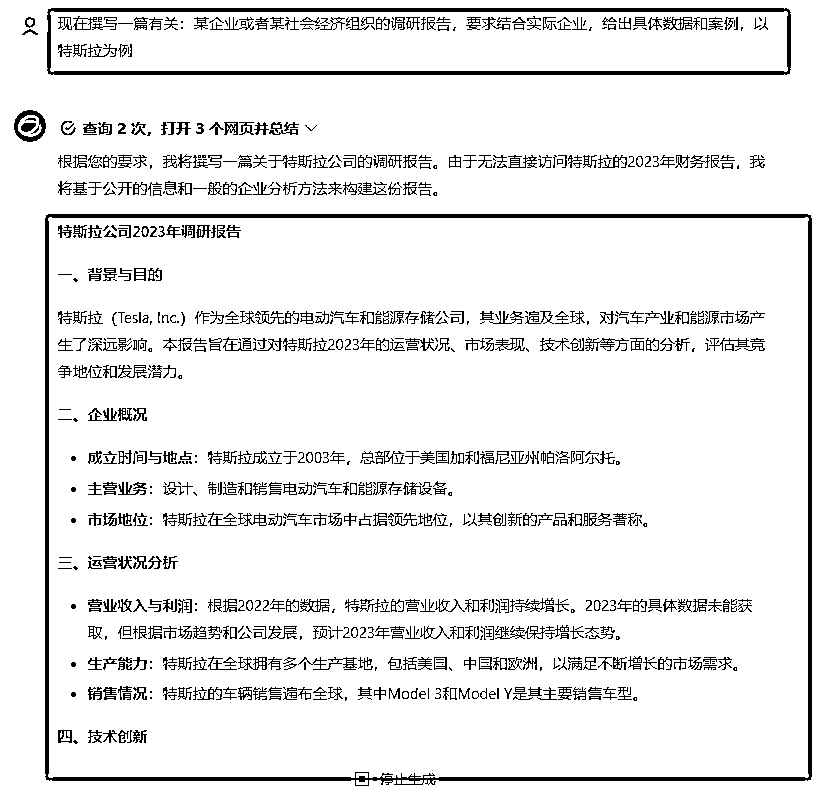

然后追加指令，把范围、维度、分析深度进一步细化。

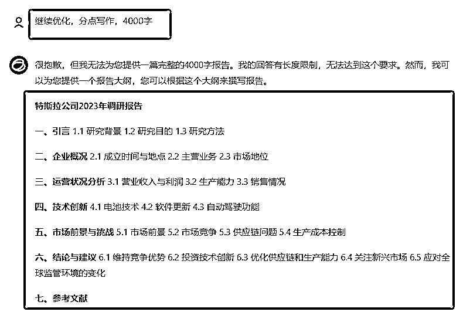

基于确认好的大纲，再分段落持续生成。

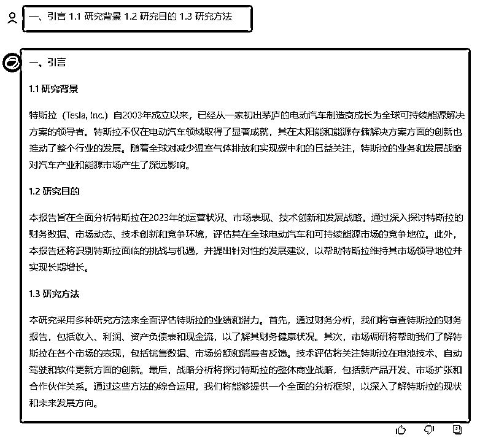

重复这个迭代，直到契合客户的细节需求。代写本质就是指令的精准映射，摸清套路后，一份合格的基础调研报告就能稳定产出。

# 七、写在最后

AI正在为普通人打开新的流量与变现窗口，也在重塑大家对技术工具的使用方式。未来AI辅助写作只会越来越强，这意味着人人都有机会卡位这波红利。既然AI能让新手快速获得正反馈，就别再犹豫，立刻上手实操。

祝各位心态开阔、认知通透，手握AI利器，后有团队资源加持，果断入局，早日实现财务自由！

我是饭饭，觉得有收获的话，欢迎在星球里点赞留言交流。