# 抓住考研调剂风口，普通人也能快速起量

# 一、实操复盘

操作了两个账号，一个认证号一个普通号，十天左右在小红书发了两篇相关笔记，就带进来了900多个考研人，成交额破3万。说白了不是因为自己有多强，而是正好站在了热点的浪尖上，起步门槛很低，小白一样能跑起来。引流分别用两台销售微信负责低客单的成交，再用一个老师助理号去承接高客单的转化。

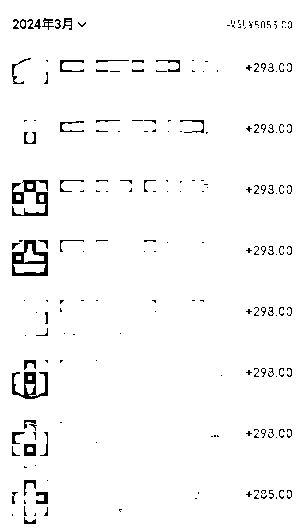

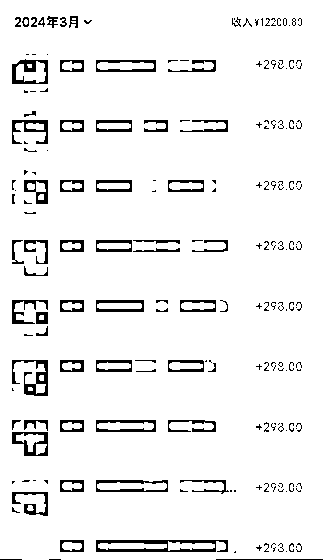

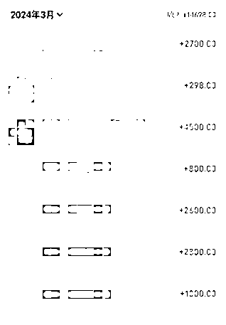

（左图是普通号，右图是认证号）

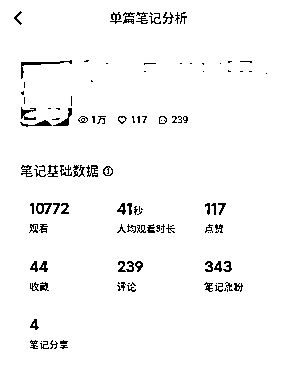

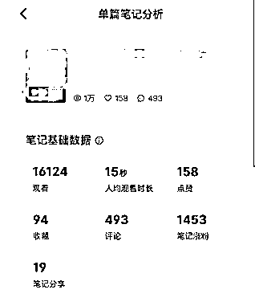

# 二、考研市场有多大

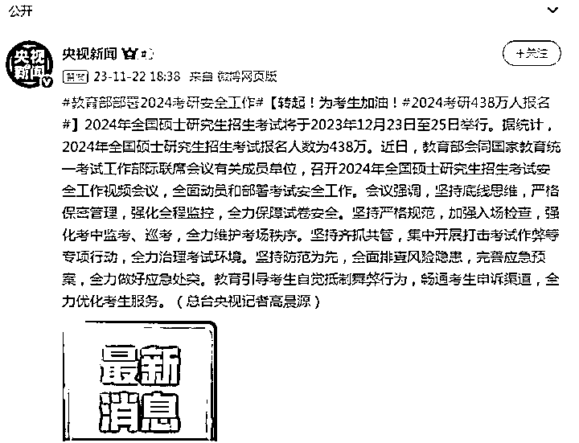

把官方数据和身边情况结合起来看，考研已经成了应届生的主流选择。教育部的数据显示，21到23年应届毕业生人数分别是909万、1076万、1158万，对应的考研报名人数是377万、457万、474万，占比稳定在四成左右。2024年报名人数回落到438万，比前一年少了36万。也就是说，国内高校里差不多有一半学生会走考研这条路。

而考研并不是人人都能一次过关，没上线、没进复试的学生自然都要进入调剂环节。下方这张图能帮你梳理考研整体时间线：

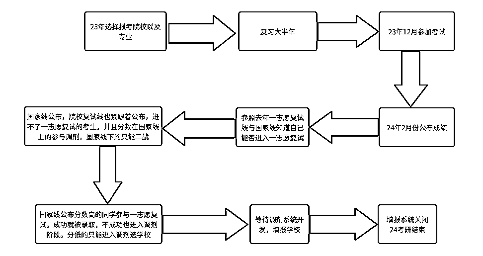

（国家线在3月12日已出，目前正处在调剂窗口期，也是需求最集中的阶段。要么调剂上岸，要么二战要么放弃，学生对调剂相关服务的需求非常急迫）

# 三、产品怎么选

考研周期长，每个节点都有对应的服务类产品。主动去对接头部机构或者找业内大V推荐，很快就能接触到不少资源。核心是看清楚口碑、内容交付方式以及佣金结构是否合理。个人建议做考研这类影响求学前途的品类，优先选头部大机构背书的，千万别只看佣金高就上。

# 四、为什么主攻调剂

初试阶段竞争白热化，头部机构早就占满了赛道，外人很难挤进去。调剂阶段反而是机会点：一是考研录取率本身就不高，每年都有大量考生需要调剂；二是如果考生A初试报了某机构的班，跟机构走了大半年，到最后成绩不理想，他大概率不会再把调剂这条生路也押给同一家机构。这就给像我们这种轻量化的游击队留下了服务空间。

# 五、笔记打法

很多做内容的前辈都说过，刷到评论数远超点赞收藏的笔记，一定要拆。基本要么是强互动，要么就是强需求。能判定为强需求，就别犹豫，直接上。

笔记其实没那么难做，一张实拍封面+一个直击痛点的标题就能发。要是觉得是偶然，多看两家同行的作品就明白了，都是简单粗暴的一图一标题，一天评论就爆了，说明这是当下的流量热点。

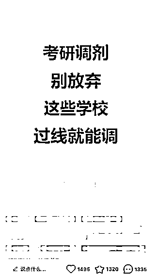

# 六、钩子设计

做内容离不开钩子，钩子也有专门的课程体系，这里就不展开。简单说，小红书的推荐机制很看重评论和关注，钩子就往这两个点上埋。既能引导用户咨询，也能提升笔记权重拿到更多流量。

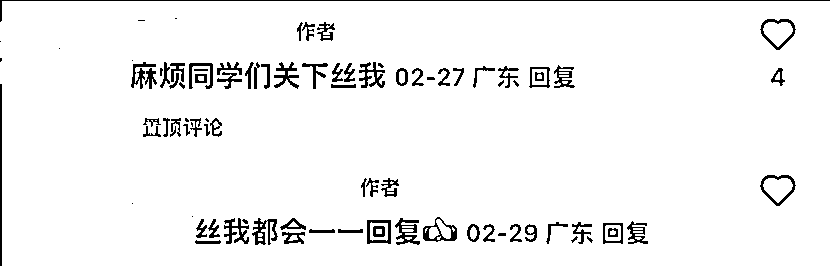

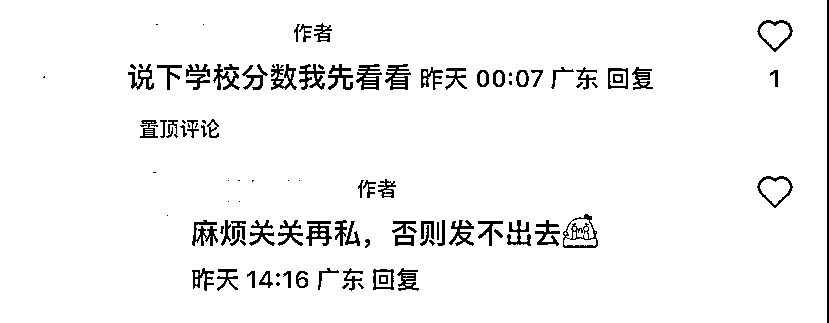

# 七、引流方式

认证号：如果账号已开通聚光并且拿到私信豁免权限，引流就很直接，在私信里发微信就行。考研调剂关键词聚光投不出来，可以先投一篇无关笔记拿豁免权，再把微信发出去。

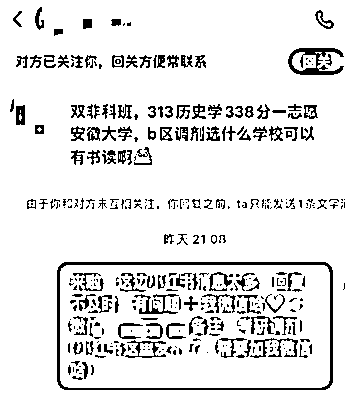

普通号：引流手段有很多，关键是别死磕一种。个人更习惯用进群法，通过群名、置顶公告，再配合小号在群里主动发言，三管齐下带人出来。

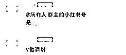

# 八、微信端的转化

先根据对接的产品把话术固定下来，再结合每天的成交数据做微调。这次只推了三类品：调剂报告、一对一调剂指导、调剂保进复试，所以话术和配图都高度标准化。用户加进来走一遍流程，讲清产品是什么、能做什么、价格多少，基本就能成交。

微信运营我重点用朋友圈和群发助手。朋友圈定期晒成交截图和学员好评，群发助手隔天发一条制造紧迫感的提醒，强调调剂是倒计时赛。

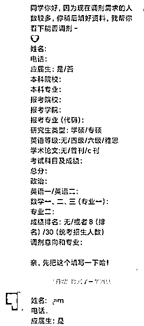

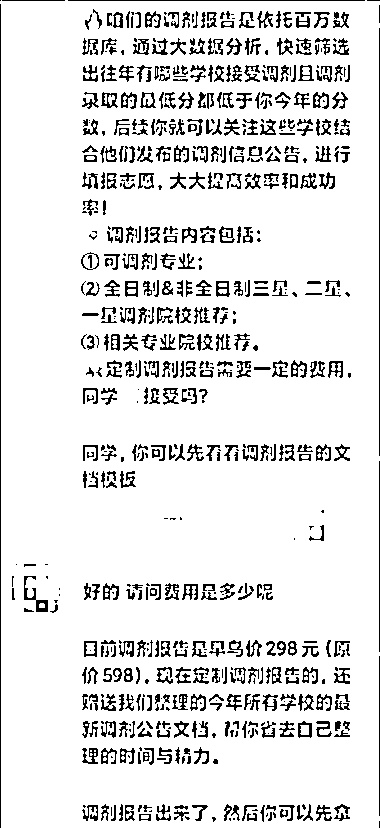

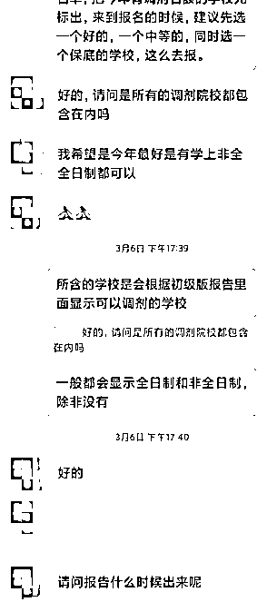

# 九、最后说两点

现在国家线刚出，下一步就是一志愿复试线。能过一志愿线的直接上岸，剩下总分和单科在国家线以下的不能参加调剂，其余的全部要进入调剂流程。系统预计4月8号开放，持续到4月底，整个调剂期还有一个半月左右窗口。

另外，积累的调剂人群还有长尾价值。最终没调剂上的同学，很大概率会选择二战，备战25考研。手里有初试产品线的，完全可以顺势承接。

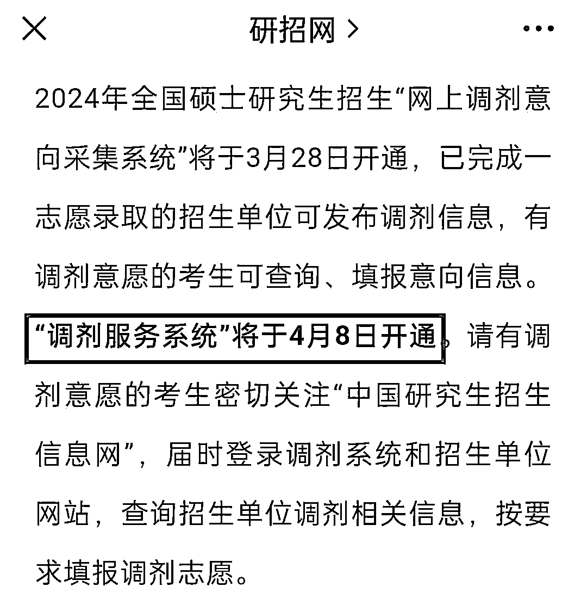

感谢阅读，祝各位项目顺利，收益长红。