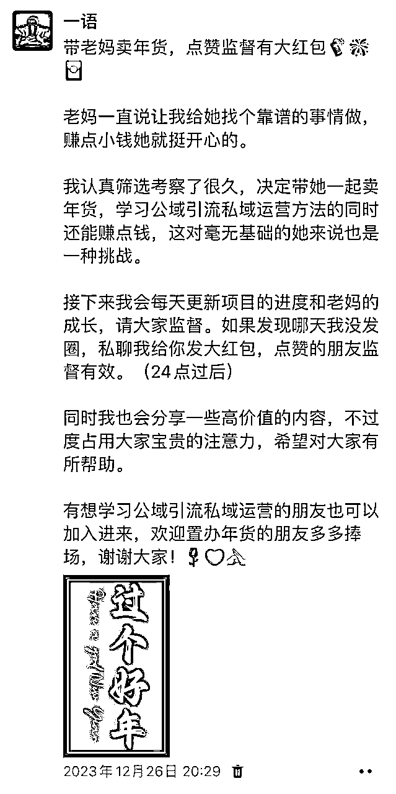
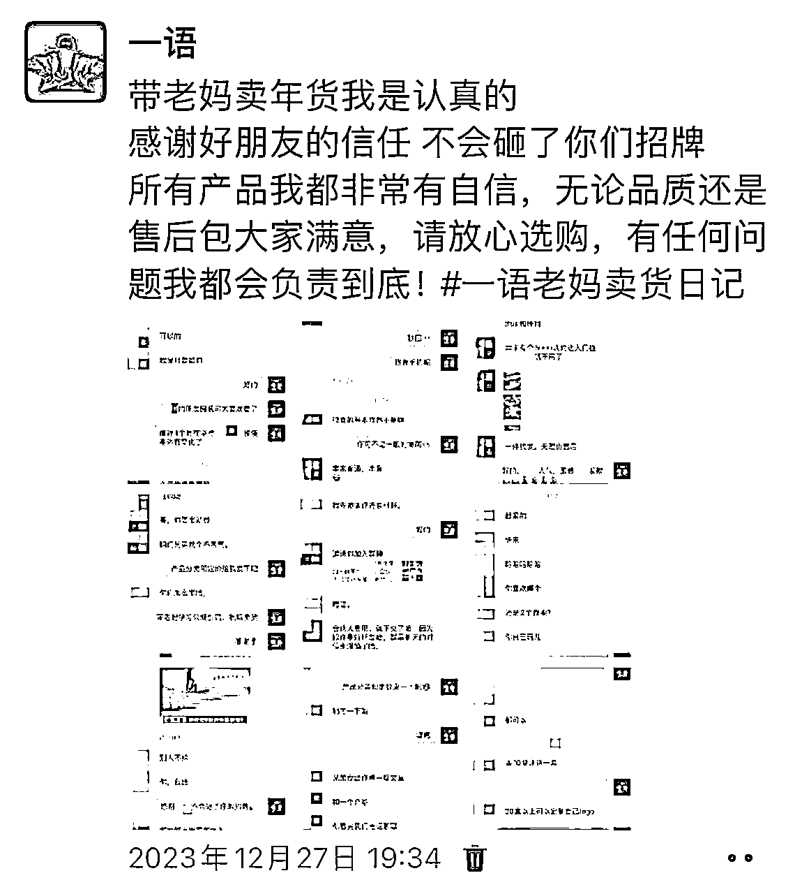
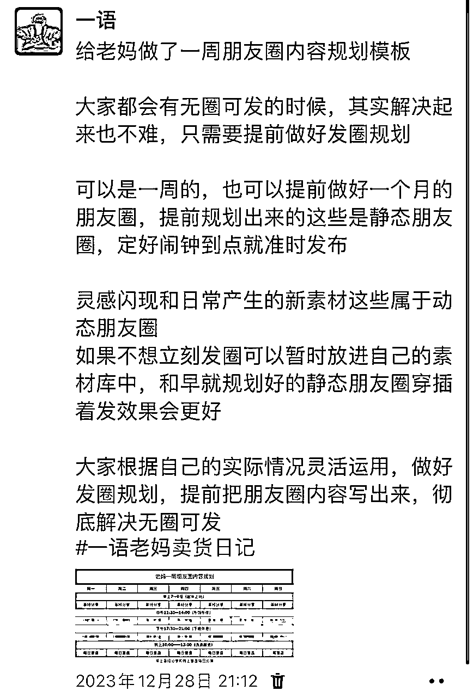
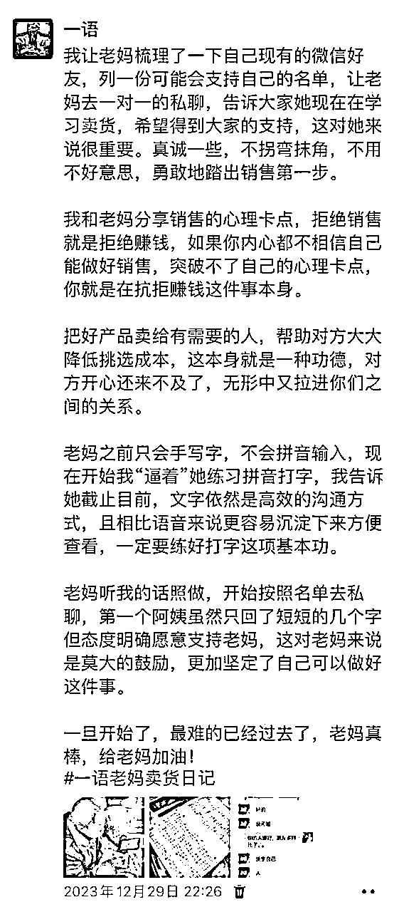
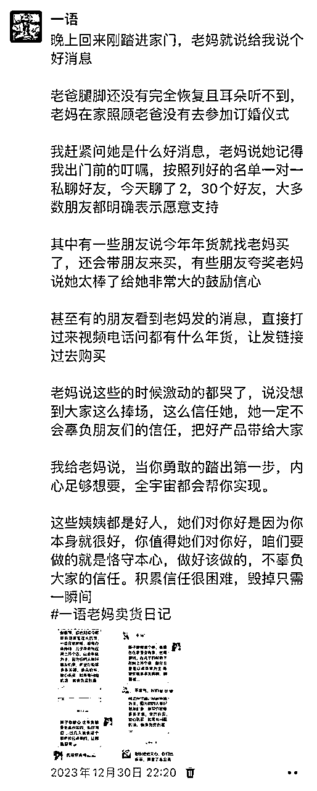
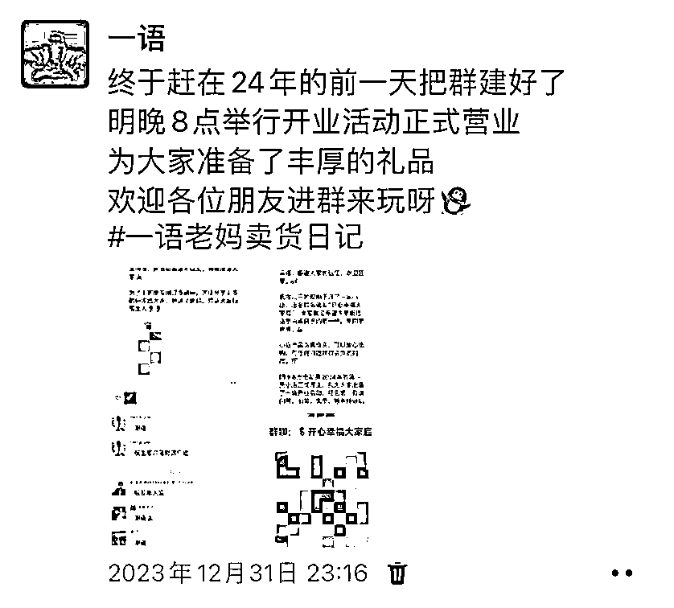
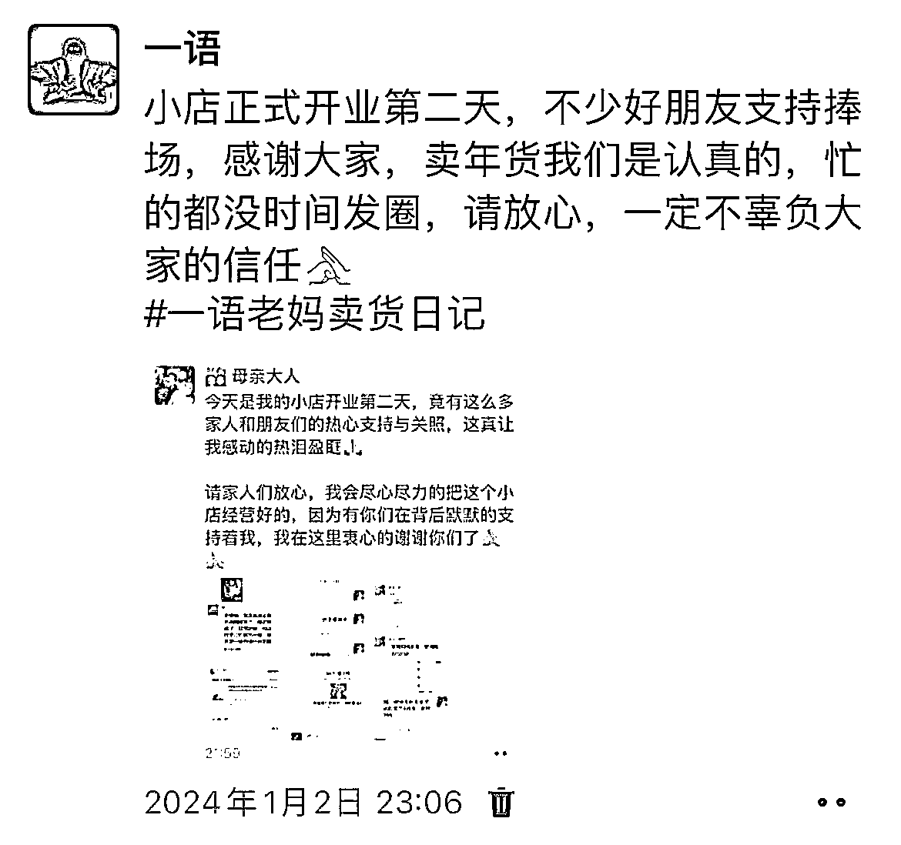

# 带0基础老妈卖年货赚到第一个5000块

今天想跟大家聊聊一件挺有成就感的事——我带着对互联网一窍不通的老妈，趁春节卖了一波年货，最后赚到了5000多块。

先说下背景。我是河南郑州的圈友一语。我爸妈都是做保洁的，我妈负责室内，我爸搞高空外墙清洗。去年我爸在工地上出了意外，摔得不轻，我和我妈在医院照顾了大半年，好在年前顺利出院，回家静养就行，官司也在正常推进。

我妈是个闲不住的人，知道我一直折腾互联网，就让我帮她找个能在家做、门槛低还靠谱的活儿，说能挣点小钱就开心了。我认真比较了很久，眼瞅着要过年，干脆就带她卖年货。当天我就发了条动态官宣，算是立下了flag。

接下来就是一步步落地。

**先解决货源。** 我找了几个靠得住的朋友，代理了他们的好产品，又给我妈开了两家线上商城。这样一来，大多数人的年货需求都能满足。品质和售后我都有底气，就算真有问题，我也承诺一定负责到底。

**然后是朋友圈怎么发。** 我妈本来就不爱发朋友圈，可既然要靠这个卖货，就不能太随意。朋友圈最忌讳的是一水儿的广告，完全没有生活气息。很多人说不知道发什么，其实是没有规划。我给老妈定了个方法：提前把一周的内容排好，这叫静态朋友圈，到点就发；平时突然来的灵感或者新素材，算动态朋友圈，可以存起来和静态的穿插着发。按这个思路，我给她做了一周的发圈模板。

**紧接着，我让她把微信好友捋了一遍。** 列一份可能会支持她的名单，然后一对一私聊。怎么聊？就是真诚地告诉人家：“我现在在学习卖货，希望你能支持我。”千万别拐弯抹角，也别怕丢面子。销售最难的就是开口。我跟她讲，拒绝销售就等于拒绝赚钱，如果自己都觉得做不好，那就是在跟钱过不去。咱们把好东西推荐给有需要的人，帮人家省了挑选的功夫，这是积德的事，对方开心还来不及呢。另外，我妈以前只会手写，不会拼音打字，我就“逼”她练。因为文字是最高效的沟通方式，也方便以后查找，这基本功必须拿下。我妈很听话，真的去练了。她私聊的第一个阿姨，只回了简短的“好的，支持你”，但就是这短短几个字，给了她巨大的信心。一旦开了头，最难的部分就过去了。

**一对一的私聊效果远超预期。** 第二天我妈聊了二三十个好友，绝大多数都表示愿意支持。有人说今年年货就找她买了，还要带朋友来；有人夸她厉害，给了她很大鼓励；还有人直接打视频过来，问有什么年货，让发链接购买。我妈说到这些时都哭了，说没想到大家这么捧场、这么信任她，她一定不能辜负大家。我跟她说，勇敢迈出第一步，全世界都会帮你。这些姨姨们对你好，是因为你本身就好，你值得这份好。咱们要做的就是守住本心，别辜负信任。毕竟信任建立起来很难，毁掉却是一瞬间的事。

年货群赶在2024年元旦前一天建好了。

建群之前，我把文案、图片、店铺二维码、群二维码、开业福利全备齐了，先拉了40来个人进群。接着发群公告：我是群主“开心幸福”，在儿子帮助下开了家小店，店名群名都叫“开心幸福大家庭”，希望大家把这儿当自己家。产品货真价实，有任何问题我都负责到底。同时预告明晚8点开业，有红包雨、有奖问答、抽奖、免单等活动。注意，开业活动之前千万别急着发产品广告。发完公告再发个红包热热场，金额别太小，2块钱发10个包或8个包都行。

朋友圈也要跟上。我让我妈发了条动态，说要正式开始经营小店了，感谢大家认可，为了不在朋友圈刷屏，特意建了个群，欢迎扫码加入。评论区再补一句：明晚8点开业，群里有免单抽奖，一定要来。这种朋友圈可以反复发，甚至可以发完就删、再发一遍，既不会打扰人，又能让更多人看到。

然后就是定向邀请。照着名单一个一个发消息，说明自己开了小店，卖年货，诚邀对方进群。同时也请亲友帮忙拉人，还给亲友准备了转发话术。比如：“我姐/我娘开了家小店，东西质量好，现在主要卖年货，有需要的可以照顾照顾生意，没需要也欢迎进群凑个热闹，明晚8点有红包雨、抽奖、免单。”引流工作花了整整两天，目标就是拉到100到200人。

建群第二天，还得打20个电话。这一步对很多人来说都是挑战，但电话确实比文字更有诚意。打电话给亲友或潜在客户，就告诉他们：“我今晚8点开业，好紧张，你一定要来帮我撑场子啊！有合适的就买几单试试，能七天无理由退换，满意了帮我多宣传。”对方一般都会答应。有了这句承诺，开业后看到群里的产品确实优惠、品质又好，自然就会下单，算是顺水人情。

正式开业那晚，提前一小时发公告、发红包预热：“倒计时还有1小时，晚8点不见不散！有红包雨、抽奖、免单，千万别错过！”到了8点，先放一段自己录好的视频——这一步一定一定不能偷懒。视频里做个自我介绍，感谢大家，告诉大家小店正式开业，产品货真价实，有问题负责到底。然后再发一段文字版自我介绍：我是开心幸福，来自河南南阳，是个保洁员，有一儿一女。如今网上骗子多，但我有底线，只赚良心钱。快过年了，年货是刚需，我就想帮大家省心挑好物，同时也给自己赚点零花。儿子帮我精选了好产品，开了这家小店，欢迎大家常回家看看。接下来就是互动环节：抢答、红包、抽奖、免单，气氛搞起来。如果有客户下单，就把订单截图发到群里（记得把价格打码），再发个专属红包感谢。最后再补几个红包，名字可以是“感恩你的光临”“谢谢信任支持”“开业活动圆满”等等，再附上店铺小程序，让大家自由选购。

老妈的小店开业后，很多朋友都来捧场，她忙得连朋友圈都顾不上发了。

到春节前一周，我粗算了一下，卖货的收入已经5000多块了。钱不算多，但对我妈来说特别重要——她终于相信自己也能靠卖货赚钱，那份成就感和信心，比什么都珍贵。

再聊聊遇到的问题吧。其实因为爸妈这些年攒下的人品和信任，加上我们卖的东西确实实在，整个过程没遇到太大的难题。第一个小插曲是我妈跟老爸说想卖年货时，老爸半信半疑，觉得她不可能赚到钱。我就跟老爸说，你等着看，老妈肯定行。其实最开始我和老妈定的目标只有1000块，最高不超过2000。赚钱不是目的，主要是想让她成长。结果直接冲到了5000多，老爸都忍不住竖大拇指。另外，小店肯定比不上淘宝京东货全，但满足基本年货需求没问题。遇到没有的品牌或商品，就站在客户角度推荐平替，客户能感受到我们的用心。至于📕引流，其实也想过，但规则越来越严，素材又不能共用，重新拍效率太低，加上快过年了，就没做。

最后，特别想感谢一些人。当时看到易凡团队的年货项目，觉得交付手册做得很用心，就加入了；后来觉得只卖海鲜大礼包太单调，又自己加了优质货源，给老妈开了线上商城。感谢策哥中途提的宝贵建议；感谢龙哥说的“信心比黄金重要100倍”；感谢拱卒和靠谱的建议；感谢铭尘帮忙审核改稿；感谢所有信任和支持我们的朋友。

未来，希望老妈能把卖货当成一份长期副业，稳扎稳打做下去，有余力再尝试更多适合她的变现方式。