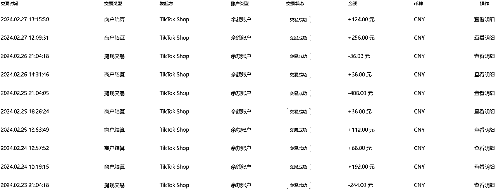
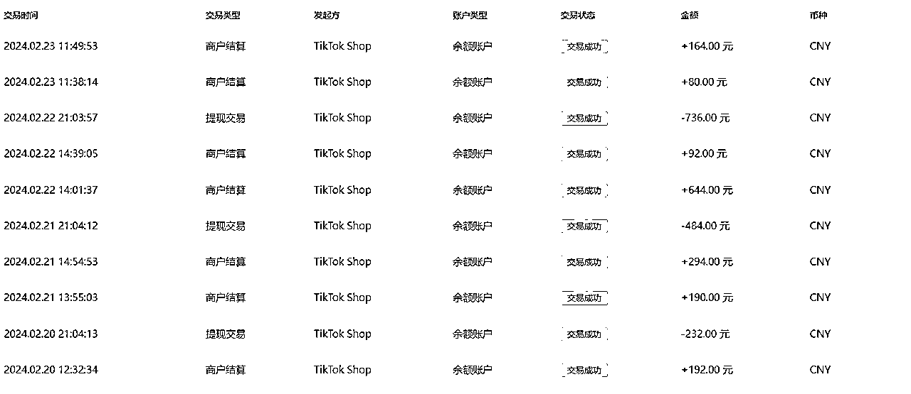
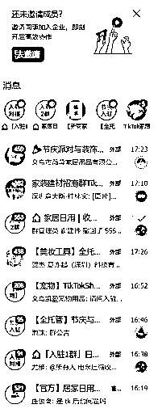
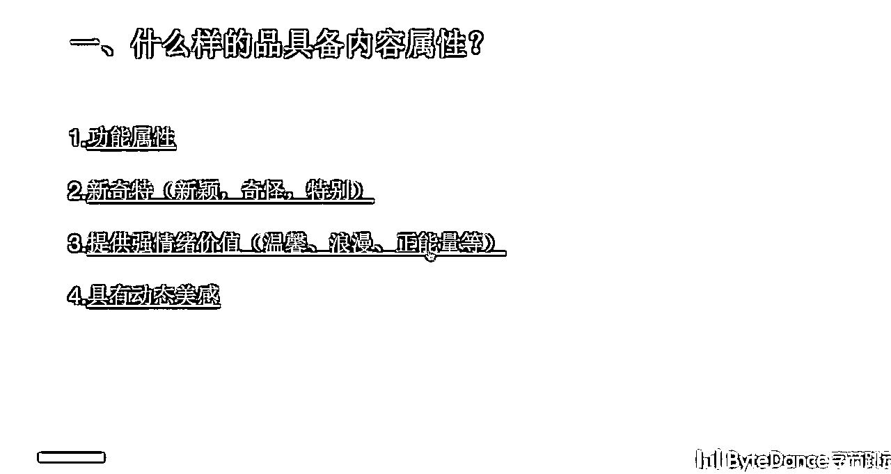
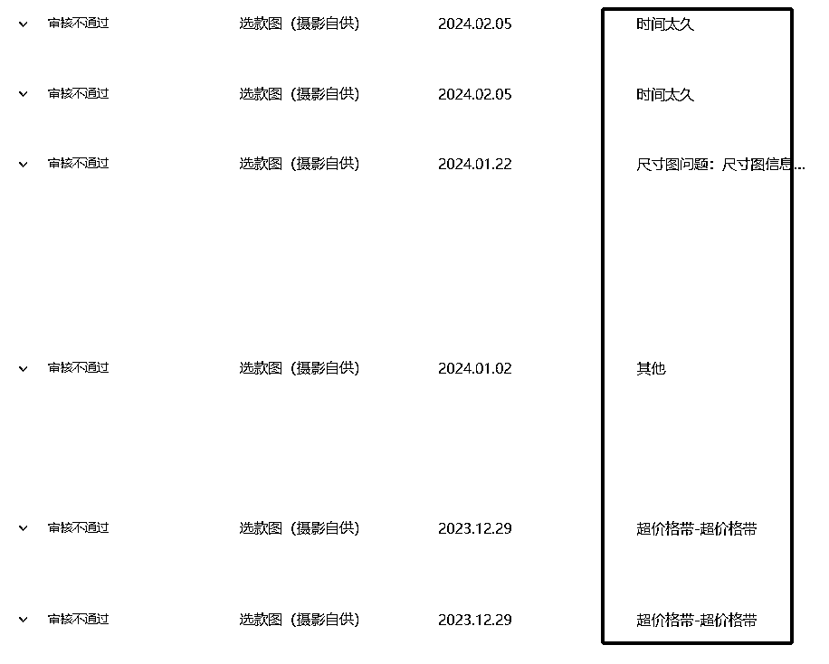
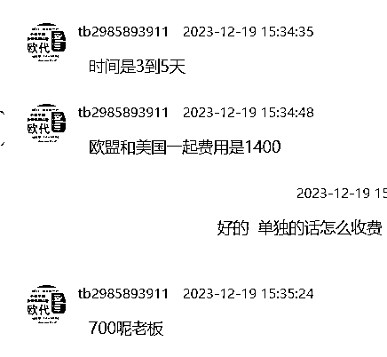
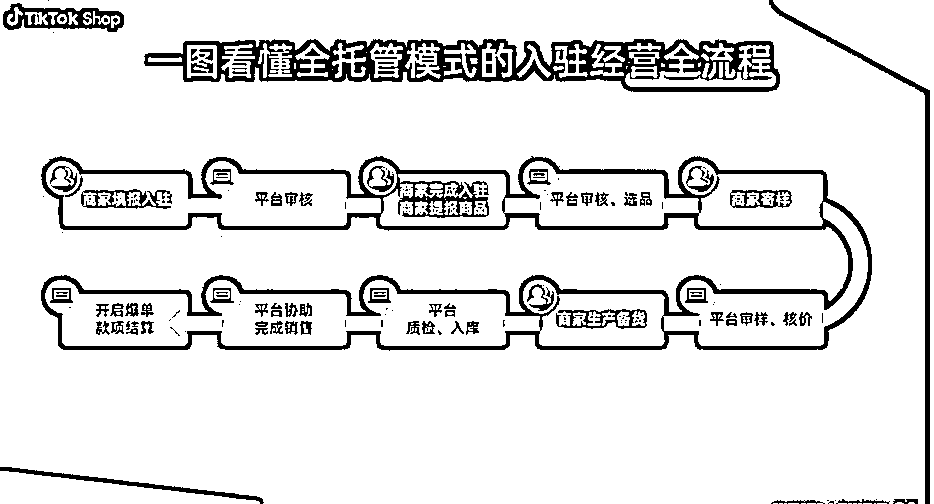
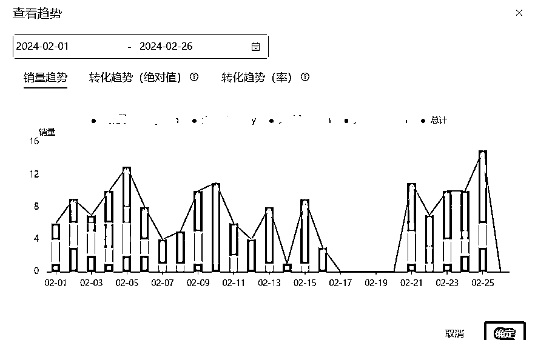
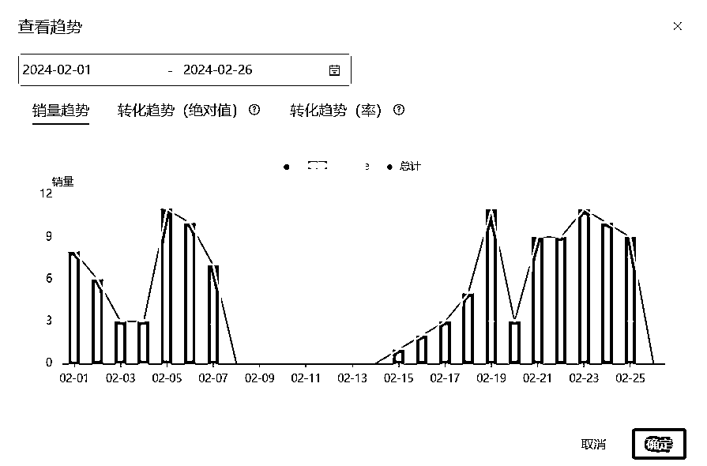

# 没认真做两个月，TikTok全托管就月入过万？我的实操复盘

> 来源：[https://lpt8zt3scl.feishu.cn/docx/Tvsxdt6gSoobVvxP6FwcCLB0nwd](https://lpt8zt3scl.feishu.cn/docx/Tvsxdt6gSoobVvxP6FwcCLB0nwd)

大家好，我是大郑，95后，创业这条路一直没停过。电商就是我混的主要战场。毕业后在深圳入局跨境，先后做过亚马逊、速卖通等几个主流平台，成绩平平，竞争也越来越卷。后来转战国内抖音电商，算是攒到第一桶金。

TikTok全托管出来也有一段时间了，生财群里大家聊得挺热，但像样的实操贴却不多。我正好把它当成一个测试标的，摸了整整两个月，现在把真实的体感和数据摊开说，让想入局的朋友有个更立体的判断。

先说大背景。TikTok美区本土店刚经历过一波大封店，巨量需求之下产品缺口很大，靠本土商家根本补不上。于是全托管模式就填上了这个空。它的核心优势也很直观：平台背书，自带前后端补贴，价格更有竞争力；物流由平台整合，虽然比不上亚马逊的速度，但和现在的Temu比已经很能打了。

先说结果。入驻时我也没想着all in，纯粹试试水。第一批试水的品一口气上了21个，后面就没再补新品。最终审核过12个，真正上架9个。现在能稳定出单的有3个，日销在50单左右。拿货价在10到30元区间，利润率能做到供货价的40%-50%。只要供货稳定不断货，月入过万是稳的。

说实话我自己也挺意外。9个链接里能有3个小爆，我觉得除了过去跨境电商的积累和这几年电商的经验外，最大的变量还是站上了TikTok电商的风口。

入驻流程

操作起来并不复杂，之前群里也有人分享过。按平台要求正常提交资料就行。目前只接受公司执照和个体户入驻，纯个人暂时不支持。资料通过后，平台会拉你进飞书商家群，后续问题直接找对应买手或在线客服就行。

招商链接：full-service.tiktokshopglobalselling.com

审批通过后登录全托管卖家中心：https://mmo.fanczs.com/

在 https://mmo.fanczs.com/ 上报商标信息，如有的话，再完成对公认证和税表提交。商标审核通过后就能开始推品了。补充一点，现在商标并非硬性要求，无品牌也能正常上架。

基础配置

进店先把基础设置做完：

收款方式：支持对公、对私、连连支付；
地址管理：退货地址和发货地址要填对；
资质管理：对公认证、税务信息、商家验证，走顺的话1-2小时搞定。

类目设置

目前主营类目分四大块：家居日用、3C数码、服饰配饰、美妆个护。平台要求一个店铺只挂一个类目，每个类目背后都是独立的运营团队。比如你做家居日用，3C数码的官方是不会跟进你的。

入驻后平台会把你拉进对应的官方类目运营群，有事找对口的人。实际跑下来发现，店铺也可以兼挂其他类目的品，只是要额外对接其他团队。平台更倾向商家做垂直精细化运营。

选品思路

有跨境经验的老手这块可以跳过。选品方式很多，但现在给新手的建议是直接对标Temu的爆品和潜力品。托管平台的用户重合度高，参考价值很大。

要注意的是，所有审核通过的品平台都有备案，你看上的品可能前面已经有几十家商家在卖了。平台会优先推最早通过的链接，如果你的款式一样但价格没优势，通过率和流量都会受限。

所以选品前最好装一个TikTok美区版，看看商城里竞品的真实售卖情况。竞品少可以跟，竞品多且卖得一般就放弃。市面上现在冒出了不少TikTok选品工具，价格对标老牌跨境工具，但数据准确性一般，新手没必要硬上。手动看盘更扎实，品感也会练出来。工具等到精细化运营阶段再补也来得及。

官方选品建议如下图：

上架细节

据官方经理透露，后台框架是美国团队做的，和国内电商后台差别不小，刚用会不习惯，多上几款就顺了。上架流程简单，但对图片审核极严。实物和图片有出入、尺寸对不上，就会打回。上架时一定要把图片和尺寸图准备好，严禁出现中文字体。系统在上品时会一步步提示，按要求完成即可。后台现在有卖家学习中心，建议先过一遍。上架被拒也不用慌，系统会给出具体原因，改完重传就行。

平台有专门的买手部门，只有品早、符合需求，运营才会真正把链接推到对应国家。买手审核过不代表一定能上线。我有几个新品发货过去快两个月了还在待上线，大概率是同款太多被卡在运营环节了。

特别提醒：所有带电或需要通电的商品，都必须上传对应国家的电器认证和标签。美国要FCC，欧盟要CE，英国要UKCA。这些资质一般要找工厂提供，有实力的工厂都会有。也可以找代办，淘宝上几百块就能搞定，国内测试3-5天能出。

上架后会经历买手、风控、品牌、资质、类目、体积、重量等多个审核，最后由平台运营决定是否上架到具体国家。会出现美区上架了，英区、沙特没上架的情况，通常是因为资质没补全或各国政策不同导致的。

发货要求

新品上线后，平台会要求每个SKU至少备5个作为测品的最低量，这个门槛算很友好了，商家接受度也高。但一定要严格按发货指南操作。国内唯一中转仓目前在广州花都，每个包裹必须包含SKU标签、送货单、物流标签。包装只允许英文和中性包装，不能出现中文，否则会被拒收退回。

测款成功后平台会下返单，只能按平台给的量备货，不能超发。有紧急需求可以找买手申请额度。整体来看平台运营比较克制，单量平稳，不会出现国内抖音那种大起大落的情况。

入驻全流程可参考官方图：

运营端

商家基本不用参与运营，只需要接单发货。如果想自己找达人带货清库存，平台是鼓励的，也有给达人寄样的入口，具体可以联系在线客服协助。

最后是我自己的几条实操感受：

1.  反馈速度很快，有些品隔天就出单了。平台对好品扶持明显，选品投入产出比很高。

2.  目前贸易商身份入驻比工厂身份更有优势。早期平台缺的是大量优质商品，对价格不敏感。贸易商选品能力强，能快速铺货赚差价。工厂受品类和产能限制，起步会慢一些。当然很多工厂也是以贸易商身份在操作。
3.  平台扶持很实在：发往广州仓库的国内运费，平台与商家各担50%，且签约运费很低；备货时间宽限度大，没有国内电商24/48小时的考核；退货成本除质量问题外由平台承担；目前无平台佣金、无流量费、无入驻费、无海外仓储物流成本。
4.  单量稳定性是我最担心的点。怕像国内一样爆单后断崖式下跌。但目前来看流量是被有意控制的，出单品的销量比较平稳，不会出现大起大落，给供应链留了喘息空间。下图是我两个品近一个月的出单曲线，中间的空档是过年工厂停工导致的断货。
5.  虽然不用备货到海外，只发国内仓，但仍是重资产模式。单量做大后备货压力会显著增加，滞销风险也随之上升。这是目前我不愿意重仓投入的原因，正在探索更轻的模式。同时托管模式还在早期，政策会变，要持续关注。建议根据自身资源和资金量理性决策。

总体来说，TikTok全托管是一个正反馈快、门槛相对低的项目，小赚大赚都可以。哪怕当副业做，月入过万也比较现实。因为不用耗费大量时间做运营和售后，出单后抽空采购发货即可。

分享就到这里了，希望对大家有参考价值。有错的地方欢迎指正。我也在持续找轻资产项目，5年跨境经验，2年国内社交电商经验，抖音、视频号、小红书都做过，目前也在做自媒体公众号：进击的大郑，欢迎交流。合适的项目也欢迎推荐。

祝大家早日暴富，一起生财！我是进击的大郑，下次见！

10月份更新：目前该项目我已暂停，后续政策变化需要自己实操才能感知。现在的TK全托管竞争比今年2月时激烈很多，想入局的朋友建议先开店自己试一下。本文主要是开路作用，不做任何投资建议。