# 支付宝无人直播带货，新手也能上手的完整教程（附蓝海红利解析）

大家好，我是华聪，一枚混了四年生财圈的老圈友。平时我基本都是潜水看别人的分享，自己很少动笔。这次不一样——一个朋友最近在折腾支付宝无人直播，起初我没太上心，但眼看他这几天的数据越跑越好，我赶紧去圈里搜了搜。结果发现风向标倒是有不少，真正能照着做的步骤却没人写。行，那我来写。缠着朋友把每一个细节都问了一遍，自己又跑通了全流程，今天完整拆解给你。

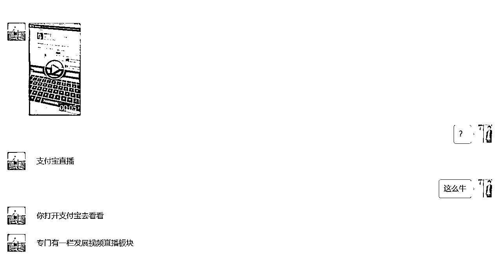

## 为什么现在入局是好时机？

### 1. 平台正处扶持期

支付宝直播目前还在红利阶段，官方允许优质的录播内容进场。也就是说，你只要把素材准备好，完全可以“人不在直播间，货照卖”，不用怕录播被判违规。一天24小时都能挂着播，还能复制多个号做矩阵，放大收益。

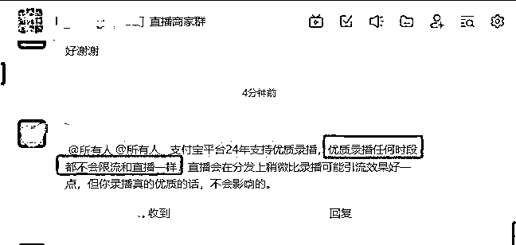

### 2. 零囤货、高佣金

卖什么？直接去支付宝的选品广场挑就行。看中的商品一键加入带货车，开播后就能挂车卖。选品广场品类丰富，佣金也给得相当豪爽，最高能拿到50%的分佣。相当于卖一单赚一半，而且不用你发货、不用你囤货，省心到极致。

我还特意去筛选了一圈，50%佣金的高福利品不少，客单价也不高，用户买起来不犹豫，出单率预计不错。

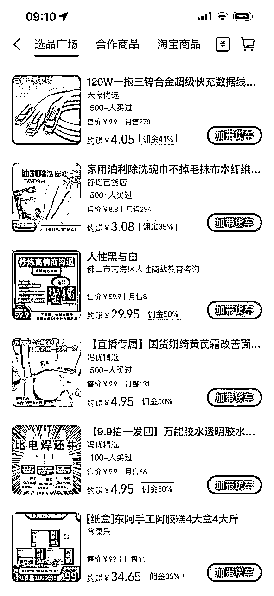

### 3. 背靠9亿活跃用户

支付宝月活用户有9亿，而且大多是带着钱包来的，消费力在线。现在入场还有平台流量扶持，竞争者又少，妥妥的蓝海。

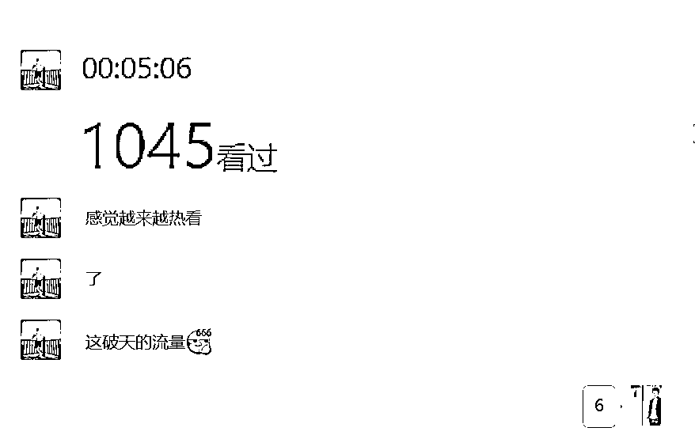

## 从哪赚钱？

### ① 卖货佣金

最直接的变现路径。选一些日常高频、佣金比率高的商品去挂，一个号一天做到1000块GMV，佣金收入就能有好几百。多个号跑起来，收益更可观。

### ② 带学员收徒

操作顺手后，你可以矩阵化放大，也可以把方法整理成教程带人。现在知道这个玩法的人还不多，信息差就是钱。市面上已经有不少人靠收徒收费几百块，你也可以分一杯羹。

## 手把手实操：五步跑通全流程

### 第一步：申请个人达人开播号

打开支付宝，在搜索框输入“支付宝直播”并进入。如果你还不是认证主播，按提示点“去认证”。

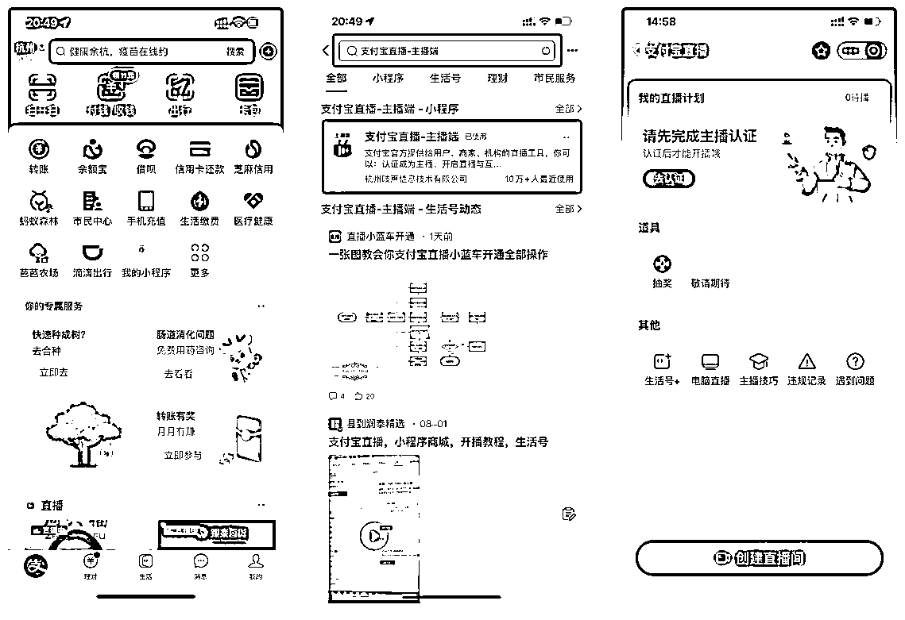

认证通过后，点击“带货广场”。如果没开通带货宝，系统会提醒你操作。

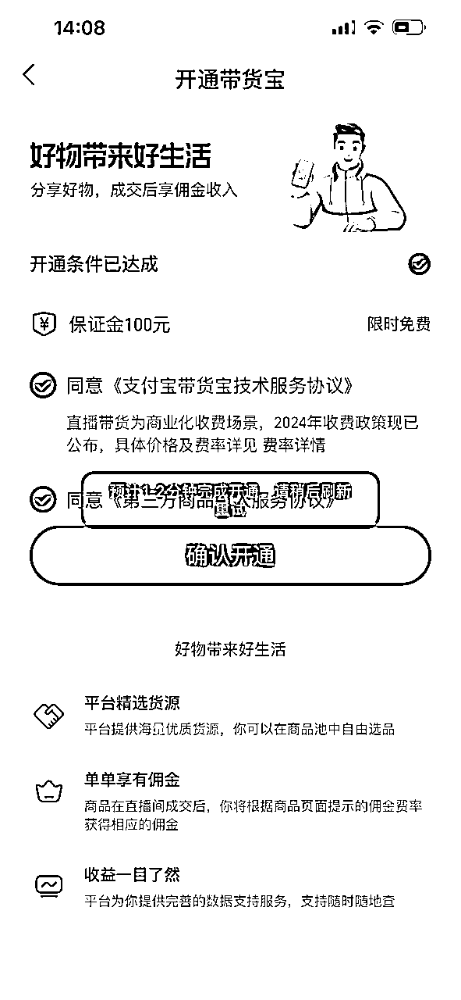

带货宝原本要交100元保证金，好在现在有活动，限时免费开通。开通后，你的账号就有了直播带货权限。

### 第二步：选品

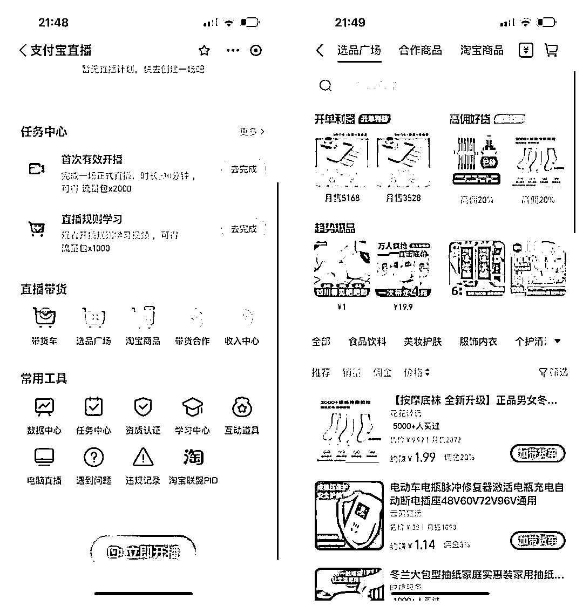

进入选品广场后，建议优先选佣金高、销量好的通用商品；如果你有自己熟悉或喜欢的类目，也可以选那些品。把看中的商品加入带货车，以后开播时直接在带货车里上架就行。

### 第三步：下载官方推流软件

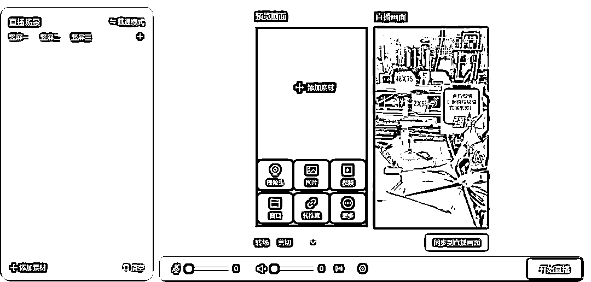

需要用支付宝官方的直播伴侣，安装说明链接放这了：
https://shenghuohao.yuque.com/vtztm0/odmr7z/ueo7zt6fz5nssepw?enableWK=YES

### 第四步：配置直播素材

下载安装后，打开软件，先点“一键开播”。接着把准备好的直播素材传进去。我这儿整理了一份各行业的素材包，直接拿走：

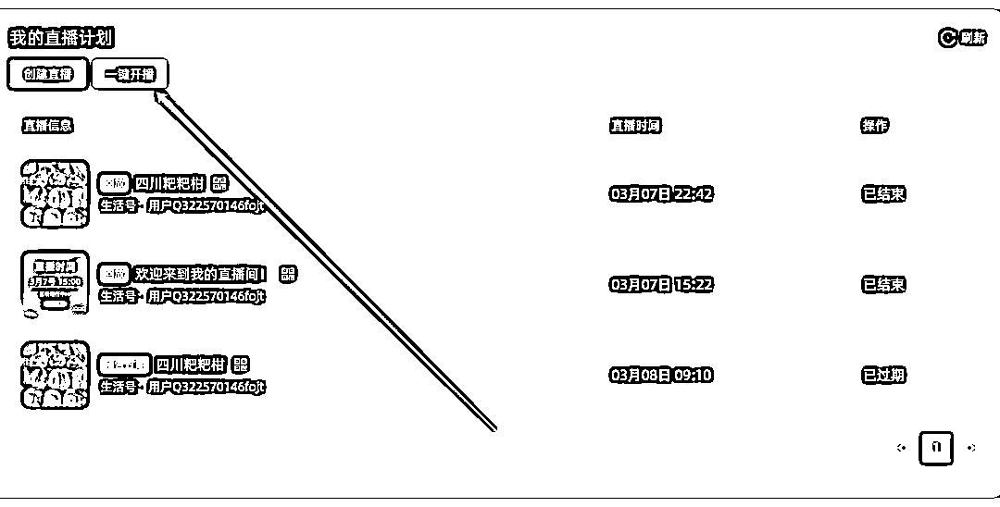

支付宝无人直播素材
链接：https://pan.baidu.com/s/11yGDZk303xrwPfUJEF1ZBA?pwd=9999
提取码：9999

不想用现成素材的话，还有个办法：找一些画质好、和你带货品类一样的直播间，尽量选不带人物肖像的，用录屏工具把画面录下来当素材。录屏软件和教程都在上面的素材包里，保存后就能全部领取。

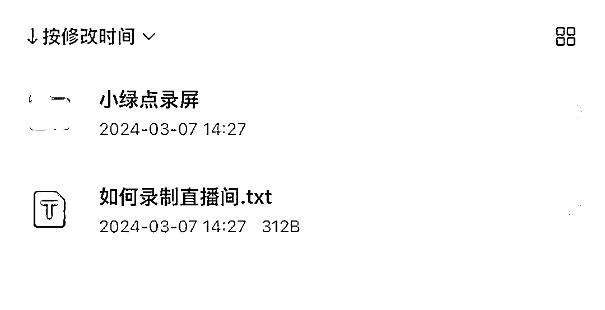

### 第五步：正式开播

打开软件，点“添加素材”，你准备卖什么就添加对应类型的录播素材，然后点“开始直播”。

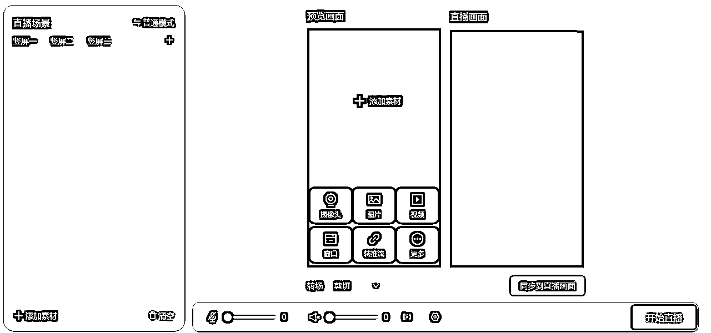

开始直播前，记得把直播间类型选为“正式直播”。封面图可以截取产品视频里的画面，或者用稿定设计套个模板，制作一张封面传上去。

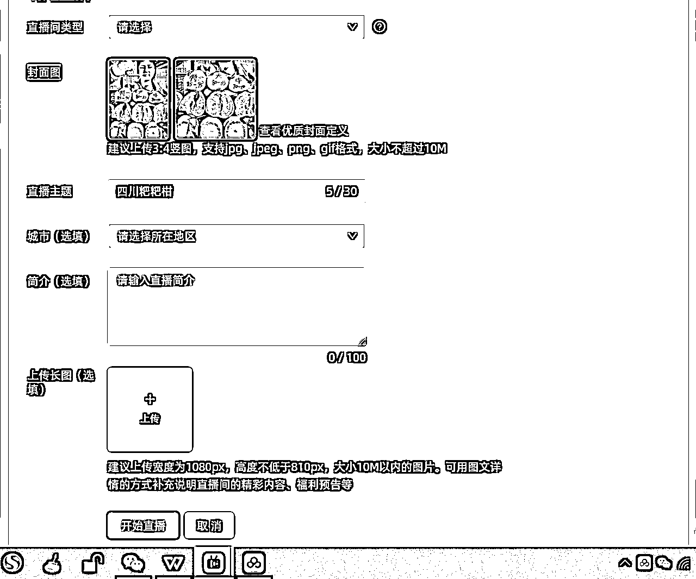

这些设置完成后，点“开始直播”就行。直播开始后，去带货车里把要卖的商品上架，整个流程就通了。此外，项目需要用到的资料、文档和常见问题解答我也汇总了一份，有需要可以自取。

## 最后说点掏心窝的话

上面这套流程是我亲自跑过的真实步骤，但我不保证你跟着做一遍就能马上赚钱。做项目本来就会遇到各种幺蛾子，封号、限流、数据波动都正常。以前我遇到这些问题也会慌，第一反应是项目不行、我不行，想换赛道。但这两年看生财的分享、跟有结果的人学，心态慢慢变了：只要大方向没问题，遇到一个问题就解决一个问题。你能做出多大成绩，往往和你解决掉多少问题成正比。共勉。