# 节气借势的海报该怎么写？一次春分实操复盘
作者：龙哥

最近翻朋友圈，春分当天各路品牌都在发贴合节气的视觉物料。恰好碰上这个节点，回想起以往做品牌传播、以及为医疗机构搭建节日海报SOP的经验，用这次春分来把借势的思路理清楚。

先看一则真实的牙科连锁在春分的投放：

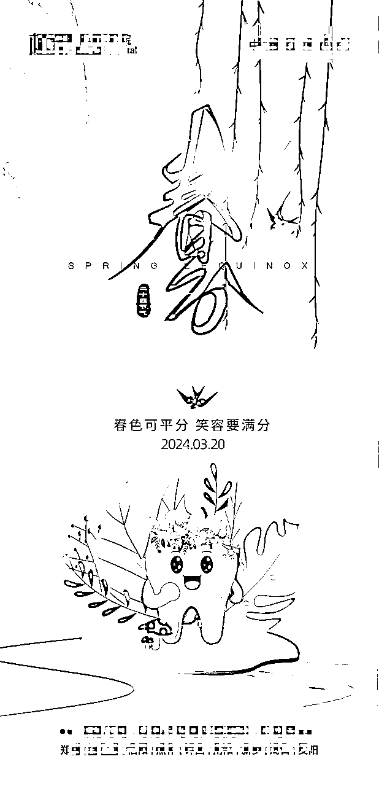

只看表层，“春色可平分，笑容要满分”顺口好记，但拆开来看逻辑是断裂的。

春色可平分到底在呼应春分哪一点？春分作为节气，为何能推出春色平分？笑容要满分本身没问题，笑容与春分之间的桥梁在哪？笑容又如何自然落到牙科品牌上？整张图想打动谁，我始终找不到共情锚点。

品牌内部可能会辩解：春分的含义你总该懂吧。据公开解释，春分的“分”一层指时令被二分，立春到立夏为春，春分正居中；另一层指昼夜二分，春分日太阳过赤道，昼夜各十二小时。气候上是暖和明亮。

笑容和牙齿不相关吗？一笑便露齿。这句文案既呼应节气又点到业务，这还不算巧思？我们业务覆盖种牙、儿童牙科、牙齿矫正，老少皆宜，这次借势自然想兼顾各年龄层。

正是这种打法，暴露出节日借势里的典型误区。

# 01 节日借势里常见误区

## 误区一：自己懂就以为别人也懂
春分意味着什么，对当代的大多数人而言感知很弱。日常注意力都在工作、娱乐、家庭上，节气知识几乎属于盲区。你按专业视角去写，受众根本接不上，越写越偏差。

## 误区二：硬在用户心智里造新联想
比如把笑容等同于牙齿。表面像常识，实则是自我合理化。传播不是凭空创造新概念去说服，而是抓取用户已有的认知做拼接再推进。

我曾接触过一个很小众的暖床产品暖被机。做法是通过一根管道把热风送进被窝，冬天进被窝更暖。跟同事提起名字，对方一脸茫然，需要很长的解释才略有认同。为何？直觉里暖被是伴侣做的事，电热毯又便宜又好用，凭什么花三百多买个鸡肋。品牌在解释概念，传播阻力早已出现。若改说成“比男友更靠谱的暖床帮手”，理解成本马上下降。

回到牙科案例，用户听到笑容第一反应是幸福、愉悦，而不是牙齿。做传播要不断自我质疑、自我批判、反复校验，别沉浸自嗨。我习惯把文案给母亲看，她能看懂才算过关。

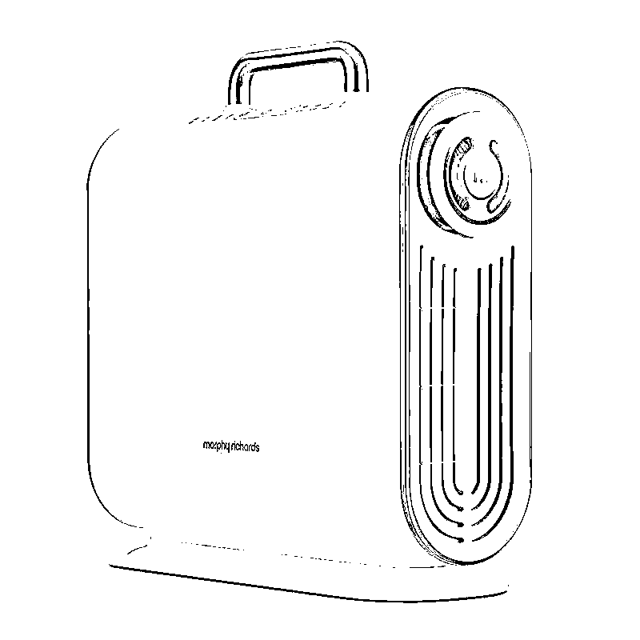

## 误区三：想覆盖全部人，最终没打动任何人
为了追求曝光，海报面面俱到。这是致命错误。说服无法用同一句话打动所有人，必须精准聚焦。面向所有人等于对谁都没说到点上，设计、人力、投放都浪费。

反过来，有聚焦才更有张力。你明确服务某个群体，其他人看到也会好奇“有没有适合我的方案”，反而会主动来询问。

说完问题，再看正确做法。

# 02 借势该怎么打才有效

看一个做得好的案例。

节点：母亲节
品牌：高性能抽油烟机

创意核心：妈妈大半辈子在厨房做饭，日复一日被油烟熏，伤身又劳累。母亲节这天，用一台吸力强的抽油烟机守护她的呼吸与健康。

文案：岁月侵蚀了她的脸庞，别再用油烟吞噬了她的健康。

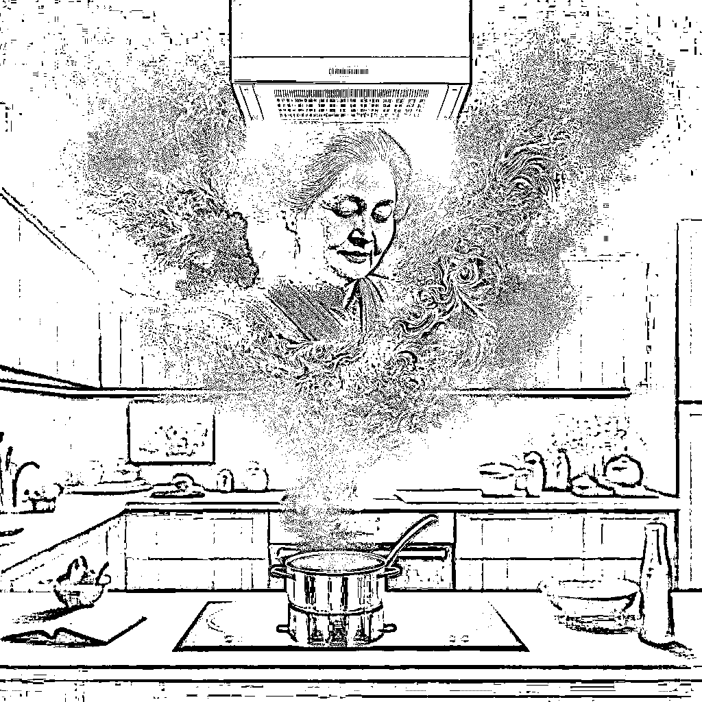

这组为何有效？

1. 节日与品牌衔接顺滑，没有生硬感；
2. 受众画像清晰，是想回馈母亲的年轻一代；
3. 读完会产生购买冲动，因为之前忽略的问题被点醒。

逻辑可拆为四步：

1. 先解析节日对应的大众愿望。母亲节的核心愿望是母亲更健康、更安好。
2. 明确品牌的核心受众，以及该受众与愿望的关联。高性能抽油烟机的核心用户是年轻有娃的女性，她们刚成为母亲，更懂照顾的辛苦，也更希望自己的母亲健康。
3. 找到品牌能解决的具体痛点，以及解决后如何助力愿望。很多母亲远离家乡来带娃做饭，长期受油烟困扰。强吸油烟机切断伤害源，让母亲更健康。
4. 把节日、愿望、品牌价值三点拽在一起，就能产出好创意好文案。

思路清晰了，灵感跟不上怎么办？用 ChatGPT 走流程。我使用的是 ChatGPT 4.0。

# 03 用 ChatGPT 落地春分海报

第一步，我先把春分的释义喂给模型。

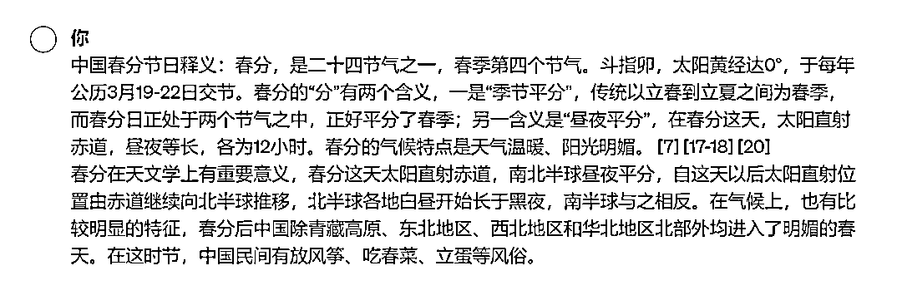

它做了归纳总结，先不评判。

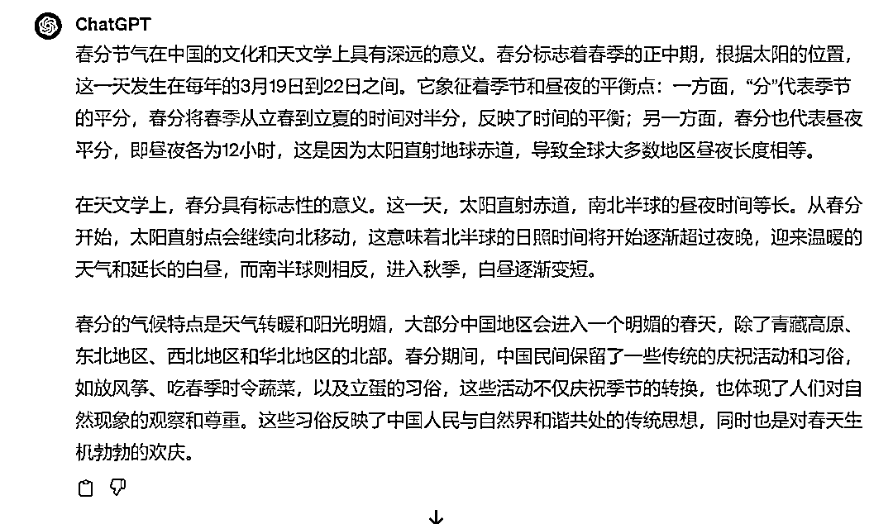

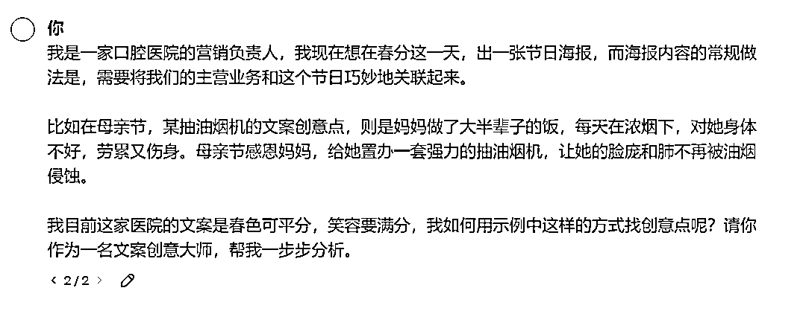

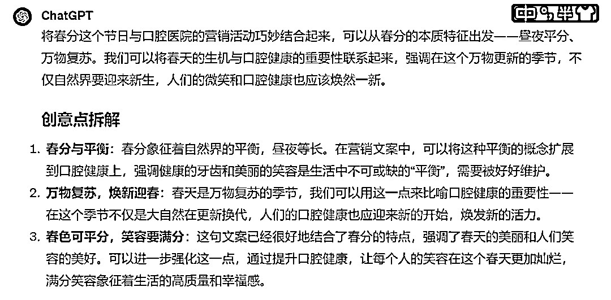

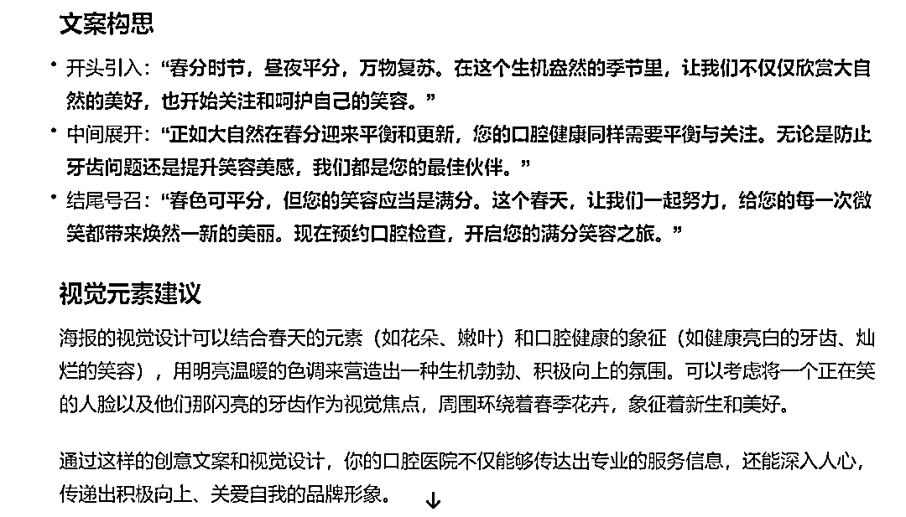

结果不满意，于是给出修改方向：

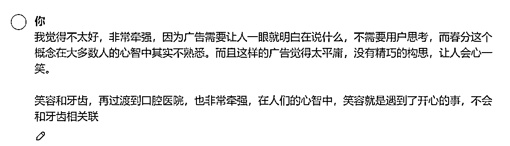

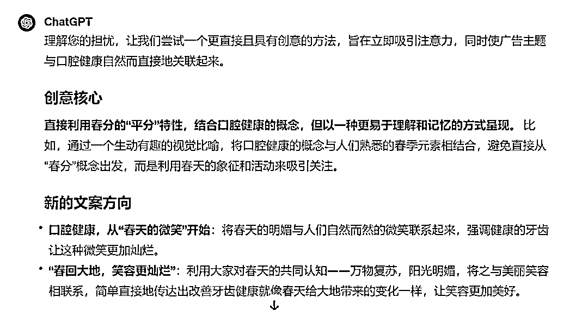

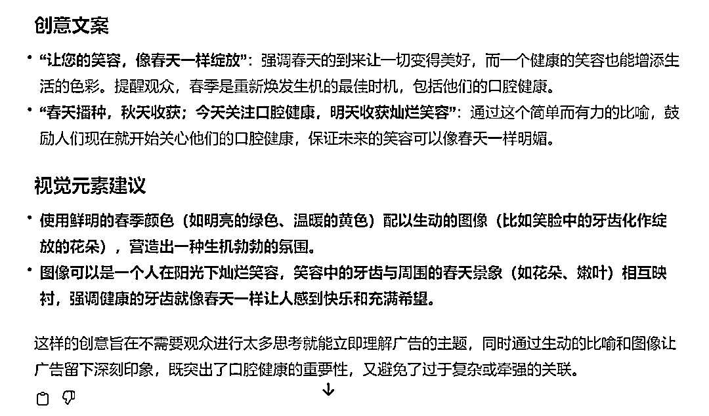

仍不理想。于是我把品牌与节日关联的步骤教给它，让它重跑。

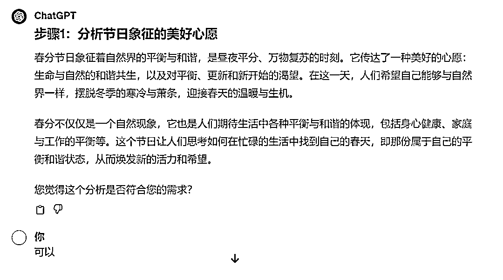

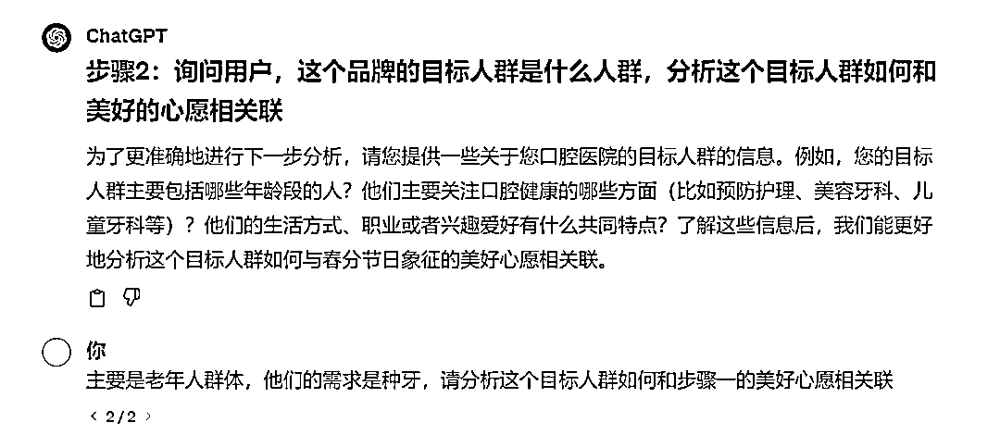

我锁定老年客群，是因为该医院当时正在做种牙节，种牙的典型人群多为老年人。

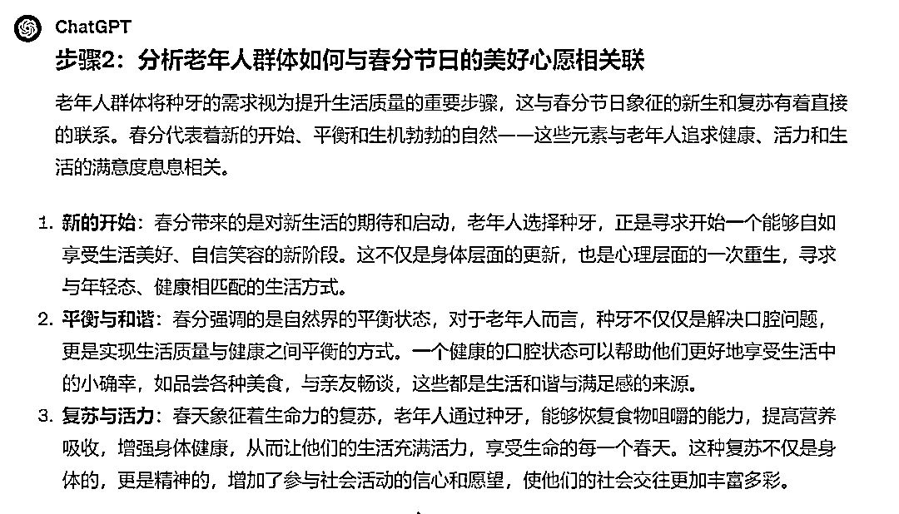

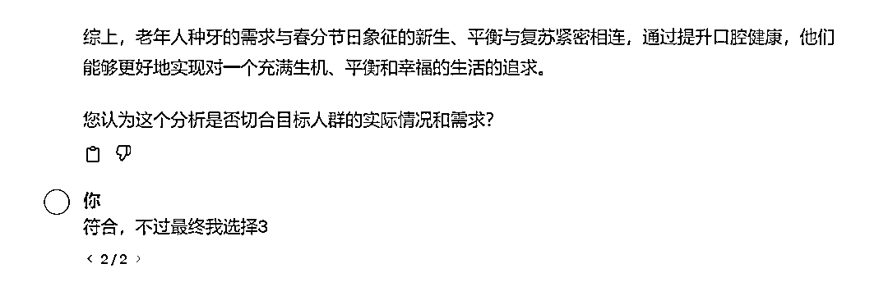

为何只保留3条？海报需要聚焦，一个点讲透即可。

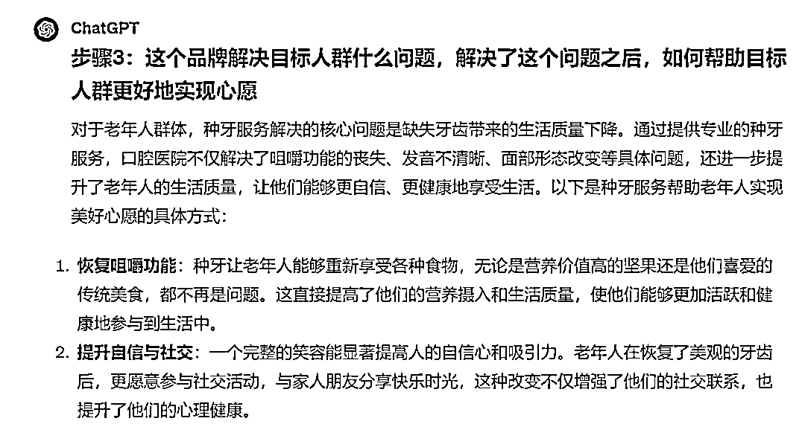

看到它的解读后，我获得灵感，蹦出一句文案：

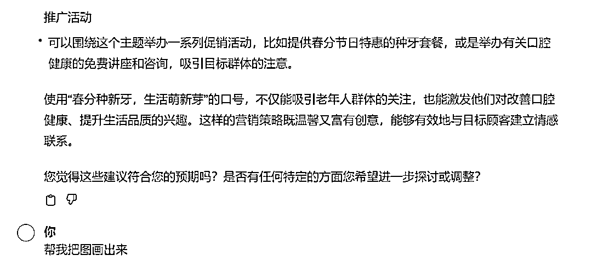

这个阐释我比较认可，接下来让它直接出效果图做参考。

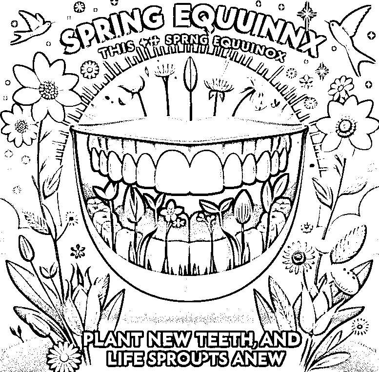

生成的图视觉冲击力强，与文案搭配度高，后续交给设计师做精修即可。

案例已获当事人同意后发布。