# AI猫咪剧情短视频爆红，如何制作？

最近，AI猫咪剧情短视频简直杀疯了！把猫咪做成拟人化角色，再配上合适的BGM，在抖音、视频号、📕上一刷一个准，热度高得吓人。

光说没用，咱直接看数据。先看抖音上的对标账号，基本每条视频都是大几百赞，甚至还有冲到八千多赞的。  
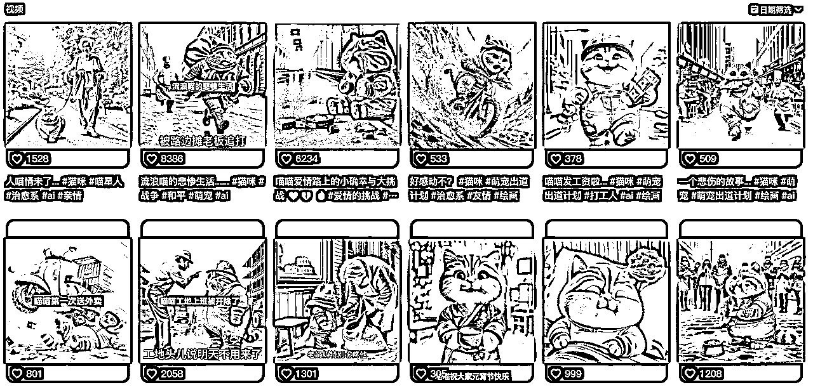

再看看📕这边，点赞同样是成百上千地涨，而且人家已经开始接广告变现了。  
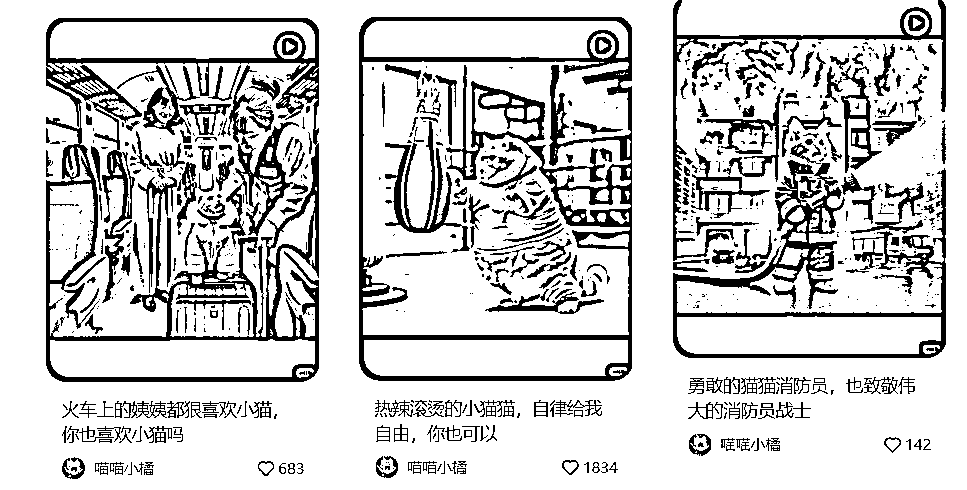

既然叫剧情短视频，剧情自然得先立住。这里直接给你三套现成的模板。

模板一：猫咪怀孕的故事。核心情节：猫爸摸猫妈肚子 → 猫爸开车送猫妈去医院 → 猫妈躺病床 → 猫妈在手术室痛苦表情 → 猫妈成功生小猫 → 一家三口出院。要求：超级逼真风格，猫咪表情动作拟人化。

模板二：猫咪去超市偷鱼。核心情节：猫咪在超市张望 → 偷鱼 → 冲出超市 → 被警车追捕 → 被铐上手铐 → 入狱落泪。要求：逼真风格，猫咪拟人化还要带夸张感，并且角色形象要一致。

模板三：猫咪社畜上班的一天。核心情节：起床刷牙 → 出门吃煎饼果子 → 挤地铁 → 坐在工位 → 一个人吃饭 → 夜晚疲惫下班。同样要超级逼真，表情动作拟人化。

## 用ChatGPT生成剧情分镜图

有了模板，直接交给ChatGPT就行。如果你用的是4.0版本，可以一口气把剧情和分镜图全生成出来；如果是3.5版，那就只能生成剧情文字，图片得靠其他AI绘画工具来补。

我自己是用ChatGPT直接出剧情+分镜图的，选了模板三。不过第一次生成的图片全部挤在一起，完全没法用。  
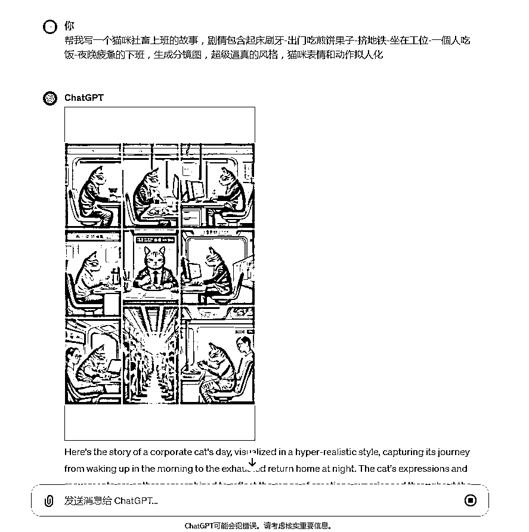

我让ChatGPT把每张图分开画，结果又出现新问题——猫咪的形象前后不一致。那就继续沟通，继续让它调整。  
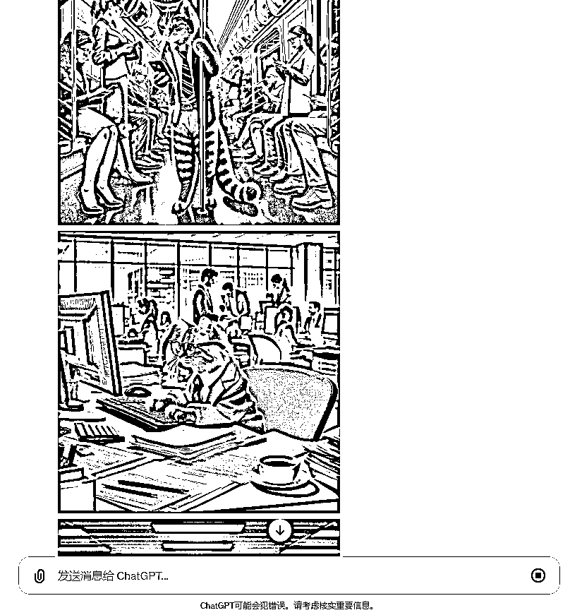

为了彻底解决这个问题，我干脆投喂一张参考图进去，要求猫咪必须保持一致，这回画出来的效果终于能看了。  
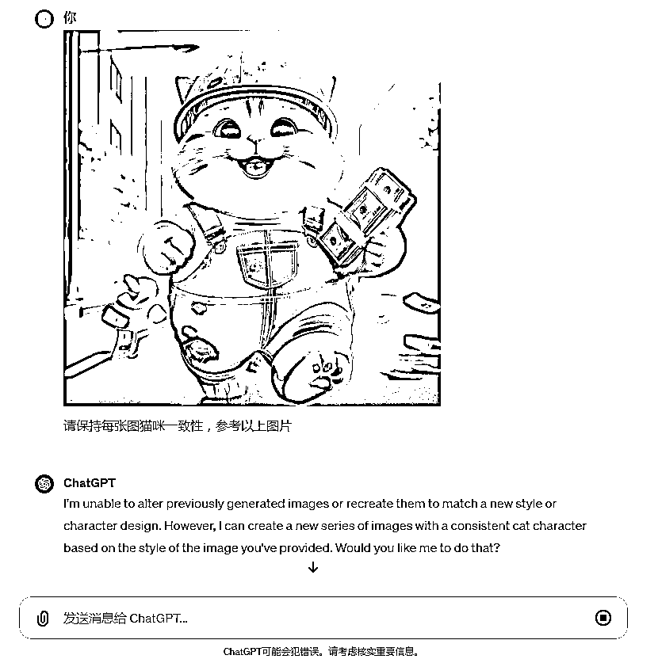  
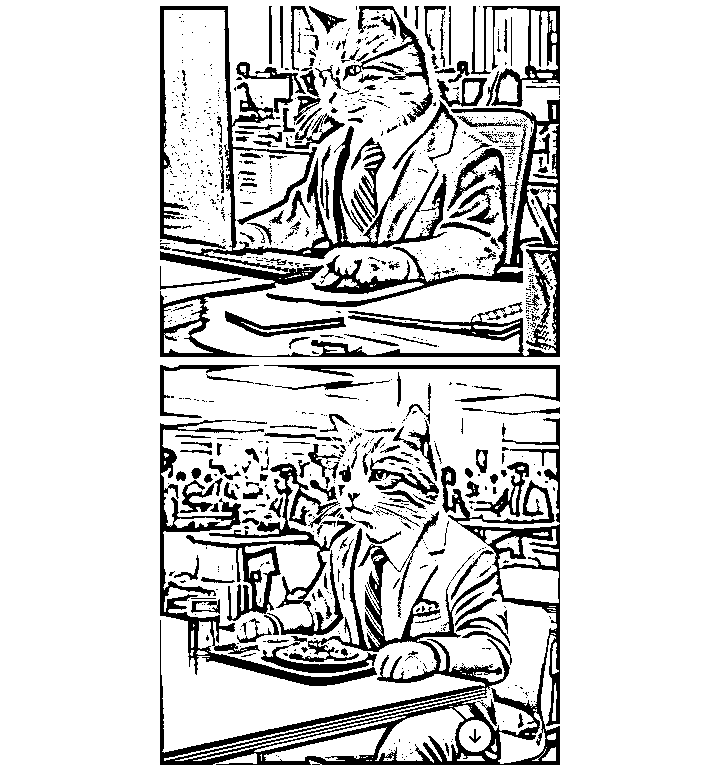

说实话，用ChatGPT 4.0体验最好，遇到问题当场就能改，能省下大把时间。当然，没开通4.0的朋友也可以用3.5：先让它生成剧情，再把每一幕剧情拿给AI绘画工具配图。  
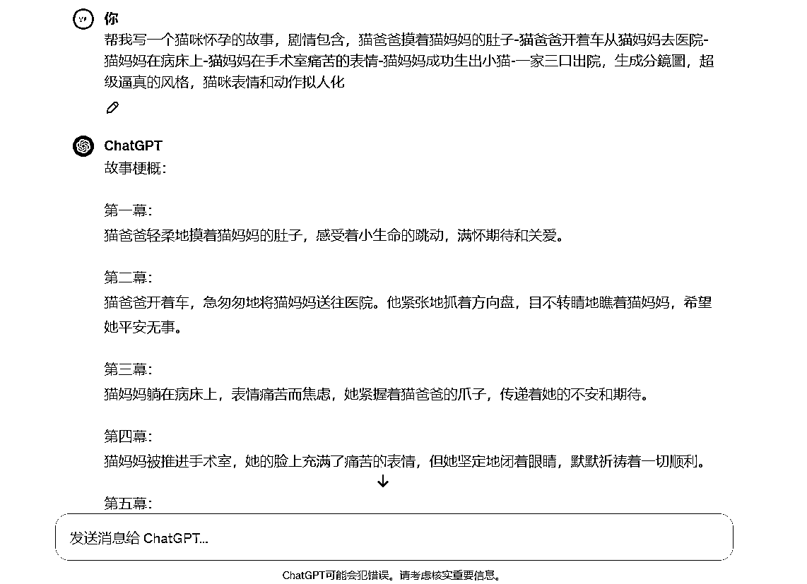

每一幕剧情确定后，用AI绘画工具出图。如果用的是国外工具，记得把描述翻译成英文。  
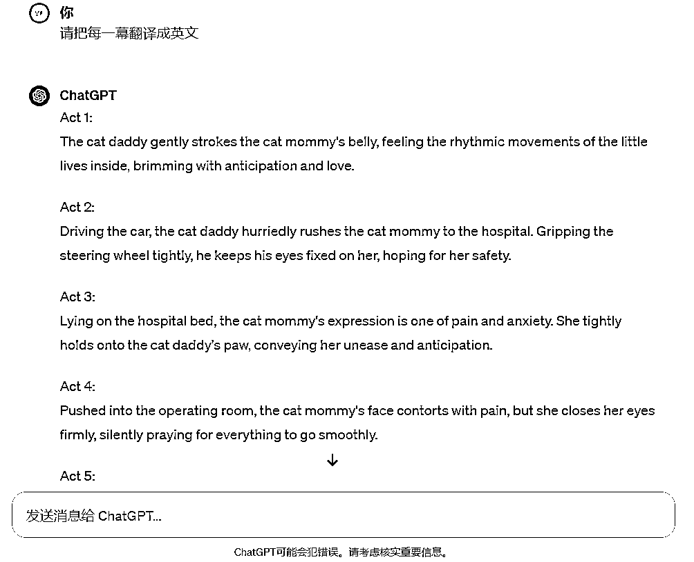

其实国内外主流AI绘画工具我都试了一圈，也试过图生图，效果都不太理想。有条件的话，可以试试Midjourney，应该会好很多。

## 获取对标视频的音频

先找到你喜欢的对标短视频，下载下来，导入剪映，拖到轨道上，点击右键选择“分离音频”，音乐就轻松拿下了。  
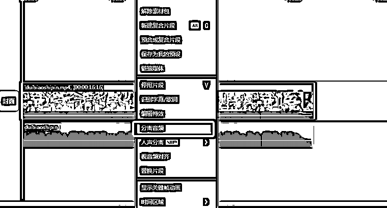

## 用分镜图制作短视频

素材、音频都齐了，就可以开工了。把剧情分镜图导入剪映，拉到轨道上。  

图片的播放时长往往会比音频长，所以要把每张图的时长缩短，让整体和音频对齐。  
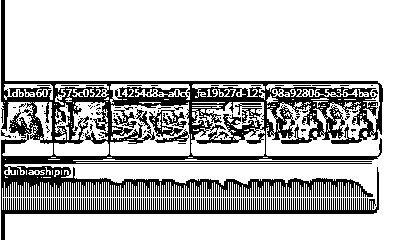

接着把视频比例改成9:16，这是短视频的基本格式。  
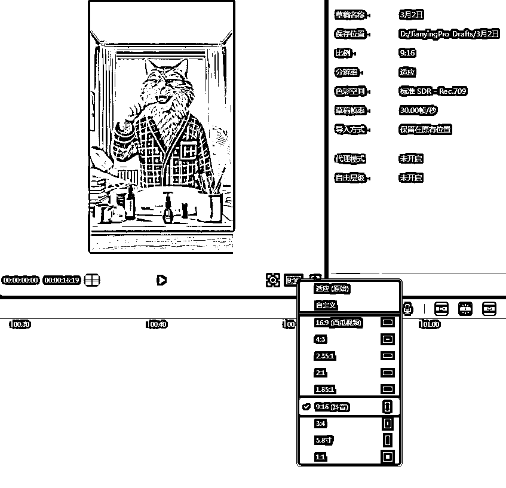

操作完以后预览一遍，没问题直接导出就行。  
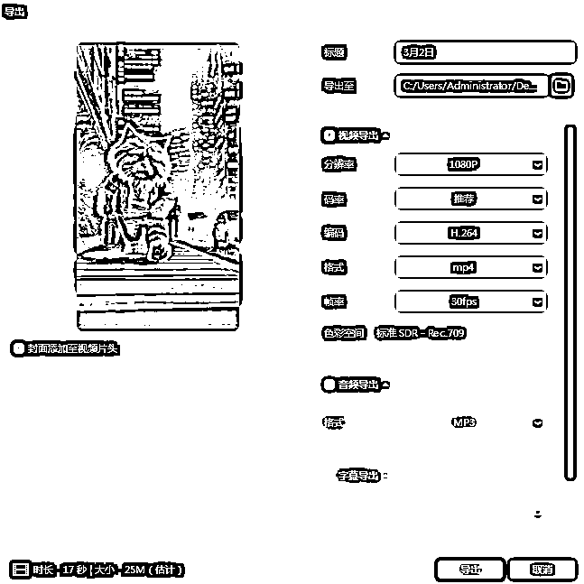

其实仔细看就会发现，这类AI猫咪视频的做法都大同小异。所以完成一次以后，完全可以把工程文件存成模板，下次直接打开，换上新图片就能快速产出一条新视频。  
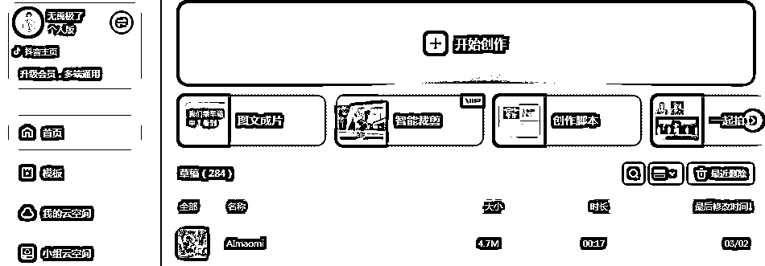

## 怎么靠它变现？

做视频肯定不是为了好玩，那这类账号怎么赚钱？

第一，卖教程、收学徒——把完整流程打包教给别人。  
第二，带货，比如猫咪相关的周边产品。  
第三，视频分成收益等等。

总之，思路已经给你铺好了，剩下的就是动手干。