# 3个月靠AI把人生首马跑进4小时，小白也能复制的打法

AI健康管家早已不是健身圈的玩具，它正在重塑医疗级健康管理的逻辑。用数据说话、用模型定制个人方案，专业教练制的壁垒被打破，精英才能享有的系统化身体管理，现在普通人也能用。跑步、抗病、日常体能，全流程都能被精准掌控。

# 一 为什么我一定要去跑马拉松

一个人清楚自己为什么而活，就能扛住几乎所有难受。

2017年查出肿瘤，经历过生死线后，我在病房里读到戈达德的故事。1939年二战阴云笼罩，15岁的约翰·戈达德在餐桌上写下127条人生清单，并寄给《生活》杂志公开。尼罗河探险、埃塞俄比亚原始文化调研、攀登珠峰、潜艇下潜、海上航母起降、学笛子小提琴、通读大英百科全书……这些目标放到今天依然惊人。70岁时他完成了其中109项。环球4次、养猎豹、造望远镜、做教授、还客串了《人猿泰山》。从那以后他成了我的人生坐标。

2019年30岁时我给自己立下活出100种人生的目标，腹肌、置业、出版都在里面。
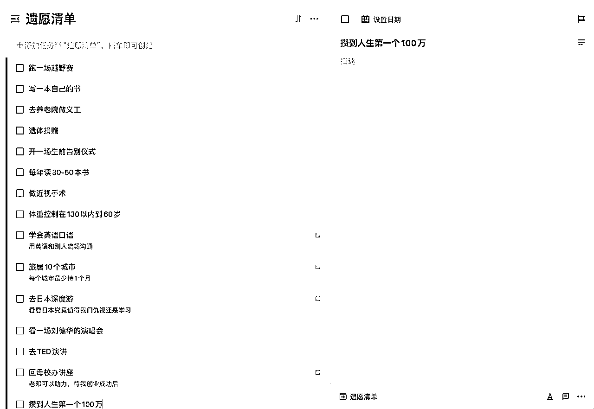

这几年我越来越明白，人生不是攒钱换药续命，而是用来体验的。我只活一次，要一年换一种活法。对人敬畏，带着礼物的心态出现；对事敬畏，有准备再出发。

这几年一路跌撞，但目标一个个兑现：腹肌、买车买房、月入10万、跑马拉松。中国能跑全马的只有22.6万人，约万分之一。很多人跑马是为挑战，我不一样。我自律极差，需要用赛事的硬约束倒逼自己改变作息，把肿瘤复发的风险降到最低。

2022年2月接触AI后，我想用自己做一次普通人的生活实验，测一下AI Agent到底能做到什么程度。想推广AI，先让AI改变自己，把自己变成案例，这一直是我的做法。

我问过身边做跑步教练的朋友，他们的核心服务无非六件事：定制化训练计划、技术动作纠正、心理激励、营养指导、伤病预防与康复、赛事策略。于是我没有找真人教练，直接在GPT上训练了一个属于自己的AI跑步教练。

2月开始跑步，断断续续跑了4场半马，验证这几年手术后的体能底线，没太大问题。
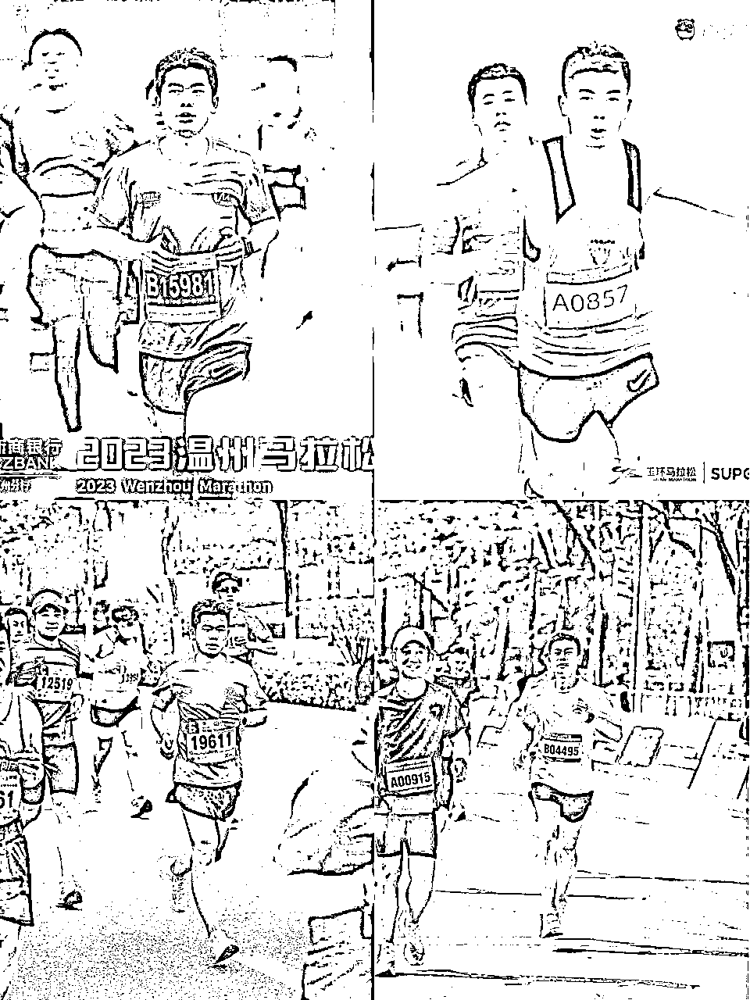

随后在2023年11月底，我借助ChatGPT正式开启为期12周、3个月的全马冲刺周期。

# 二 训练实操

## 1 训练计划怎么来的

教练最值钱的能力，就是结合基础和目标做周计划和成绩预估。这也是我最频繁调用AI的功能，细到每周每天。
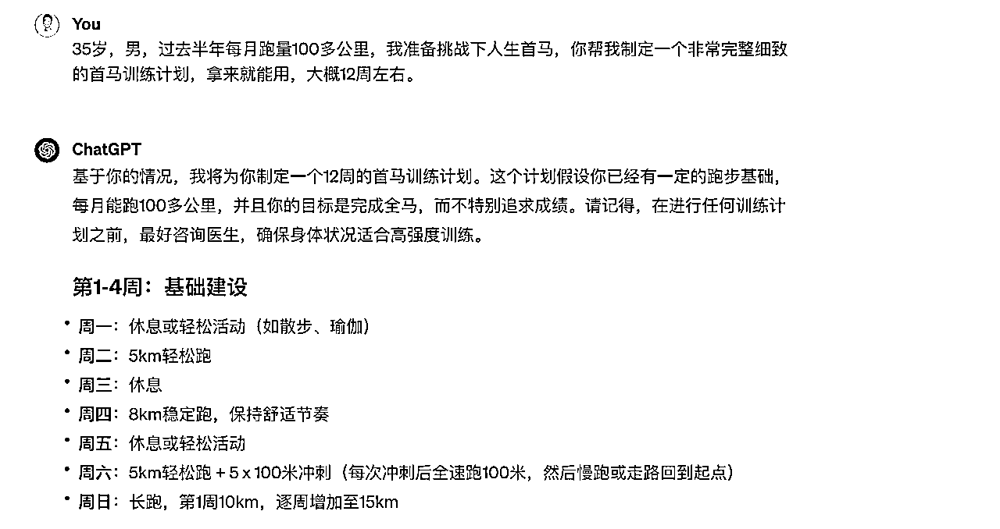

我总结了一套极简指令框架，CHAT模型=角色+背景+目标+行动。只要告诉它年龄、性别、当前跑量、目标配速和周期，它就能按四段式给出方案：热身期、强化期、模拟期、赛前减量期。
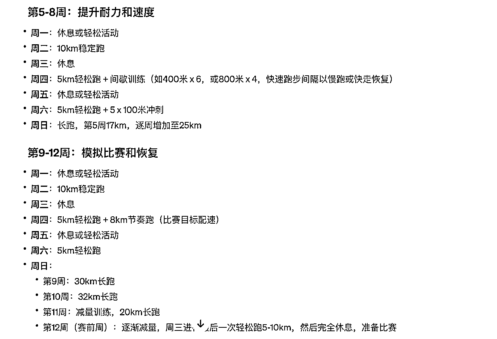

从11月29日到3月15日，我完全照单执行。3个月里严格跟着AI跑。
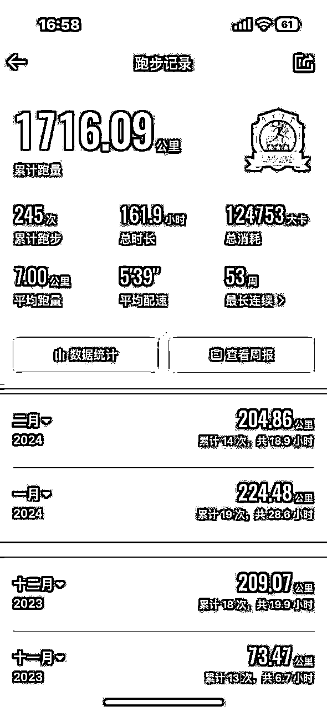

最难的是2月，月跑量冲到200公里。惰性、春节大餐、人情应酬、寒冷天气全上来。想做就有办法，不想做理由一大堆。跑步教会我的就是韧性，为了目标可以遇佛杀佛。
## 2 训练中的陪伴

完成训练后它会夸我，卡住时它会猛灌鸡汤。春节期间我跟它抱怨：大家都在吃喝我还在跑，太痛苦了，天又冷。它回得很暖，让我坚持下来了。
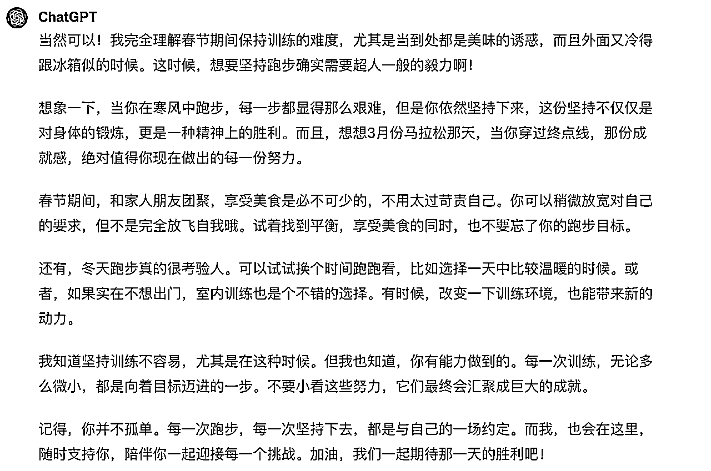

# 三 赛前准备

这是我人生第一场全马，准备清单全靠AI。半马只是溜溜腿，全马是另一回事。
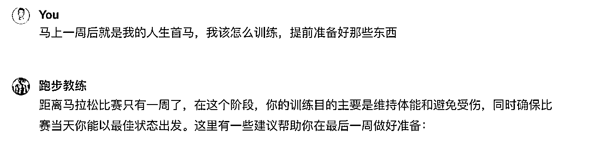

## 最后一周怎么跑
* 减量期：不是增肌的时候，是恢复储存能量的阶段。总量降到平时的50%-60%，保持轻松跑。
* 保持活跃：3-5公里低强度跑几次，保持身体在线，避免高强度拉练。
* 拉伸放松：瑜伽或散步，助肌肉恢复。
* 睡眠：足睡，增强免疫，避免临场感冒。

## 比赛前注意事项
* 装备检查：跑鞋、跑衣、号码布、芯片、防磨膏、能量胶全备齐。
* 赛道熟悉：起终点、补给点、厕所位置提前研究，有地图就先过一遍。
* 补给策略：训练时就用比赛同款补给，确定多久补一次水电解质和能量胶。
* 饮食：赛前一周逐步加碳水，增加糖原储备。赛前一天别吃油腻不熟悉的食物。
* 天气：看预报调整穿搭，下雨备防水，炎热选透气。
* 心态：别紧张，信任训练，保持乐观。

# 四 赛中打法

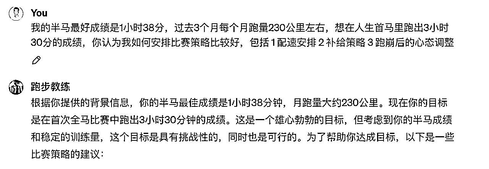

## 配速怎么配
目标3小时30，平均配速约4分58。开局要保守。

* 起跑0-5公里：略快目标，约5分05，避免过早透支。
* 中段5-30公里：稳定在4分58，保持呼吸均匀、姿态放松。
* 后段最后12公里：体感允许就提速到4分50，为冲刺蓄力。

## 补给节奏
* 水电解质：每5公里补一次，别等口渴。
* 能量胶：45分钟到1小时一次，训练时就要模拟。
* 实战演练：比赛补给要用训练时适应过的产品。

## 跑崩了怎么办
* 先接受：跑崩是常态，调整呼吸，慢跑或快走恢复。
* 目标重设：根据当下状态降配速或以完赛为目标。
* 回到过程：关注脚步、呼吸、环境，别总想还剩多少公里。

马拉松是对身体和意志的双重考验，保持正向心态，相信准备。祝首马顺利！
# 五 赛后恢复

回看AI的成绩预测很准，我首马成绩3小时40分。
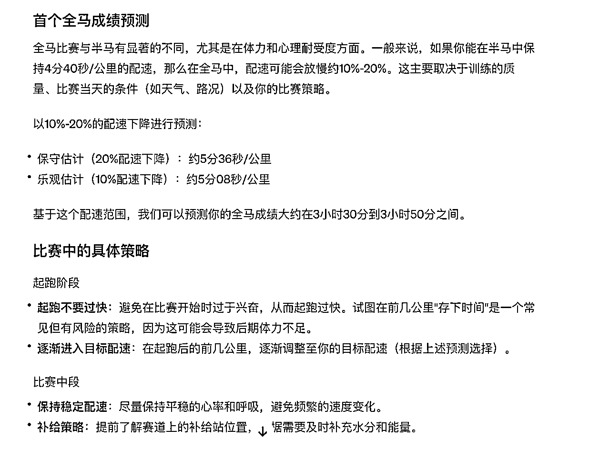

跑完常见问题：水泡、肌肉酸痛、抽筋。我是酸痛加抽筋。按GPT建议：充分休息、冰敷、抬腿、盲人按摩、扶他林，3天基本恢复正常跑。
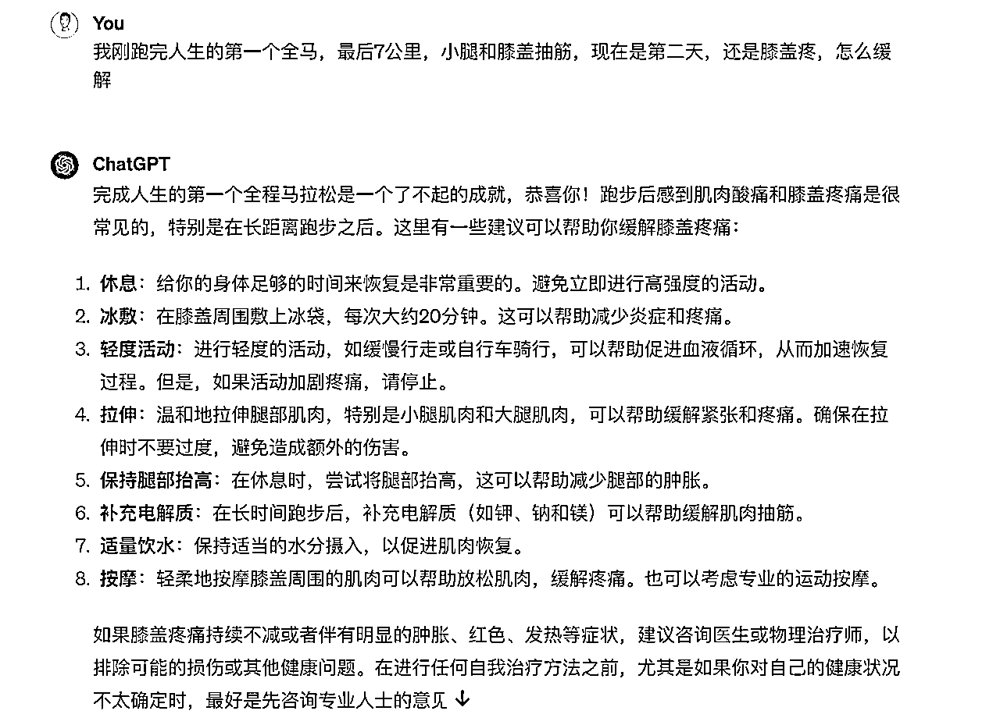

食补也很重要，我按它的建议做了营养补充。
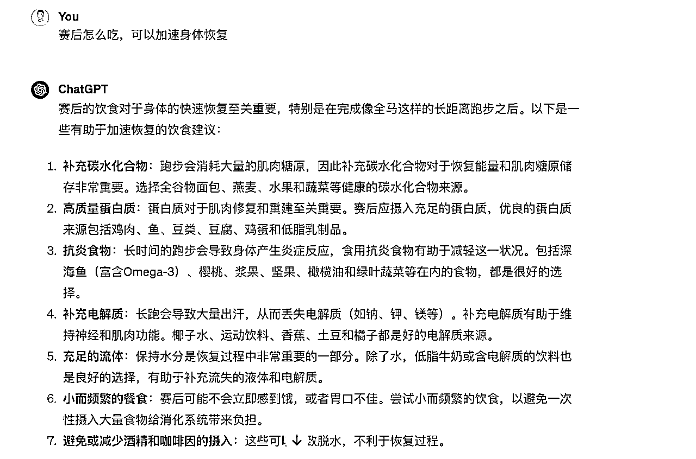

赛后多久能跑？继续问GPT，给出循序渐进的恢复节奏。
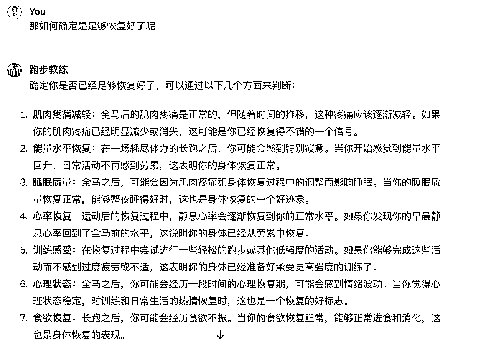

# 六 首马的真实感受

我有病才跑这个破马拉松。2024年3月17日宁海马拉松，32公里处心里第一句话就是放弃。配速从4分掉到6分，肚子难受想上厕所，下半身全抽筋，周围没厕所。每一步都像拔牙。

脑子里无数个声音：走吧，别跑了。女儿会不会觉得爸爸不行了？终点老婆在等我。我不甘心。我不想回去说自己关键时刻掉链子。

小腿、大腿、膝盖都在抽，屎快拉出来了。我想到徐霞客，富二代为什么要去徒步丈量山河。我看到孩子们和老人撑着雨伞为陌生人加油。我想到小柏爸爸，从2015年起连续10年推着脑瘫儿子跑了68场马拉松带着他看世界。

冲过拱门我直接瘫倒，被工作人员扶出来。来不及看表，来不及听欢呼。领奖牌的那几十米，眼泪止不住，用手挡着不想让人看见一个中年男人的矫情。

我跑马拉松的原因在我心中找到了：我不想过平淡无奇的一生，我骨子里热辣滚烫。

一场马拉松像过了一生。第一个10K像少年，活泼冲劲；第二个10K像青年，体力充沛稳定；第三个10K像中年，步频变慢仍在坚持；第四个10K撞墙期，像步履蹒跚的老年；最后2K像弥留，一步蹭一步走到终点。你始终只能靠自己。

# 七 AI跑步教练的边界在哪

用了近4个月，AI已像水电网络一样成为生活基础设施。最近和杨一老师聊，她说对AI已经无感了，我也是。

AI取代的不是一个职业，而是一整个打工生态。会用AI的人，一个人或小团队能创造千万亿级效率；不用的人被挤到服务业。

3个月备赛证明，人类教练能做的，AI跑步教练都能做：计划定制、技术指导、心理激励、营养方案、伤病预防、赛事策略。唯一暂时缺的，是面对面的拥抱和同伴间的现场鼓劲，等机器人普及后也会被补上。

AI时代才刚开始。一套指令就能干掉一个职业，不是玩笑。我们这一代人很幸运，能用AI把过去做不到的事做到，过更有意思、更有意义的人生。