# 0成本打造专属AI虚拟网红，Fooocus全流程上手指南

虚拟网红这两年已经成了行业标配，宝马都请了 Lil Miquela 来代言，可见热度有多高。今天就用一套完全免费的方案，手把手教你用 Fooocus 生成属于自己的 AI 虚拟人。

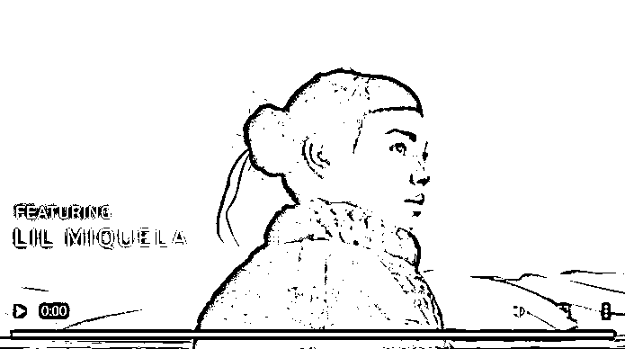

市面上做虚拟网红的工具不少，这里讲的 Fooocus 是 ControlNet 原作者开源的项目。它基于 SDXL 模型搭建，操作门槛比 Stable Diffusion 要低很多，上手快得多。

## Fooocus 到底在哪下？

官方 GitHub 地址：https://github.com/lllyasviel/Fooocus

我这边也备了网盘备份：https://pan.baidu.com/s/1yLt95sO9R_LtNsNZsqrkZQ?pwd=2z6c

提取码：2z6c

进入 GitHub 页面后往下找到 Download 区域，按自己的系统选安装包。Windows 用户直接点 Click here to download 即可，整体包体大约 1.8G 左右。

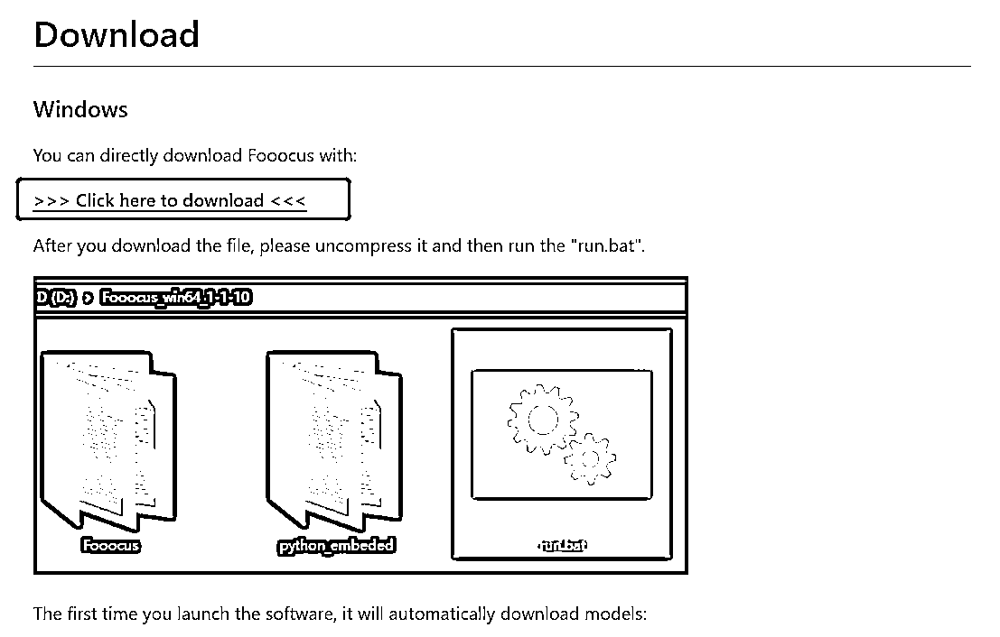

## 本地安装是怎么操作的？

下载好的压缩包解压后，双击里面的 run.bat 启动。

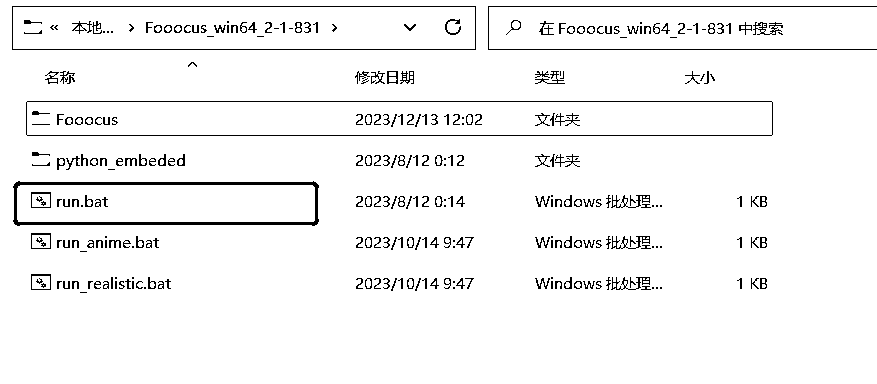

启动后会弹出一个命令行窗口，程序会自动从 HuggingFace 拉取模型，体积约 6G 左右，建议🪜，速度会更稳定。

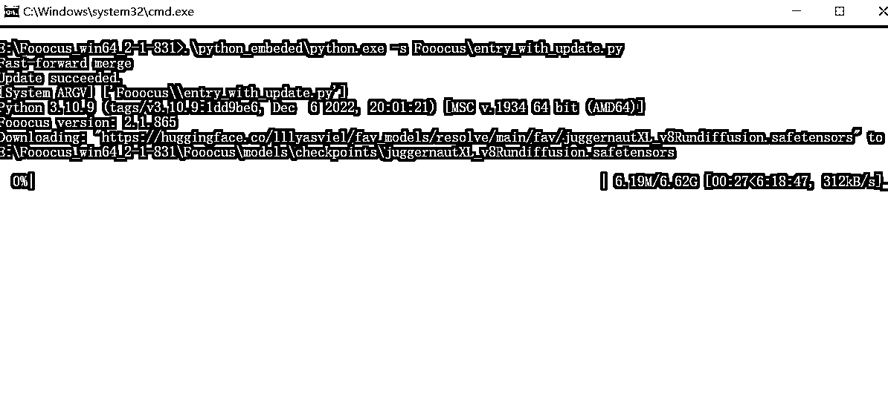

模型全部就位后，浏览器会自动打开 Fooocus 的绘画界面，到这里安装就算彻底完成。

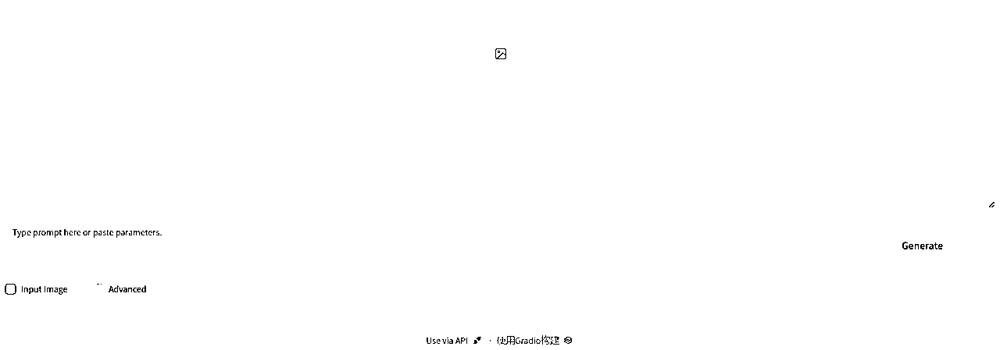

## 电脑配置不够怎么办？用 Colab 跑

担心本地配置扛不住？直接搬到 Colab 上免费跑就行。

在项目页面找到 Colab 专区，点击 Open in Colab。

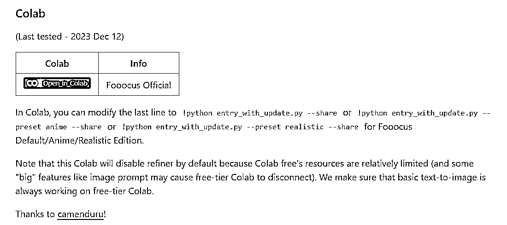

进入后会看到预设好的运行代码，点击左边的播放按钮自动开始部署。

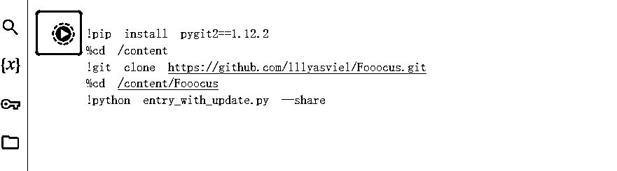

当界面出现可访问的链接时就代表部署成功了，点击链接进入绘图页面即可开始使用。

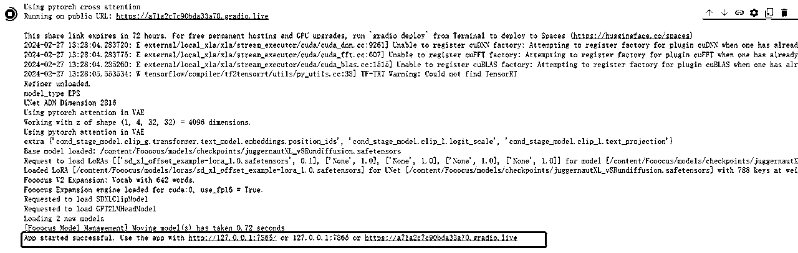

## Fooocus 界面功能拆解

整体界面非常简洁，下面把各个区域的功能说清楚。

最上方是输入绘画关键词的区域。

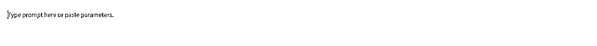

Input Image 区域用来做二次创作和超分放大。

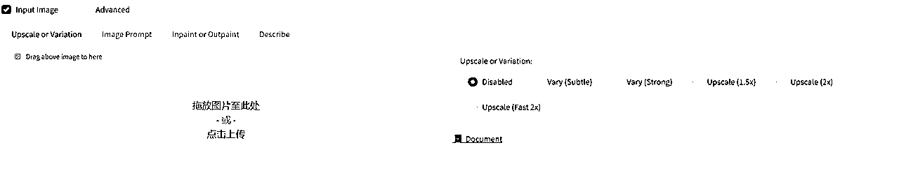

Advanced 是核心参数设置区，逐项来看。

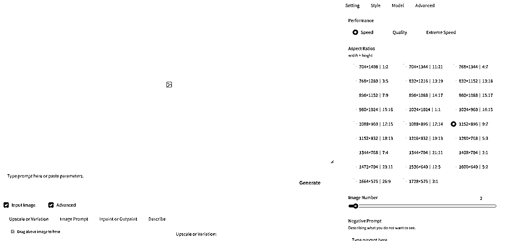

Setting 里面的 Performance 可选速度优先 Speed、质量优先 Quality、极速模式 Extreme Speed；Aspect Ratios 用来定画幅比例；Image Number 控制一次生成几张，配置低的建议一张一张来；Negative Prompt 则是负面提示词区。

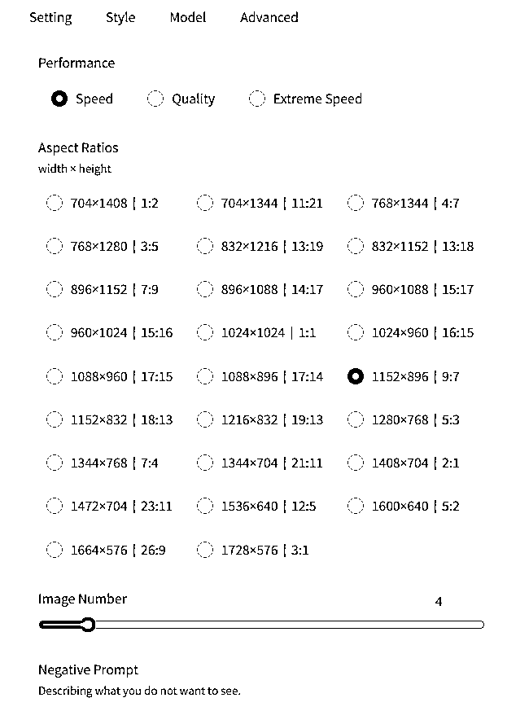

Style 区域内置了约 200 多种绘画风格，每种都有预览图，找起来很直观。

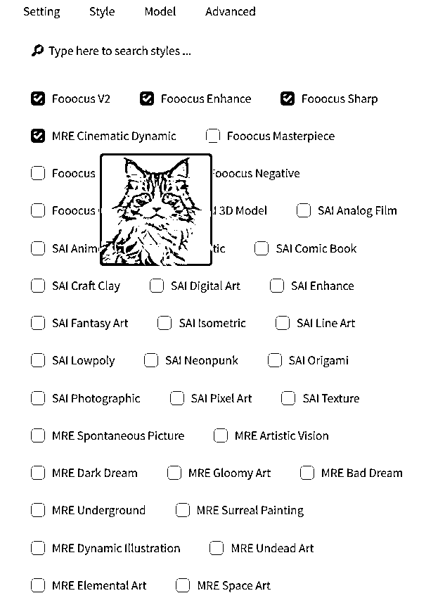

Model 区域是切换大模型和 LoRA 的地方。形象点说，大模型是房子，LoRA 就是装修风格。新手保持默认即可。

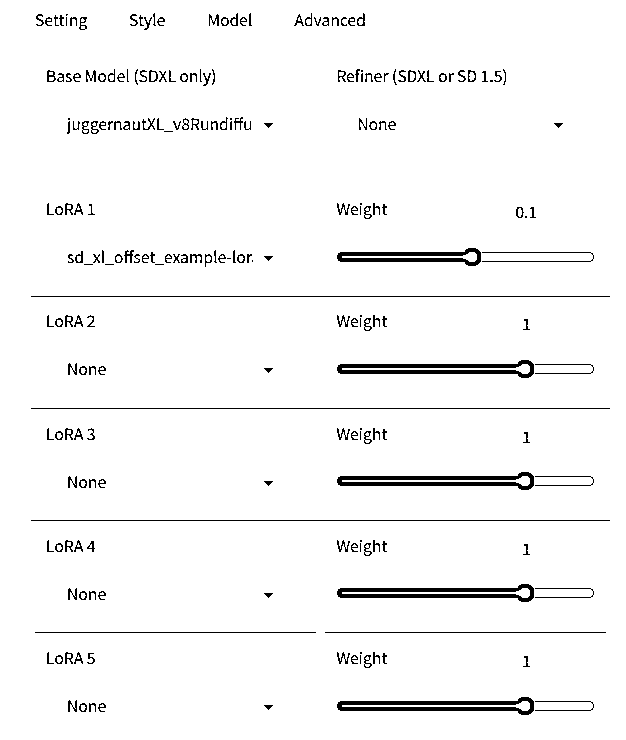

Advanced 高级区提供更精细的调节。第一个参数平衡画质和多样性，常用 5-7 之间；第二个参数控制锐化强度，画建筑或纹理强的图时可以适当调高。

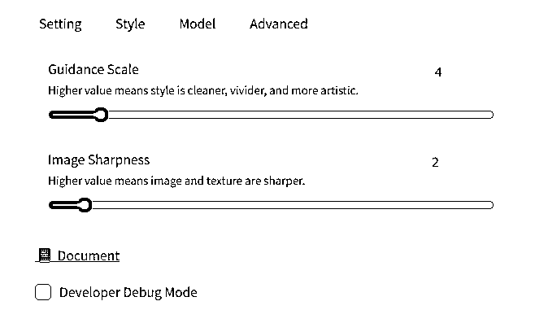

到这里 Fooocus 的基础功能就介绍完了。

## 实战：从零生成一个 AI 虚拟网红

开始生成前，先在关键词区填入需求，负面词、风格一起配好。推荐组合：Fooocus V2、Fooocus Enhance、Fooocus Sharp、MRE Cinematic Dynamic、Fooocus Masterpiece，其他参数保持默认。

负面提示词参考如下，可根据需要自行优化：
nsfw, paintings, cartoon, anime, sketches, worst quality, low quality, normal quality,
lowres, watermark, monochrome, grayscale, ugly, blurry, Tan skin, dark skin, black skin,
skin spots, skin blemishes, age spot, glans, disabled, distorted, bad anatomy, morbid,malformation, amputation, bad proportions, twinsmissing body, fused body, extra head, poorly drawn face, bad eyes, deformed eye,unclear eyes, cross-eyed, long neck, malformed limbs, extra limbs, extra arms,
missing arms, bad tongue, strange fingers, mutated hands, missing hands,
poorly drawn hands, extra hands, fused hands, connected hand, bad hands,
wrong fingers, missing fingers, extra fingers, 4 fingers, 3 fingers,deformed hands, extra legs, bad legs, many legs,more than two legs, bad feet, wrong feet, extra feets

Stable Diffusion 老用户可以再深入调参。

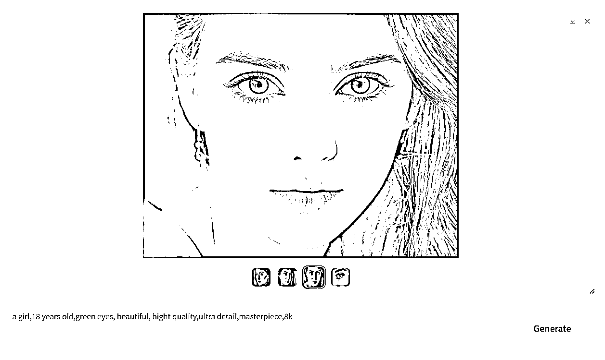

一张图不够用，我们要做的是脸不变姿势变。先生成一批面孔，挑一张最满意的拖到下方的 Image Prompt，然后在 Advanced 里打开 FaceSwap 换脸，再次生成同脸不同图的素材。

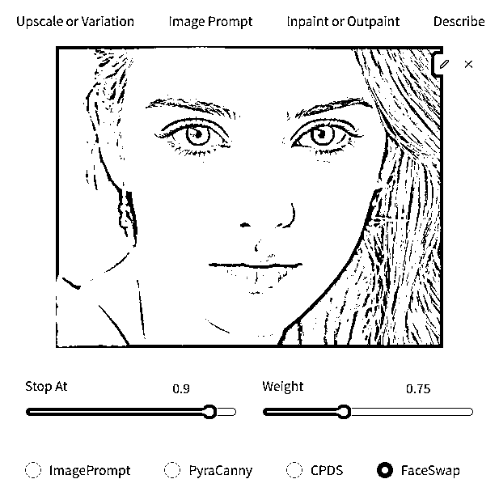

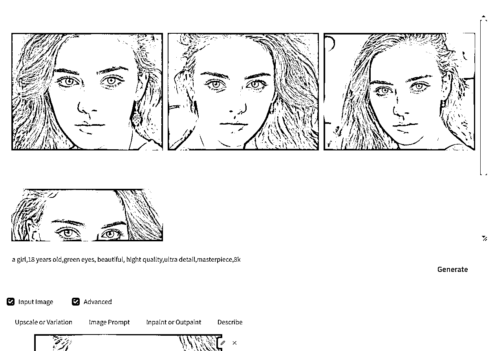

光换脸还不够，还要换姿势。找一张喜欢的姿势参考图上传到 Image Prompt，在 Advanced 里选择 PyraCanny 保留轮廓功能，并在关键词里加上 smile 指令，再次生成。

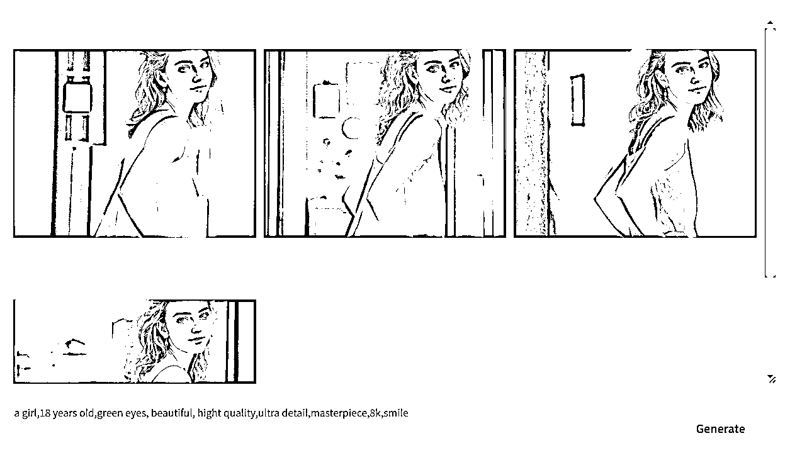

姿势参考图不是每张都合适，多跑几轮直到选中满意的为止。

姿势确定后，再换背景很简单，直接在关键词里追加背景描述即可。

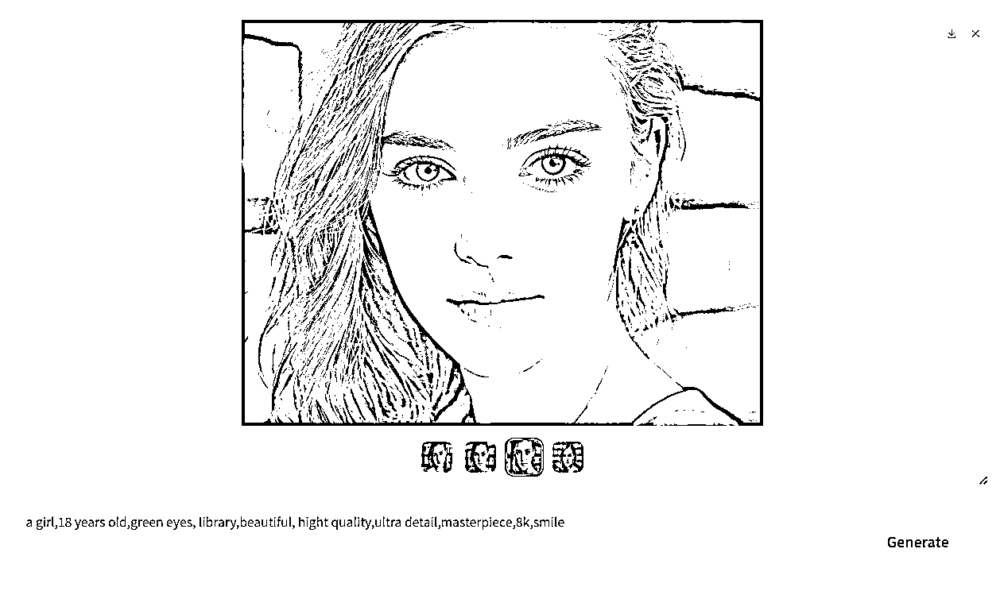

按这个流程一步步来，成品的真实感会非常惊艳。

全部生成完毕后，图片会保存到 \Fooocus\outputs 目录下。

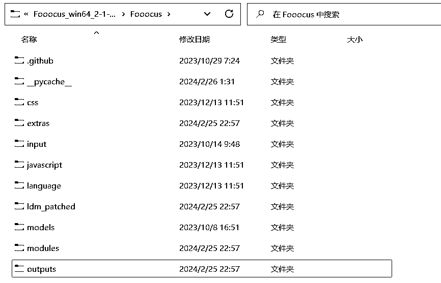

最后提醒几个小细节：初次运行需要下载模型和 LoRA，耗时取决于网速和配置；Colab 偶尔会出现生成失败的情况，重新运行一次一般就能恢复。