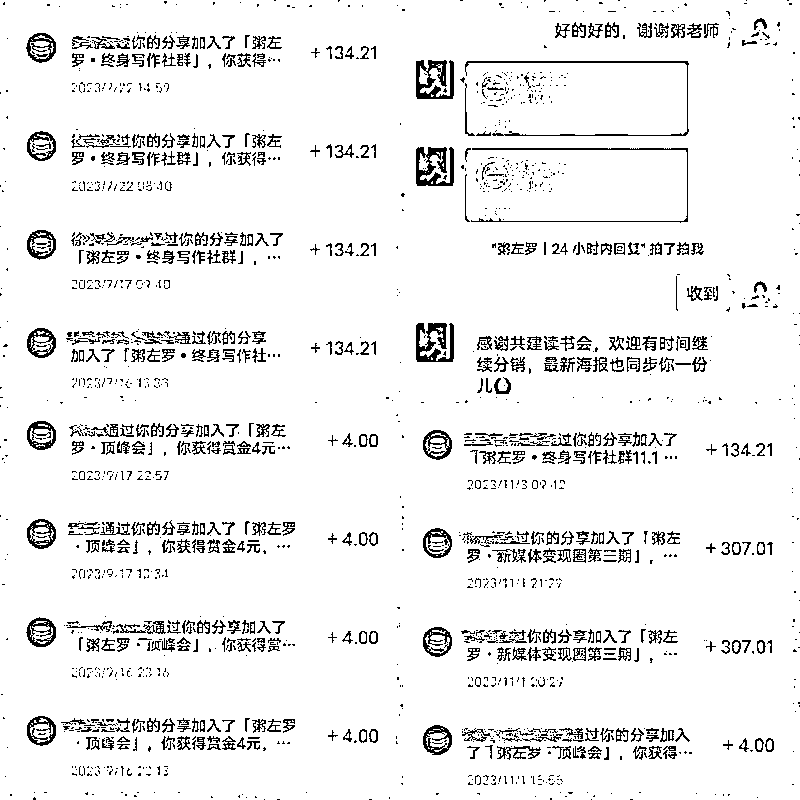
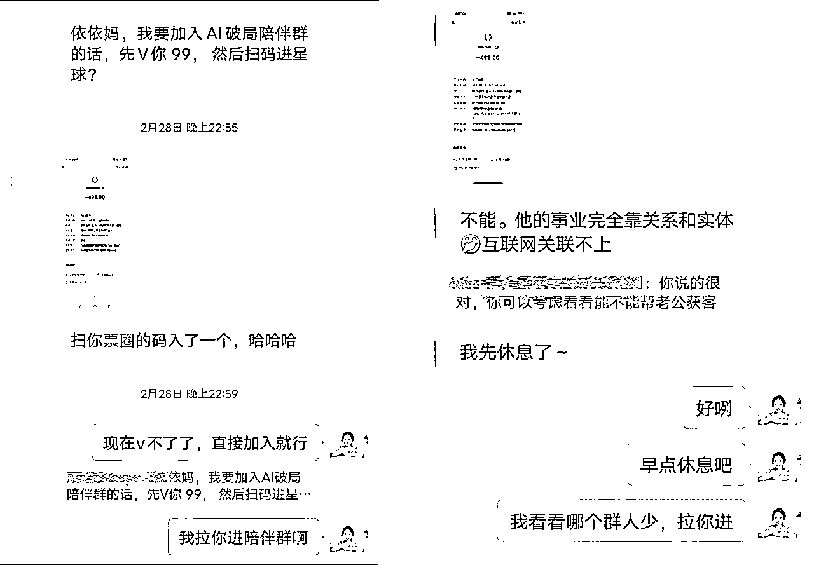
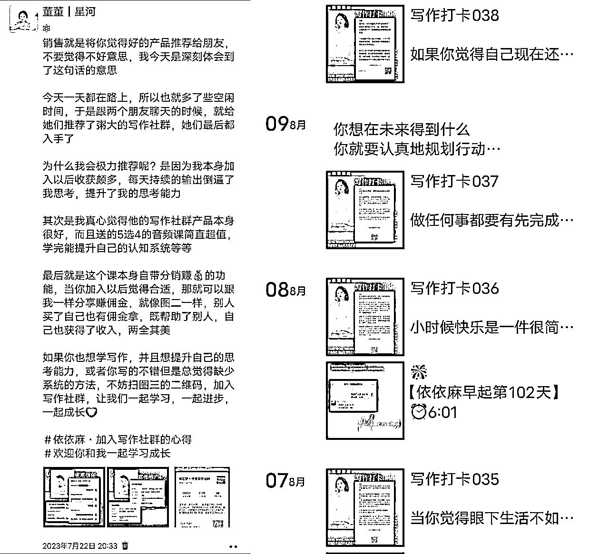

# ('自媒体小白每分销必出单，我是如何做到的？', (2, 22))

从不敢卖到总能出单：一个自媒体小白的复盘，关键就两件事

圈友们见帖欢喜，我是董董依依妈。前两天粥老师那边的读书会分佣到账，两单，说实话收到时还挺意外——毕竟就在大半年前，我还是个不敢卖东西的自媒体小白。

可现在回头看，好像只要我认真去推的产品，基本都能出单。写作社群、顶峰会、生财拉新……多多少少都有成交。

所以我也认真复盘了一次：为什么能走到这一步？想来想去，其实就是把两件事想通了。一是心态，二是渠道。心态顺了才敢开口，渠道铺开了才有人看见。

先交代下背景。去年7月，我因为认识粥老师，一脚踏进了知识付费这个圈子，当时为了加入他的年度写作社群，第一次下载了知识星球，天天在星球里写，晚上再把日更发到朋友圈。一篇一篇地发，前前后后吸引了十几位伙伴跟我一起加入写作社群。8月底看到顶峰会可以盲订的消息，我第一时间锁了名额；9月10号正式发售那天，有4位朋友跟着我一起加入，11月又有一位朋友上车，加起来5位。

今年我第一次参加生财的破局拉新，作为谱白灰战队的核心成员之一，也拉了4人。

这些成绩在高手面前确实不值一提，但对我来说，已经是很正向的反馈了。真正让我转变的，是打通了下面两个卡点。

**一、心态：先体验，再受益，然后才去卖**

我给自己定过一条规矩：不熟悉的不卖，不认可的不卖，自己没受益的不卖。原因很朴素——卖一个自己心里都没底的产品，讲出去是虚的，后续也容易被交付问题打脸。靠谱老师有句话我记得很深：没有亲自体验过产品就去推荐，那不叫真诚，叫背书。只有你先加入、先使用，讲出来的才有分量。

很多人卡在“不好意思卖”，是因为下意识觉得推销等于赚朋友的钱。可当你真的从产品里受益时，推荐就变成了帮忙。比如生财，我每次跟人介绍都会说，这是一个聊赚钱不伤感情的地方，因为我确实在这里看到了很多搞钱项目，也慢慢知道了哪种赚钱方式适合自己。写作社群也一样，以前写作是我最怕的事，现在反而成了拿得出手的技能。一个产品如果真让你变好了，你讲的时候眼里是有光的。

人这辈子成长，无非三条路：从书本里学，向身边的人学，还有一条最容易被忽略的，是从自己身上学。你亲自经历过、亲自受益过，就是最好的活案例。所以选产品，不只要选口碑好的，更要选自己真的有体感的。销售这行做久了你会发现，底层逻辑其实是“价值交换”四个字：对方有需求，你的产品刚好接得住，成交就是水到渠成的事。

**二、渠道：公域、朋友圈、私聊，一个都不能少**

先说公域。做自媒体最怕沉默。敢表达的人，能吃到沉默者的红利；能坚持的人，能吃到退出者的红利。所以千万别把肚子里的话憋着，去写公众号、发小红书、拍短视频都行。让内容自己去跑，替你攒下账号资产、粉丝信任和长尾流量。就拿推广生财来说，如果你擅长写公众号，完全可以写写自己是怎么认识生财的、加入后跑通了哪些项目、学到了什么认知。大家不爱看广告，但没人不爱看故事。看到你从一个普通状态变得越来越好，自然会有人想靠近你、跟着你。

朋友圈就更不用说了，这是离潜在用户最近的窗口。以前我也有发圈羞耻，怕亲戚看到多想，怕同事觉得我不务正业，更怕发了也没人理。后来想明白一件事：朋友圈营销的本质，不是刷屏硬广，而是把你的价值观、生活状态和成长轨迹反复触达给用户。你天天营业、持续蹦跶，就是在给自己搭一台自动成交门店。做自媒体到最后拼的不是聪明，而是谁能一直“剩”在牌桌上。别人未必在意你某一天发了什么，但会因为你连续365天都在而信任你。而且内容要有布局，新加你的人在翻朋友圈时，一两分钟就能知道你是干什么的。

我最开始那一批写作社群成员，就是从朋友圈日更打卡吸引来的。每天在星球写完，晚上截图发圈，慢慢开始有人问：你加的是什么社群？怎么打卡？就这样，朋友圈陆陆续续帮我带来了9位成员。

印象最深的是某天打卡，我写了一句：如果再来一位伙伴加入，我就能免费拿到变现圈名额了。结果真有人看到后直接私聊我下单，第10位就这么来了。当时我确实很想进变现圈，可那期已经过半，不适合中途加，就琢磨着多带几个人进写作社群来换名额；没想到顶峰会提前出现，直接让我解锁了十年变现圈，也算意外之喜。

私聊这一关，我以前同样怕。怕被拒绝，怕打扰对方，不知道第一句话该怎么开口，甚至觉得收钱会显得不配。真正让我迈过去的是顶峰会的价格——不到一万块，就能把一位年收入千万级别的老师和未来十年“打包”回家。这种好东西要是不告诉朋友，我反而会觉得可惜。所以9月10号发售那天，我去私聊了几位朋友，也没整什么话术，就是把直播间推给她们，让她们自己看、自己判断。最后有4位朋友选择加入。

做私聊，真诚是唯一的套路。你从对方需求出发，真心觉得产品适合她，她是能感受到的。但也要牢记两点：第一，以利他为前提，不要硬推；第二，被拒绝了也没关系。销售本身就是概率游戏，把基数铺大，少数拒绝不会影响大局。如果你因为十个人里六七个说“不”就放弃，后面再大的机会也轮不到你。

最后聊聊我对销售段位的理解：最低段位拼价格，往上一点卖产品，再往上卖服务，最高级的销售，是在卖自己。销售这条路，永远没有到顶的那一刻，你能做的，就是一次次把自己重新归零再出发。我也还在路上，跟着靠谱老师学谈单技巧、长见识，也是她把我领进生财这道门。希望咱们都能从卖产品、卖价格的阶段，一步步进阶到“卖自己”的销冠段位。

一起加油，生财有术。