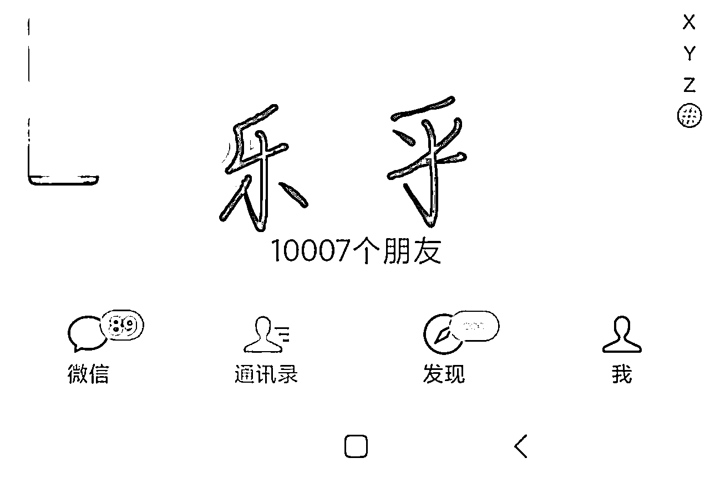
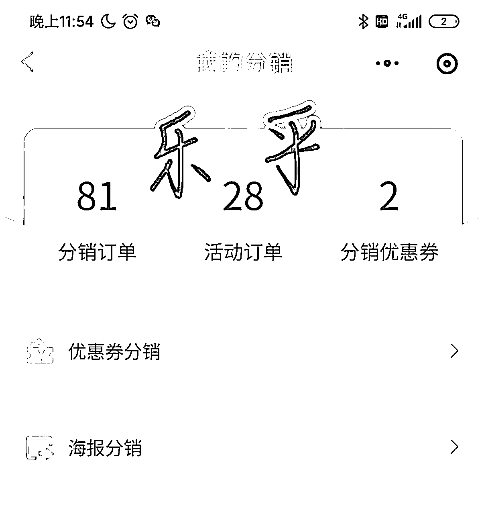
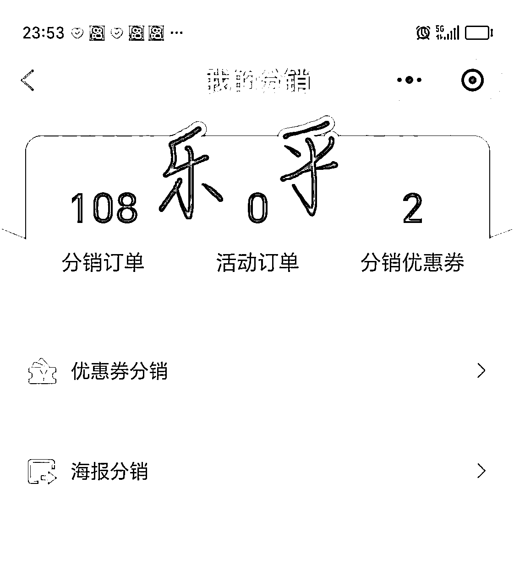
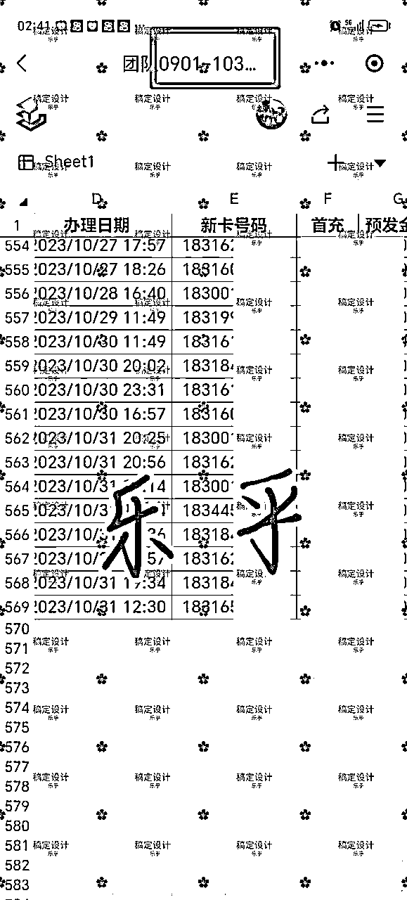
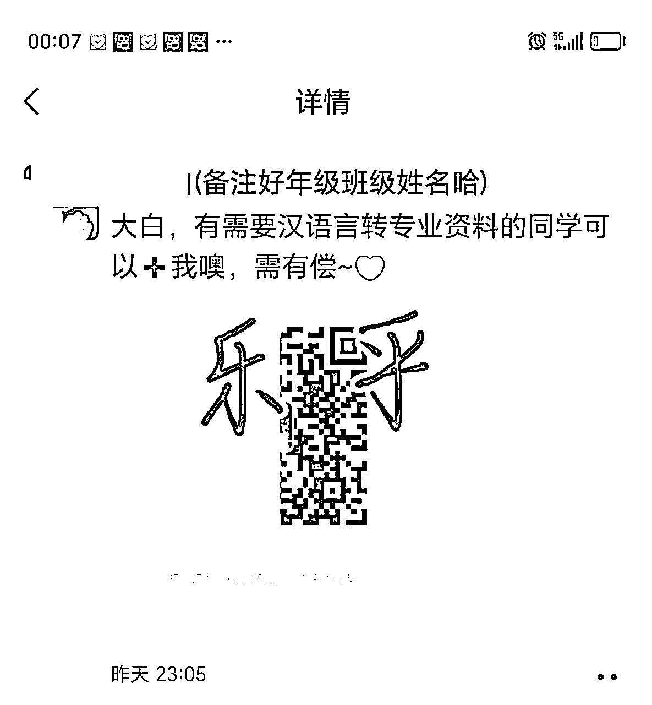
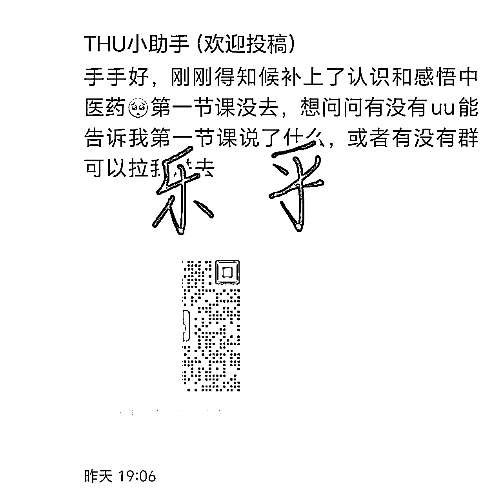
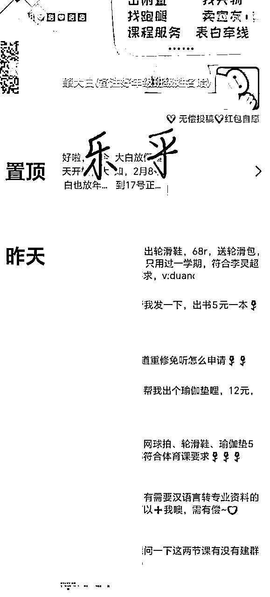
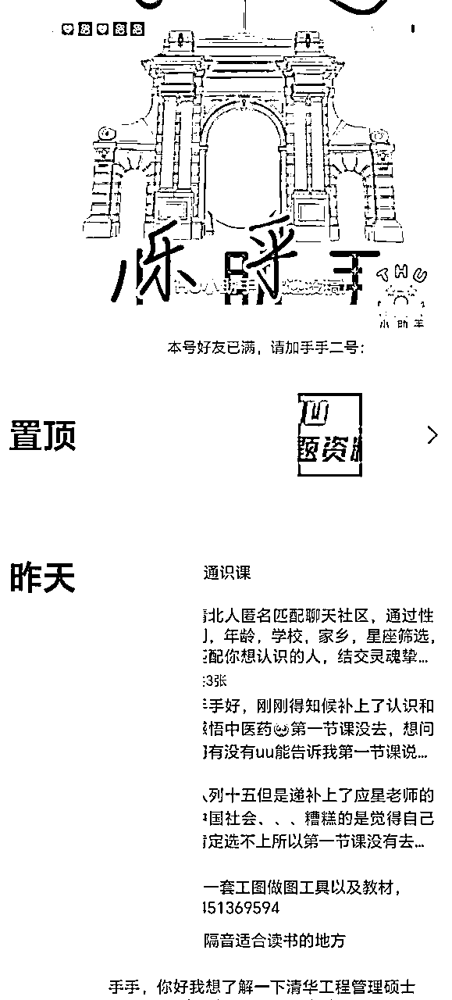

# 把一所大学变成你的现金流：校园墙玩法全拆解
作者：龙哥

赚钱的各位朋友大家好，我是去年11月才加入赚钱的新人。翻了很多精华帖，关于校园这块的实操分享却很少。今天就把我这几年在高校里做的校园墙/表白墙项目拆给大家。

现在校园里的核心流量入口，基本就是校园墙和表白墙，统称校园墙。它像一所大学的地下信息枢纽。只要把一个万人的墙养起来，年收入十几万是常态。

校园墙本质是一个私域流量池，变现就两条线：接推广和做业务。推广是周边商家、线上品牌放广告；业务则是把流量转化成驾校报名、校园手机卡、外卖分销、劳务派遣、考研考公留学等，组合方式看学校属性来定。

可以理解为：墙是根基，广告是过渡，做业务才是最终的盈利点。

先简单说下我的情况，我叫乐乎。目前运营着好几所高校的表白墙，母校是体量最大的。母校这边一个主号、两个副号，主号一万人，副号各七千人，基本覆盖全校。过去一年，广告收入三万多，业务收入二十万以上。做的最好的两块是驾校和手机卡，劳务也有一笔。

招生一个是280～300元左右，我个人包括在门店报名的，有290个左右，团队有100个，总利润保底是10万元

移动校园卡1年，开学季开了569张，再加上平时的开卡量，一年总共超过800张，总利润超过7万元左右。

劳务一万多，大巴车推广和分销一万多。依靠校园墙，毕业一年总共收入超过22万。

很多人会问我怎么做到的，为什么在读期间一定要试试校园墙。

高校的商业流量基本都被校园墙垄断，而且每所学校都是各自独立的，高度分散。它的启动门槛极低，有个能正常用的🛰️号就能开始。核心工作就是把学生投稿的内容搬运到朋友圈，就像这样。

看起来很简单，难点在于起号期。

一、起号

起号决定墙号能不能活过来，分线上起号、线下起号和关键节点引流。

①线上起号
号还没成形时没有专属名，前期可以混进新生群、社团招新群、闲置群、跑腿群。与群主沟通投一条广告，6-10元一条。文案就说：我是XX大学的万能墙，找兼职、寻物、表白、捞人、答疑都能投稿，顺手发名片即可。这样能快速积累种子用户。

同时在📕、抖音用学校名做账号，定期发校园风景、活动信息，把粉丝导到🛰️墙号。

②线下起号
开学季到新生宿舍楼、尤其是女生宿舍楼发传单卡片，扫码加墙号，转化率很高。

③关键节点
暑假高考放榜前就开始预热。在📕/视频号发学校美景、地图、周边街拍，吸引准新生关注。放榜后立刻按往年分数线建新生群，这是最优质的冷启动工具。每天发一条群公告+一条学校介绍。

等线下录取通知出来，再按学院建新生群，持续做学校宣传。这一波操作下来能把全校新生快速收拢到你的号里，老生也会主动来加。顺利的话起号期就能加到两三千好友。

就算错过暑假黄金期，开学第一周也是窗口期。花钱请兼职到宿舍派卡片，给兼职按拉新数量计酬，也能迅速做到两三千人的基础池。

二、运营与裂变

起号后要做服务和裂变。

方法一，投稿时顺带裂变。学生来投稿时问一句要不要帮忙转发朋友圈，很多人不好意思拒绝。这一轮扩列能把好友推到三四千人，话语权进一步提升，也能开始接广告了。

方法二，用活动裂变。开学/校庆做校园纪念钥匙扣、指环赠送活动。用便签海报配二维码，要求转发到3个200人以上的本校群并截图，或朋友圈停留24小时，就可领取校徽周边。类似玩法在广州大学城的校园墙大佬那里验证过，一天单号引流900人很正常。叠加前期积累，墙号轻松到四五千人。

三、接广告与放大

完成起号和扩量后进入稳定运营期。投稿原则上免费，部分墙会收1-2元手续费。只要出现桃色新闻、院系骂战、渣男渣女事件，流量就会暴涨。之前一次体检插队的院系对骂，一天涨了四五百人。

这时候可以开始接活。校园适合的都是高客单长周期业务：驾校、劳务、校园卡、考研考公、家教平台、外卖、健身课等。单月大额广告要谨慎甄别。

四、做高佣业务

这是最核心的变现。挑一两个与学校匹配度高、佣金高的品类，用小号承接。

1、驾校
墙号做起来后直接找学校周边驾校的招生经理谈，别找校园代理，层级会被压。直营驾校招生费在250-350元之间，有等级返佣；校园代理拿底价，单张利润能到400-500元，但学生可能被多收踩点费。

招生打法常用涨价+倒计时制造紧迫感，临近截止报名会集中爆发。寒暑假用小号在各大群预报名锁单，也有团队专门组学生队伍去跑。

2、电话卡
先找运营商区域经理，争取单张佣金80元以上。然后在墙号招募开卡团队，开学季让团队进报道摊位，给团队设置阶梯返佣：1-5张25元、6-10张30元、11-15张35元、16-20张40元，以此类推最高50元。我们团队33人，一年开卡800张，占全校开卡量的约35%。

最后说点实话

校园市场玩法千变万化，但核心永远是私域流量池。深耕三年后我觉得单个学校的体量有限，年收入一般很难长期超过20万，天花板比较明显。起号后投稿量大、琐事多，做业务又要投入时间，基本是半全职的状态。

缺点虽多，但意义感很强。学生会很尊重你，因为你在帮他们发声、答疑；收入上远超食堂、快递站每小时10-15元的兼职，起号后每天稳定300-500元不难。适合在校大学生、宝妈、后勤人员、行政老师等时间相对自由的人。

还有一点，校园墙是社会变化的雷达，新事物都会先在大学里发酵。作为学校的情报中心，你能第一时间捕捉机会。这也是我一直建议赚钱的在校同学都去做一个墙号的原因。