# 普通人如何快速入局成人用品（情趣用品）行业

普通人想快速挤进成人用品这门生意，到底有没有一条相对省力的路？答案是有的。核心逻辑就一句话：把公域平台的流量导入私域，一边卖货，一边招代理。

变现的方式不止一种。你可以用小程序的商城卖货，也可以做视频号带货；还可以做“主理人＋美团店”的招商，赚美团外卖店的收益，再加上团队管道收益和玩法收徒的学费。谁最适合干？个人工作室想转型的，或者完全没有经验的创业小白，都可以入局。

抖音人设怎么立？

如果你是卖货路线，男性粉丝可以走“睡衣体验馆”“情趣体验官”“黑丝穿搭”这种风格；女性粉丝则更适合“穿搭日记”“约会穿搭”“感情导师”“内衣挑选技巧”。对标账号可以直接搜素材里提到的抖音号，去参考他们的内容套路。

如果是招商路线，关键词就搜“大人玩具创业”“情趣创业”“大人玩具外卖”“成人用品”。想找内容灵感，就去看创业vlog、00后创业、大学生创业这类视频。典型的爆款标题比如：“00后裸辞挑战用两万块开一家成人用品外卖店”“东北男生裸辞创业，开了家大人玩具外卖店”“00后大学生毕业做线上成人玩具店第三个月”“00后情趣创业赚100万vlog”“04年女生独自创业卖情趣两个月做了30个w”“90后宝妈创业卖情趣内衣第一天”“今天是情趣创业自己当老板的第50天”。这些自带流量，可以直接拿来当选题参考。

再说抖音养号起号。好消息是，创业类内容不需要长期养号，但前几天的动作别做错。

第1天，先打标签。注册完账号后，在推荐页刷同领域的优质作品，该点赞点赞、该关注关注，既方便以后找灵感，也能把账号权重刷上去。

第2天，找10到20个对标账号。选择注册时间在6个月内、粉丝在10万左右的账号，关注起来，继续刷权重。等你打开抖音，刷到的全是同类内容，说明权重起来了。

第3天，把主页资料完善好。头像、昵称、个性签名、背景图，都参考对标账号去改。另外，记得建三到五个粉丝群。

第4天，开始做内容。在对标账号里找那种刚发布一两个小时、点赞量已经很高的视频，模仿它的选题和形式，做出你的作品。视频尽量控制在15秒以内，完播率更高。每天分早、中、晚三个时段各发一条，连续发一个星期。

发视频的时间也有讲究。上午6:00到8:00，中午11:30到14:00，晚上18:00到22:00，周六日全天都是热门时段。但更准的做法是去创作者服务平台的数据中心，看粉丝活跃时间。比如你的粉丝集中在20:00到23:00在线，那就提前半小时发。视频发出后，流量大概会跑4到6小时，在这个周期里做好互动。音乐可以蹭热门榜单，加互动性强的配乐，互关对标粉丝，有人评论尽量回，但回复数量控制在50条以内。标签用热门词，不需要投流，自然流量就够了。

有几个坑一定要避开：不要在抖音私信里跟人聊太多，容易被小人举报封号；个人简介和背景图千万别留🛰️号，会被平台判定为营销号；头像、简介、背景一定要认真设置。粉丝群是承接流量的关键，千万要建。

做卖货类的图文和视频，素材从哪来？📕搜“性感穿搭”“辣妹穿搭”，抖音找美女博主，淘宝、1688筛选制服、女仆装类目，全部去水印保存。制作工具方面，图文用美图设计室、美图秀秀，做海报用青柠设计室，视频用剪映做合集和切片。案例参考： 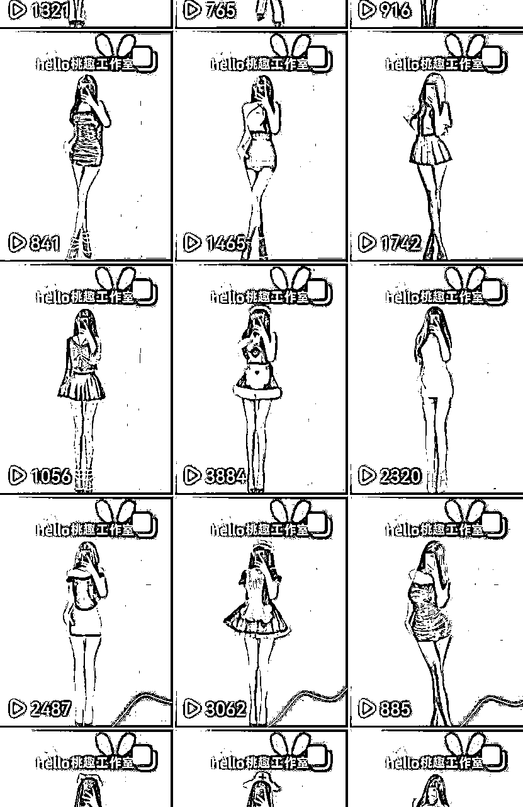  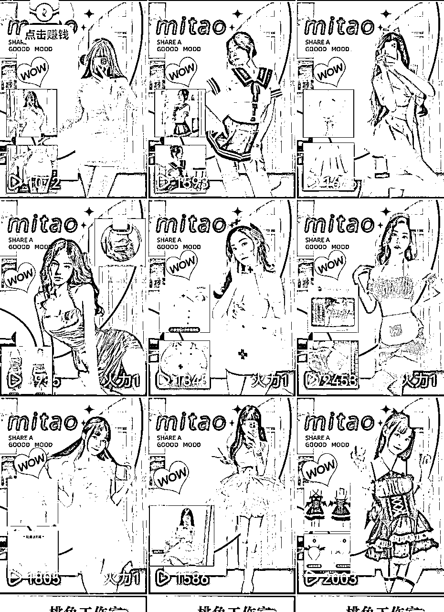    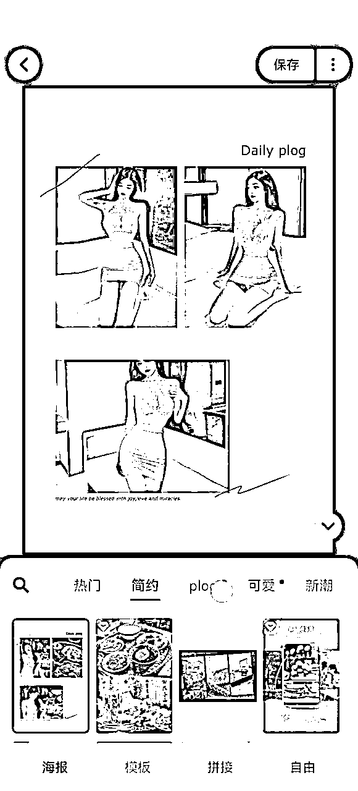 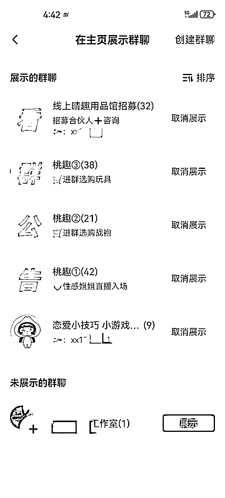 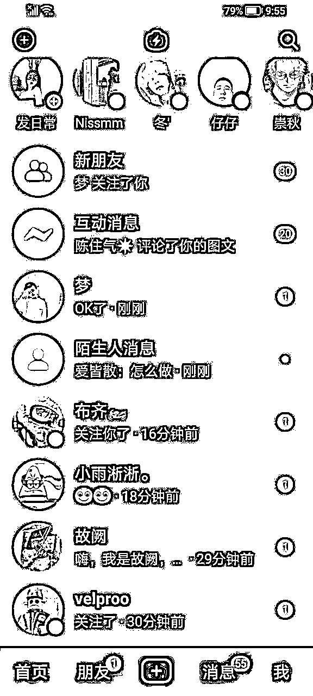

朋友圈人设同样重要。先在Soul、Momo这些社交平台上，用“一个正在努力创业的xx＋性感照/帅照＋日常生活兴趣”的公式吸引关注，再用三句话把人引到🛰️，可以用建群、提问式、吃瓜式的方法。朋友圈的打造要突出三个感觉：高级感、空气感、真实感。内容上分两类：纯卖货，以及卖货➕招商。参考案例：  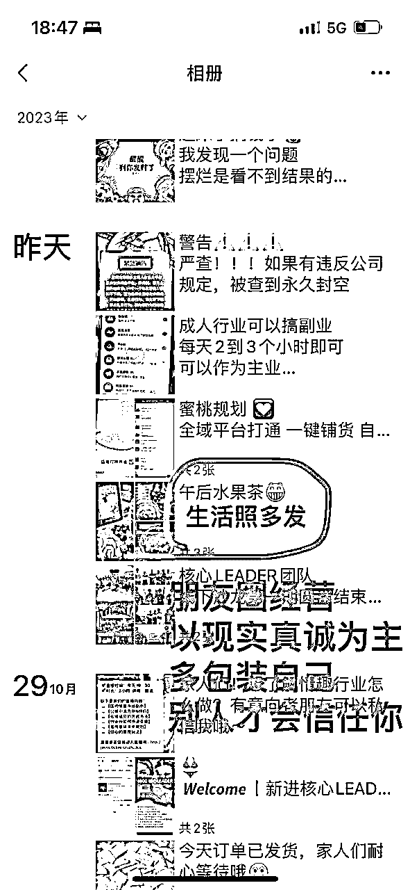 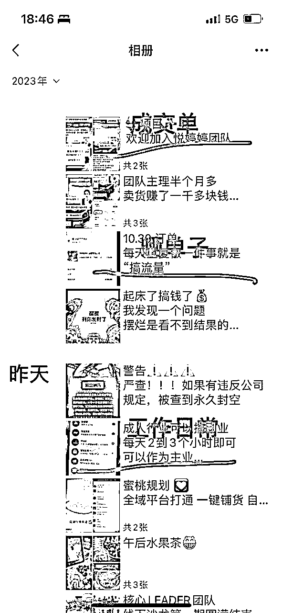 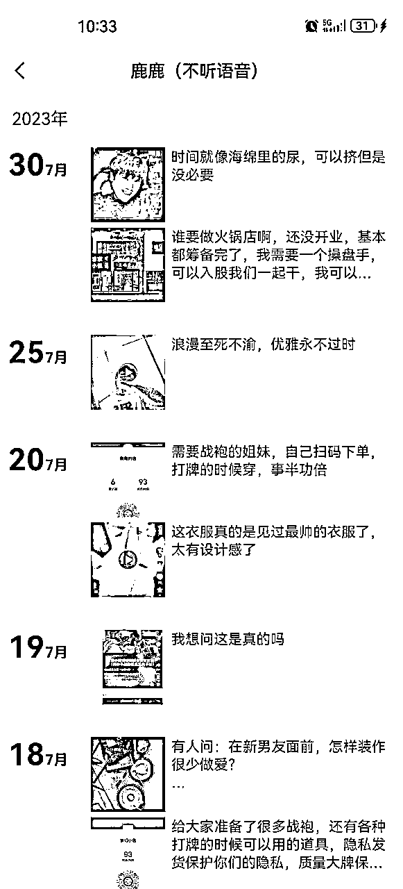 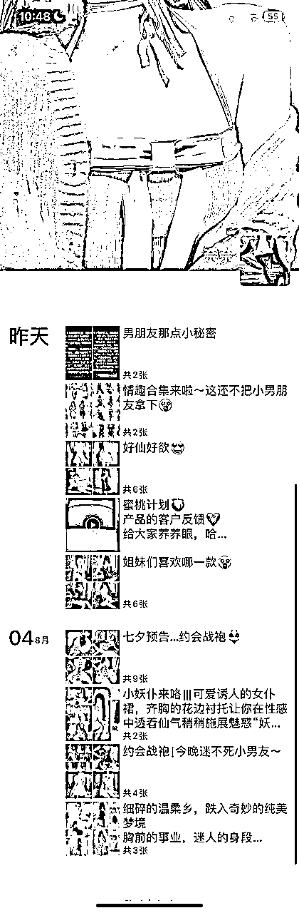 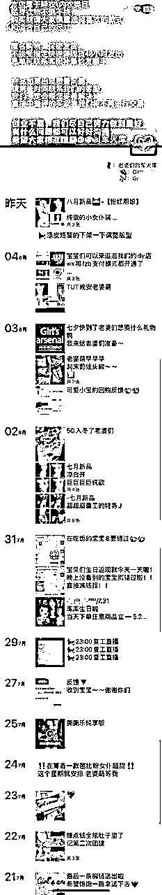

最后是沟通话术。框架有了，具体话术要看对象灵活调整。可以打电话、发语音、发数据图，重点让客户觉得你靠谱、专业、踏实。卖货的话术看这里：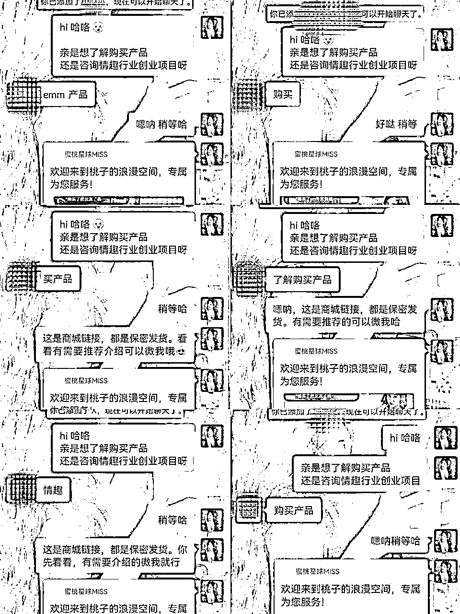。引流、转化、招代理，要做到以不变应万变。四个关键动作：小程序锁粉、介绍利润、推广模式、指导交付。建议提前写一份介绍文档，让客户先了解你和项目，有信任基础后成交率会高很多。

另外，这段话可以丢到各种群里，尤其是兼职副业群，咨询量不小：“正规长期稳定绿色大人玩具，不用囤货，不用发货，适合团队转型，不论你是个人还是工作室，都能干，项目有小！想详细了解的私我！”引用这段话时，再配上你的参考案例，讲清项目运作模式、盈利原理、赛道前景、个人经历、项目优势和成果。

入局不难，难的是把每个环节都做到位。按这套路径走，至少能少踩很多坑。 [PRE*] flag缺失？素材中并没有[PRE*]，只有到，按原样保留即可。