# 2024年澳洲 TikTok 电商市场洞察：半闭环内测下的新机会
作者：龙哥

澳洲市场正迎来电商半闭环功能的内测期，下面这份调研汇总了当下可落地的关键信息。

根据 DIGITAL 澳大利亚 2024 数据报告

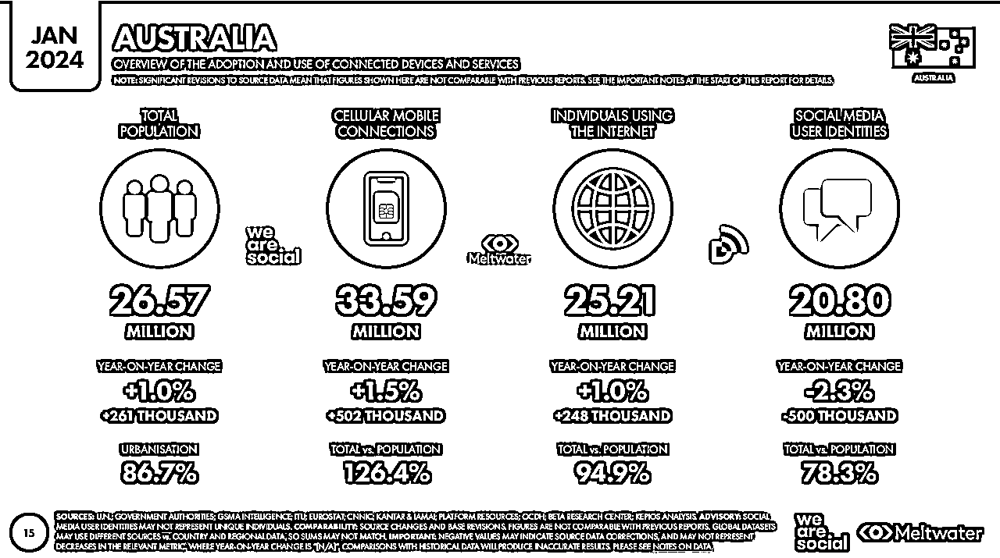

澳洲的线上购物渗透率持续抬头，背后是便捷性、品类丰富度和价格竞争力的共同作用。成熟的数字化底座、极高的网民覆盖率以及对安全支付的偏好，共同支撑了电商的扩张。用户偏好能够提供流畅移动端体验和高效履约的购物平台。

根据 PiPiADS 的监测数据

澳大利亚当前 TikTok 广告受众规模约 1000 万，正保持小幅增长。这一体量意味着一支爆款在单日即可实现数百至数千单的产出。体量不及欧美大市场，却非常适合作为利润补充和测品跳板。

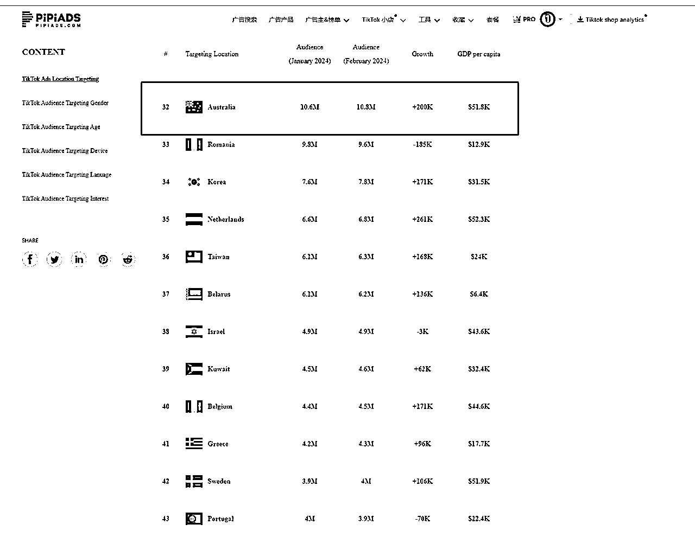

澳洲电商格局呈现多元化竞争态势，主流阵地由几类平台构成：

*   国际巨头 eBay AU 与 Amazon AU：凭借全品类覆盖，在澳洲占据重要份额。
*   本土零售头部：Woolworths、Coles、Apple、JB Hi-Fi、Officeworks 等，按营收计位居前列，覆盖生鲜到数码办公等刚需场景。
*   垂直细分站：时尚、家居园艺、爱好、健康美妆等垂直品类电商同样活跃。

其中 eBay 是最早进入澳洲的国际电商平台之一，目前仍是澳洲非食品类网购的核心渠道，超过一半的非食品类线上销售额由其贡献，市场影响力突出。

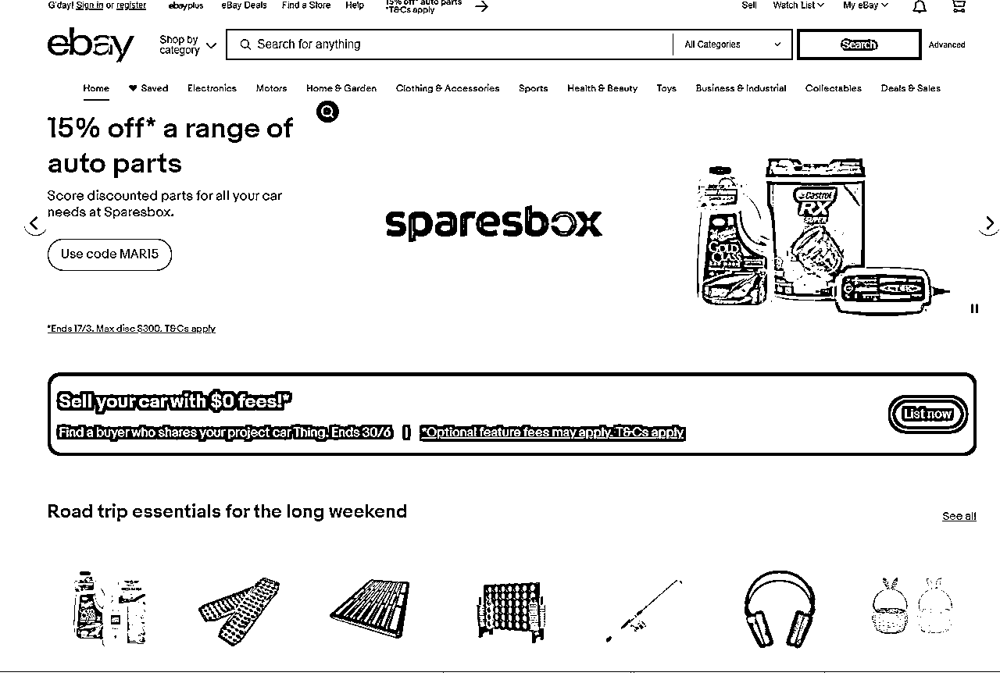

Catch

被视作澳洲本土最具代表性的综合型线上商城，品类跨度大。据官方信息，每 2.1 秒便产生一笔订单，日均出库包裹在 1-2 万件区间。

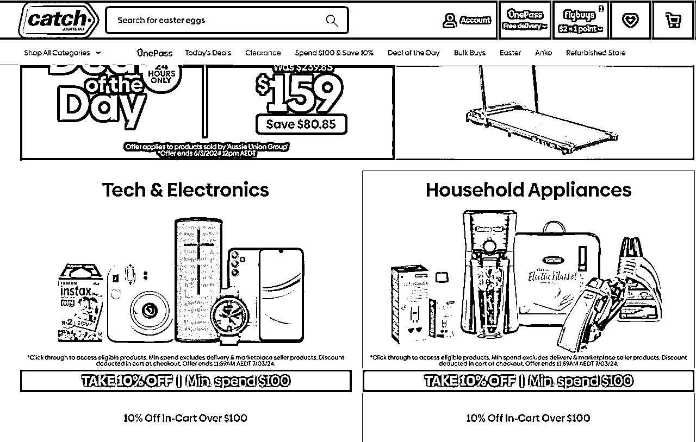

MyDeal

澳洲知名的大促型电商平台，商品线从家具家电延伸至个人护理等多个细分赛道。

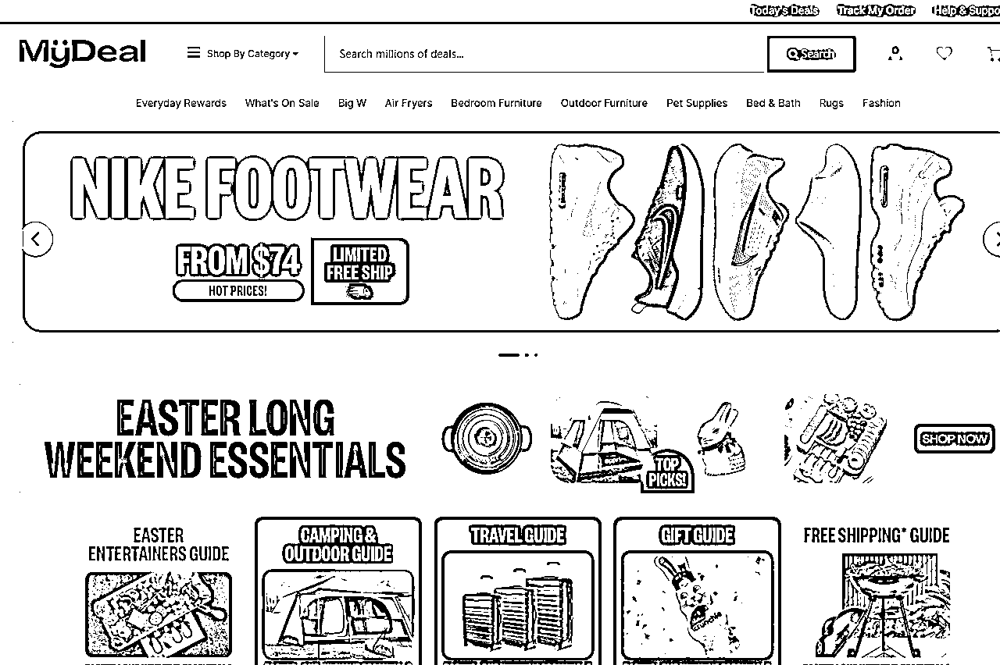

Kogan

澳洲老牌电商之一，品类涵盖电子产品、家电、健身器材、服饰及工具。成立于 2006 年，最初聚焦电视销售，后逐步扩展至全品类。

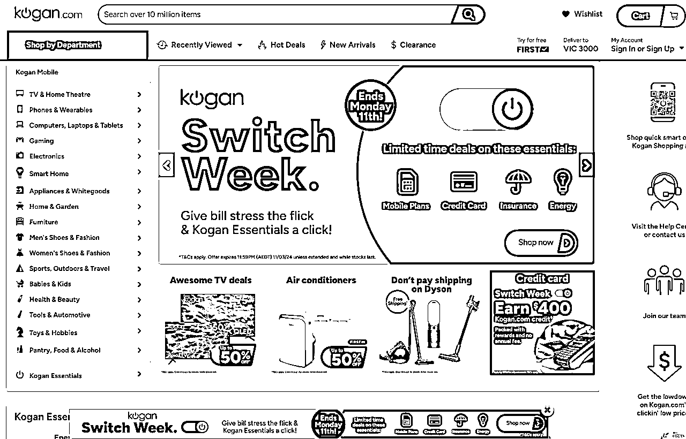

Woolworths 全称 Woolworths Group，总部位于澳洲，是以零售为主的大型集团企业。

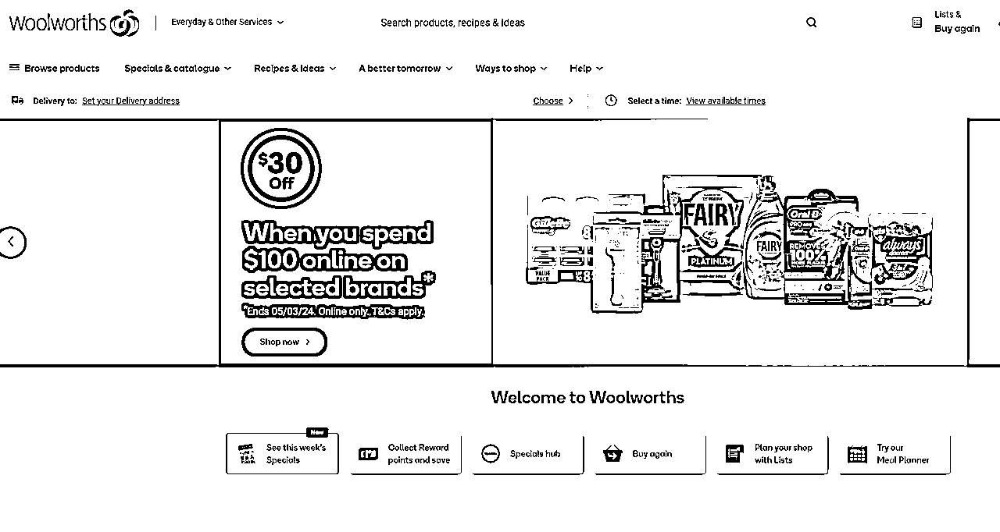

Big W 定位平价日用百货，商品集中在婴儿用品、儿童玩具、家居用品及服装配饰。

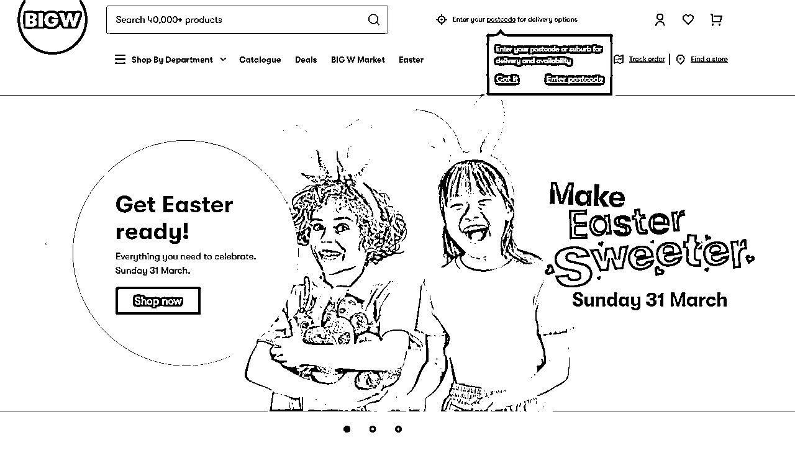

### TikTok 在澳洲的用户规模与画像

TikTok 在澳洲的购物转化意图快速增强，用户被短视频种草、达人共创和互动内容所驱动。短视频形态搭配可购广告和品牌合作，大幅提升了兴趣与购买意愿。

*   用户体量：截至 2023 年，澳洲月活用户达 850 万，渗透率深厚。
*   使用时长：人均月均使用 29 小时 36 分钟，活跃度极高。
*   人口分布：核心人群集中在 18-34 岁，正是广告主的主力投放圈层。

澳洲整体消费能力强，人均 GDP 全球前十。NAB 数据显示，截至 2023 年 6 月的 12 个月，澳洲网络零售支出达 532.9 亿澳元，同比下滑 5%。月度增速持续收窄，5 月同比 +4.4%，6 月基本持平 +0.1%。

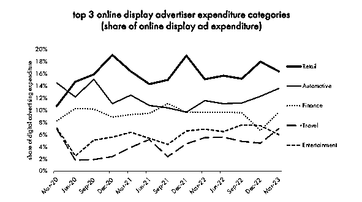

### 电商融合趋势

*   平台联动：TikTok 已与 Shopify、BigCommerce、Ecwid by Lightspeed 等完成对接，为澳洲商家提供半闭环内测的无缝电商能力。
*   营销打法：头部品牌多采用视频内嵌商品链接、TikTok LIVE 带货和定制化投放组合策略。
*   消费心智：#TikTokMadeMeBuyIt 等话题印证了平台对购买决策的强影响，约 41% 的澳洲 TikTok 用户承认曾因应用推荐而产生冲动消费。

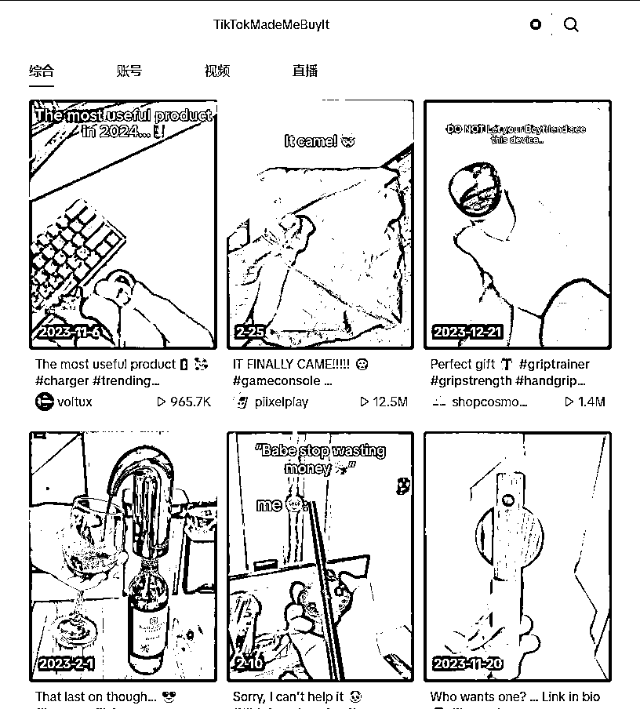

### 机遇与挑战

*   内容策略：教育型内容 + 达人种草 + UGC 共振，是驱动互动与转化的有效组合。
*   广告触达：TikTok 广告能够覆盖超过 18 岁网民近 18% 的规模，为精准投放提供充足空间。

### 竞争环境

*   社交端：短视频形式让 TikTok 与 Facebook、Instagram 形成差异化，据估算澳洲 Facebook 用户维持在 1700 万左右，约占全国人口三分之二，TikTok 正持续分流增量。
*   电商端：兴趣电商的崛起让 TikTok 成为传统在线市场的强有力竞争对手，购物体验更具互动性。

### 支付偏好

澳洲用户支付习惯多元且偏向数字化：

*   借记卡：最主流支付方式，占比显著。
*   先买后付 BNPL：Afterpay 等分期支付在年轻群体中爆发，并催生 Afterpay Day 等节庆消费。
*   数字钱包：PayPal 等移动支付在无线场景快速普及。
*   银行转账：仍在高客单交易中占据一定比例。

### 购买行为变化

疫情后澳洲消费行为发生结构性调整：

*   线上迁移深化：家庭线上购物的比例明显提升。
*   节点化消费：BNPL 和大促活动驱动的脉冲式购买愈发明显。
*   成本压力：利率上行、通胀与生活成本上升压缩了消费弹性，对零售商提出新挑战。
*   健康关注：对健康和福祉类产品的兴趣与投入度持续走高。

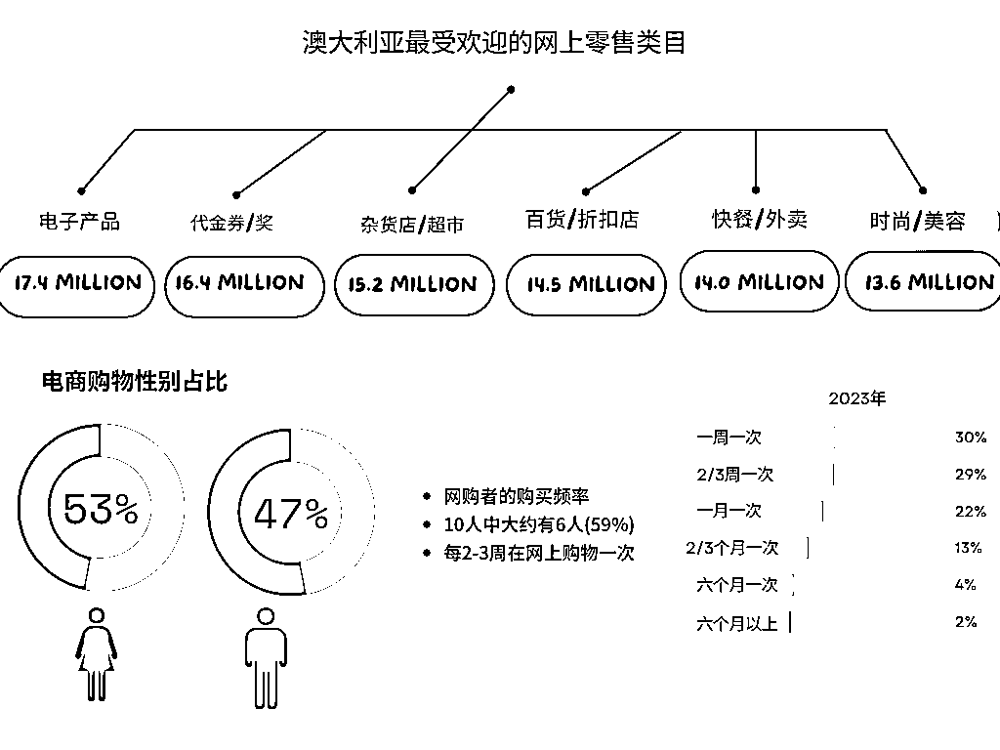

澳洲消费者特征

1.  重视生活品质：对产品质感要求高，偏好高品质商品。
2.  消费节奏稳定：不像国内周末集中购物，澳洲薪资多按周发放，逢周四发薪。
3.  客单与复购特征：客单价整体偏高，退货率偏低，常习惯一次性多件下单。
4.  价格与时效敏感：注重性价比与配送速度，偏好合理价格与快速履约的组合。

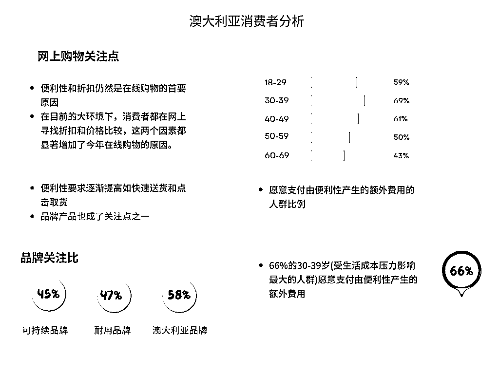

订阅经济在澳洲已相当成熟，订阅范畴远超媒体与流媒体，已覆盖音乐、影视、健身、教育、美食、服饰与家居用品等。用户通过周、月、季、年付费获取持续服务或产品供给。

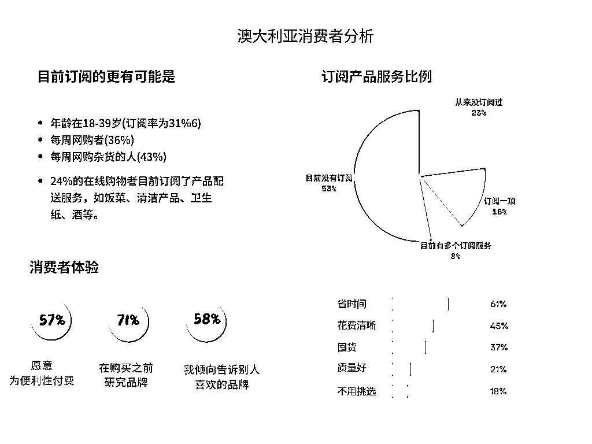

在线品牌研究的渠道偏好

16-64 岁网民在进行品牌研究时，各渠道作为首要信息来源的占比分布。

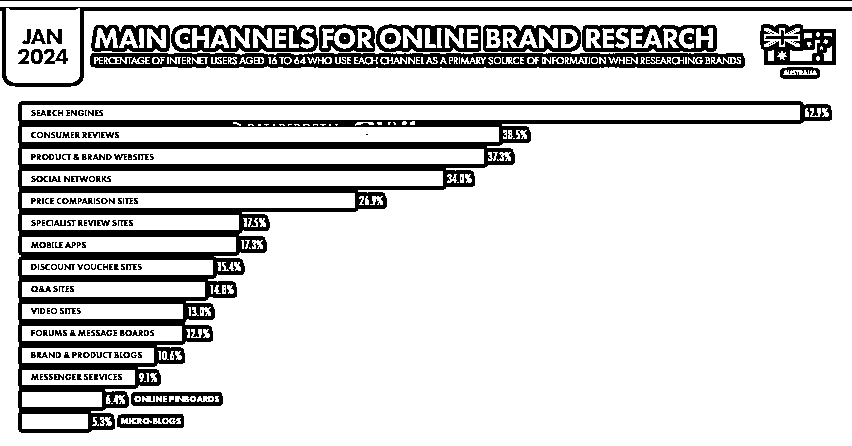

### 中国电商出海的机遇与挑战

机遇：澳洲电商生态成熟且多元，为中国商家提供差异化供给与价格竞争的空间。

挑战：需在本地与国际品牌的激烈竞争中突围，深入理解当地消费习惯与偏好，同时合规遵循澳洲消费者保护与电商法规。

澳洲政府对 TikTok 的态度主要集中在国家安全与隐私层面。2023 年 4 月，澳洲宣布在所有政府设备上禁用 TikTok，系基于情报机构建议。这一举措体现出政府对数据跨境风险的谨慎。

即便存在政策担忧，TikTok 在澳洲的商业价值依然突出：在年轻群体中渗透极深，为触达传统媒体难以覆盖的人群提供新路径。平台正通过将用户数据存储于美国德州等举措缓解安全顾虑。总体来看，TikTok 仍是品牌触达广泛受众、尤其是年轻市场的有效入口。

澳洲网购正处于后疫情时代的稳定期，支出增速趋于平缓。

预计线上零售将保持稳健增长，但生活成本抬升要求零售商精细化运营。消费者在非刚需品类更趋谨慎，支出更注重性价比。利率、通胀与生活成本的压力仍在持续，对零售端形成考验。

全渠道体验愈发关键：澳洲网民几乎无差地使用电商网站与 App 作为发现和研究产品、品牌与零售商的核心渠道。线上与线下体验正深度融合，零售商需在双渠道同时交付优质服务。

澳洲热销品类聚焦

1.  电子产品：手机、平板、数码相机、电子阅读器等需求稳定，苹果、三星、索尼等品牌领先。
2.  家居园艺：家具、家居装饰、厨卫用品、户外家具、烧烤及园艺工具持续热销。
3.  食品饮料：对品质与风味要求高，有机食品、进口红酒、咖啡豆等表现强劲。
4.  时尚服饰：覆盖 Zara、H&M、Uniqlo 等国际品牌，以及 Sheike、J.D. Williams 等本土品牌。
5.  美妆个护：雅诗兰黛、资生堂、露华浓等国际品牌与 Hada Labo、Clayton 等本土品牌共存。

### 实操建议

*   以美区验证过的爆品在澳洲做差异化快测，缩短验证周期。
*   利用季节差异，南半球夏季与北半球冬季错位投放。
*   市场规模适中，建议聚焦高利润品类，通过 TikTok 独立站撬动增长。

澳洲 TikTok 投放案例一：贴牌牙齿美白
累计广告播放量：1 亿
售价：18.83 美元

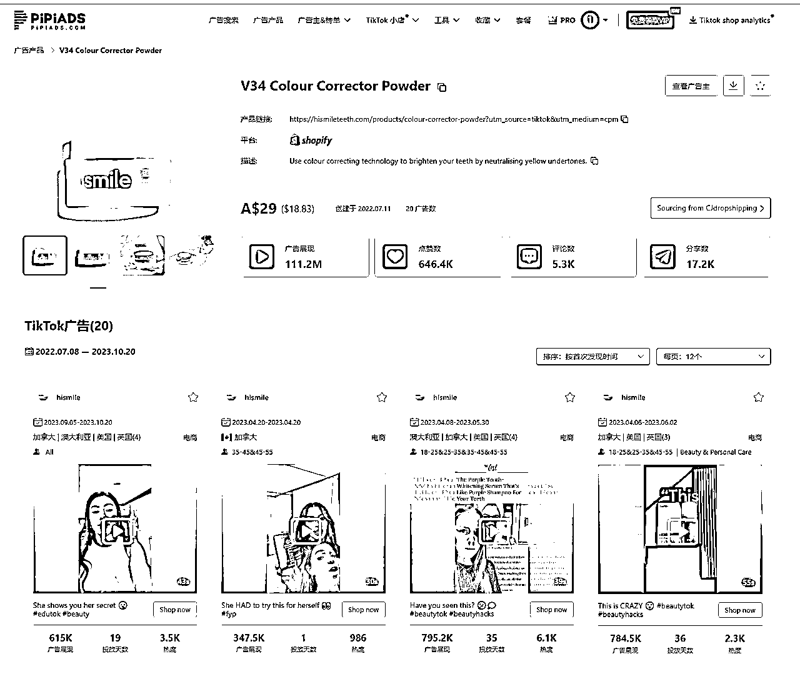

https://www.pipiads.com/zh/product-search/62cd5b3dc5861b70531eea76/

2600 万播放广告素材：达人种草 + 效果展示

澳洲 TikTok 投放案例二：脱毛器
累计广告播放量：9300 万
售价：84.35 美元

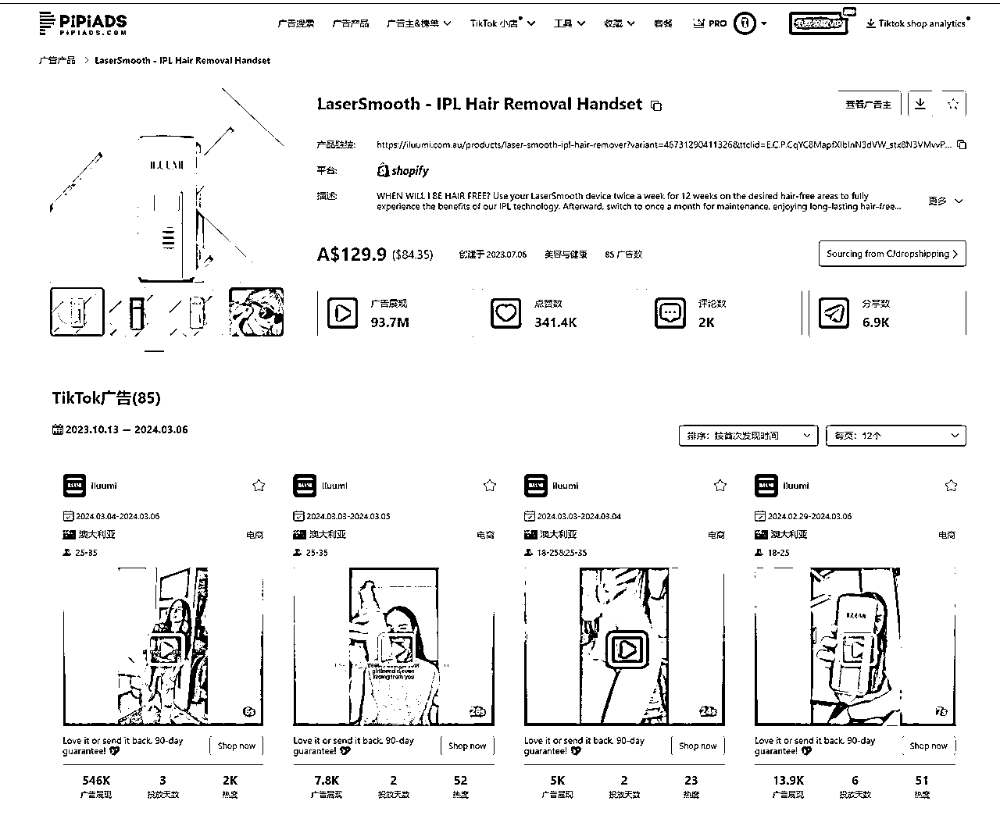

https://www.pipiads.com/zh/product-search/652a5c929b9ebe5125179cf0/

1450 万播放广告素材：夸张的前后对比 + 痛点解决

澳洲 TikTok 投放案例三：定制礼品卡牌
累计广告播放量：4500 万
售价：29.22 美元

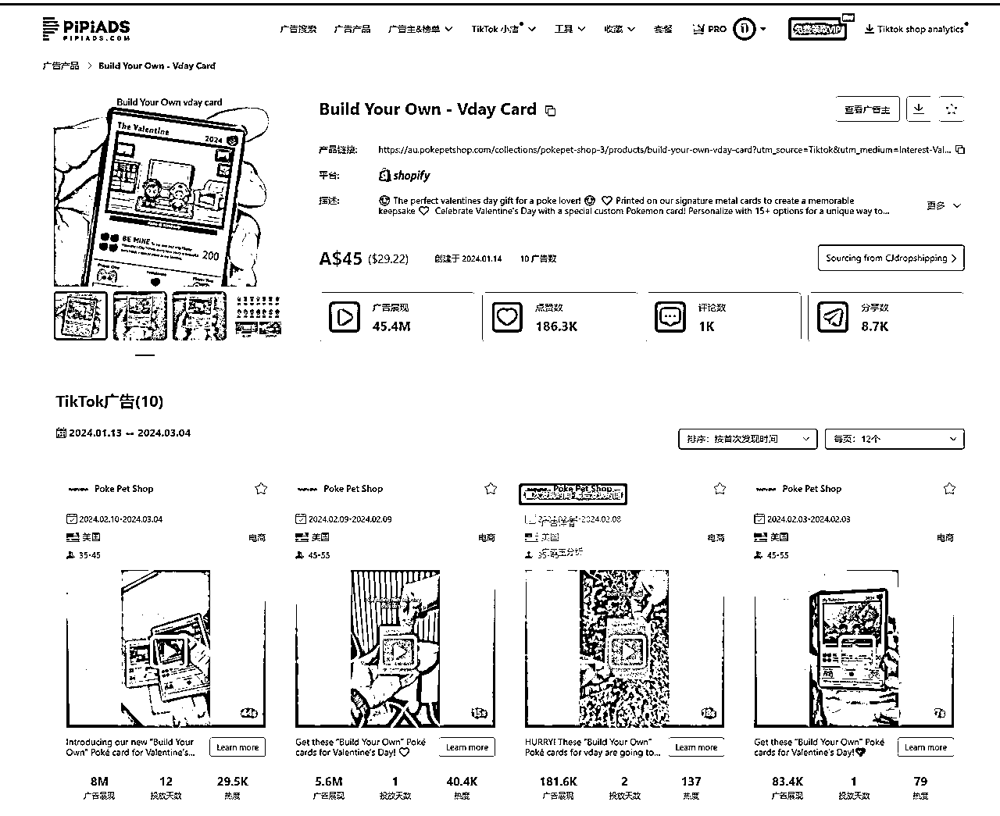

https://www.pipiads.com/zh/product-search/65a9a92093328758adef2432/

1950 万播放广告素材：定向人群 + 定制路线

结论

地广人稀但经济发达的澳洲，其电商市场潜力充足。TikTok 在澳洲的高活跃度为品牌提供了连接年轻高黏性用户的重大机会。通过结合平台的电商能力与内容趋势，品牌可建立更深层的用户关系并驱动电商增长。随着社交与电商边界持续融合，澳洲市场有望继续站在社交电商变革的前沿。

交流建联：17684058749