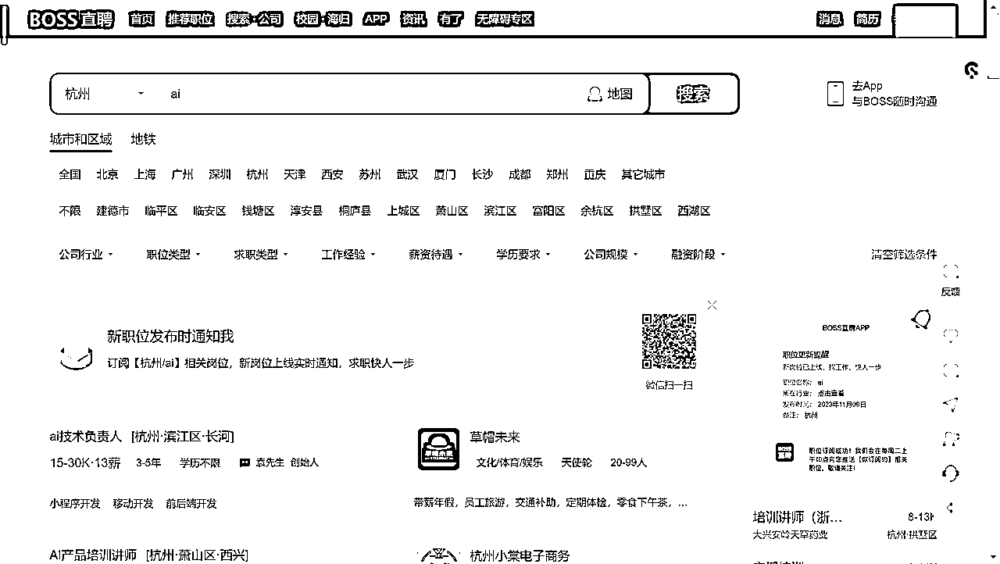
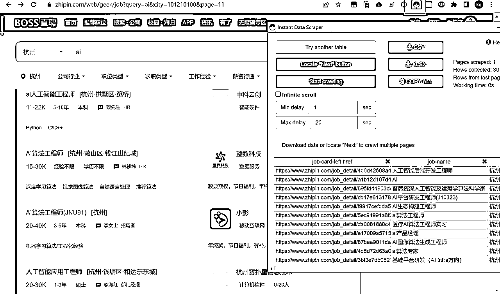
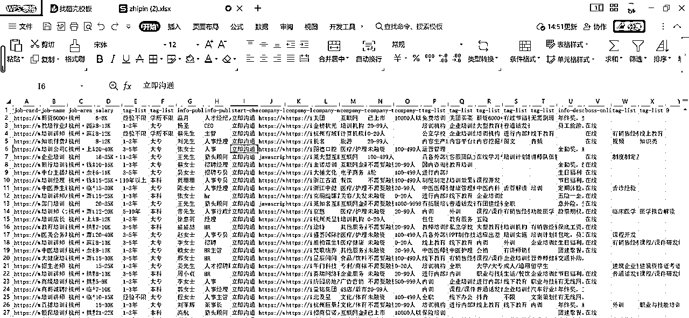
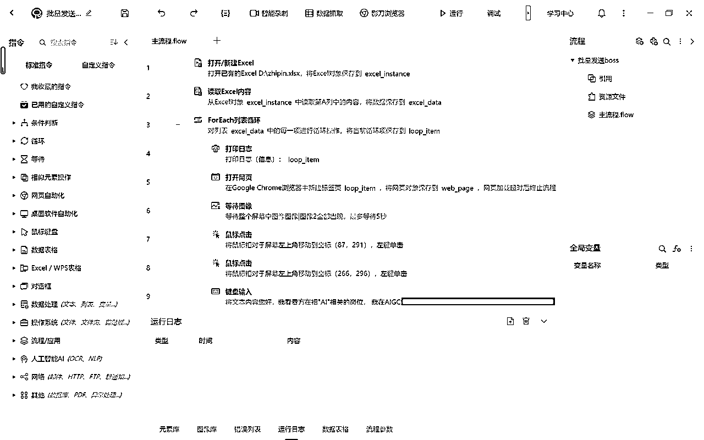
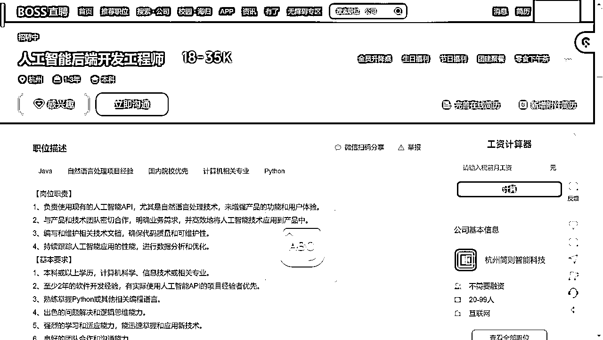
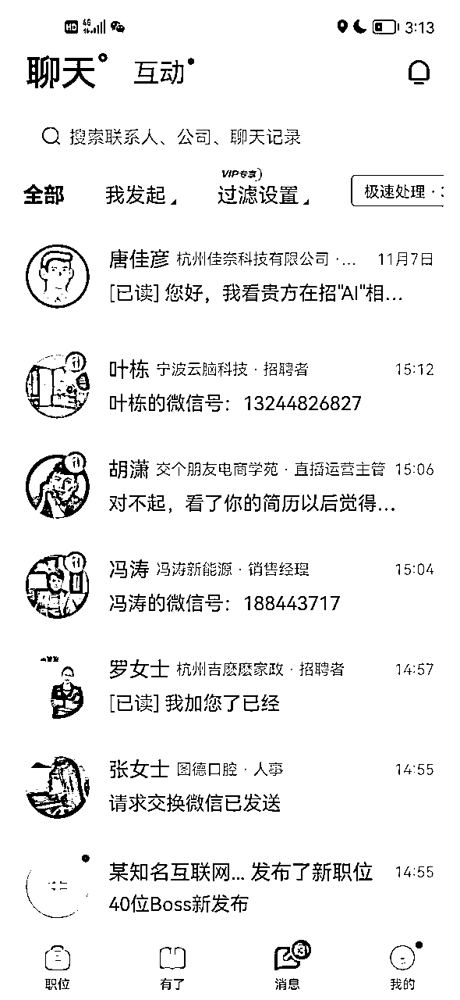
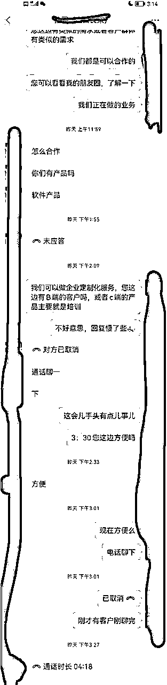
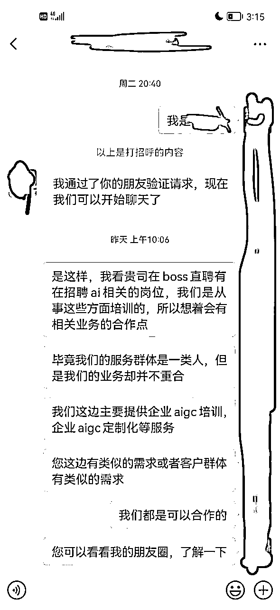

# 我用这个“笨办法”，在Boss直聘上每天多聊20个高客单客户

> 别再把招聘平台只当找工作的地方了，它也可能是个隐藏的流量池。

## 故事是这样开始的

我之前待的那家公司是做AI的，技术上没得说，但流量一直是老大难。每天愁的就是一个问题：目标客户到底在哪？

后来我把目光瞄向了国内最大的招聘网站。思路很简单粗暴：既然搞AI的公司和人才都在这上面，那我直接去找潜在合作伙伴和客户，一个个聊不就行了？

结果聊了几个就发现，手动效率太低了。好歹我也算半个程序员，不如写个RPA自动跑？说干就干。

具体的玩法是：用关键词搜索，把相关的招聘用户网页数据全爬下来，然后挨个私信。谁回复了，就说明有兴趣，再加到微信深聊。

这里有个细节：搜的时候可以限定地区，甚至精确到区。我当时把杭州的钱塘区、余杭区、西湖区轮着爬，这样每次拿到的数据都是新的，不会老跟同一批人打招呼。

不过会员每天打招呼也有次数限制，大概200多次封顶。

## 一、数据从哪里来？

批量操作的前提是，得先有足够多的目标用户名单。用关键词一搜，返回的列表基本就是我们想要的潜在客户/合作伙伴池子了。



小技巧来了：如果搜索结果很多，先从自己所在的市区开始搜，比如我在杭州，就以我所在的位置为中心，一圈圈往外扩散。Boss直聘每10页是个坎，改了链接虽然能翻更多，但10页以后的用户活跃度通常不咋地，直接跳过。每个区拿10页，每页差不多30个，数据量妥妥够用。

## 数据怎么抓？

我当时用的是Instant Data Scraper这个免费插件，打开网页后点一下，表格数据嗖地就出来了。配合自动加载分页按钮，10页数据几秒钟就能拿到，再一键导出成xlsx文件。



导出的数据里，我们最需要的是第一列——也就是用户详情页的链接。



## 二、怎么批量打招呼？

核心逻辑很简单：读取文件，拿出所有链接，逐个进入详情页，点几个固定位置，粘贴提前准备好的话术，然后下一个。

### 方案A：影刀（适合小白）

影刀的可视化界面很友好，操作门槛低，基本就是：逐个访问链接→执行固定点击→复制粘贴话术。



点“立即沟通”按钮。



立即沟通后通常有两种情况：
1. 一开始就弹出对话框，可以设置一句默认问候语。我就直接把我的来意贴上：我是谁、我做什么、想找兼职/合作。
2. 对方会先收到系统问候语，必须点“继续沟通”才能发消息。这估计是平台防滥发消息的机制。

### 方案B：Python + Selenium（推荐有代码基础的朋友）

我恰好懂点代码，主要工作交给GPT写了用Selenium跑。逻辑和上面一样：读文件→拿链接→进页面→点“感兴趣”（防止重复点击）→点“立即沟通”→发消息。


代码我放在最后，会用的人直接拿去。

## 三、效果怎么样？

整个过程完全SOP化：批量发话术、统一回复、加好友后自动回复。转化率不算高，也就3%左右吧，但胜在能筛选一轮客户。一个号一天下来，大概能加上20个客户或合作伙伴——主要卡在聊天次数限制上。如果以后想扩大规模，多开几个号就行。

实际跑起来，你只需要启动程序，然后等回复。程序能自动回复，简单交流几句后加上微信，作为备选客户/合作伙伴储备。后续再通过朋友圈等私域手段慢慢转化。



昨天发完一轮后，因为筛选的都在杭州，甚至有个有合作意向的哥们直接跑过来面谈合作了。



做高客单的私域，大家都懂，急不来。靠朋友圈立人设、建信任、让人了解产品，所以只要加到微信，都是潜在机会。合作伙伴那边更有意思，有的人比你还急，直接上门谈合作（少，但真有）。

这项目最重要的意义是给大家打开个思路：如果缺流量，能不能去最大的招聘网站里找？通过平台规则倒流，其实完全行得通。

## 四、几个关键细节和话术

**第一，问候语**要用心写，别太硬广。

```
您好，我看贵方在招"xx"相关的岗位，
我在xx方面有蛮多经验的，问下贵方这块是否考虑兼职，或者其他合作形式？
```

**第二，简历很重要。**把主营业务和成绩写清楚，加微信前先发一份给对方，专业感一下就上来了。

**第三，加好友后的话术**也要提前备好，别加完人就不知道说啥。



**第四，建议开会员。**哪怕操作频繁了点，给官方交了钱，对方也会睁一只眼闭一只眼。

**第五，千万别跟客户吵架抬杠。**我自己测试过，如果被举报，轻则禁言，重则封号。当时我因为开了会员，答完题就放过了。

## 五、费这么大劲值吗？

其实RPA代替了手工重复操作，你真正要做的事很少，大部分时间都是程序在跑。而且高客单行业的获客本来就不容易，其他平台要么监管严，要么获客成本高。相比之下，Boss直聘真是个被低估的渠道。

## 六、代码（含注意事项）

> 重点：用以下程序前，先关掉当前的Chrome浏览器。

有三个前提要满足：
1. **环境**：必须配好Selenium环境。如果你纯小白，我更推荐用影刀从0到1搭一个自己的RPA，图形化操作会友好很多。
2. **参数**：代码里有些参数建议自己过一遍，比如`user_data_dir`要改成你自己的Chrome数据路径（大概率就是把用户名换成你自己的）。
3. **文件地址**：我把数据文件放在Python文件同目录下，方便直接读取。

我直接用了本地Chrome账户数据，这样就不用每次启动程序都登录一次。所以如果你按下面代码跑，也记得先把Chrome彻底关掉。

```
import time
import pandas as pd
from selenium import webdriver
from selenium.webdriver.common.by import By
from selenium.webdriver.support.ui import WebDriverWait
from selenium.webdriver.support import expected_conditions as EC
from selenium.common.exceptions import TimeoutException, WebDriverException
import pyautogui
import logging

# 设置日志记录
logging.basicConfig(level=logging.INFO, format='%(asctime)s - %(levelname)s - %(message)s')

def wait_and_click(xpath, timeout=10):
    try:
        # 显式等待直到元素可点击
        element = WebDriverWait(driver, timeout).until(
            EC.element_to_be_clickable((By.XPATH, xpath))
        )
        element.click()

    except TimeoutException:
        logging.error(f"元素加载超时：{xpath}")
def load_and_interact_with_website(url):
    try:
        # 设置隐式等待时间，例如设置为10秒
        driver.implicitly_wait(5)
        driver.get(url)
        # WebDriverWait(driver, 10).until(EC.presence_of_element_located((By.TAG_NAME, 'body')))
        # 在这里执行更多交互操作
    except WebDriverException as e:
        logging.error(f"加载网页时出错：{url}，错误信息：{e}")
def setup_chrome_driver():
    user_data_dir = r'--user-data-dir=C:\Users\86180\AppData\Local\Google\Chrome\User Data'
    # profile_directory = r'--profile-directory=C:\Users\86180\AppData\Local\Google\Chrome\User Data\Profile 1'
    chrome_options = webdriver.ChromeOptions()
    chrome_options.add_argument(user_data_dir)
    return webdriver.Chrome(options=chrome_options)

# 脚本的主函数
def main():
    # 加载Excel文件
    df = pd.read_excel('./zhipin_培训_AI.xlsx')
    urls = df.iloc[:, 0].tolist()
    global driver
    driver = setup_chrome_driver()

    for url in urls:
        try:
            if driver.find_element(By.XPATH, '//*[@id="wrap"]/div/div[1]/div/button'):
                time.sleep(10)
        except Exception as e:
            pass

        logging.info(f"正在处理: {url}")
        load_and_interact_with_website(url)
        # 执行具体的点击等操作，这里用pyautogui作为示例
        try:
            # 检查是否存在取消感兴趣的按钮
            # 这里我们查找包含'btn-interest active'类的a标签
            element_1 = WebDriverWait(driver, 10).until(
                EC.element_to_be_clickable((By.XPATH, '//*[@id="main"]/div[1]/div/div/div[1]/div[3]/div[1]/a[1]'))
            )
            if driver.find_elements(by=By.XPATH, value="//a[contains(@class,'btn-interest active')]"):
                logging.info(f"\n页面{url}已显示‘取消感兴趣’，跳过此页面。")
                # 使用pandas删除第一行
                df.drop(df.index[0], inplace=True)
                # 保存文件
                df.to_excel('./zhipin_培训_AI.xlsx', index=False)
                time.sleep(5)
                continue  # 如果找到，则跳过本次循环
            # 移动鼠标到(214, 691)
            pyautogui.moveTo(214, 691)
            time.sleep(3)
            pyautogui.click(214, 691)
            # 点击第一个坐标点的元素
            # element_1.click()
            # 移动鼠标到(569, 696)
            pyautogui.moveTo(569, 696)
            pyautogui.click(569, 696)
            element_2 = driver.find_element(By.XPATH, '//*[@id="main"]/div[1]/div/div/div[1]/div[3]/div[1]/a[2]')
            element_2.click()
            time.sleep(3)
            # 移动鼠标到(1552, 1100)
            pyautogui.moveTo(1552, 1100)
            pyautogui.click(1552, 1100)
            # element_3 = driver.find_element(By.XPATH, '/html/body/div[11]/div[2]/div[3]/div/span[2]')
            # if element_3:
            #     element_3.click()
            time.sleep(3)
            text_to_copy = """您好，我看贵方在招"xx"相关的的岗位，我在xx方面有蛮多经验的，问下贵方这块是否考虑兼职，或者其他合作形式？"""
            # wait = WebDriverWait(driver, 10)
            # 等待输入框元素加载完成
            input_box = WebDriverWait(driver, 10).until(
                EC.presence_of_element_located((By.XPATH, '//*[@id="chat-input"]'))
            )
            # 输入中文内容
            # input_box.send_keys(text_to_copy)
            # 复制内容
            pyperclip.copy(text_to_copy)
            # 粘贴内容
            pyautogui.hotkey('ctrl', 'v')

            # 可以选择通过回车发送消息
            input_box.send_keys(Keys.ENTER)
            time.sleep(5)
    driver.quit()

if __name__ == "__main__":
    main()
```

### 部分代码逻辑说明

1. 代码内置了一些反爬措施和较长的休眠时间。程序跑起来后如果访问太频繁，会触发验证码，所以休眠时间建议别乱改。
2. 每运行一次，程序会删掉一行已处理的数据，防止中断后不知道从哪继续。如果你不想丢数据，记得先备份一份原文件。

---

方法分享到这，重点是思路，不是代码本身。流量不一定非要在流量池里找，招聘网站上的“人”，也许就是你的下一个客户。