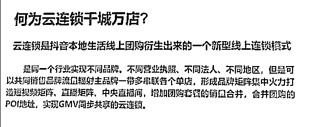
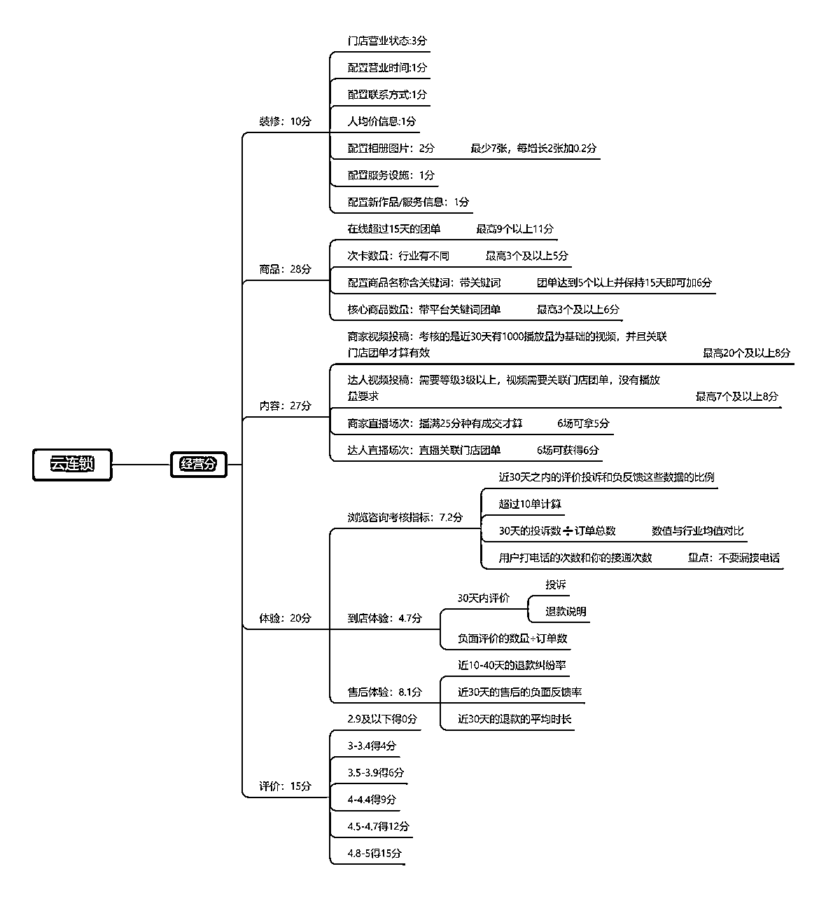
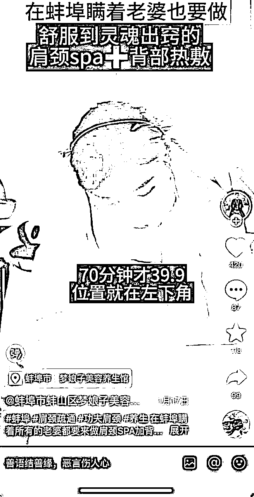
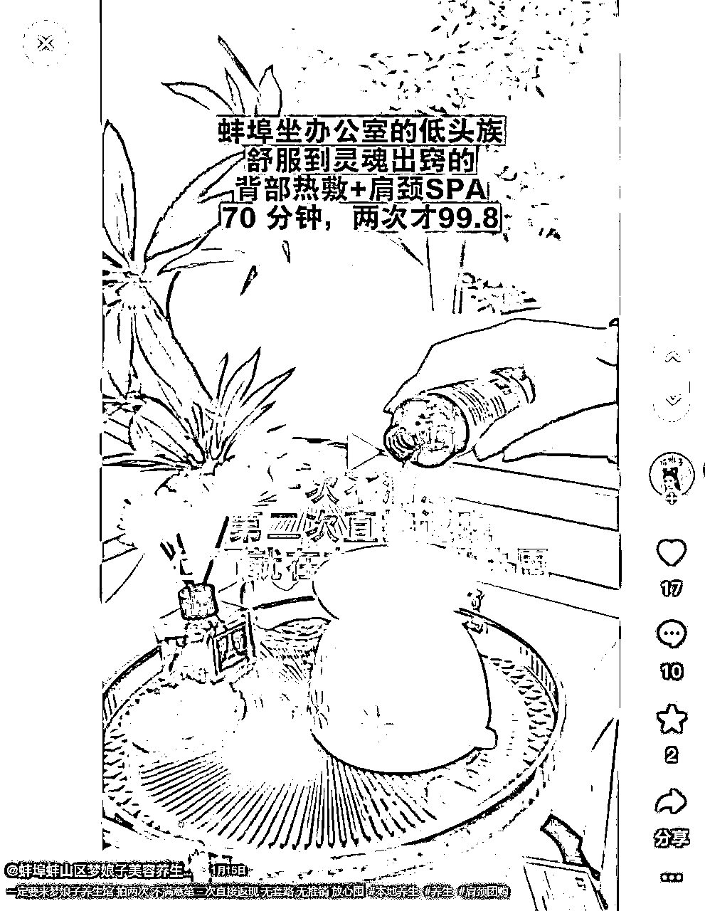
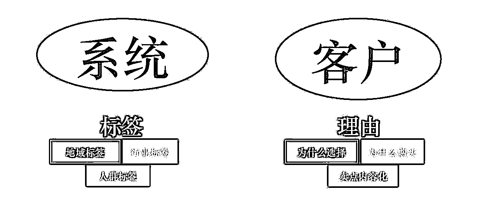
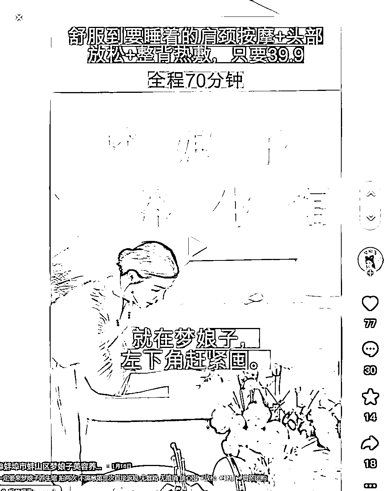
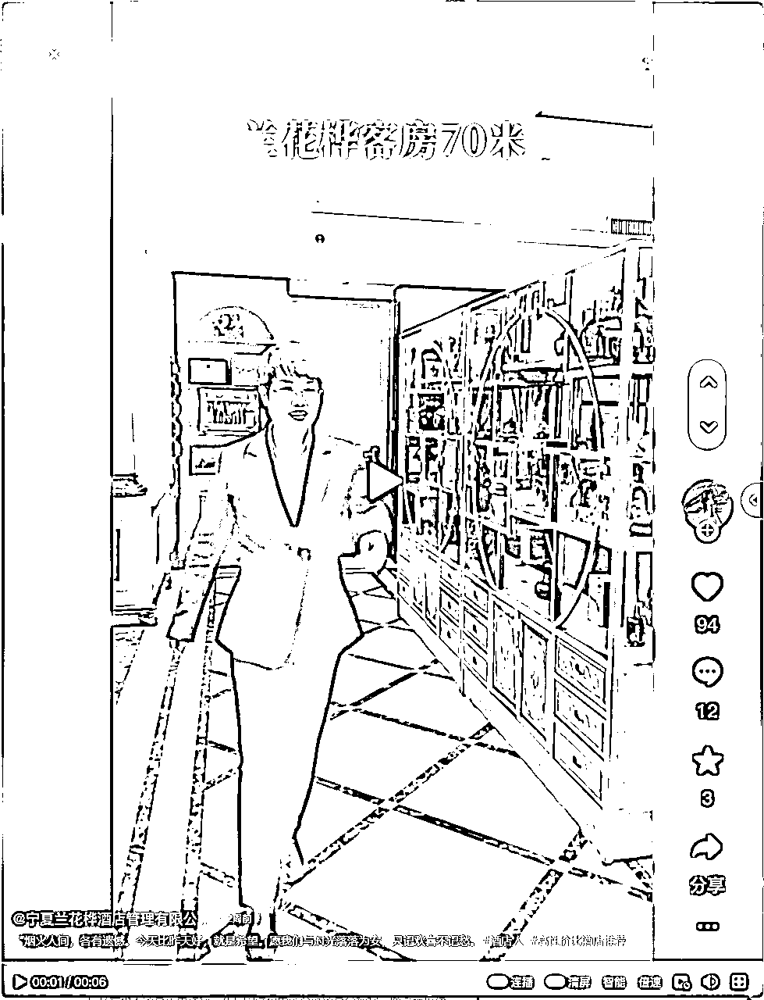
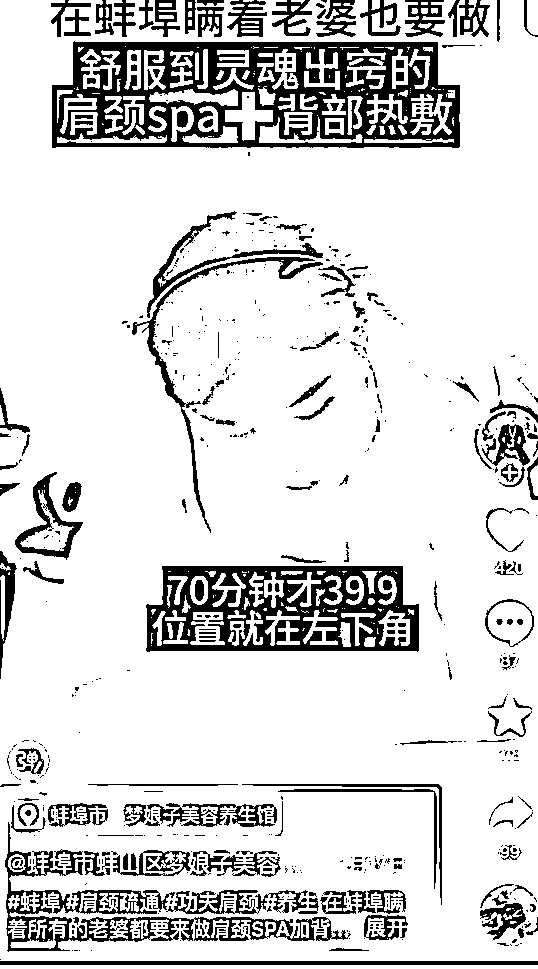

# 本地生活新模式——云连锁之打爆单店
作者：龙哥

刷抖音的时候，你是不是也刷到过这样的团购链接？直播间或短视频里挂的同款套餐，销量动辄几万、几十万，甚至冲上百万。

这就是“云连锁”。

啥是云连锁？简单说，它是一种全新的线上连锁玩法，靠抖音流量吃饭。不同品牌、不同营业执照、不同老板、不同城市的门店，全被一个主品牌串起来，共享流量辐射，组成品牌矩阵。

这么玩有啥好处？最直白的——所有门店的销量合并到一个链接里，用户看着销量高，下单更爽快。另一个好处是统一运营、集中搞流量，运营成本能压下来。这模式美团时代就有过，只不过现在抖音流量更大，更容易让单店爆单。可要是店铺承接能力跟不上，流量来了接不住，那就白白浪费了。

# 本地生活的几个阶段

往远了看，本地生活这盘棋，大概要经历这么几步：单店模式 → 培训招商 → 连锁经营（也就是云连锁）→ 自营加盟 → 资本收购。

云连锁正好卡在第三阶段。

要说赚大钱，还得靠后面的自营加盟和资本。资本那事儿可遇不可求，跟找对象一样，得看缘分，咱先不聊。

那云连锁的价值在哪儿？我的理解是：用很低的成本快速把规模拉起来，建立品牌势能，然后规范自己的自营体系，最后转成传统加盟模式。

啥意思？云连锁的核心打法，是先打爆一家单店，让流量往外溢，再把溢出来的流量分给其他合作门店。这样一来，原来的竞争对手反倒变成了合作伙伴。

如果单店模式能跑通，等于掌握了流量密码，你就能把这套核心能力复制给无数合作店铺。

对合作店铺来说，不用自己折腾抖音、不用拍视频，就能有顾客上门。只要成本划算，他们肯定愿意跟你干。

为啥？线下商家最大的痛就是不知道怎么获客。但绝大多数老板根本不懂抖音运营。

于是他们去找代运营、找达人帮忙宣传。可很多代运营水平堪忧，交付不了结果，达不到商家的预期。

要是你能让店铺低成本获客，那就能通过“连接”其他店铺，快速铺开规模。

规模一大，联营店铺的管理问题就冒出来了。这时候就得精简店铺数量，把联营店慢慢变成自有品牌，做强管理。说白了，最后还是要回归传统加盟的路子。

云连锁在这中间起的作用就是：快速扩张规模、高效招商。

所以我说，云连锁就是招商连锁的10X思维。

# 实体店怎么入局？

回到开头的问题：实体店老板想玩这个模式，该怎么做？

你说你不想？只想把眼前这家店做好，赚点小钱就知足了？

那你得掂量掂量，你店里一天能接待多少客人？就算从早忙到晚，又能赚几个钱？

要是隔壁同行开始搞抖音，用不了多久，你的客流就被他吸走了。

你眼睁睁看着人家店里顾客排长队，还跑来一堆人交钱学习。这时候你还觉得，这事由你想不想决定吗？

道理很简单——你不做，别人做，别人不光赚钱，还要抽走你的流量。

干掉你，真的跟你没关系。

所以实体店老板必须往前迈一步，主动拥抱新平台、新模式。

扯了这么多，无非是想说清楚：实体店靠抖音获客，不是趋势，是生死问题。

那第一步怎么迈？先把单店的盈利模式跑通，把店铺流量引爆。只有单店跑通了，后面才能继续往下走。

下面说正事。

先看抖音给店铺经营分的评判标准：

上面这5个板块，能拿到60分，曝光量涨5倍；要是能做到90分以上，曝光量直接涨19倍，业绩能涨31倍。作为店铺，能拿的分一定要拿满。

这篇咱们重点聊第二部分：内容分。也就是店铺视频该发什么、怎么发才有效。

我把它拆成三块：为什么发、发什么、怎么发。一个一个说。

## 1.0 为什么发视频

给老板们打个比方：发视频，就相当于发传单。传单的目的是让更多人知道你家店。

短视频跟传单，本质是一回事。

一个播放量，就是一张传单。

这么理解就通了：多发视频，就等于多让人看见；账号矩阵化，就相当于多雇几个人帮你发传单。

这是“为什么发”。

老板们最头疼的，多半是内容。店里一堆事忙不完，哪有时间拍视频、剪辑、发布？

那要是有个办法，又快又省事还管用，你是不是就能落地实操了？

别急，往下看。

## 2.0 发什么内容

想让视频效果好，有三个核心：内容吸引、标签精准、大量分发。

### 2.1 内容吸引

目标是吸引同城用户，那就得制造同城话题。

发什么能勾住同城的人？大致分三类：同城、产品、人设。

#### 2.1.1 同城流量内容

一个视频上，简单写几个字，系统就能识别出标签，带起同城话题。

你想啊，要是成都人刷到这条，是不是忍不住在评论区说一句？这一互动，视频数据就上去了，系统就会判断“成都人爱看这个”，然后更精准地推流。

这种视频拍起来一点不难，把【成都】换成你所在的城市，就能吸本地用户。再带上店铺地址，还能把POI热度提上去。

同城流量的密码，总结起来就三个字：借、造、蹭。

借：借本地人感兴趣的话题，比如美食、小区、景点、学校、酒吧等。
造：造一个有争议性的话题。
蹭：蹭热门事件来抬流量。

这里简单列几种视频形式，你能拍哪种就拍哪种。重点是你要知道有这些玩法，然后用关键词去搜更多类似视频。

#### 2.1.2 产品营销内容

营销内容分两类：产品驱动、人物驱动。

产品驱动有四种形式：新闻体、广告体、探店体、图文体。

重点说说新闻体，这个最容易落地。

看几个案例就明白了。

###### 产品新闻体

这种视频拍起来不费劲，把服务过程录下来，剪成几秒钟到几十秒的短片就行。

你可能会问：这么粗糙也能有效？画质不精良、不美观，字幕字体还像牛皮癣一样。

咱们得想明白：你的目的是让顾客上门，不是拍精美大片。实体店做抖音只有一个目的——把人引流到店里。不能带来顾客的视频，再好看也没意义。最简单的办法就是直接告诉他：你这儿是干啥的、能解决什么问题、多少钱。

还记得前面说的“发视频=发传单”吗？理论上，发得越多，看到的人就越多。

那这种视频到底有没有用？当然有。咱们拆解一下。

吸引顾客到店和咨询，靠两个东西：系统标签 + 客户理由。

通过字幕、声音、画面、封面、发布文案里的话题、POI地址、评论区来传递信息。比如视频上写着“某个地方”，这是地域标签；“肩颈spa”是行业标签；“办公室低头族”是人群标签。购买理由则是：便宜、手法专业、体验好。

这些元素凑齐了，就是一个有效视频。

###### 产品广告体

广告体视频就是把已有素材混剪，再配上配音解说。这个也不难，把文案写好，用剪映的智能配音就行。

###### 产品探店体

从第三方视角拍，需要解说。适合达人用。

人物驱动呢？也有新闻体、广告体、探店体。

###### 人物新闻体

人物驱动里最简单的、最能落地的也是新闻体。

俗称：走两步。看案例：

人物新闻体

就这么走路的视频，人家已经发了一年多，说明确实有效果。

###### 人物广告体

###### 人物探店体

这种形式吃人设，适合能出镜的老板。

#### 2.1.3 人设IP内容

人设IP类的要求就高了，得围绕IP专门建团队，不太适合小店老板玩。

### 2.2 标签精准

标签的作用是让系统认出你的视频，判断什么样的用户需要它。

前面说了，系统得先识别标签，才能决定推给哪类人群。

所以，凡是能展示的地方，都得打上标签。

标签分三种：地域标签、行业标签、人群标签。

在哪儿展示？就是：字幕、声音、画面、封面、发布文案话题、POI地址、评论。

推荐什么样的流量，取决于三件事：1、内容标签；2、停留人群；3、成交人群。

先把标签做得足够多、足够准，系统就会给对应人群推送。如果这群人停下来看了，你又能拿到一个权重。看得人越多，成交概率自然越高。

### 3.0 如何发视频

店铺发视频，记住一个“123公式”：一家店一天发2条视频——1条同城流量拉热度，1条产品营销或人物内容。

具体怎么发？有三个技巧：

#### 3.1 短视频矩阵

第一批先准备5-10个账号，批量发视频，后面再持续加号。

只有大量发视频，才能让更多人看到。

前期预算紧，就得用最低成本搞流量。方法就是：多申请账号，多发布视频。

一个账号，相当于一个分店。账号越多，曝光面越大。

你可能要问：这么多视频哪来？10个账号每天2条，就是20条。哪怕拍摄再简单，剪辑、制作、发布都要时间。

确实如此。

那就可以把这些重复性的活儿外包，交给工具或者兼职。

很多老板会用批量剪辑工具，一次性产出几百条视频都不难。

不会用工具的话，就花钱请兼职。去闲鱼搜【远程客服】，定位到偏远点的地方，比如宁夏、甘肃、内蒙，能找着20块钱一小时的兼职。

把制作流程拆成单一动作：比如剪辑请一个人，一套SOP；发布请一个人，一套SOP。每个人只做一件事，效率高，效果还好。

算笔账：一天请3个人，成本不过60块，一个月1800块，能帮你省下大量精力。你想想，店都开了，员工都雇了，几十万都砸进去了，营销上多花这么点钱，值不值？

#### 3.2 探店

探店分两种：云探店、达人探店。

云探店就是人不到店，拿着素材剪辑、发布就行。

达人探店呢，是真人到店体验，把产品核心用视频展现出来。

达人也可以做矩阵化，但要看你预算。

云探店价格便宜，可以大量怼，这跟找兼职剪辑一个道理。区别在于达人账号有权重，对播放量和POI热度有加成。

#### 3.3 POI热度

POI热度会直接影响店铺的综合评定和搜索权重。发视频一定要带上POI，一来方便用户直接下单，二来也能把POI热度养起来。

具体有三块：

1. 店铺图片：门头、环境等图片要传上去。
2. 用户评论：好评能提升POI搜索权重。
3. 位置曝光：视频带POI，标签更精准，权重也更高。

# 总结

今天聊的是实体店怎么入局抖音。

第一，为什么要发视频。抖音已经是国民级APP，实体店得把线上宣传当主阵地，舍得投资源和预算。

第二，发什么内容。可以发同城流量类、产品营销类、人物IP类。

第三，怎么入局。第一步先用低成本方式，把店铺同城流量打爆。具体就是批量做短视频、打精准标签、矩阵化分发账号。

24年做抖音云连锁，个人还是有机会的。一旦错过这波，等资本进场用投流打法来洗牌，个体就彻底没戏了。

我算半个餐饮人，做过年营收过亿的好吃街，还因为一篇小店经营的帖子拿过“龙珠”。看到本地生活的新机会，我对实体经济又重新燃起了希望。

今年我会重点做本地生活品牌，也希望能跟更多老板交流。

下一篇咱聊聊云连锁具体怎么执行。

感谢你看到这里，希望能给你一点启发。