# TikTok正在德国憋大招？这份市场调研信息量不小
作者：龙哥

最近跨境电商圈有个消息传得挺快：TikTok已经在德国低调启动半闭环模式的招商，目前采用的是邀请制，只对部分商家小范围开放内测。

对于熟悉欧洲市场的卖家来说，这绝对是个值得盯紧的信号。德国是欧洲电商成熟度最高的市场之一，消费者网购习惯多元且稳定，商业基础设施相当扎实。TikTok这条流量大鳄一旦正式进场，很可能重新瓜分德国电商的蛋糕。

先把基本盘聊清楚。德国总人口约8300万，在欧洲属于人口大国。互联网普及率极高，超过90%的居民都能上网。更重要的是，绝大多数网民都养成过在线购物的习惯，购买意愿在欧洲范围内名列前茅。

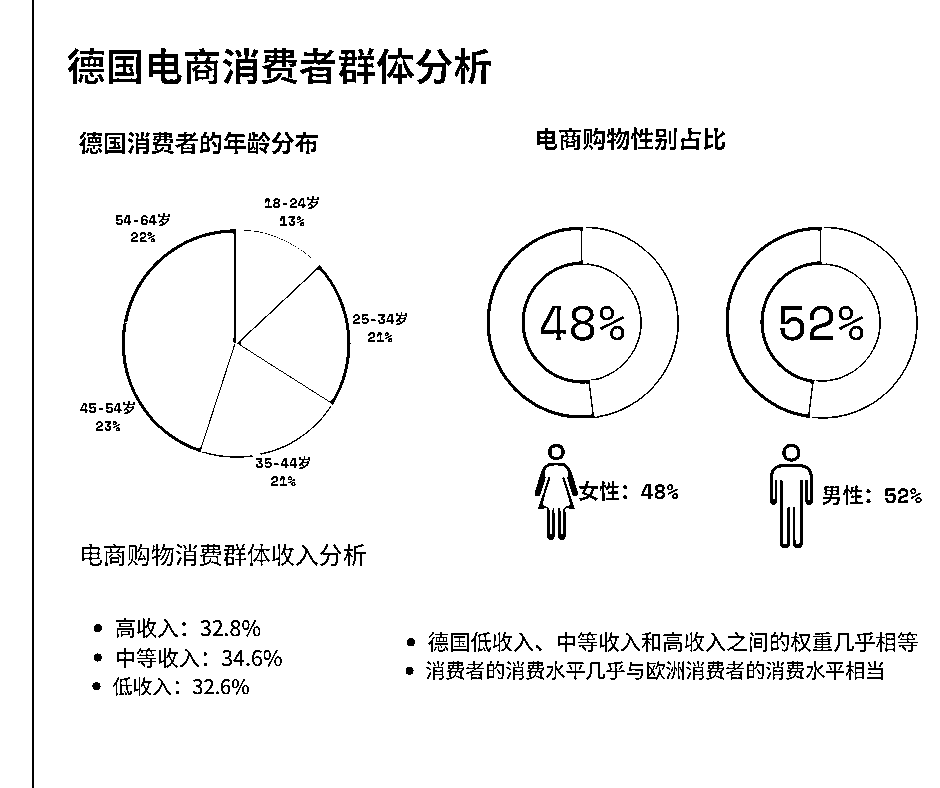

但市场规模大，不代表一路高歌。德国电商协会Bevh最新数据显示，2023年德国线上商品销售总额为797亿欧元，对比2022年的904亿欧元，跌了11.8%。受宏观环境影响，整个电商大盘增速放缓，目前正在触底企稳、缓慢回升。

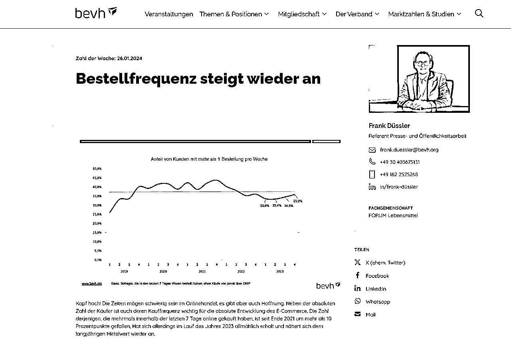

与此同时，移动端购物占比持续走高。2019年，德国电商订单里有33.5%来自移动设备；到了2023年，这个比例上升到45.1%。而TikTok用户恰好是重度手机/平板使用者，这波趋势对TikTok电商来说，简直是天然顺风。

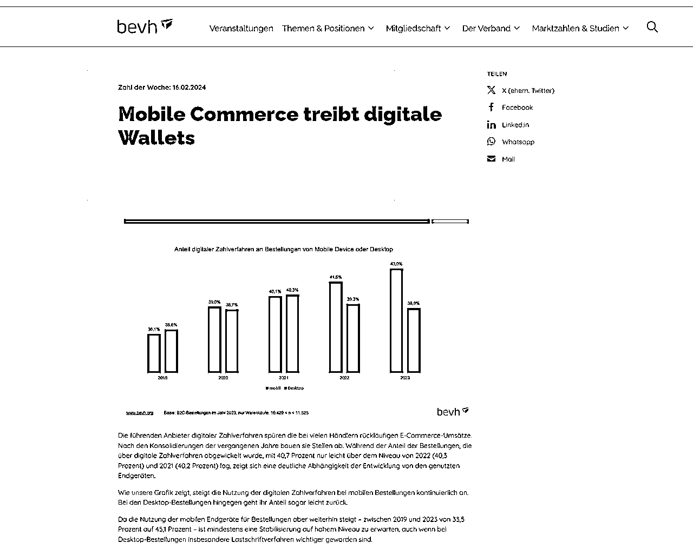

TikTok在德国的群众基础已经相当可观。根据Statista数据，TikTok占据了德国38%的社交用户份额，稳居全国前五社交平台。

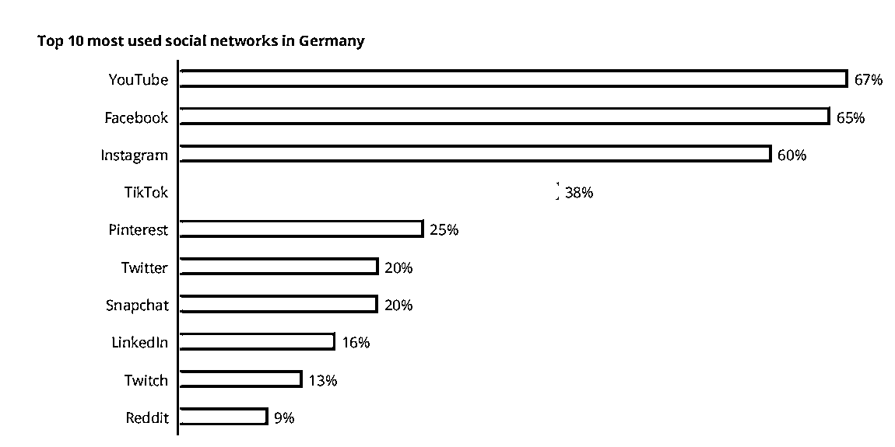

用户花在TikTok上的时间还在不断增加。从2021年到2023年第四季度，社交媒体用户中TikTok的使用比例暴涨了20个百分点，增速惊人。

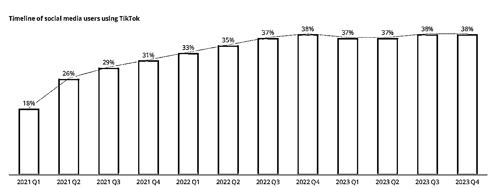

广告盘子也越做越大。Pipiads数据显示，截至2024年2月，TikTok全球广告受众排名中，德国排在第17位，广告受众规模达到2690万，一个月内新增了120万，增长势头很猛。

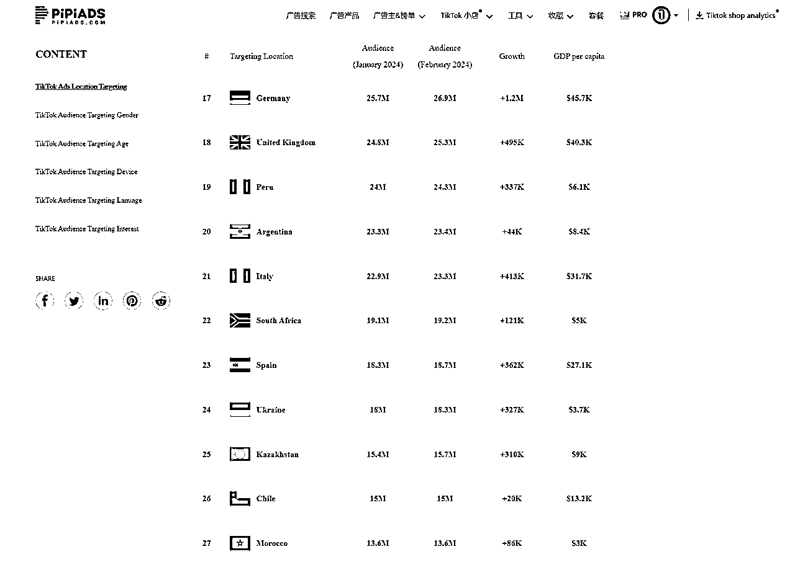

从消费行为看，德国网民对网购的接受度非常高：超过90%的互联网用户都有网购经历，购物频率也不低——很多人每月至少买一次，还有相当比例的用户几乎每周都下单。

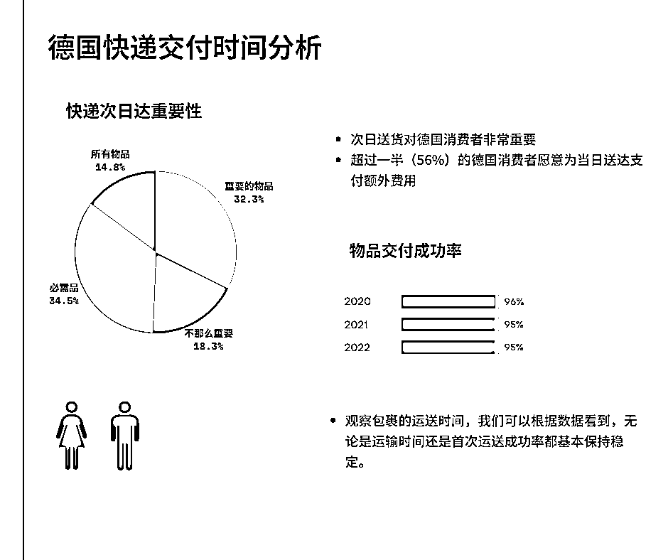

德国电商市场呈多平台并立格局，各个玩家都有自己的基本盘。

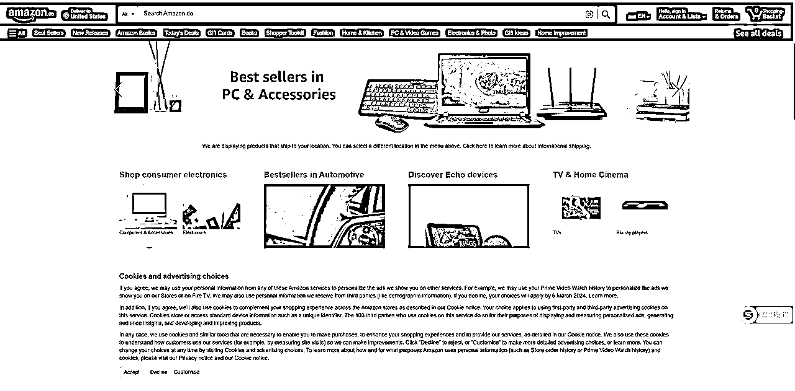

Amazon.de是绝对的老大。作为国际电商巨头，它在德国拥有主导地位，产品线从电子产品到日常消费品，几乎没有买不到的。

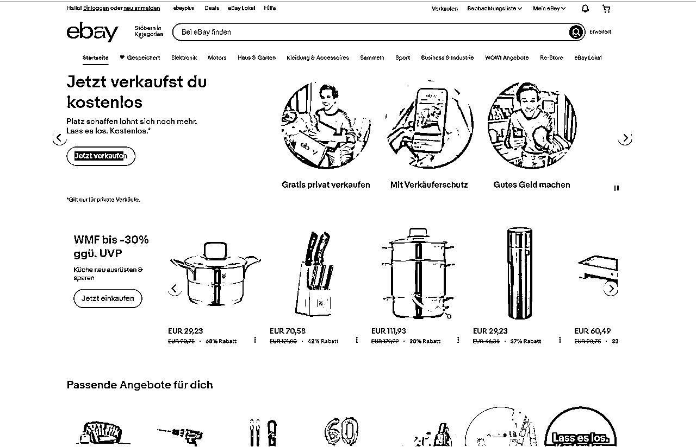

eBay.de人气同样很高。它一头连着个人卖家，一头连着个人买家，同时也有大量企业卖家入驻，新旧商品都能在这儿找到交易场景。

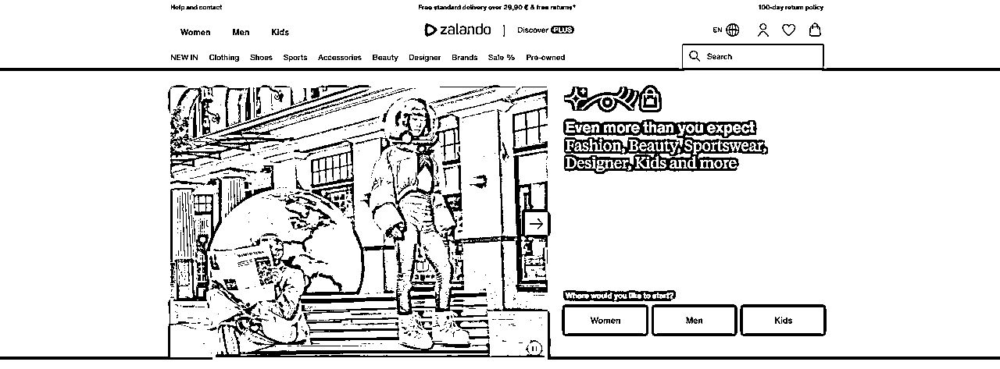

Zalando专注时尚与生活领域，卖服装、鞋履和配饰，在德国消费者中口碑很好。

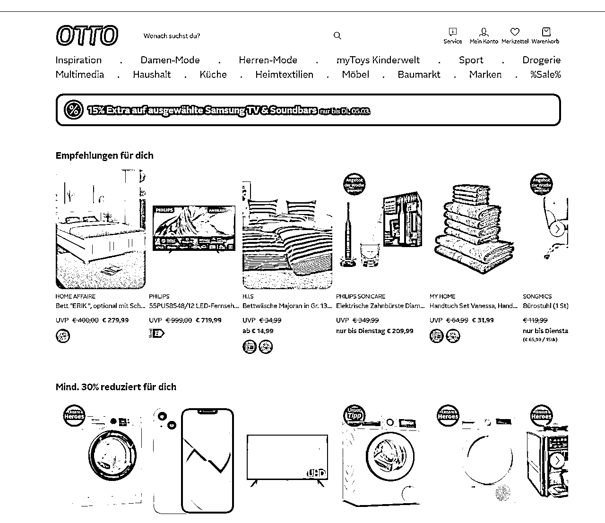

Otto是德国本土大型电商平台的代表，产品覆盖家居、电子、时尚等多个品类，实力相当能打。

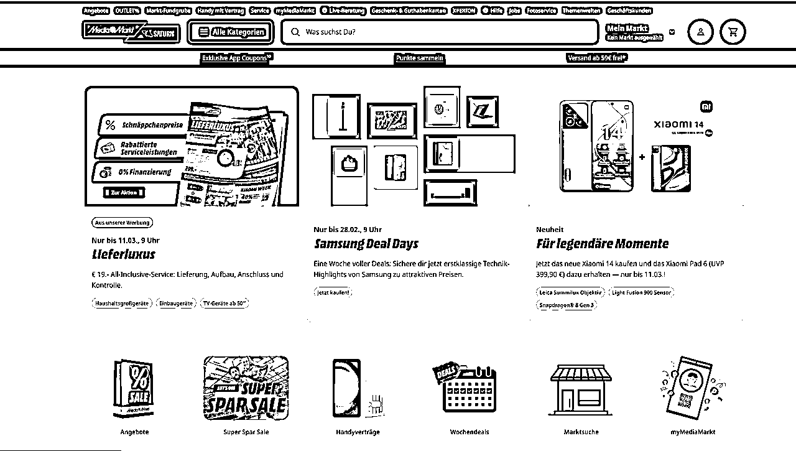

MediaMarkt和Saturn则是电子消费品和家电领域的重炮手，线上表现同样强劲。

面对这些实力对手，TikTok的机会点在哪？德国电商虽然竞争白热化，Amazon是第一巨头，但Zalando、Otto等本土平台依然活得很好，说明市场既有垂直平台的空间，也有综合平台的容身之地。TikTok带着兴趣电商的打法切入，再搭配中国供应链的极致性价比，完全有机会在德国点燃新一轮增长。

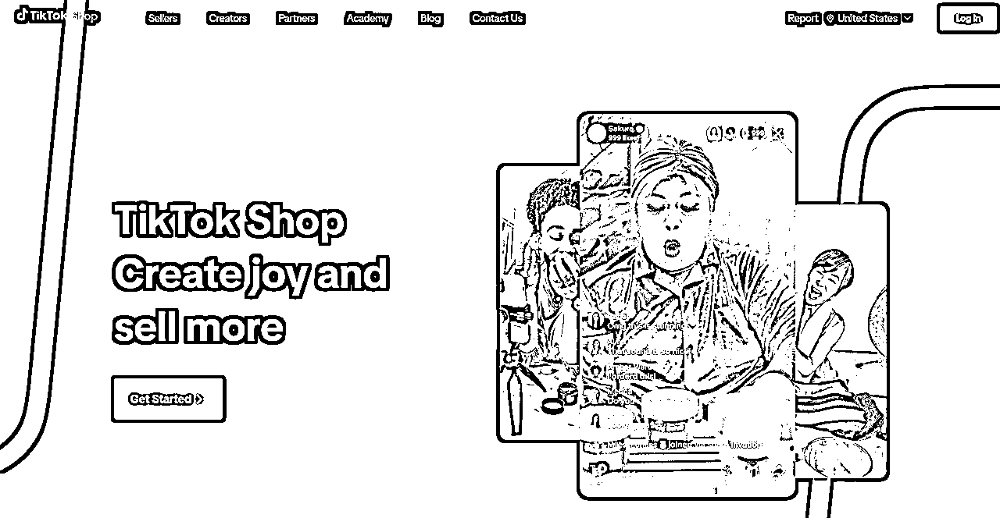

德国人的购物习惯，有着鲜明的“德式风格”：小心谨慎，极度看重品质。质量、耐用性和可持续性，几乎嵌入到他们的消费DNA里。德国人愿意为好产品和环保属性多花钱，但前提是让他们信服。他们在下单前习惯做大量比较和研究，价格对比网站、真实用户评价，都是左右购买决策的关键因素。社交商务的兴起，也给德国人的购物方式带来新的可能，越来越多消费者通过社交媒体发现和购买商品。

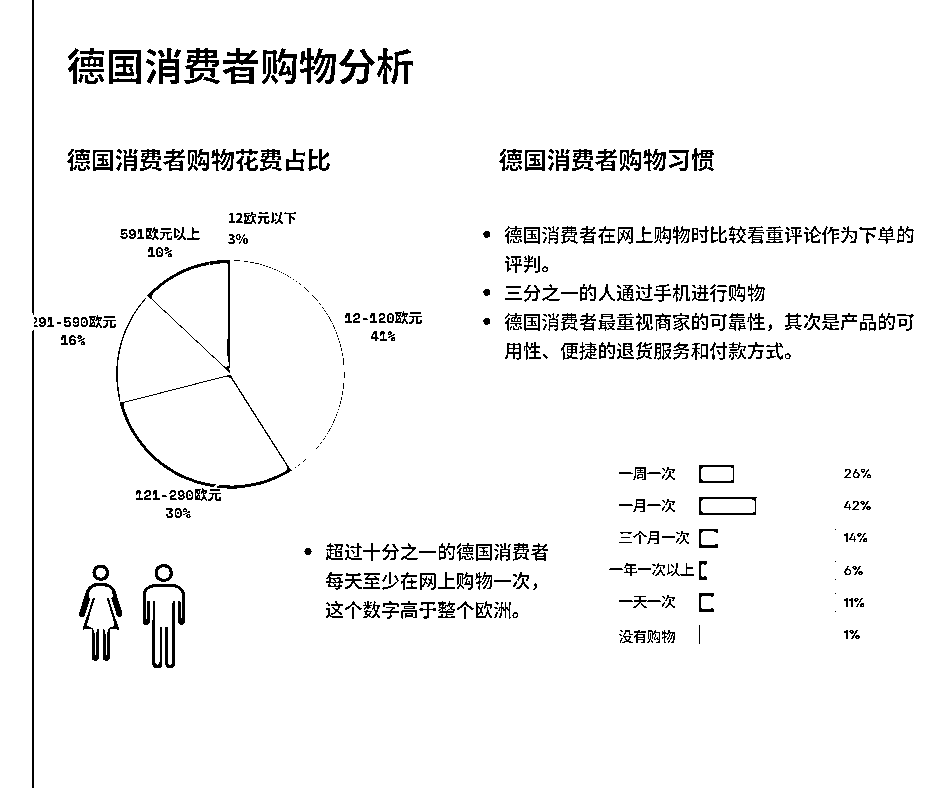

“可靠”是赢得德国市场的通行证。长期以来，德国消费者对产品质量、性能和耐久性有着很高的标准，尤其在汽车、家电和工具等高价品类上，这种偏好体现得特别明显。“德国制造”之所以能在全球赢得口碑，正是源于对工艺和品质的死磕；反过来，德国民众也格外信任本土制造。近几年，环保和社会责任也在购物决策中占据越来越大的权重，特别是在食品、服装、化妆品等类目，绿色和可持续的产品更容易被接受。

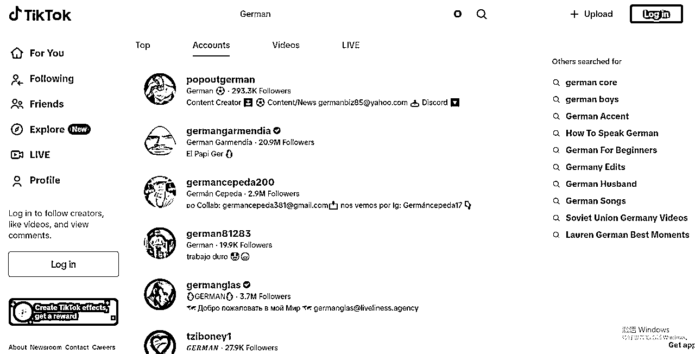

但德国消费者并不是只吃“质量”这一套。在时尚、美妆、科技产品等领域，名人背书和社交网红的影响力正在不断上升，尤其是年轻群体，很容易被明星和KOL带动消费。这种影响的背后不只是产品本身，更关乎品牌形象和生活方式——人们通过购买某个品牌，表达自己认同的社会角色或向往的生活状态。

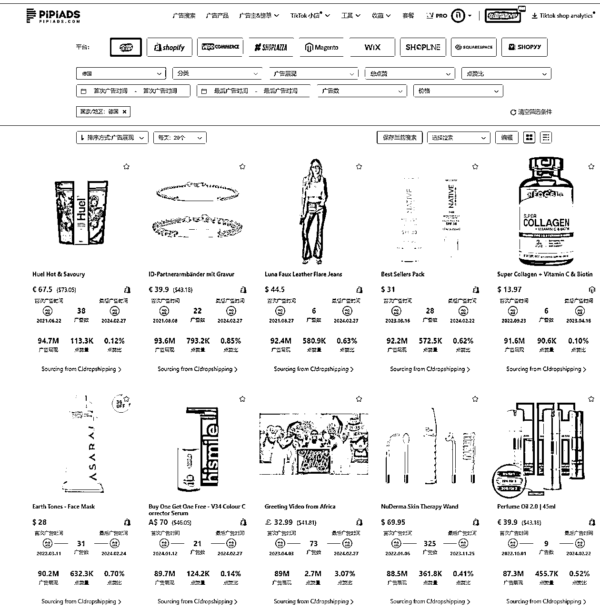

德国文化的底层逻辑，也深深影响着电商生意。这个国家崇尚效率、精确和品质，消费行为同样如此：德国人偏爱有规划、成体系的购物流程，对产品细节和技术规格格外较真。环保意识也渗透到日常决策中，可持续产品天然受欢迎。语言上，德语是绝对的主流，从教育、政府到媒体和日常生活，无处不在。不过德国的英语普及率也相当高，大约56%到64%的人能使用英语交流，年轻人英语更好，因为英语很早就进入小学课程，大学阶段也有大量英文授课项目。在商业和科学领域，英语几乎就是通用语言。

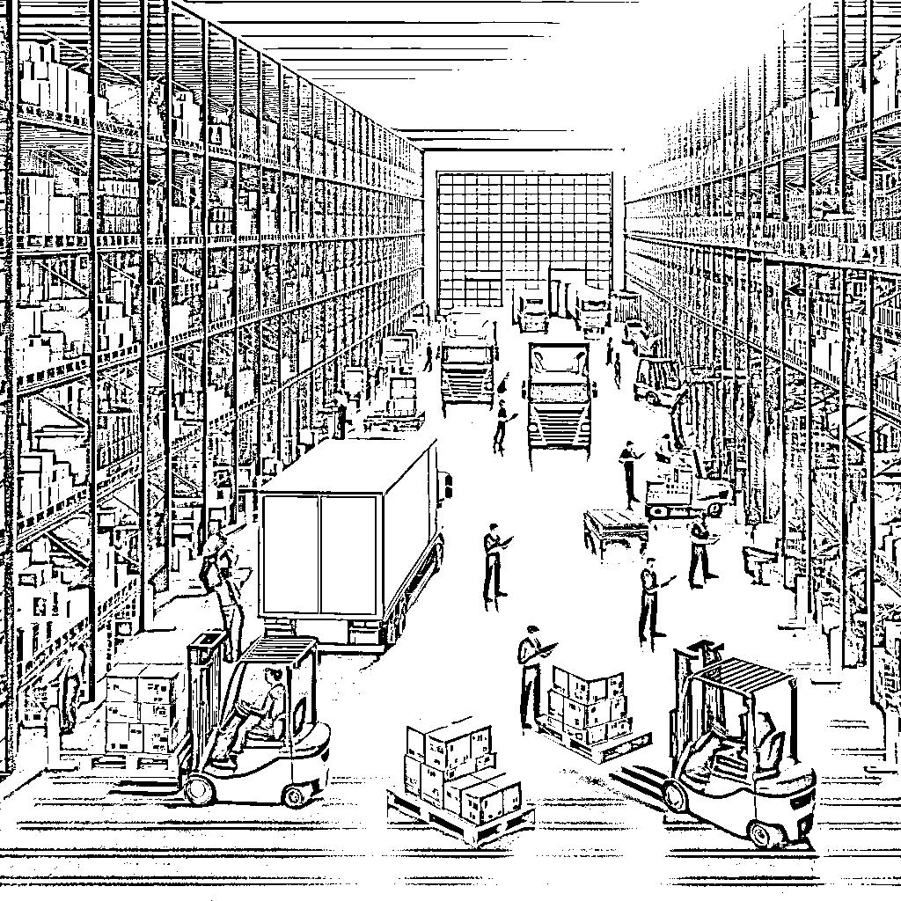

消费力方面，德国是欧洲最大经济体，也是全球举足轻重的经济体，人均GDP高，消费者购买力强。但德国人花钱并不随意，他们对性价比很敏感，折扣、促销和优惠永远有吸引力。

物流基础设施更是德国电商的坚实后盾。这个国家拥有覆盖全国的高速公路网（Autobahn），货物运输效率极高；铁路系统同样发达，提供高效的替代运输方案。德国各地遍布现代化物流中心和仓库，高度自动化管理支撑着海量货物流转，法兰克福、杜塞尔多夫、汉堡和慕尼黑等枢纽城市都配备了顶级物流设施。汉堡港更是欧洲大港之一，既服务国内，也连接全球贸易线路，对进口商品的区域分发至关重要。

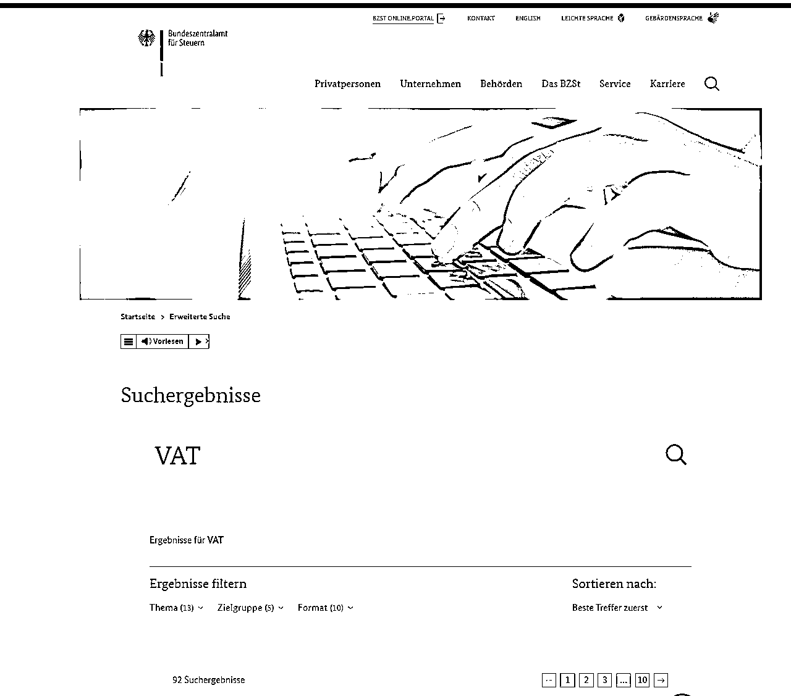

末端配送环节同样成熟。德国消费者可以享受非常多元的配送服务：传统快递、包裹站点、自动包裹柜（Paketbox），甚至还有快递自行车这种新型配送。DHL、DPD、Hermes、UPS是主要的末端服务商，其中DHL作为本土企业，市场份额和口碑优势都相当突出。

支付端的多样性也值得玩味。德国电商支付方式非常丰富，信用卡和借记卡（Visa、MasterCard）是标配，直接借记（Direct Debit）和银行转账同样普遍，PayPal更是拥有极高的普及度和信任度。Klarna这类“先买后付”服务愈发流行，SOFORT Banking即时转账也占有一席之地。随着智能手机普及，Apple Pay、Google Pay等移动支付方案正逐步被更多德国人接受。

对中国卖家而言，攻入德国市场既要看到机遇，也要正视门槛。文化差异、GDPR数据保护合规、语言障碍，每一个都是实实在在的挑战。但机会也同样清晰：TikTok社交电商在德国正处于上升周期，只要吃透当地消费者对品质、可持续性的要求，抓住移动电商的增长趋势，再针对性地调整产品和运营策略，完全有机会撬动这块成熟市场。需要特别提醒的是，德国电子商务受增值税（VAT）严格监管，合规问题千万不要掉以轻心。

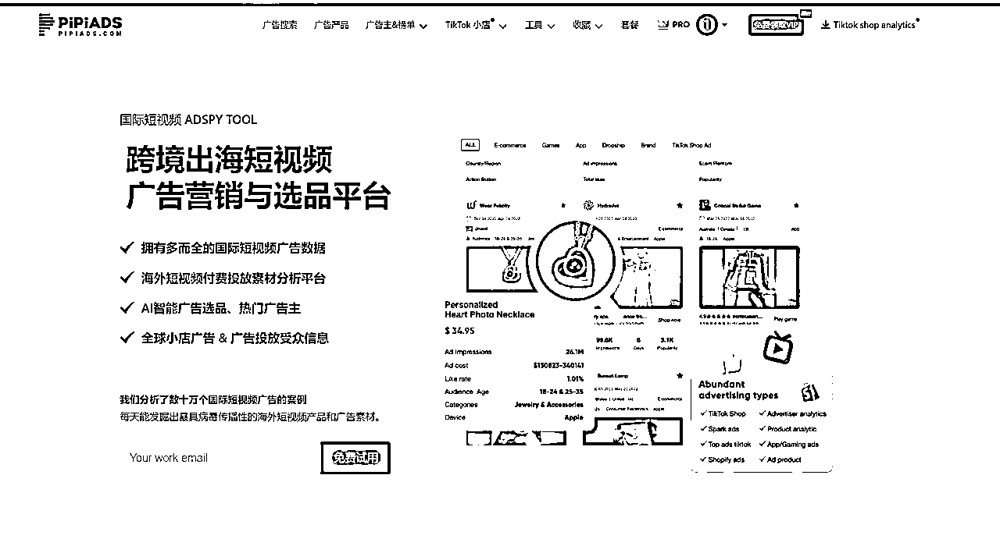

德国VAT的规则，卖家必须提前搞清楚。德国的增值税制度非常明确：只要在德国境内销售商品或提供服务，无论企业是否在德国注册，都有缴纳义务。跨境电商卖家向德国消费者销售商品或提供电子服务，同样适用。

2021年7月，欧盟做了一次重大VAT改革，废掉了各成员国原本的征税阈值，改用全欧盟统一标准：年度销售额超过1万欧元，才需要在其他欧盟成员国注册和缴纳VAT，德国也执行这一规则。OSS（一站式服务）系统则让事情简单不少，企业只需在一国注册，就能统一申报所有欧盟成员国的销售，省去了各国分别注册报税的麻烦。

VAT申报周期取决于应缴税额：如果前一年应缴VAT超过7500欧元，通常按月申报；低于这个数则可能按季度；如果不超过1000欧元，还能申请按年申报。所有申报必须通过德国税务局的ElsterOnline电子系统提交，缴税时使用指定银行账户，并准确备注税号和缴款期。如果进项VAT高于销项VAT，可以申请退税，德国税务局通常会自动处理，退到企业登记的银行账户。

物流履约同样考验卖家功力。跨境运输成本、关税规则的复杂性、德国消费者对快速配送的高期待，都直接关系到客户体验。与本土物流服务商合作，充分利用德国强大的物流基础设施，是确保订单顺利交付、减少体验损耗的关键路径。

总体来看，TikTok和社交商务平台正在为中国卖家进入德国打开一扇前所未有的窗口。但想要成功，不能只靠流量，必须具备对本地生态的深刻理解——从消费者偏好到物流履约，再到政策合规。对中国企业家来说，一方面要主动适应德国市场的商业规则，另一方面也要活用自己在产品创新、数字营销和电商运营积累的独特优势，才能真正打动那群挑剔又成熟的德国消费者。

德国电商格局已经呈现出鲜明的多元性和竞争性：Amazon Germany、eBay Germany、Otto、Zalando等平台各据一方，商品从电子产品到服装家居无所不包。消费者行为也在不断进化：对品质和可持续的要求持续强化，移动电商快速增长，PayPal和Google Pay、Apple Pay等移动钱包接受度很高。社交商务的兴起，加上智能电视、智能音箱等新购物入口的普及，正让德国电商生态变得更具活力。

出海企业家闯德国，绕不开文化差异、法律监管适配和语言三大关卡，但只要你用心读懂德国消费者的行为习惯和深层偏好，这个成熟市场里潜藏的机会，足以给敢于深耕的人丰厚回报。

TikTok想在这片市场上分一杯羹，先把德国的电商生态看清楚。TikTok在德国的飞速增长，给品牌带来了全新的电商入口。通过TikTok Shop，商家可以直接在平台内展示和销售商品，用短视频和直播把兴趣用户转化为实际订单。但要真正玩好TikTok电商，离不开对当地市场的深入理解——用户喜欢什么内容、习惯什么消费方式、正在追什么趋势，都需要持续跟进。

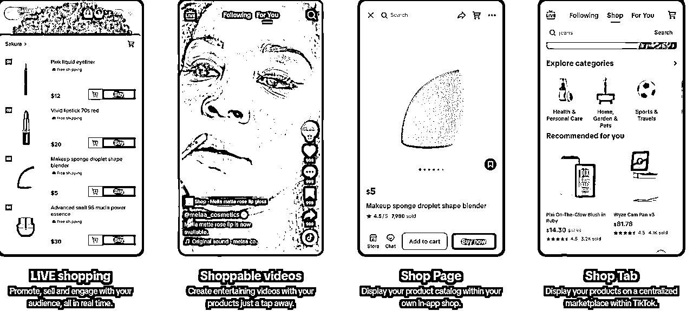

与传统社媒相比，TikTok的优势相当突出。相比Instagram、Facebook，TikTok拥有更高的用户参与度，加上独特的内容创作工具，品牌可以跟目标受众建立更互动、更有趣的连接。TikTok聚集了大量年轻用户，正好是品牌布局下一代消费者的绝佳入口。挑战、标签等互动玩法则让品牌能够用更具创意的方式推广产品。此外，TikTok的算法特别擅长放大内容，新品牌只要做出好内容，也能快速收获关注和流量。当然短板同样存在。大量品牌涌入TikTok，注意力竞争越来越卷；同时，想在海量内容中脱颖而出，逼着品牌不断输出高质量、有创意的内容，这对专业的策划和制作能力提出了不小的要求。

从品类机会来看，目前德国电商热销类目集中在四个方向：电子产品与家用电器——智能手机、笔记本、影音设备是常青树；时尚服饰——品牌服装、运动装备、时尚配饰增长稳定；家居园艺——家具、装饰、园艺用品受益于网购的便利性；健康美容——营养补充剂、护肤品、化妆品需求旺盛。

未来更有潜力的隐藏赛道在哪里？可持续环保产品是明确的方向，精准踩中德国消费者的价值观；智能家居设备正在加速普及，智能灯泡、智能插座、家庭自动化系统都有很强的增长预期；个性化和定制产品也值得重点布局，德国人对能体现个人风格的商品越来越感兴趣；健康健身装备同样潜力巨大，疫情影响让居家健身和健康监测设备的需求持续释放。

德国电商市场足够大，机会足够多，但从不辜负有准备的玩家。想要在这里立足，产品要能打，还要契合本地需求；物流配送要顺畅，还得符合德国人的高标准；更重要的是，要始终保持对市场趋势的关注，持续迭代产品和策略。只有真正融入这片市场，TikTok电商的德国故事才可能写出漂亮的章节。

最后分享一个真实案例：一款刻字手镯套装，在德国TikTok投放后，累计广告展现量达到9360万次。售价39.9欧元，拿货成本仅7.6元人民币。如此高的曝光和利差空间，已经让人看到德国TikTok电商的爆发潜力。

德国TikTok正在成为出海商家不可忽视的高流量阵地。许多中国卖家凭借精准素材和低成本产品，在欧洲市场打出了令人惊讶的曝光成绩。接下来盘点的几个案例，均为来自德国市场的真实投放数据，覆盖不同品类、不同素材玩法以及人群定向策略，值得细细拆解。

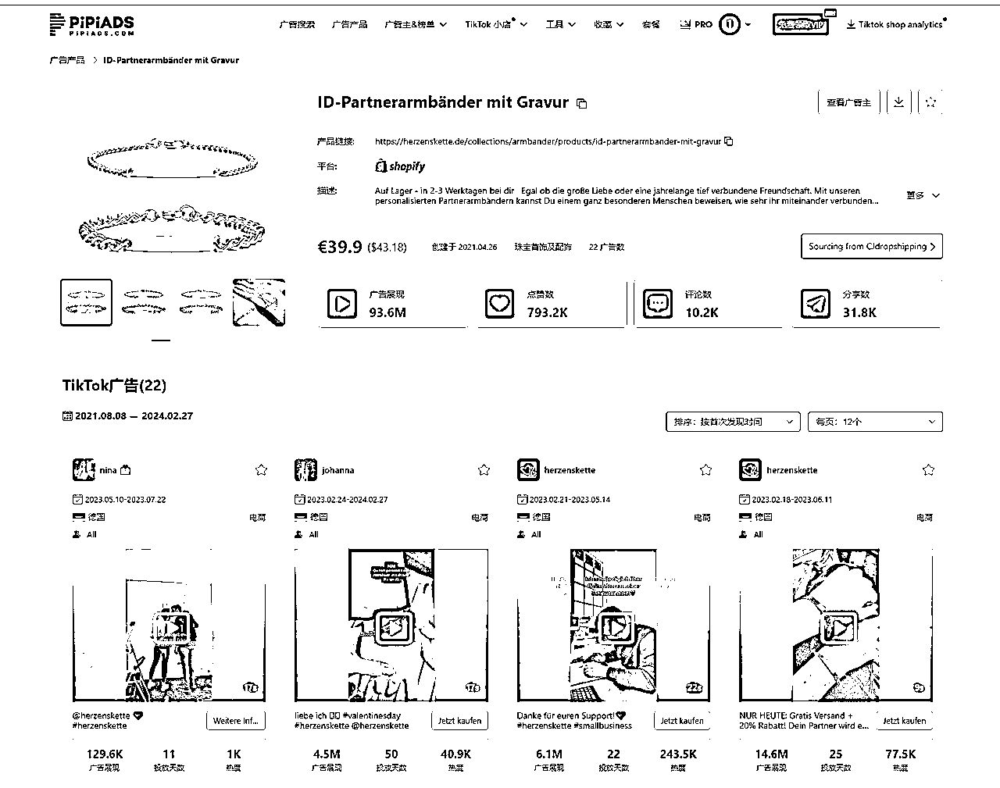

https://www.pipiads.com/product-search/6267d98e3a879868acae17ee/

第一个案例，是一条累计播放量高达1460万次的广告素材，巧妙结合了网站展示、线下使用场景，以及情侣CP人群精准定向，把产品场景感拍得很有代入感。

案例二则是字母手环。该产品在德国TikTok累计投放展现量达到4520万次，售价定在€19.9，而1688拿货成本仅需￥6.9左右，中间差价空间相当可观。

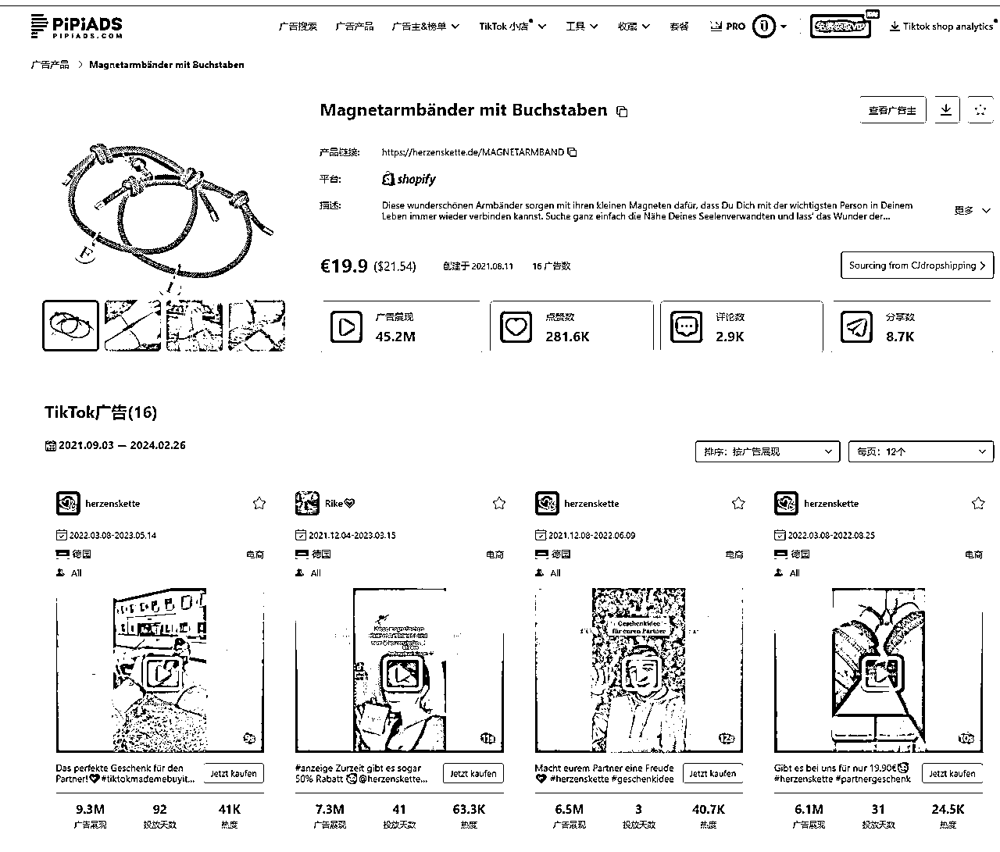

https://www.pipiads.com/zh/product-search/6274f66bd84aa03f9f6f7cb2/

值得留意的是，第二款睫毛套装广告的素材脚本，与第一个案例有着高度相似的结构——同样走网站展示+线下场景+情侣定向逻辑，最终累计播放达到930万次，售价€29.99。

第三个案例是连帽衫。该产品在德国的投放累计展现达4170万次，一条1260万播放的广告素材采用真人出镜、边讲解边演示效果的拍摄方式，售价为€39.95，而1688端拿货价仅￥32.99。

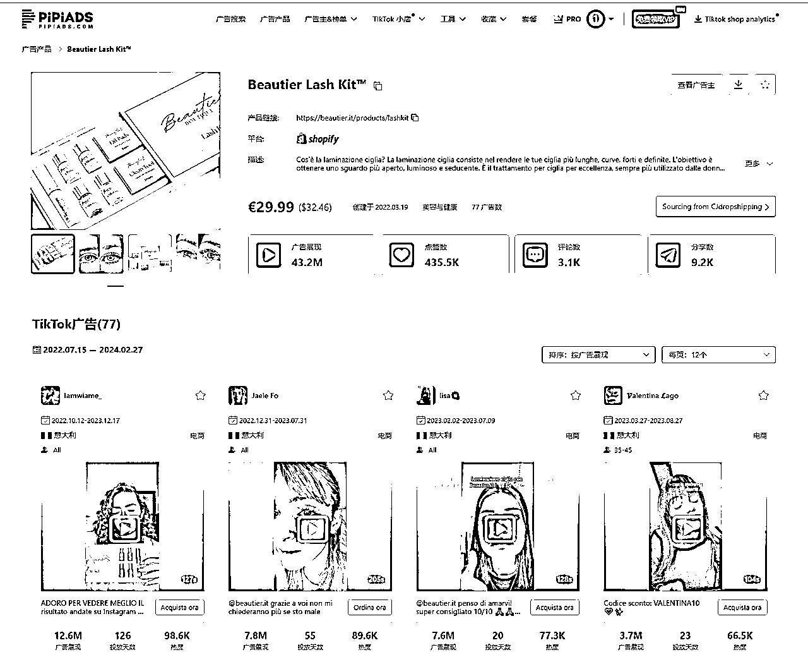

https://www.pipiads.com/zh/product-search/62d99acec5861b70531eff1e/

连帽衫品类的素材强调真实上身和视觉对照，转化意图很强。

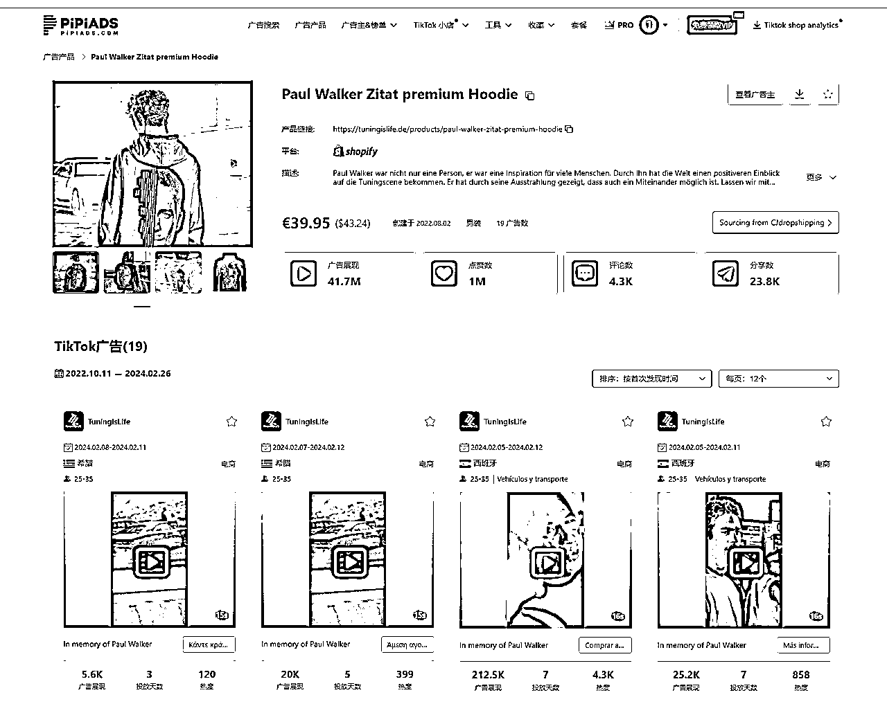

https://www.pipiads.com/zh/product-search/63479bd8b7fc56094fe5aa91/

第四个案例是贴身内衣，累计投放展现数据高达35800万次。160万播放的广告素材走的是IP定位加产品图混剪路线，售价€22.99，1688拿货成本却只有￥3.88，这一价格区间投射出的利润弹性相当明显。

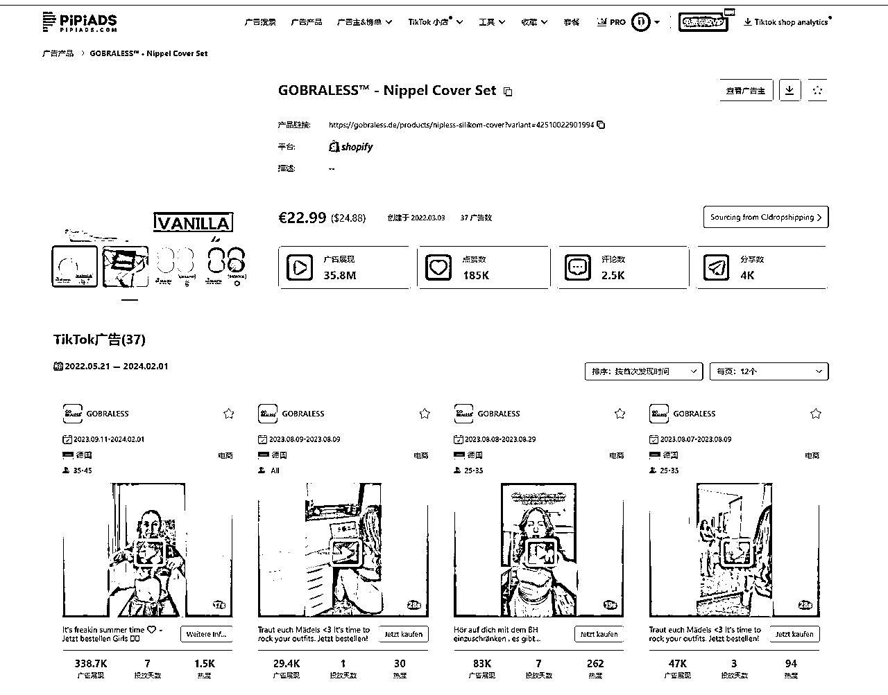

https://www.pipiads.com/zh/product-search/628c254ab663a328e6ebe70c/

最后一个案例为另一条620万播放的素材，落脚点放在产品功能展示和用户痛点解决上，简洁但直击需求。

结论其实已经很清晰：TikTok正在为进入德国市场的中国电商卖家创造一个此前并不存在的增长窗口。通过该平台，品牌能够直接触达年轻且有高活跃度的消费群体，同时借助创新内容在短时间内建立认知和信任。

更有意思的是，从两年前到现在，这套打法一直在延续：本质上还是走差异化测试路径。美国市场跑出来的爆款，搬到欧洲发达小国继续测；南半球市场跑通的品，则搬到北半球做新一轮验证。何况欧洲人口体量摆在那里，电商基础设施又相当成熟，新产品的试错和起量节奏普遍更快。

基于目前的数据反馈，我个人判断，接下来会有越来越多具备成本优势的供应链商家进入欧洲，低价商品将会迎来一波明显的爆发期。另一方面，像已经相当成熟的电子产品或其他标准化品类，能否在德国市场做出超出预期的表现，还有待更多投放数据来验证。

后续如果出现更有创意、更具品质感的产品，也非常适合放到德国TikTok进行测试。建议在真正进入德国市场之前，先通过pipiads去了解当地广告主的投放手法、素材风格以及热门产品类型，再结合自身产品做针对性规划，机会会更明确。

建联：17684058749