# 没有公司背景的个体，如何把高客单做到累计300万？

> 来源：[https://oee5lr7gsk.feishu.cn/docx/ZOaJdJTSuoflJfxSVIwc5xpCnNh](https://oee5lr7gsk.feishu.cn/docx/ZOaJdJTSuoflJfxSVIwc5xpCnNh)

全文共：14,093 字

预计阅读时间：13.314 分钟

各位朋友好，我是根源

把高客单卖出去，是每个做交付的人、每个做销售的人都想冲刺的目标。

尤其是对于个体而言，一笔几万、几十万的成交，既有实打实的收入跃升，也能极大提升交付效率，空出更多时间做更有价值的事。

可真要把钱从客户口袋里拿出来并不容易，尤其当你背后没有公司牌子支撑，纯粹靠个人时，难度会更高。

说明：

本文所说的高单价，指8000元起的产品。

文前先附上近两年我做高客单的一些实际成绩。

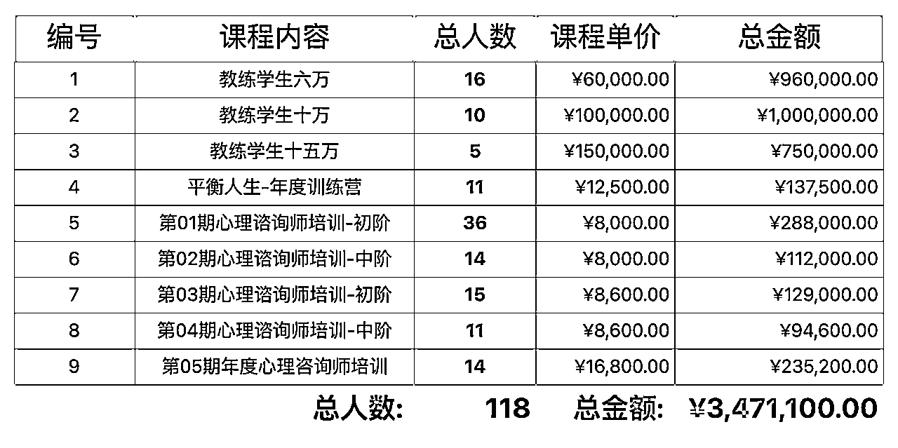

补充说明：

我自己的私域目前大概1200人左右，文中提到的成交数量与金额，全部来自这1200人的转化。

* * *

# 为什么客户愿意为你的高客单买单？

在过去的行业环境里，只要够专业，或者产品刚好打中刚需，就能收高价。

那时的高客单相对好收，需求单一、信息渠道单一，而且客户身边围着的销售也不多。

到了现在，情况完全不同。近几年多数人手头的钱变紧了，有钱人的圈子也越来越小众精准，要想切入高质量圈层并不容易。

所以我这篇文章不聊怎么去找那些顶级圈子，而是聊一个更现实的问题：

从普通的社交圈里，怎么也能筛出愿意为你付高价的人。

回溯到从前，2万以上的产品靠专业、靠能力、靠客户有没有需求，就基本能成交了。

近两年我的体感是，专业够、能力强、有需求，这三点已经不够让客户掏钱了。

现在的成交，更关键的是：

### 客户在付钱的整个过程中，要感受到舒服。

要收万元以上的单，除了产品专业度，你在销售和经营的每一个环节，都需要让客户的心情是愉悦的，而不是付完款后充满犹豫和不适。

把产品讲专业、把客户需求摸准，本来就是交付者和销售的基本功，可以说是职责所在。

既然这是基本功，很多人都能做到，那凭什么客户要把钱给你？

### 你必须具备别人没有的额外能力。

我把这个额外能力叫做：情绪价值。

这个词大家都不陌生，但对高客单来说，情绪价值的比重会更高。

要让情绪价值可操作，首先要把它拆开来定义。

我的拆解是这样：

* * *

## 情绪价值的第一层：共情力

第一层是能否站在对方角度思考，也就是共情。

在我与客户、朋友沟通时，说每一句话之前，我都会先想：

这句话发出后，对方会有什么感受？

如果预判到会让对方不舒服，我会自问：有没有更好的说法、更好的表达顺序、更好的逻辑转换？

举个例子。

产品介绍完后，直接说：这个产品2万，怎么付款？

我可能觉得信任已经建立，所以直接要钱没问题。

这是个误区。

收钱这件事，无论信任多高，都要谨慎。因为你是在请客户把辛苦赚来的钱拿出来。

换位思考，如果我是客户，内心可能是：

聊得还不错，但之前都没聊价格，现在要我马上决定，我需要消化一下。

更体贴的做法是，在报价格前先缓冲一下：

刚刚聊得很开心，我知道你现在是有这个需求的。

这个产品是我特意邀请你的，价格也不算便宜，大概是XX。

我想先确认下，这个金额是否在你目前的预算范围内？

不说这段话，客户可能最后还是会买。但加了这句话，客户会觉得你替他考虑了，给了他思考的空间和下台阶的机会。

对我而言，销售的核心不是最后有没有收到钱，而是

能不能让客户对你留下好印象。

再看一个真实案例：

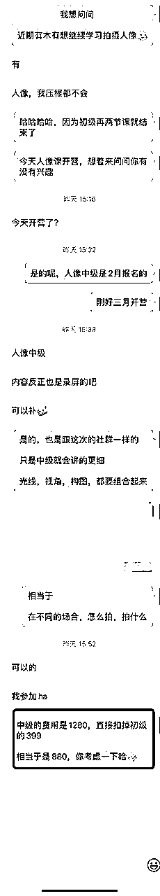

这是我的学生发来的，问我：老师，客户看到这里就不回我了，为什么？

我看了他发红框之前的所有内容，发现从头到尾都没有提到价格。

如果是我的话，发红框的价格前，会先补一句：

很感谢你愿意考虑这件事，其实之前我一直没提价格。

这是我的一个邀请，先跟你说下费用是XXX。

这样你也能先评估一下，是否在你的预算范围内？

发完这段台阶，再把红框里的内容发出去。

就算最后没买，客户对你的印象也会非常正面。

这就是共情，也是在为对方着想。

还有一种情况：客户已经约好今天付几万块的钱，结果早上他朋友圈显示家里出了事。

这时要不要收钱？该不该按原计划推进？

我认为钱还是要收，但节奏要调。

我会先关心：

我看到你朋友圈，想了解一下，这个情况我能帮上忙吗？感觉挺棘手的。

关心完后，我不会提收钱的事，也不会提之前约好的成交。让客户先把事情处理完，他会主动来找你。

我以前犯过错：那个月生活费很紧张，这笔单能养我三个月。明明知道客户有事，我关心完还是说：我们今天约好的签约你有空吗？

结果丢了一个上百万的大单。

因为不够体贴。

所以情绪价值的第一点是：

### 每一次行动前，能否多为客户想一步。

当你多替客户着想，他会觉得舒服，边界感会变清晰，不会只觉得你在做交易，而是你真的把他当回事，跟其他普通客户区分开来了。

* * *

## 情绪价值的第二层：真实性

第二层我称之为真实性。

### 你的相处状态，是否和你本人的性格一致。

很多客户最终不愿再跟某个销售员合作，就是因为对方太假。聊的时候一套，背后一套，让人感觉被算计，是不是只为了收钱才装成这样。

比如有人在追踪客户时，把自己的感情经历包装得很完美，只为制造共鸣。快成交时被识破，客户会觉得：原来你之前说的都是假的。

真实性，就是知行合一。

你说什么样的人，你就呈现什么样的人。言行、业务状态、真实自我之间没有太大落差。

举例：

我以前学过一个很知名的卜卦老师，上课讲人不要赌博，要接好能量，要反省，要破格。

结果下课后他去赌博了。

从那一刻起，我对他的信任彻底崩塌。因为表里不一带来的落差感太强。

一旦客户觉得被骗，情绪立刻变差。

所以真实性也是情绪价值的重要来源。

* * *

## 情绪价值的第三层：了解客户

第三层是了解。

当你真正了解客户，你就不再只是交易关系，而是朋友关系。你能更细致地知道他的需求、近况、过去经历，从而给出更精准的认可和赞美。

### 高客单的成交，私交非常重要。

这里的了解，不是为了成交才刻意去套话。

而是一种人际相处的习惯，对每个人都保持好奇，而不是只对有钱的客户感兴趣。

这种了解是普世的，不只是针对目标客户。

* * *

## 情绪价值的第四层：好好说话

第四层是好好说话。

我觉得好好说话很难，但它其实只有两件事：

*   学会夸奖
*   学会认同

比如：

我觉得你这篇文章写得很好

或者

你刚才说的那个经历，在当时能有这样的处理方式，很厉害，我可能做不到。

当客户说一些带有批判性的话时，即使是错的，我的回应也会是：

我能理解你的感受，我很认同你的出发点，这个做法比我想到的更进一步。

为什么把这个叫做情绪价值的第四层？

因为

### 大多数人要的不是对错，而是被认同的感觉。

你知道他可能是错的，但你要懂他为什么会这么做。这种被理解的感觉，才是情绪价值的核心。

就像夫妻吵架，妻子难过时说的话，你不应该先讲道理，而是先抱抱她。她要的是被理解，不是被说服。

下面是我日常聊天常用的认同+沟通金句整理，都是实操验证过的，会放在语句的前后中。

（不同模板一并分享）

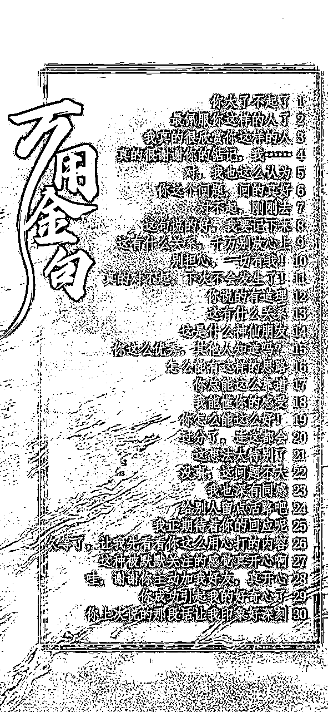

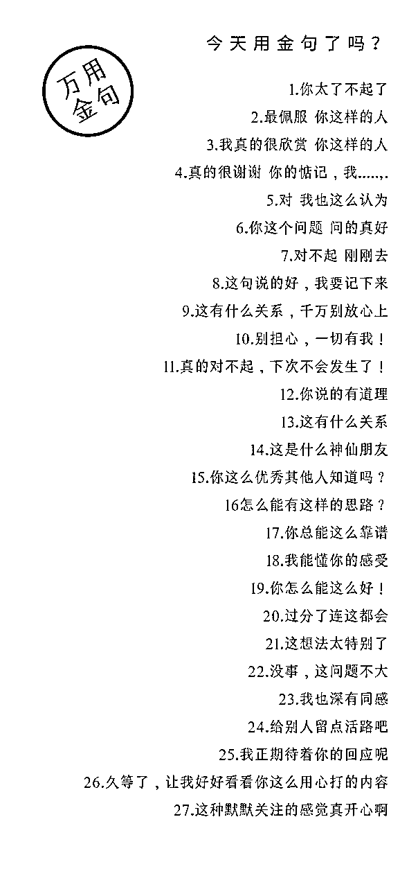

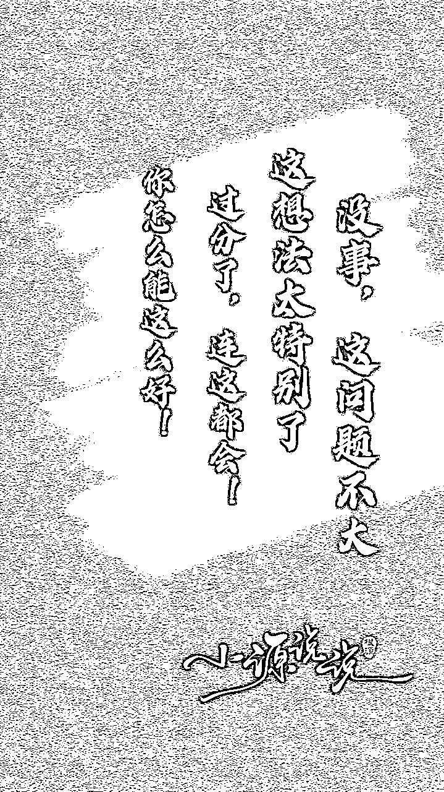

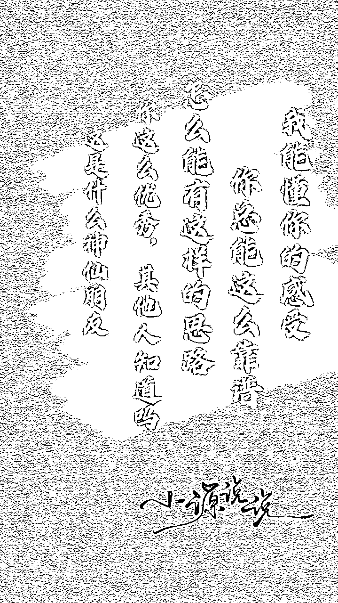

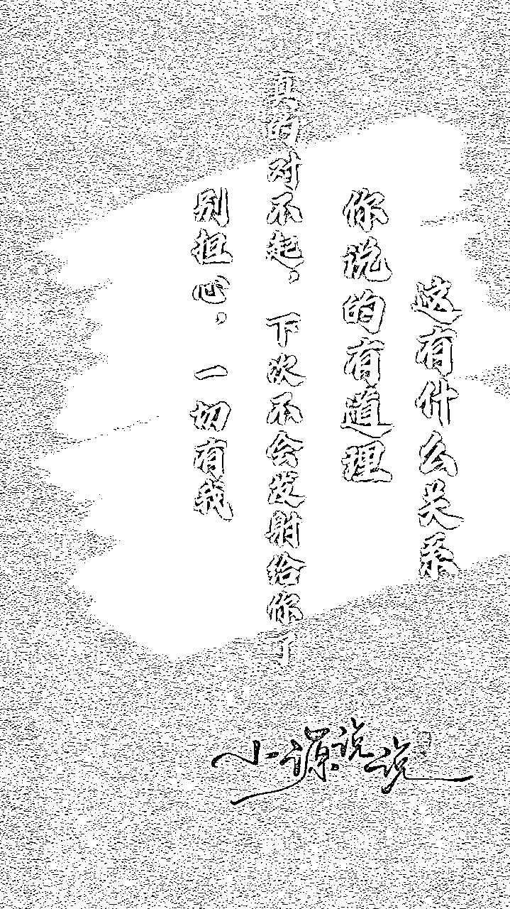

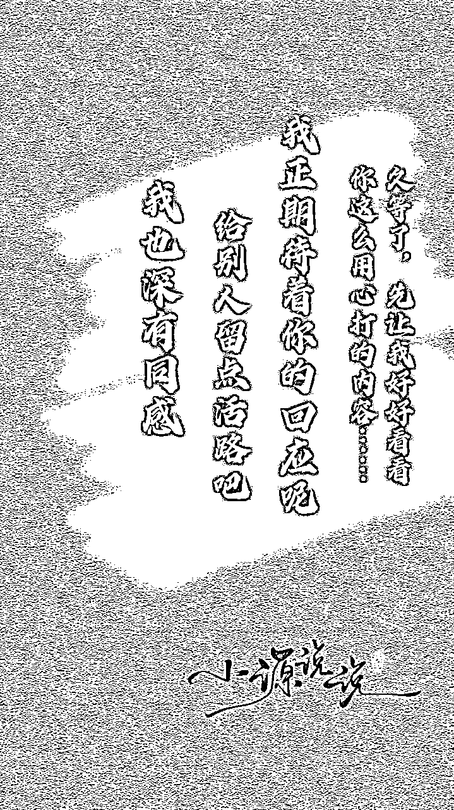

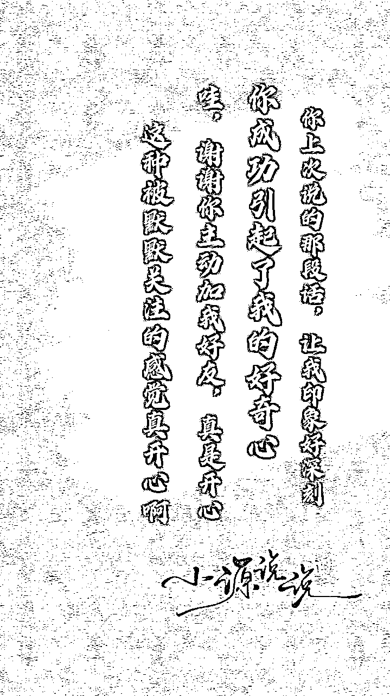

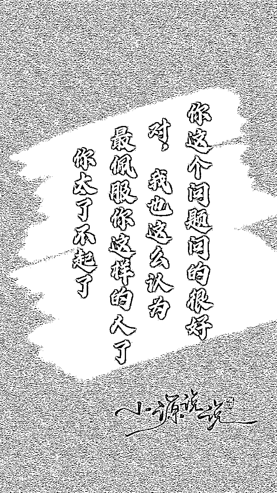

好好说话，本质上就是让认同感发生。

* * *

# 高客单成交，本质上是两情相悦

高客单一定不是短期冲出来的，需要时间沉淀。

因为这类客户本身收入不错，有支付能力，但你要让他愿意把更多钱交给你，需要长期培养。

当单价越高，信任感越关键。信任感来自交集的频率，交集越多，你越了解他，他也越了解你。

### 高客单要的不是单向认可，而是双向认可。

单向认可是什么？

你很专业，客户有需求，他觉得付钱能提升能力，于是买单。你并不在乎这个客户是不是你要的。

双向认可则是：

客户需要你的能力，同时你也欣赏客户的价值观、处事方式、气场。

因为高客单往往伴随长期交付，如果双方合不来，交付过程只会越来越消耗。

所以高客单必须是长时间累积的双向认可。你要了解他，也要让他足够了解你。

这是一个你情我愿、两情相悦的场景，而不是我喜欢你你就必须跟我走。

这也是高客单和低客单的本质区别。

高客单不能急，急躁就收不到大钱。大部分高客单的观察期，我会给到3-6个月，在这段时间里互相评估，是否适合以高价长期相处。

这才是一个双向选择的过程。

* * *

# 如何有节奏、有步骤地推进高客单成交？

成交的关键在于节奏。你有没有一套从零到收款的清晰流程？

我的个人经营节奏是六步：

从「列名单」到「邀约」，到「商品展示」，到「成交」，到「售后服务」，到「转介绍」。

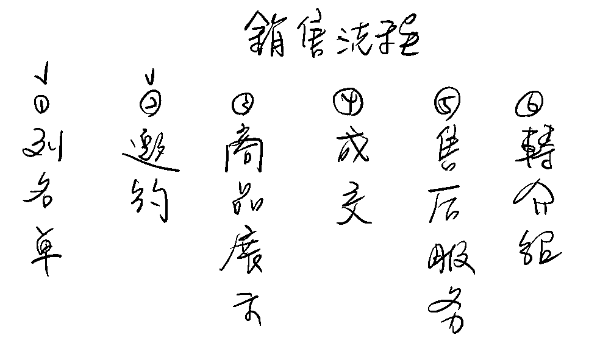

### 列名单

列名单就是把潜在客户罗列出来，同时也是筛选的开始。

很多做高客单的人，连自己的名单都没有，这就是问题。

更简单的方式是用微信打标签。

比如我一个学生的标签：

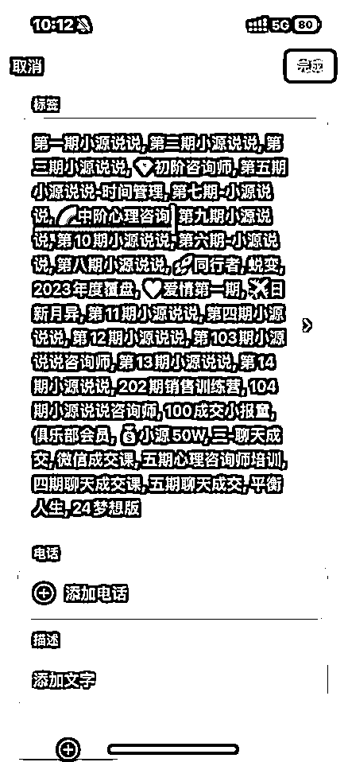

2022年他从131.4元的第一期课开始跟我学，然后第二期、第三期、第四期、咨询师培训都来了。从百元到千元再到8000多。当时的标签显示他的认同感和信任感都很稳定。

到了我标记的转折点，我向他发出10万元的终身教练邀请，他立刻答应了。

顺利的原因是，我用了近半年时间去观察、经营、筛选，他也在观察我。

所以一定要有自己的名单库，无论是表格还是微信标签。

### 高客单客户，一定是从大盘里筛出来的。

### 邀约

邀约分线上线下。

同城可以线下见面，不在同城就在微信上聊个三五句。

这三五句可以是日常闲聊，目的就是增加了解。

前面说过，高客单需要私交。私交靠的就是持续的联系。

邀约就是每次联系的开场。好的开场能极大提升沟通效率。

### 商品展示

商品展示分两块：

*   展示商品
*   展示自己

展示商品不是罗列功能，而是在挖掘和创造需求。

这里有一个公式：危机+梦想+未来趋势=结果+如何做

篇幅有限，这里不展开，但逻辑是通的。

展示自己，就是建立信任的过程。信任是成交发生的底层条件。

高客单的成交，真正的门槛从来不是话术有多漂亮，而是你有没有把该做的功课做到位。

成交的关键点，其实很直白：钱的问题一定要谈到。但在触及价格之前，意愿和预算这两件事必须先对齐。对不上，这单基本就没戏。

所以我把成交前做的准备，叫做前情铺垫。产品价格越高，铺垫就得越充分，开口时的一句交代也要更精准、更体贴。

举个例子，你可以这么说：

之前聊下来，能感觉到你对教练服务是挺有兴趣的。不过我得先跟你确认一下，教练服务的收费不低，属于需要认真评估的投入。如果你愿意继续了解，我用三分钟再跟你梳理一遍，可以吗？

这种说法就是在打预防针。让客户先有个完整的心理预期。哪怕当下没成交，也会在他心里留下好感。种子一旦种下，需求出现时他自然会想起你。

### 售后才是服务的开始

成交只是开始，真正的服务从交付后才算启动。而售后谈的从来不是把产品给到手上，因为交付本身是应尽的责任。

售后的价值在于，提供产品之外的东西。

以我自己来说，我交付的是课程，但我给到的远不止课程内容。我是心理咨询师，会看八字，会做饭，会带娃，会变魔术，游戏打得不错，组局很强，还会开车……

这些看似无关的点，都是我在经营客户时能提供的额外价值。高客单的产品，本质上就是要提供更丰富、更多元的价值。

### 转介绍是自然的结果

服务做好了，转介绍就会来。转介绍分两种：介绍别人来给你，以及客户自己回来。

客户自己回来，就是复购和升单。高客单的客户，大多也是从低客单开始，一步步复购上来的。

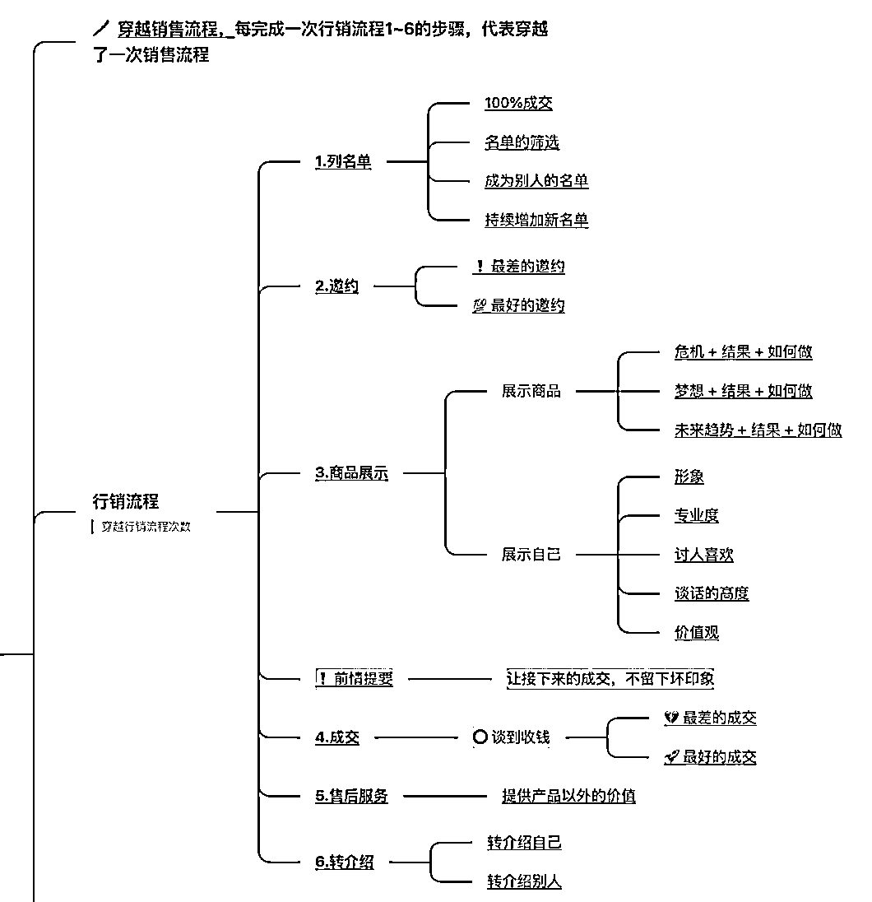

* * *

## 产品展示的节奏：持续埋锚点

在日常服务客户的过程中，你有没有有意无意地让客户知道，你手上其实有一个更高价位的交付方案？

让具备付费能力的客户明白，如果他想要更好的结果，其实是有升级选项的。

我记得2022年，我经常在公众号里写：想加速成长，就必须找个教练。我写它不是为了直接推销，而是我自己的成长轨迹就是靠教练才更高效。在心理学里这叫下心锚。

拆解来看，这就是一种信息预埋。为了避免让人觉得是套路，我会提前在内容里铺好。让客户心里先有数：我能给到更高级别的服务，并且能帮他解决更深层的问题。

平时你会不会在文章、直播、课上聊到自己的高客单服务在做什么？聊到什么样的问题才值得花更大成本去解决？

如果你经常在对外内容里提到这些，有预算的客户就会先把这件事记住。等到他真正有需求时，他会主动来问。

这就是高客单成交里很关键的一个细节。如果你一直不提，等到某天突然开口说你有几十万的产品，客户会觉得很尴尬：以前怎么没听你说过。

提前做内容铺垫，能让客户在你邀约时有准备，不会措手不及。同时有明确需求的人，会从你的内容里主动找到答案。他们也会明白，原来想要更深的服务，可以继续找你，只要多付钱，就能得到更好的结果。

这就是双向利好的预埋，我把它叫做下心锚，也叫埋种子。

* * *

## 经营客户的节奏：微信聊天流程

刚才讲的是全局的销售节奏，现在讲的是关系维系的细节节奏。微信时代，客户基本都在微信里。

从低单价到高单价的转化，我有一套固定的微信经营节奏。核心是从加好友、打招呼、筛选到二次经营的闭环。

聊天流程

1. 好友通过的标准动作
   * 按申请时间先后通过
   * 每次10个人为一批
   * 一边点一边默数，避免遗漏
   * 通过时注意申请留言，看有没有来意说明

2. 通过后的开场白
   一般固定三段式
   方式一：
   晚上好，很抱歉，下午事情比较多，好友现在才通过，点晚了请见谅。谢谢你加我，我是根源。
   方式二：
   你好呀，抱歉今天下午在忙饭和孩子，刚回到电脑前开始工作。通过有点慢，请见谅。谢谢你加我，我是根源。
   * 每批10人一起打招呼
   * 人多就先打好模板逐个发，人少就复制粘贴
   * 发送时默数，确保不漏不重复
   * 申请留言有说明的，额外多回一句

3. 打招呼时同步筛选
   * 不回应的，先放着，不设免打扰
   * 立刻回应的，告知接下来会忙上课，回复会慢一点
   * 没明确需求的，设免打扰
   * 有明确需求的，设免打扰并置顶，作为待办
   * 循环处理，直到全部通过并打招呼完毕

4. 进一步沟通
   * 无明确需求的，时间充裕就多聊几句，时间紧就简短结束，但要留一个小钩子
   * 有问题咨询的，直接回答
   * 咨询产品的，问意愿和迫切度、问预算
   * 价格异议的，用换位思考+前情铺垫，打预防针
   * 引流和裂变：让对方输出内容到小红书公众号抖音，加付费群多活跃
   * 认真经营：多夸奖、有礼貌
   * 八字类深度问题，用语音回复，提升思考速度，先不看问题，开始回复时再看

5. 回复节奏
   忙完后统一处理未读和置顶消息。用夸奖+认同开场，聊3-4段再停，等对方回复。闲聊中顺势确认需求和预算，固定话术例如：自我提升这件事对你来说很急迫吗？如果要付费，你心里大概有个什么预算范围吗？

6. 再次筛选
   有需求的继续置顶准备二次经营。没需求或回复少的，从置顶撤下。

这个节奏是我每天都在做的。固定的流程能让经营更轻松，不会漏掉高意向客户。很多人的通讯录都是被忽略掉的流量，因为人一多就漏了。有了清晰的节奏，流失率下降，转化自然提升。精细化经营，才是高客单客户的来源。

* * *

# 高客单成交的底层：信任

所有成交的本质都是信任够不够。前面提到的所有方法，背后都是在建信任。

我把信任分为两种：对内信任和对外信任。

## 如何提升被信任感

对内信任，是指我如何修炼自己，让客户更容易信任我。包含五个维度：

1. 仪表
线下是穿着、气质、气味、干净整洁。线上是朋友圈频率、文笔、照片、粉丝量、视频号播放、公众号阅读、排版、聊天是否让人舒服。头像、朋友圈呈现，都是一种展示。
2. 专业度
能快速、清晰地根据客户需求，从课程里精准提取对应内容讲解。不是发海报甩链接。信任的关键是差异化。别人复制粘贴，你能不能用自己的语言、从他的需求出发、用心打字，让他感受到这是一个真人在认真交流。
3. 讨人喜欢的能力
有礼貌、会赞美、会接受好意。夸奖要具体，收红包说谢谢，收礼物说谢谢，被夸奖也收下。这三种习惯能持续输出情绪价值。能给情绪价值的人，更容易成交高客单。我自己的终身教练服务从2022年的6万涨到20万，两年内通过经营老学员转化了50人，接近两百万净利润，很大程度上就是情绪价值做到了位。
4. 谈话高度
想成交五万以上，必须有硬实力，有自己的从0到1的实战经验。能讲清楚辛苦和突破，才能和高净值客户共鸣，让他相信你能解决他的问题。
5. 价值观
价值观是生活方式和人生格言。它决定你的表达逻辑和能量状态。价值观清晰的人，聊天更有说服力，更容易被信任。

## 判断信任感的对外框架：心谈七步

对外信任，是判断客户对你信任到哪一步了，再决定要不要推高客单。我用心谈七层来判断：

1. 四合院：家庭话题。老家、口音、家人、孩子，是破冰切入点。
2. 烟囱：第一次经历。第一次离家、第一次工作、第一次谈恋爱等，话题延展性很强。
3. 奖状：经历话题。人生经历的分享。
4. 奖杯：得意事。对方愿意谈成就，信任再进一层。
5. 拒马：失意事。聊到低落、哭诉，说明信任进入核心层，这时可以正式进入成交。
6. 贵人之手：贵人话题。人在失意后会立刻谈到拉他一把的人。这是共鸣的黄金点。
7. 学士帽和望远镜：未来话题。望远镜是看见未来，学士帽是量化的未来。从“想有钱”到“想要一套别墅+2000万现金”，越具体越能判断行动力。

信任不够，什么话术都是白搭。信任够了，成交只是顺势而为。

记得我二十六岁那年，刚开始写这类主题。当时要我想象自己八十岁的样子，我对着屏幕干坐了三个多钟头，一个字都挤不出来——真的没有画面。

后来我才懂得：当一个人愿意跟你聊他的来路、近况和去向，那说明你们的关系已经足够深。这个认知后来成了我评估两人之间是否彼此信赖的参考坐标。在服务用户的过程中，我常用它来判断双方的距离，特别顺手。

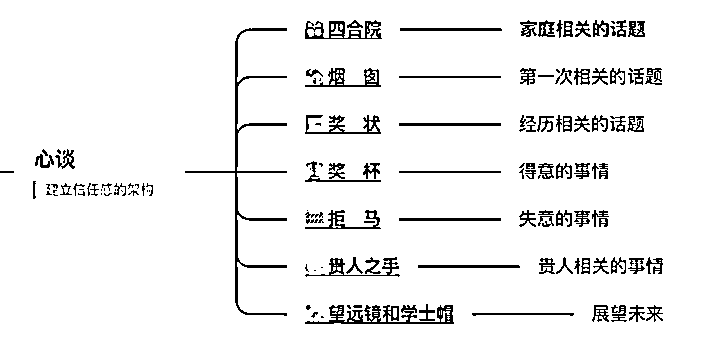

# 最后想说的话

倘若你也是做内容输出、靠个人本领服务别人的人，不妨把大额成交当作一个长期经营的目标。它耗时、费劲，而且不可能马上见效，但只要熬过初期，回报就会像滚雪球一样越滚越大。想让成交这条路越走越顺，要么把每一次交易的价值做大，要么把人组织起来一起干。

这些就是我会在谈大额订单时用到的思路，希望你能从中找到一点灵感。你若有想法，欢迎在评论区或私信找我聊。

* * *

# 关于我

我名叫根源，也是这个社群的早期成员。做过多年线下业务，也带过团队，处理过两万多个真实个案，后来转到线上，开始做收费内容。在这个社群里受益很多，少踩了不少坑，也存下一些心得。你若有兴趣，可以翻翻我过往的分享。

我的联系方式：AF54094

▲ 扫码就能找到我