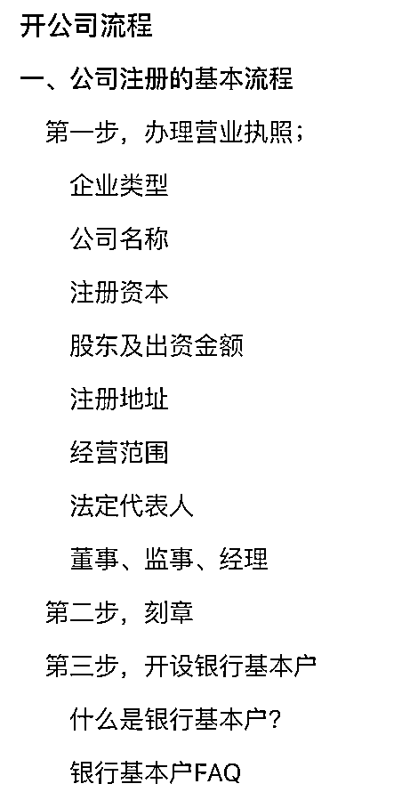
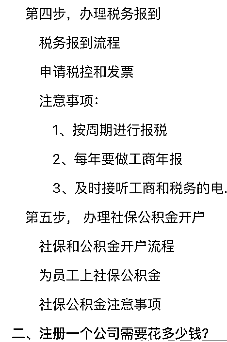

# ('新手开公司需要了解哪些知识？开了公司之后需要做什么？', (2, 28))

别急着庆祝！营业执照拿到手，只是创业开局的“小胜利”。真正的考验，从公司“出生”之后才开始。

我是山歌，长期在广深莞一带，专门为创业初期的小微企业主做工商财税科普。我给自己定了一个小目标：用客观、实用的信息，帮新手老板填平信息差，少花冤枉钱，也少一点焦虑。

新手开公司，最要紧的是先弄清楚两件事：注册一家公司的流程怎么走？公司成立后，接下来要做些什么？别小看这些基础问题，很多老板就是在这里绕了不少弯路。

我把新手开公司必知的基础知识，整理成了一份飞书文档，覆盖公司注册流程、后续经营中的财税注意事项等内容，有需要可以点开：

https://cc0xe90dra.feishu.cn/docx/FyPQd1HZ9oSw5WxYSzMcHwbzn9f?from=from_copylink

提醒一句：之前有朋友在评论区说旧链接没有访问权限，目前链接已经更新成上面这个版本，可以放心打开。

整理这些内容确实花了不少心思，觉得有用的话，欢迎点赞、留言，一起在龙哥盟的圈子里多多交流、共同成长。