# ('视频号从注册起号到变现 2w，我只花了 2 周时间', (2, 27))

从注册到变现2万，我只用两周！视频号起号玩法全拆解

赚钱的兄弟们，我是猎音狮，也就是大家嘴里的“豪叔”。这半年没怎么冒泡，一直在视频号里闷头研究。最近总算又跑通了一些新玩法，赶紧出来跟大伙唠唠。

先报个成绩：我的视频号主账号，累计已经出了差不多25万单。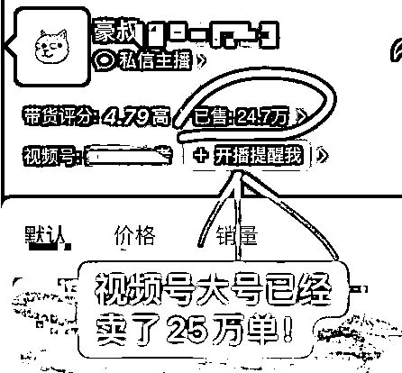

你可能会说，这号做太久了，对新手没啥参考性。那从0开始还有戏吗？为了回答这个问题，我拿同一套打法的思路，复制了五六个小号去测试，结果都还能跑出点效果，说明这方法真的可以复制。

就上上周，我重新注册了一个全新账号，从零开始，开橱窗之后第11天，佣金加利润做到了两万块。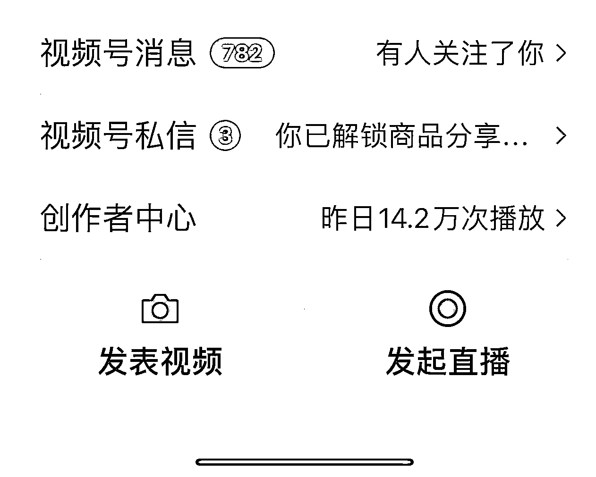

具体几号注册我记不太清了，大概5号前后吧。3月8号那天提了车，当时还特意发了条朋友圈。

下面直接说我是怎么起号的：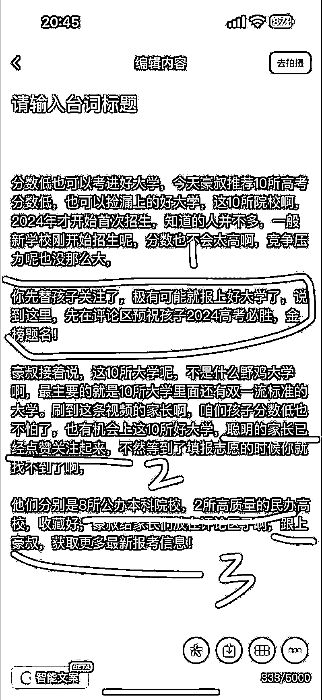

当时就用同一套文案，一口气养了五六个号。熟悉我的人都知道，我平时就一个人弄，实在顾不过来，最后只有其中一个号变现了。

这套文案你可能在刷视频时见过，现在模仿的人已经很多了。说实话它也不是我原创的，但我在洗稿的时候，在别人的基础上加了点能让人关注你的“料”，所以粉丝涨得特别快。

像那种讲好大学、讲好专业的视频，在视频号上一直很火，但大多数人都做起来涨粉很慢。为什么我这条却能快速涨粉？关键就在我圈出来的位置：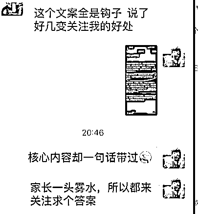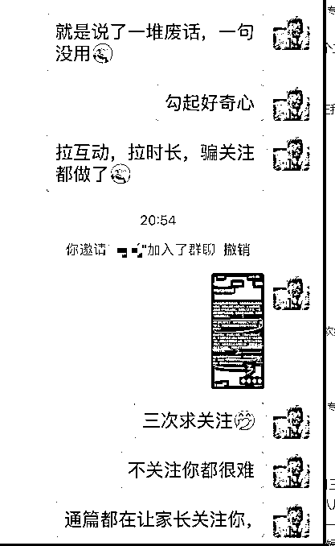

所以大家在找爆款文案做参考时，一定要带着自己的目的去改：你是想卖货，还是想涨粉？目标不一样，改法天差地别。这其实非常考验文案功底。想系统学一下的话，评论区告诉我，我下期专门拆解。

看到这儿，你是不是特别好奇我这个文案是哪篇原文改的？好，原文我直接放出来，大家看完可以对比对比，哪种写法更能让家长关注你：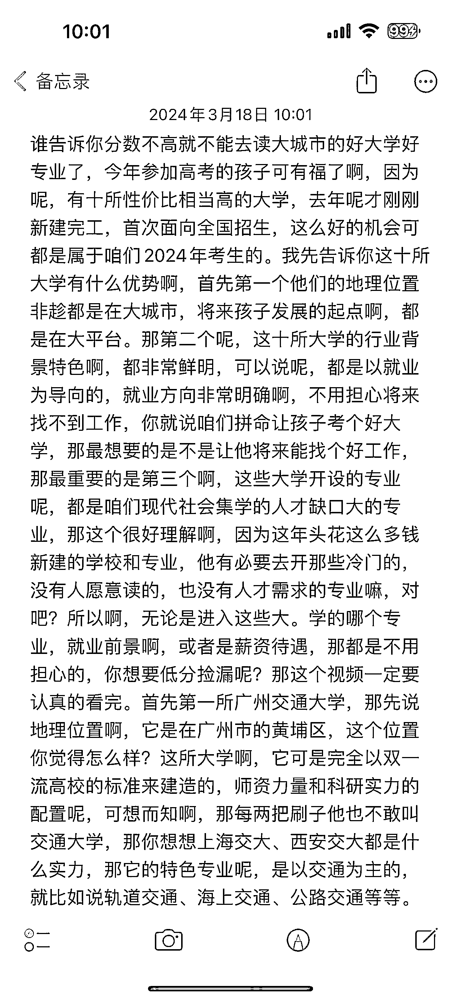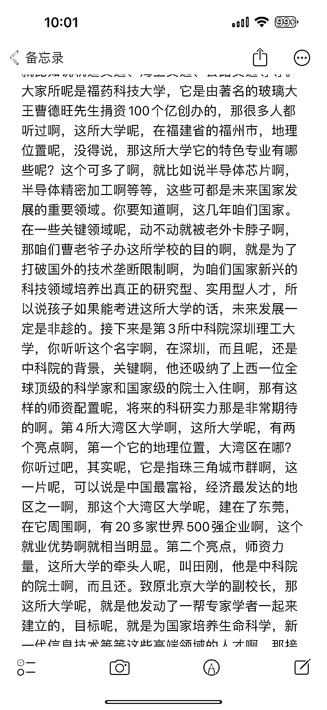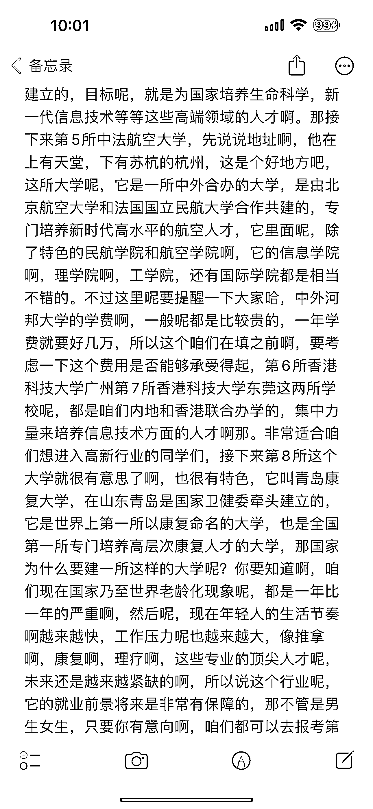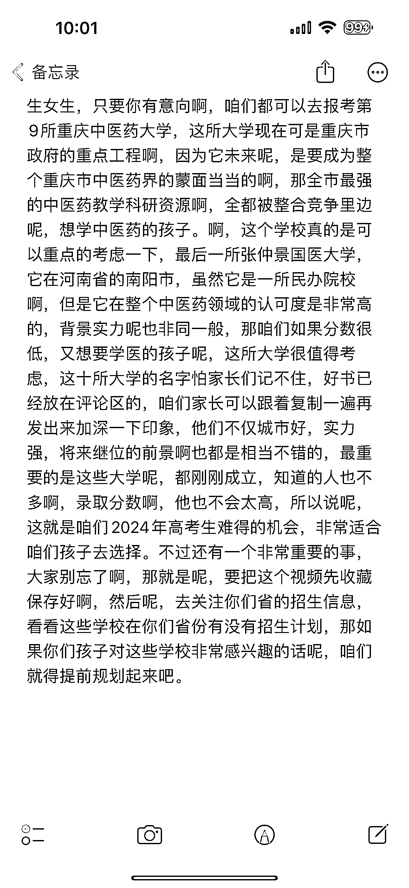

这篇原文有2234个字，介绍得非常详细，它本身也是几万赞的爆款。但我实测涨粉效果很一般。为啥？因为家长想知道的你全都讲完了，人家还干嘛关注你？说白了就是四个字：缺少钩子！

好了，说完涨粉起号，咱们再来聊变现。变现其实特别简单：你吸引来的粉丝足够精准，直接把高考志愿填报书、志愿卡、押题卷这些推荐给他们就行。这些品客单价都高，尤其是押题卷和志愿卡，跟商家谈个定向佣金，一单就能赚一两百。我这边商家给到的佣金都是行业顶格，有需要的找我要资源，可以共享。

可能还有小伙伴对这类账号怎么切入带货一头雾水。我讲解喜欢举例子，那就拿卖志愿书来演示下：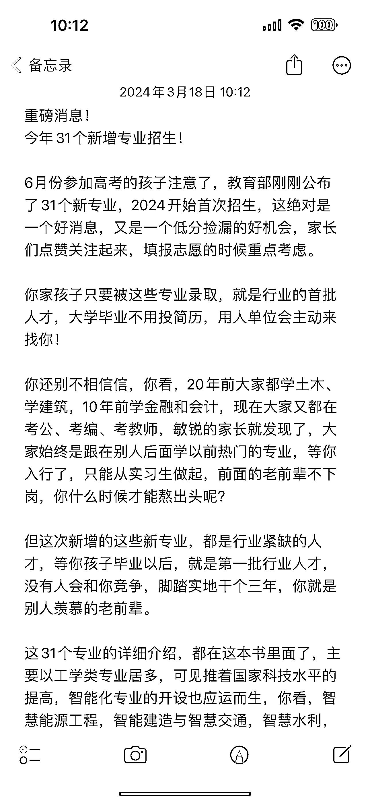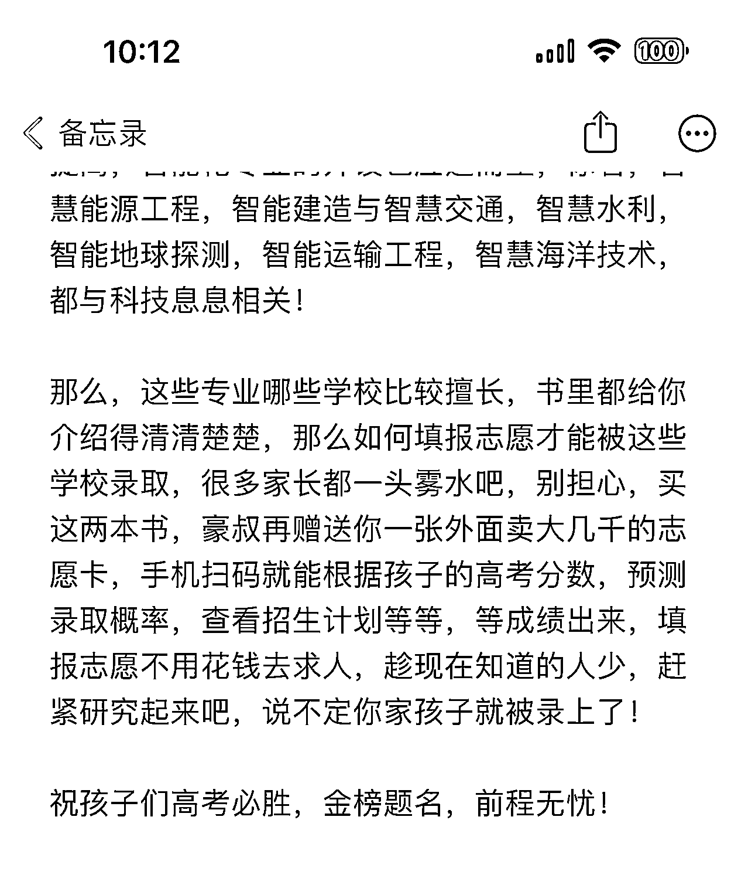

看懂没？按这个方式来操作，单子自然而然就来了。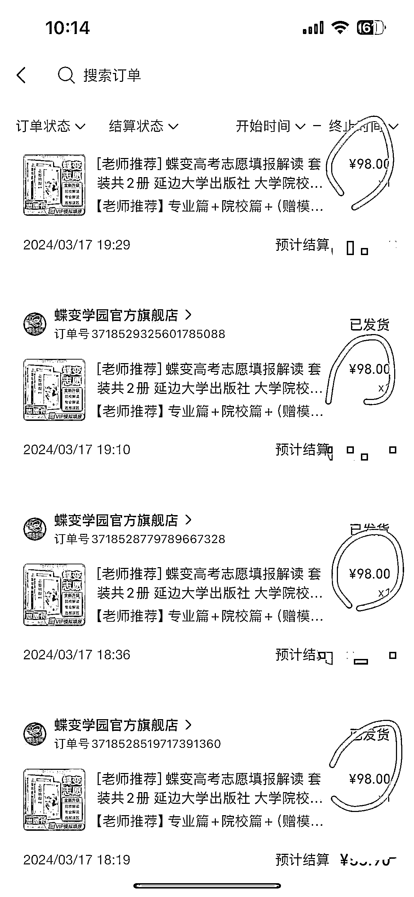

其他相关的品也能这么玩，举一反三就行。

好了，今天这波分享就到这儿。我是猎音狮（豪叔），一直专注教辅赛道短视频带货，目前全网账号累计销量60w+，今年目标冲100w！

如果这篇对你有点启发，帮我点个赞，你们的认可和鼓励就是我继续分享的最大动力！谢谢！

评论区里还有人调侃我“憋单，马扁”，哈哈，这算不算也是一种懂行？