# 八年教学实践者谈成长路径与身份布局

> 原文：[`www.yuque.com/for_lazy/thfiu8/ksc1ama27u9oefmh`](https://www.yuque.com/for_lazy/thfiu8/ksc1ama27u9oefmh)

各位朋友好，我是蜻蜓。现阶段在香港深造中，过去十余年深耕外贸，后八年在少儿英语一线。长久以来在为自己创造现金流的同时，也在探索如何帮助下一代获取更可持续的竞争力。

这次分享的契机源于三月份第一次参与赚钱福建站的聚会。名额补开后我迅速锁定，组局负责人 Y024 提出场地需求，恰好爱人公司拥有可用的独立空间，我便主动提供。原本并未准备主题，但聚会结束后报名在短短半天内满席。这种热度让我感受到，关于养育的话题同样能引起强烈共鸣。

我带教过的学生已近千名，同时也是两位小朋友的母亲。看着他们从幼儿园时期跟随我们学习，一路到初中阶段，英语分数长期保持高位，能够轻松阅读《哈利波特》原著并进行观点输出时，我会觉得投入得到回报。

然而现实环境带来的压力同样明显。学业表现尚可，但负荷过重、对升学的不安、对应试化培养的排斥，都让我开始系统性地梳理整个人生规划路径。暑假安排子女赴海外参加研学夏令营，既夯实本土基础，也为高考之外的大门保留选择权。越是深入，越能感受到信息落差对家庭决策的影响，家长的认知边界往往决定了子女的可达高度。

归纳起来落差集中在三方面：

A、各学科的学习节奏与提能节点并不一致；
B、进入国内重点高校的入口并非唯高考，至少还有十六种以上的多元通道；
C、香港身份的布局能在一定程度上缓解内地竞争压力，用等量投入换取更优结果。

探索过程中踩过不少坑，若能更早知晓，内心会更笃定。

因此本次输出并非聚焦我擅长的英语启蒙，而是围绕如何为子女做整体的成长与身份布局，帮助大家撕开信息壁垒。

整体框架围绕主体、养育者、家庭系统三个层面展开。

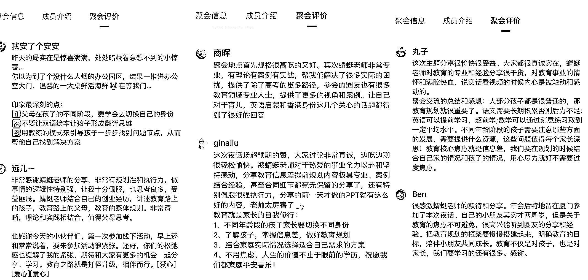

**成长中的小太阳——保持内心之光与对外关爱**

先做一次角色代入练习：假设你就是那个正在经历学业生活的主体，你的一天是怎样的？最想向父母传达什么？

不少同行者在复盘后陷入沉默——放学后被各种辅导塞满，与同龄人玩耍的时间被挤压；父亲常年加班缺席；母亲偶尔情绪失控。孩子的诉求被听见，但成人自身的无奈也被放大。

我始终相信，坚定的父母态度是子女最稳固的依靠。认知一旦清晰，工作与家庭的张力就有解法。

在了解当下状态后，可以追问自己是否真正认识到先天的倾向。为表述方便，我曾借助一位专注天赋的朋友提供的测评工具，虽不完全迷信，但对洞察潜在特质很有帮助。常见的五类倾向可概括为思者、赢者、德者、行者、学者。

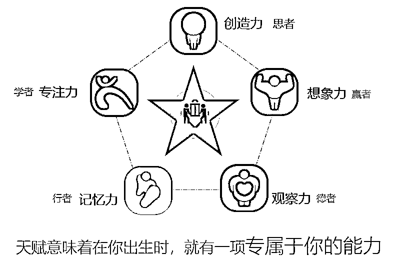

**思者倾向对应创造力——**
这类主体思维边界松弛，不喜被家庭或学校过度框定。管束越紧反弹越强，劝导与激励效果有限。他们对人生有自己的叙事，最渴求的是精神层面的尊重。缺少尊重容易长期处于低落状态。

**赢者的倾向是想象力——**
在群体中很容易被辨认。爱表现、喜当小领导、擅长气氛调动，说话讨喜。主观性强、表现欲强，自尊心来得快，需细腻呵护。

**德者的倾向是观察力——**
这类主体很少冲在前列，往往慢半拍跟随，像小棉袄般贴心。不要因表现不够突出就苛责，德者的价值在于细腻的善意表达。

**行者的倾向是记忆力——**
行者偏爱独处，不善与陌生人互动，更喜欢待在熟悉的家庭环境。社交频率低并非缺陷，而是对安全感的需求。

**学者的倾向是专注力——**
学者好带，懂事守规，按部就班完成学习与生活，应试体系很适配。短板在于刻板，变通与情商需额外培养。

**养育者自身——成为子女最可靠的底气**

不同发育阶段会出现不同的敏感窗口。理解规律后，焦虑会自然消解。

例如两岁半到四岁的秩序敏感期，我的二宝曾因物件位置微调就大哭，对摆放顺序极度苛求，配偶一度怀疑是否需要就医。实则这是阶段性典型表现，理解后引导更有效。

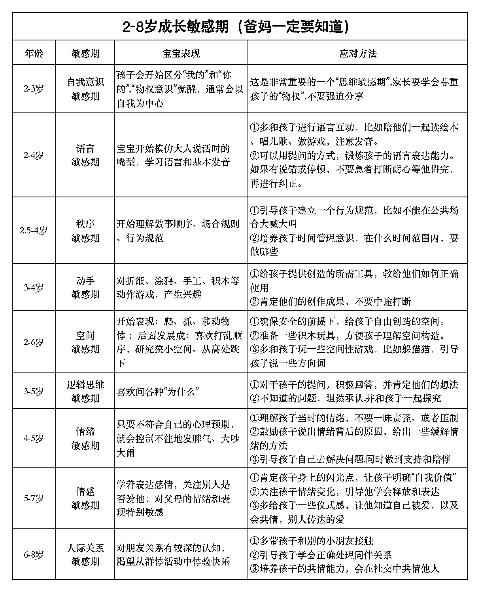

在不同阶段，成人的角色会切换：引导者、引领者、观察者、协助者、陪伴者。具体分工图可参考下图。

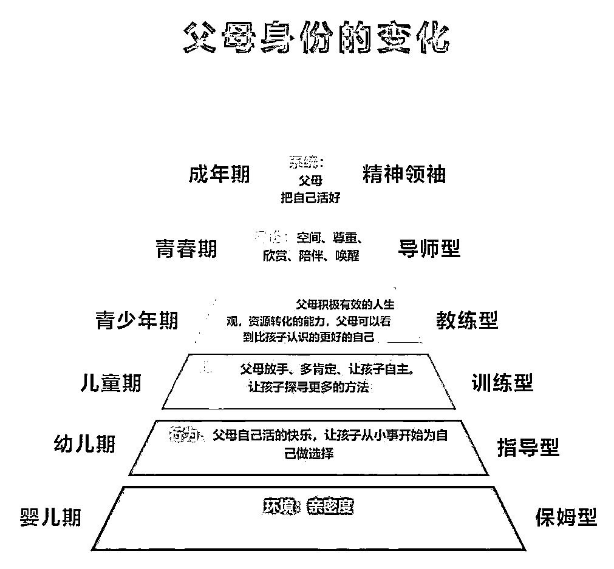

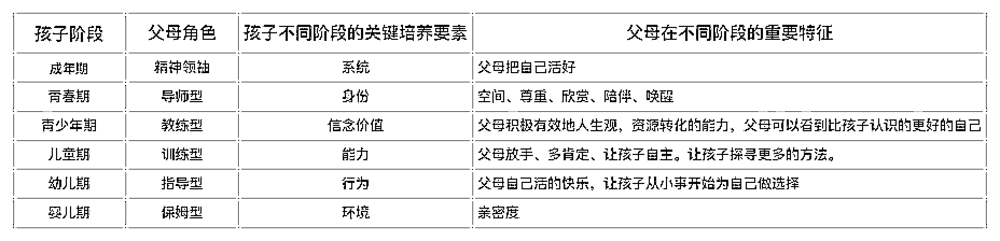

我想重点讲一次协助者的实践。大宝在小学升初中阶段明确想冲更好的学校，我们梳理目标校的能力要求后发现奥数是短板。初测时在厦门一家知名机构连入门测试都未通过，孩子非常沮丧。我与爱人沟通后明确需要具体支持，暑期由父亲每日抽出一个小时陪同学习，检索教学视频、筛选内容、听课做题复盘。一个周期后测试仅错一题。核心不是代学，而是让她感受到不孤单。

伊能静曾说，得体的放手是母亲给的最大爱，但你要让她知道回头时我们都在。父母既是早期的安全感来源，也是成年后的底气支点。

**我们作为家庭——做前瞻布局，打破信息壁垒**

越是深入，越发现信息差带来的差距惊人。提前布局可以帮助家庭明确目标、形成方法，让学习更科学，也能挖掘潜力，减少被运气裹挟。

下面从四个维度展开：学科、特长、升学、身份。

**学科布局**

语文：大语文并非指课堂内容，而是以课程为核心，向外延展。大语文时代的考查变化可看表格。

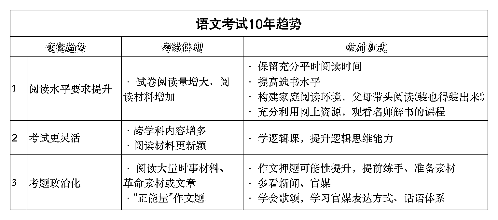

语文核心是阅读，写作是难点。低年级抓自主阅读能力，三年级后逐步引入理解方法与写作训练。小阶段完成古诗词储备。拉分项在阅读与作文，而非基础知识。

英语：小学阶段即可达到高考级别的关键在于早启蒙、方法匹配、持续坚持。听力输入比口语输出更基础，自然拼读需配合分级阅读巩固，否则易遗忘。阅读进阶路径为听读、跟读、流利朗读、自主阅读。口语突破不靠环境，靠让孩子感受到实用价值，我的做法是带她实地旅行，让她自行产生驱动力。

数学：小学阶段除计算需刻意练习外，其余可自然习得。初中高中需系统刷题与思维训练。奥数建议四年级后且校内数学轻松时再介入，避免本末倒置。数学突出者多有天赋基础，了解特点即可。

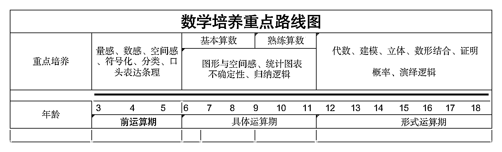

**兴趣特长布局**

艺术：2024 艺考改革后联考取代校考是主趋势，成本降低但顶尖竞争更激烈。艺术非捷径，需科学启蒙与真实热爱。

体育：高水平运动队门槛提升，文化课要求同步提高，未来职业容错空间需提前评估。

科技：信奥门槛高，数学基础需扎实，且兴趣为先，功利心易反噬。

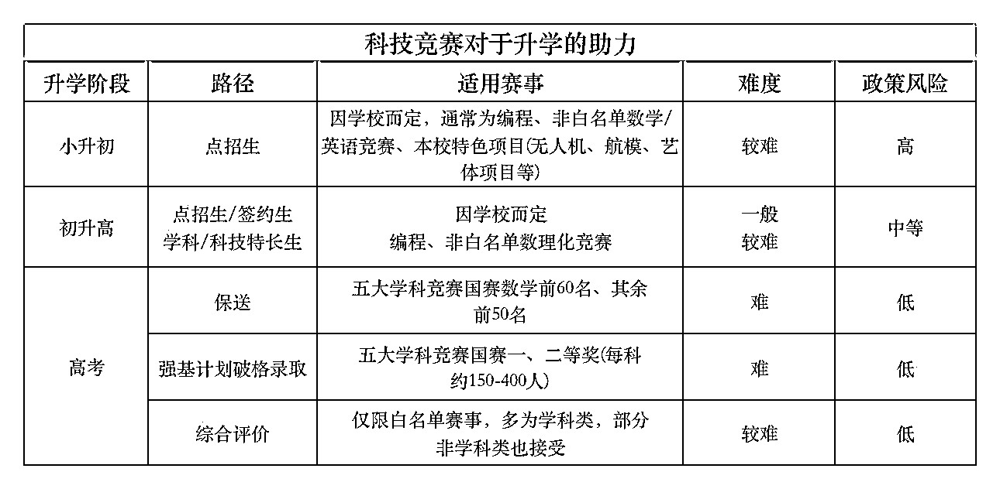

**升学布局**

除高考统招外，尚有十六条进入国内高校的多元路径。提前了解才能多手准备。

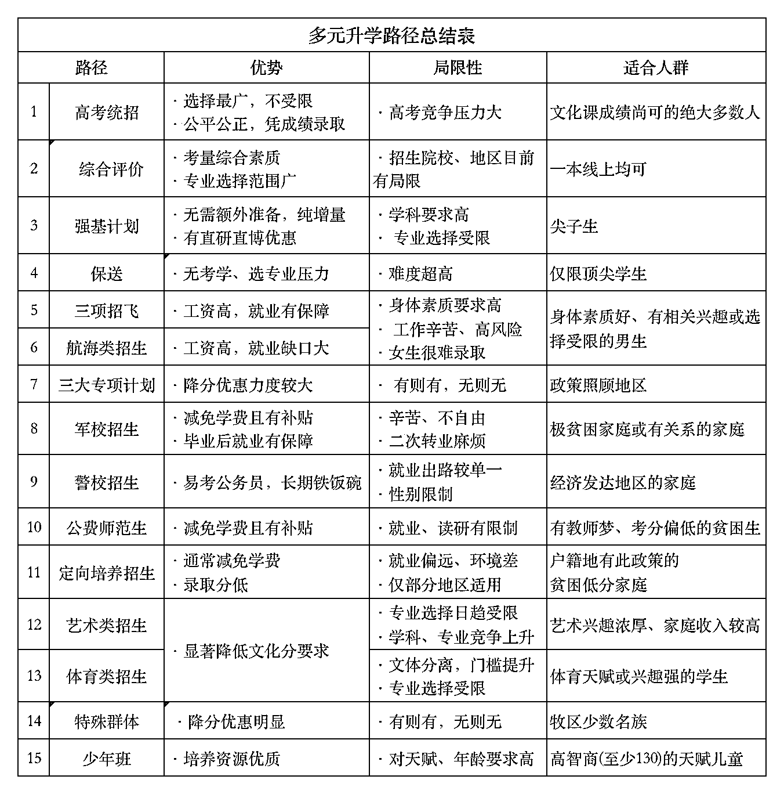

**香港身份布局**

香港身份近两年热度攀升，我本人通过港硕通道获得临时身份。优势之外，代价需清醒认知。

获取方式的利弊对比见表：

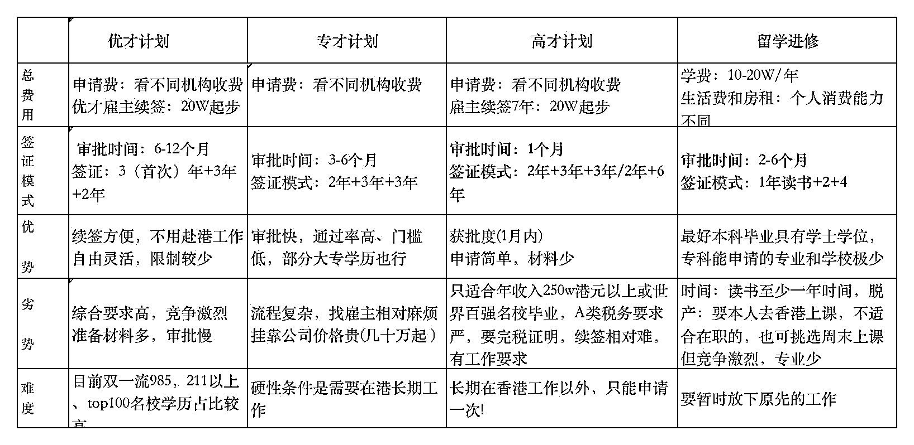

香港身份与内地户籍的优劣对比见表：

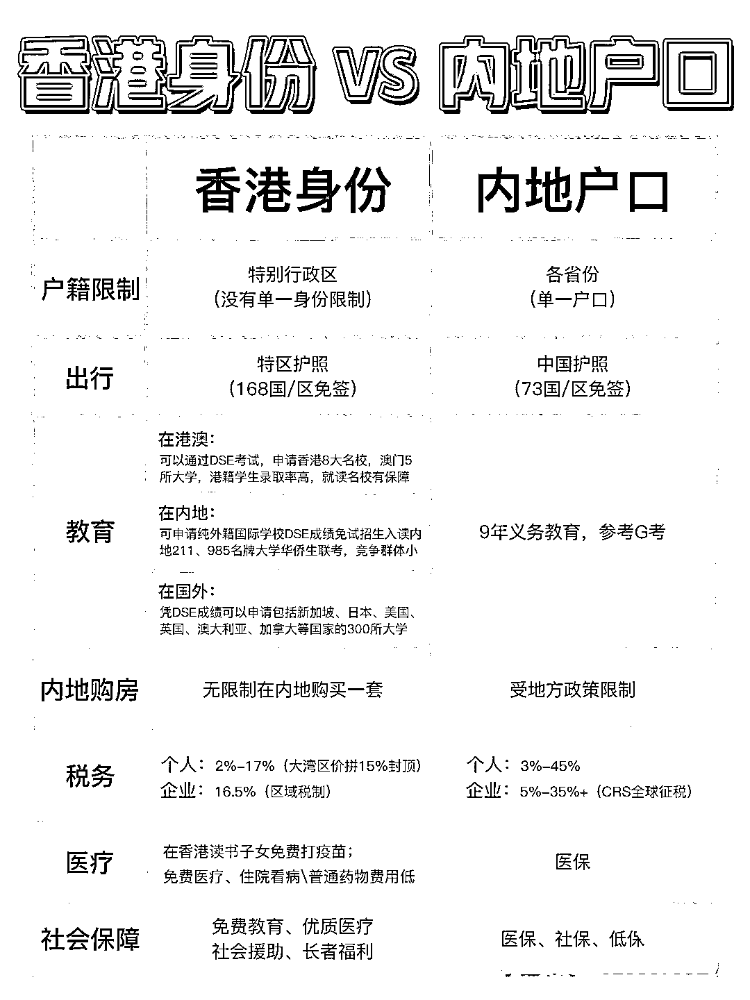

华侨生联考的录取数据对比很直观：211录取率约四成多，而普通高考仅约五成中。

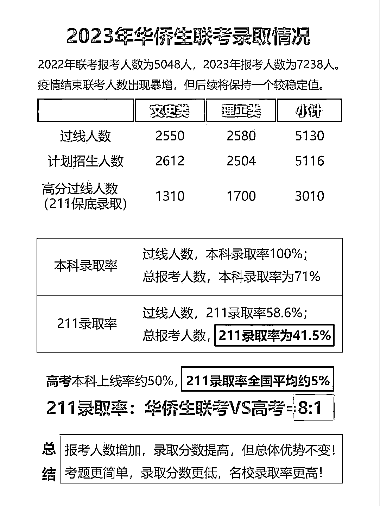

但缺点也现实：投入大、周期长，读硕路径七年花费至少五十万起，续签需真实往返与居住；公务员、事业编制受限；华侨生联考需注销内地户籍换回乡证，DSE 则无需注销。

是否合适，取决于家庭能否承受成本、子女是否匹配、布局初衷是否清晰。我当时同步申请优才与读硕，双线并行，优才周期长不稳定，最终走港硕，并为此考托福扩大专业选择。也要接受每周往返的奔波现实。

总结一句：成长布局越早越宽。子女真正的起跑线不在课表，而在家长的认知版图上。

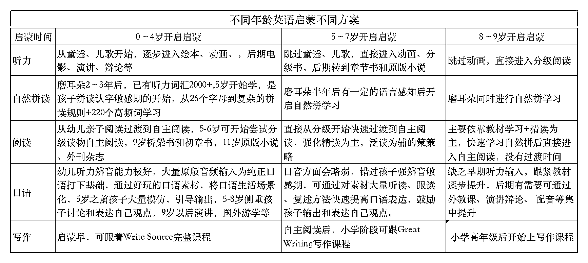

同样是手握香港身份，升学路却可以走向完全不同的方向——香港DSE和华侨生联考，我家两个孩子就选择了各自的赛道。

姐姐已经赶不上7年转永居的时间窗口，所以直接锁定香港DSE。好在我们一直注重英语启蒙，英语本就是她的强项，而DSE最让人头疼的关卡恰恰是英语，数学和语文反倒轻松不少。另外，姐姐性格温温柔柔，将来倾向于走公务员路线，保留内地户口会更方便。综合来看，DSE对她来说是最合适的选择。

这里必须敲个重点：如果想走华侨生联考，最晚四年级就要把香港临时身份办下来。原因很简单——只有从这时候开始布局，才有完整的7年时间转永居、办回乡证，进而拿到华侨生考试资格。这个时间节点一旦错过，后面就很难补救了。

弟弟则选择了华侨生联考。一来时间上转永居绰绰有余；二来我们确实没有精力再陪他卷一次，等弟弟高考时，我俩都快60岁了，只希望他能过得轻松快乐，有个不错的高校托底就满足了；三来弟弟性格外向，大概率不会走体制内路线，注销内地户口对他的影响微乎其微。每个孩子的情况各有不同，路线自然不能套用同一张模板。

说到底，规划的意义只是给孩子多一个选择，在付出同样努力的前提下，拿到更理想的结果，绝不代表可以躺平。内地的义务教育足够扎实，不必急着把孩子送去香港；当然，家庭条件允许另当别论。最终还是要结合自家具体情况，选择能够落地的方案。

那晚分享会，大家聊到近11点还恋恋不舍，每个人都积极抛出自己的教育困惑。我当时就像一块满格电的电池，高速运转，恨不得把所知所想全部倾囊相授。这次福建年会和线下小聚，让我深深体会到龙哥盟那种真诚、利他的氛围。最后想对各位父母说：没有谁比你们更爱孩子，但每个孩子都是独一无二的，教育方法从来不是千篇一律，愿大家都能找到适合自己的教育规划之路。

