# 上次拆解单号自然流月入1.8万的身心灵国学变现后，收到一波圈友落地反馈，我把他们的实操结果提炼成了这套做项目的思维和打法

> 来源：[https://m7vzu30d1s.feishu.cn/docx/JP6NdRwz8oycMdxSTs3cTTX5nrg](https://m7vzu30d1s.feishu.cn/docx/JP6NdRwz8oycMdxSTs3cTTX5nrg)

## 一、前言

大家好，我是樾樾，郑州人，连续创业者。大学一毕业就开始做线下培训机构，后来转到线上教育，推过心理课、职场课、管理课、运营课，长期深耕知识付费赛道。

现在以小红书流量工作室的形式拓展更多赛道，承接法律咨询、家居、别墅设计、留学等品牌的小红书获客与运营。之前分享的身心灵国学项目是我们自营的线下转化业务，正在对接嵩山当地的场地，后续会做正念冥想的线下课。

感恩赚钱这个平台，让同路人能更有效地连接。上次的拆解帖是：【纯自然流，单账号单月1.8w，身心灵、国学、觉醒疗愈类赛道变现保姆级实操拆解】🔗

## 二、圈友实操后的反馈

写这篇主要是被大家的反馈触动了，也想把感恩化为输出。先上几张圈友的实操截图：

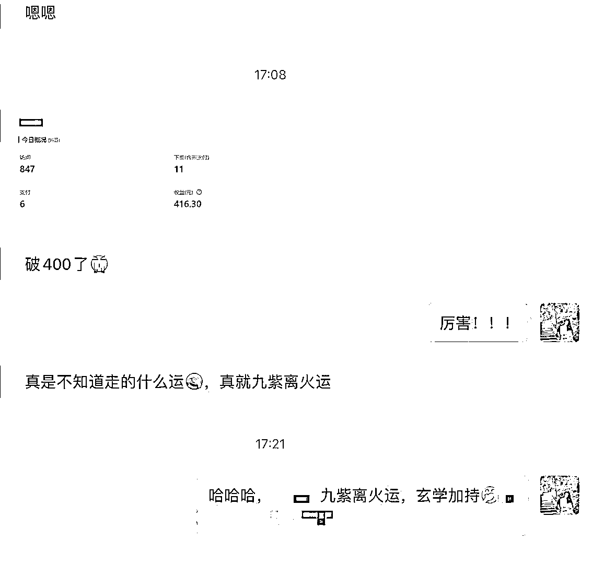

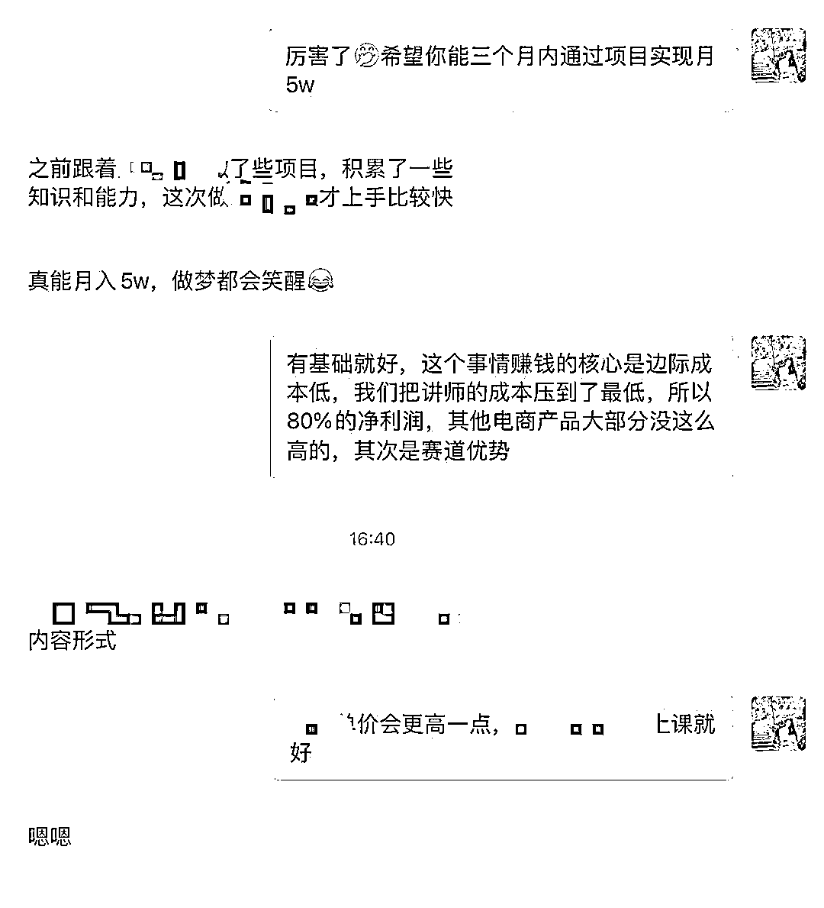

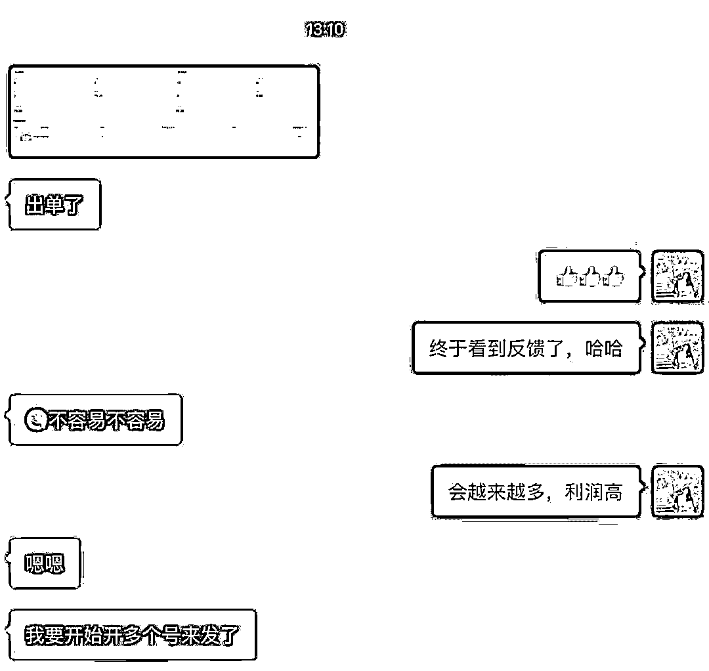

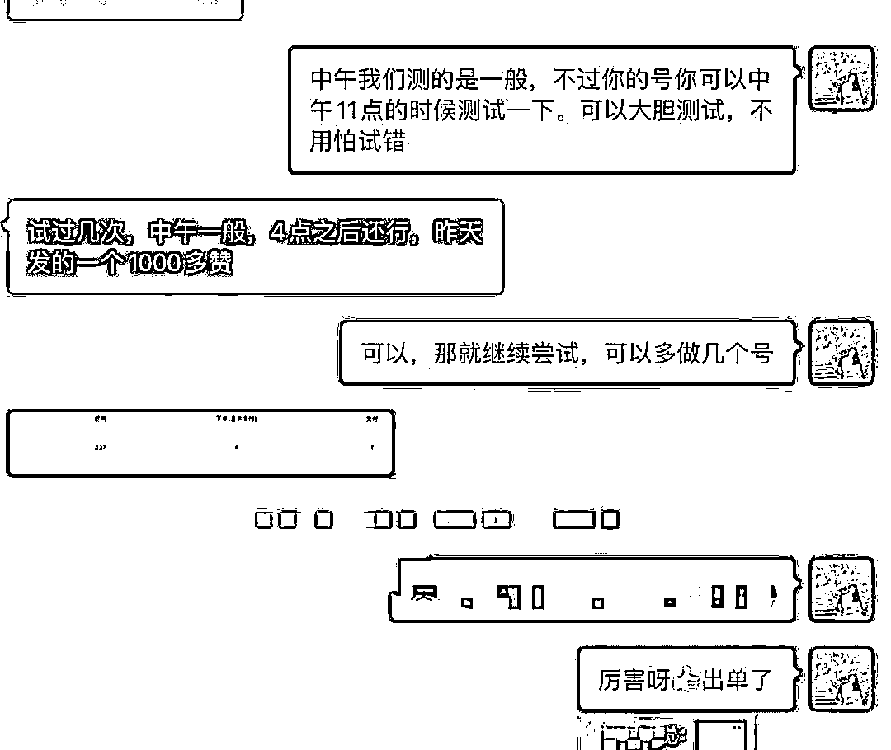

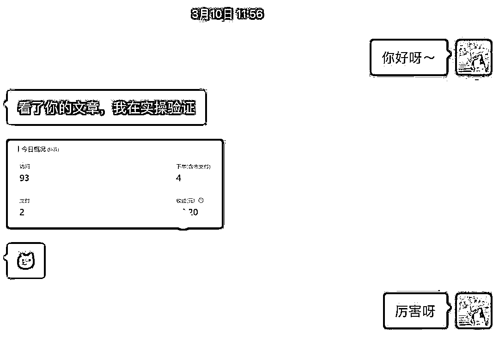

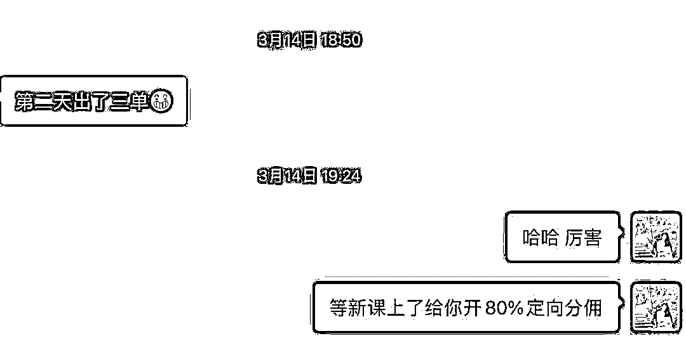

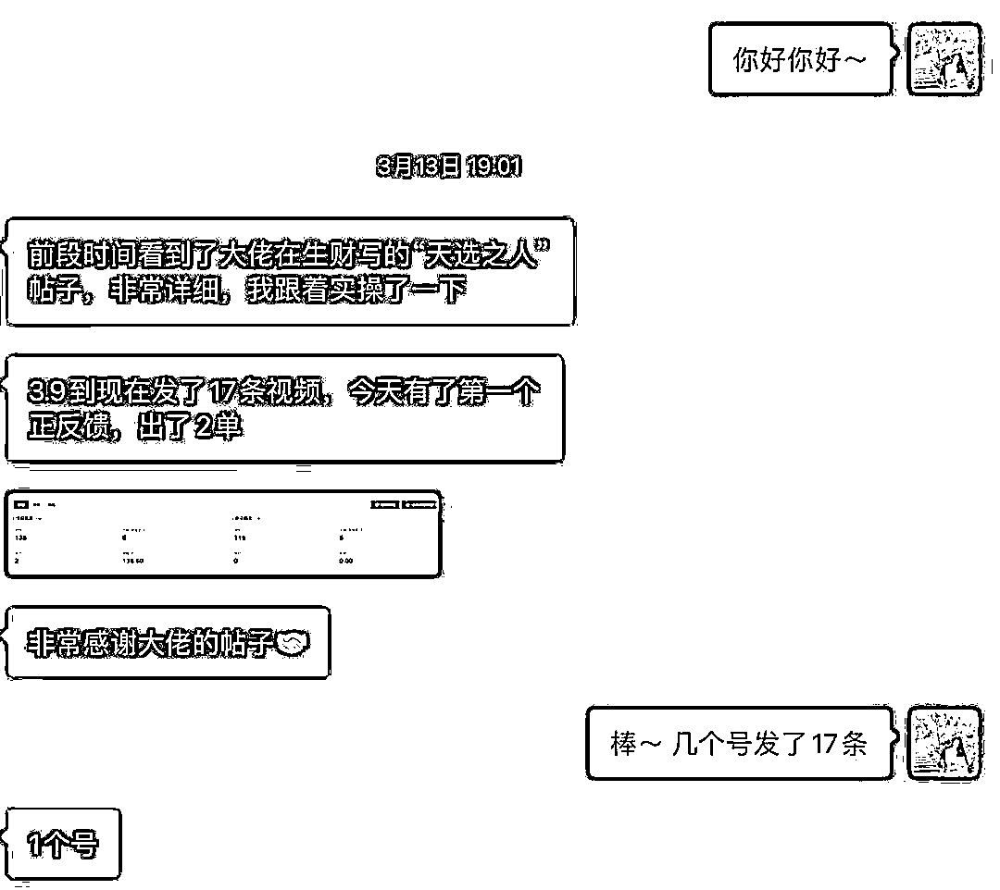

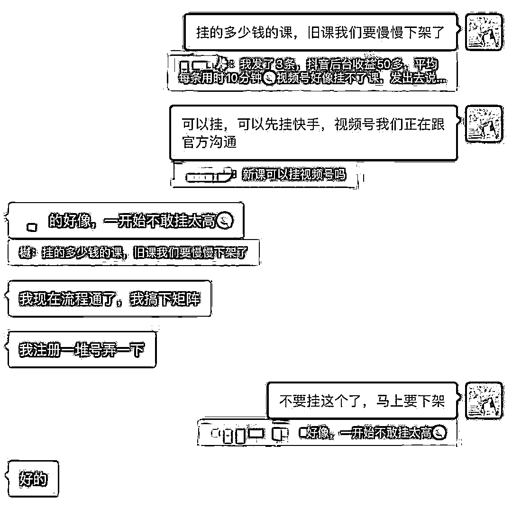

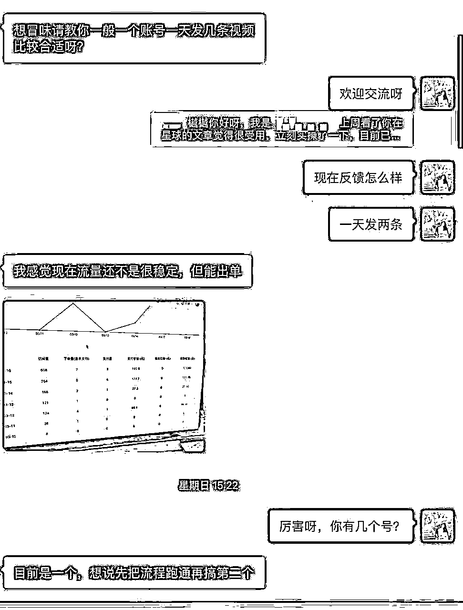

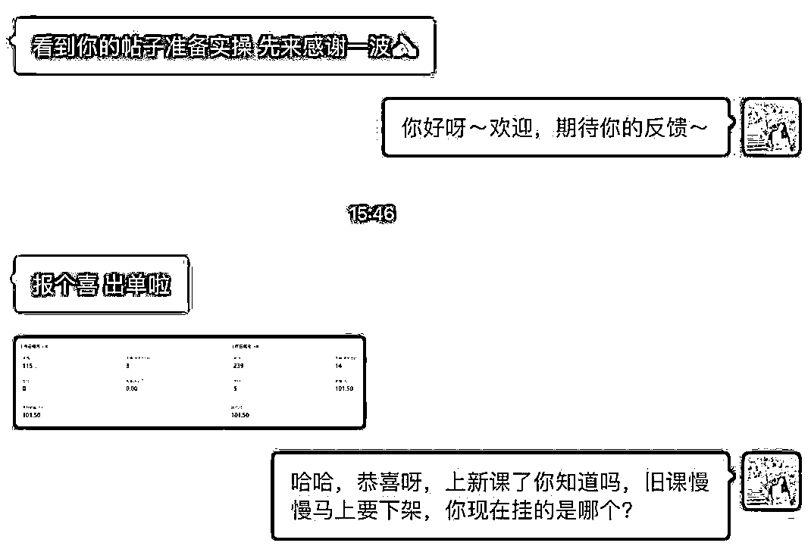

还有不少反馈是换了手机导致聊天记录找不到了，有些圈友加我时连备注都没改，之后我也记不住他是来干嘛的哈哈。看这些记录会发现，有人发一条就没动静了，有人闷头干直接开始赚钱。

聊的人多了就发现，分化很明显。同样一套保姆级教程，28定律特别明显。洗漱的时候我在想，干脆把跟大家沟通后的体悟整理成帖子，边想边剪短美甲开始码字，希望能帮到还在路上的人。

## 三、做项目的思维模型

#### 1、复盘的习惯

跟几天就做到单日400+收益的伙伴聊，他们每出一单都会复盘原因：是开头钩子留住了人，还是评论区引导起了作用。脑子里全天候在复盘成功点。

而还在卡在第1、2步出不了单的人，对比之下这些人已经跑到第5、6步了。

一开始不出单的伙伴，会不断复盘自己卡点在哪，会主动来问我为什么没效果、怎么优化。在持续复盘调整后，也陆续有了首单反馈。

#### 2、模仿的能力

不少圈友把自己剪的视频发给我看，眼花缭乱，我第一反应是教程里教过这样剪吗？好像没有。有人自己创新，换音色、换比例、换字体动画，甚至上高清国外冥想素材，还有把文案改得玄之又玄，我一个持证心理咨询师都看不懂。发过来问我为什么没播放，就是不出单。

反观出单多的那批，画面比例、文案、配音节奏几乎照抄教程，最多只加了点特效和音乐。教程里也强调过一定要参考对标，别人用啥你就用啥，保证原创度即可。

这样才具备流程化、批量化的可能，无脑操作10分钟出7条，直接多号上量，效率拉满，我都惊讶。

回想我刚开始做项目时也很爱创新，总想加点自己的风格，想换个更酷的，更有玩法的，团队还测试过国外魔法师的人设，最终数据还不如普普通通的样板。

后来老老实实照抄自己和团队成交过的视频，连字幕颜色、动画节奏都不改，挂课链接直接复用，多号复制粘贴，数据才慢慢回温。我帖子里分享的成品，就是我们反复测试后最稳的一套打法。

所以想强调的是：抄不是贬义词，会抄、抄得准是很稀缺的能力。做号做项目，先把主观喜好放下，去复刻已经被市场验证过的东西。市场认不认可才是真理，自我创作大部分时候只是自嗨。

#### 3、主动链接的习惯

通过帖子找到我的圈友，有些人会明确说明自己赛道、来意，表达合作期待。有些人加过来一句话不说，我也不知道他想干嘛。

让我特别欣慰的是，不少人做了之后即便没结果也会来复盘进展，遇到卡点主动提问，没回复还会追问第二次。他们真的想把问题解决，比如剪辑、文案、挂课节点等，帮他们梳理后收益就明显上来了。

主动为自己牵线搭桥，资源自然向你靠拢。这点我自己也得学习，多出击。

#### 4、复制的杠杆

有个伙伴首单完成后立刻备了6个号去跑，后来号量做到20个左右。跟教程里说的完全一致：能赚钱就趁热打铁快进。

举个简单的账：一个号一天能稳定赚100块净利，想一年赚100万怎么来？复制。把一天赚100块的动作复制到200个号，一天就是2万，50天就达标。

算清账，把正在赚钱的动作不断重复，是小项目做大的核心逻辑。

#### 5、资源整合的视角

大家常说：做成它不一定非要拥有它，但可以用起来。这就是我的资源观。

有位圈友说他一个人就搞了20个号，我问他怎么做到的这么快。他说自己有主业在上班，发现这个抖音号不需要实名就能变现，于是动用了父母、妹妹的手机号，一个号能绑2个，加上自己手上的号，很快就凑齐了。

做流量项目，账号、实名、设备永远是瓶颈。想清楚资源用来干嘛，就能主动去搜集、链接身边一切可用资源。

#### 6、管理的意识

有一位圈友的反馈很有意思：这种活跟室友同学解释不清，也不爱讲。干脆让他们帮我剪，一条给多少钱，然后再找个人代发。

花出去的钱能覆盖成本，项目就从自己单干变成了牵头运营。自己抽身出来管理，不仅有收益，还顺带给了身边人一个岗位，很聪明。

管理思维本质是把时间精力做减法，从执行者升级为组织者。

#### 7、合作的放大效应

帖子发出后找我聊合作的人很多，大家的合作逻辑五花八门，很有意思。

每个合作方案都会把项目和团队组合成不同的结果，比如我跟嵩山场地谈的线下课，不同合作方就有不同玩法。小红书不同品类的流量合作也各不相同。总之合作就是放大器。

主动抛橄榄枝，主动链接，哪怕这次没成，也埋下了未来的种子。

#### 8、利他的底层逻辑

老生常谈但依然成立：持续利他的人，最后都验证了这个逻辑。利他即利己，利己必须建立在利他之上。

我写上篇帖子时把全流程拆得清清楚楚，后续合作也优先考虑对方利益。身边能长期合作的人，大多都是这种心态。

出单多的圈友给我反馈时，带着报喜和希望给我们正向激励的心态，我就直接邀请他成为下一个高客单课程的优先分销。互利互助，越做越顺。

做人做事是付出还是索取，对方能感受到。短期利己能快，但长期收益一定来自利他。做视频也一样，画面是否方便观看，文案是否方便理解，都是从用户出发。

#### 9、兜底的安全感

这是我从管理课里学到印象最深的一个思维：上限谁都会说，可总得有人兜底。

一个项目上限可能是百万、千万，但我们要清楚保底在哪。我习惯用“至少”这个词。比如跟留学团队合作，我会明确至少单月多少客资、至少每天完成什么。

用在项目上就是：今天至少完成几条有效视频？至少沟通几个成员？至少注册几个号？至少跟几个同行老师交流？

喜欢听到别人说至少的人，因为会感受到安全感。我现在做事也常玩对赌：你至少付出什么，我至少保障什么。这样就避免了花大钱学费打水漂的情况。

赚钱航海的押金其实就是一场对赌，双方都把时间精力押上一起进步。我也在考虑做一种对赌式学习：我跑通的玩法你来做，赚不到我退学费。感兴趣的提到“对赌”我就能get。

市场浮夸的东西太多，需要更多踏实兜底的人。

## 四、做项目的方法论

#### 1、先盘点自身现状

这次航海报了投资船，第一课老师就说：投资要先哲学先行，先认清自我。别人的方法论套在你身上不一定适用。

做项目同理，没有放之四海皆准的打法。要结合自己的情况、能力、资源、偏好、作息、身体状态来定制方法论。

比如回到这个小项目，就是盘点：你一天能剪多少条？能管多少人？能整合什么资源？你什么时候状态最好？这些都是关键变量。

#### 2、一张图看执行力

如果你在赚钱圈，缺执行力就是原罪。大项目要战略，小项目靠执行就够了。

第二天就开单的伙伴，不是第二天才开始做的，而是前一天就已经在做了。所以才有第二天的结果。

看到就做，快速试错，持续迭代，找准节奏。“何以赚钱，唯有实操。”

放一张最近很火的图，共鸣感拉满：

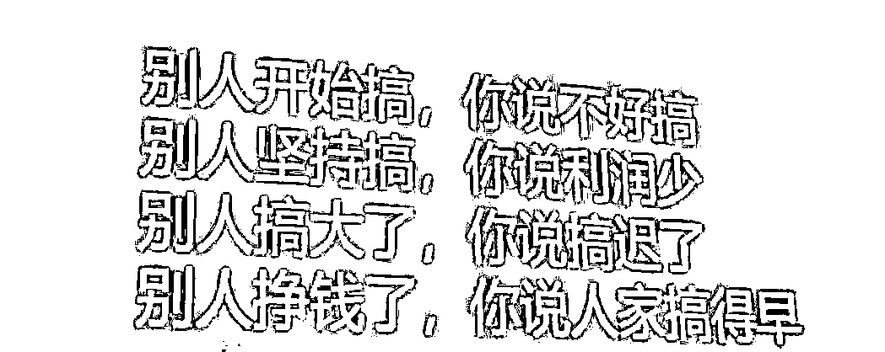

#### 3、如何提升效率

前面提到有人已经迭代到第5、6步了，有人还在原地打转。直接用上面的9个思维去对照，就是最高效的提速方式：

多复盘得失 → 照抄对标 → 主动提问解决卡点 → 复制有效动作 → 主动链接调动资源 → 尝试管理 → 主动寻求合作 → 保持利他 → 为每日目标兜底

执行这一套，效率自然上去。如果还上不去，找我，我给你兜底。

另外多用工具：剪映批量剪辑、批量提取文案、让家里闲置人力帮忙剪辑发布，都是降本增效的做法。

#### 4、如何规模化

复制的核心就是把赚钱的动作重复做。多开号、多发作品、做矩阵，具体参考上面圈友的实践。

“一个号一天赚100块净利，一年想赚100万怎么办？复制200个号，一天2万，50天就到。一笔账算清，重复赚钱的动作，就是小项目做大的思维。”

#### 5、合作的打法

觉得单打利润天花板低，有资源想放大，或自己在某环节特别擅长，都可以用合作来解。

比如你擅长批量剪辑不擅长写文案，就找文案合伙人。合作能把效率和结果推到更高。

我这里也欢迎带着具体合作想法来交流。

先写到这，希望对正在实操的你有用。