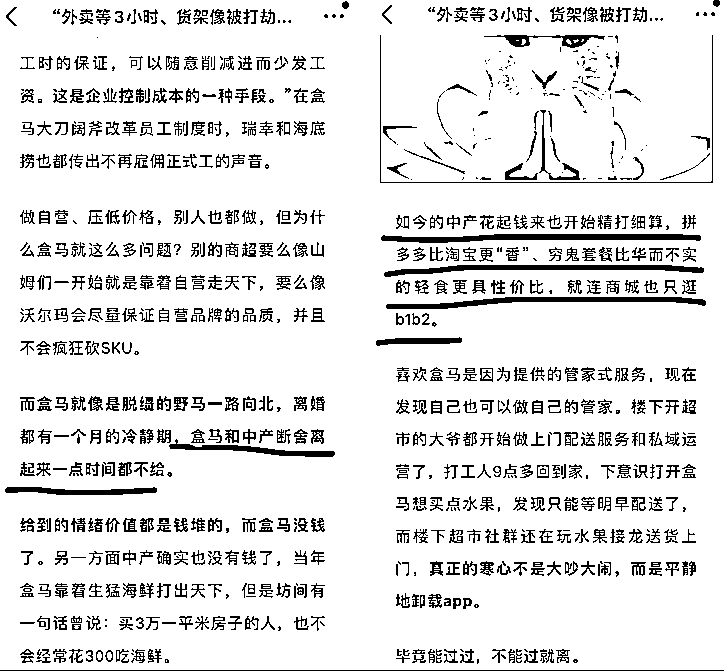
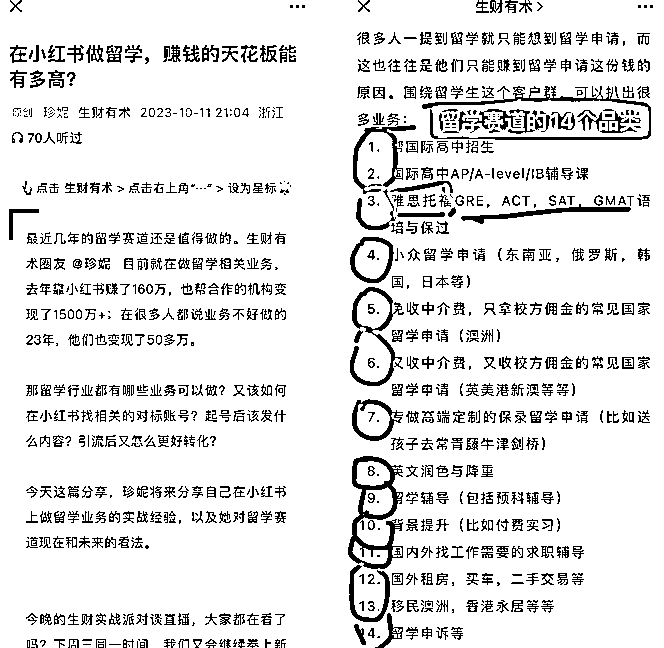
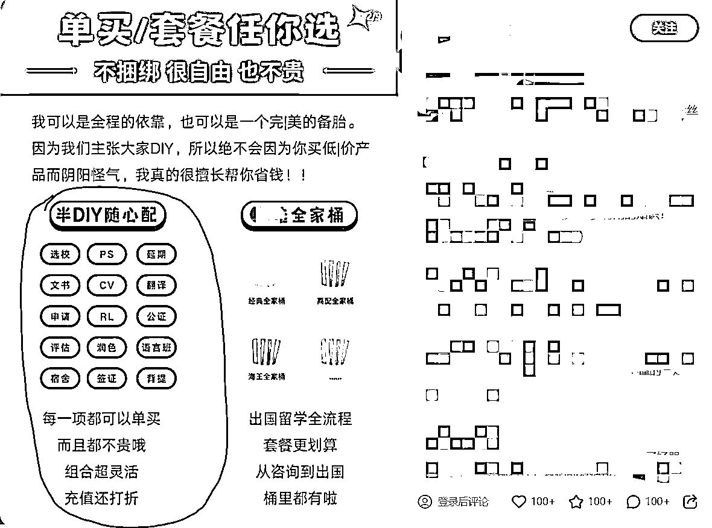
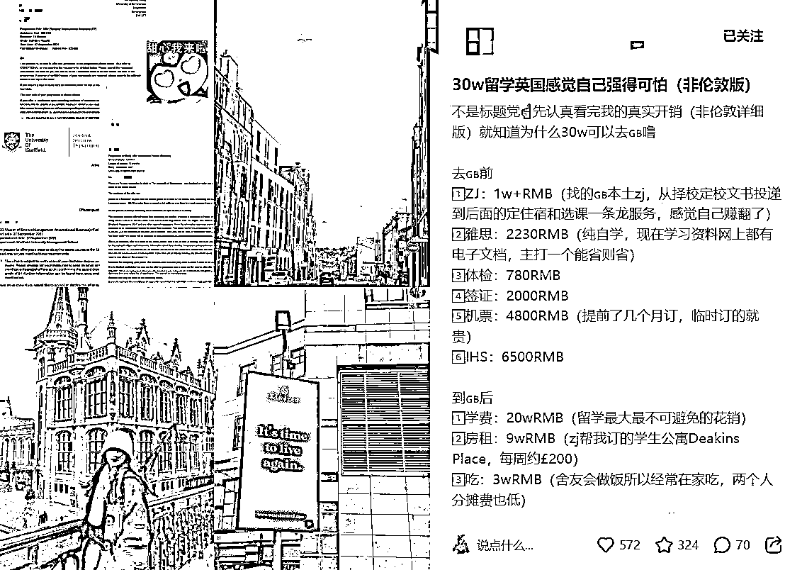
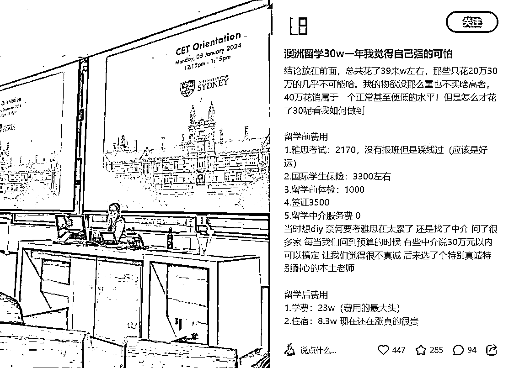
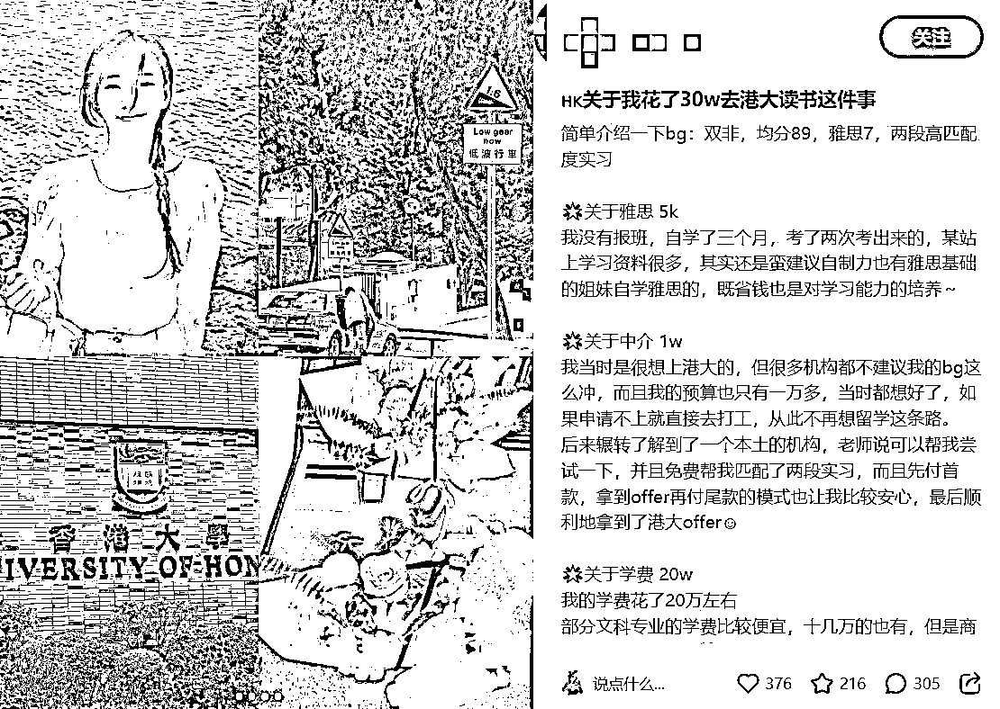
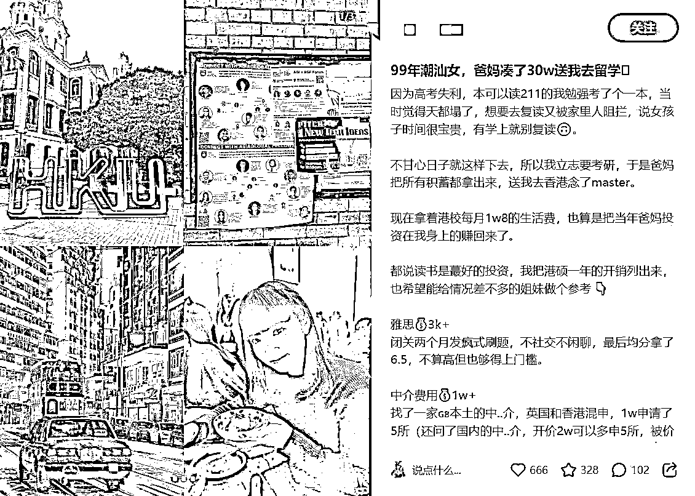
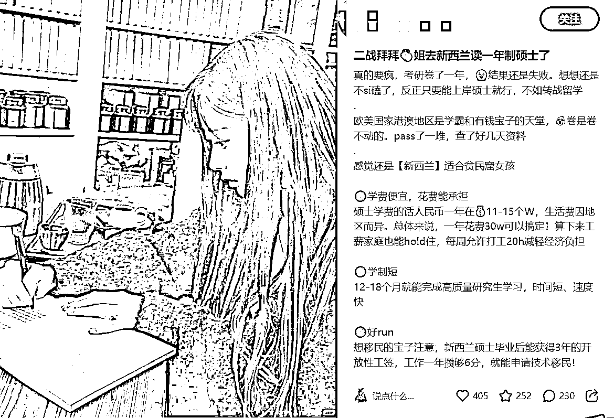

# 从小红书撬动2700万营收后：留学赛道现在还能不能做？我的全景复盘

> 来源：[https://ht16ej1tui.feishu.cn/docx/N3xWdm6iLoiDyZxWWUEcGW5SnLc](https://ht16ej1tui.feishu.cn/docx/N3xWdm6iLoiDyZxWWUEcGW5SnLc)

大家好，我是珍妮。1500块起步，22-23年教育赛道在小红书累计做到2700万营收。我是这条业绩背后的操盘人，也是《老板避雷手册》那篇帖子的作者。

和赚钱圈陈铭Ivy一起创业，22-24年间在圈子里分享过不少实操。我把链接放这儿了，感兴趣的可以自行回顾：

24年：老板避雷手册|年1100w营收背后，如何识别不合适的运营人员、合作商、合伙人？https://t.zsxq.com/18clCvA0e

23年：小红书教育赛道GMV1600万/年，小团队创业心法https://t.zsxq.com/18RnIxsp7

22年：粉丝3000月营收20万，小红书低粉高变现的蓝海攻略分享https://t.zsxq.com/18tvEOFgZ

今天这篇主要聊「留学行业的趋势判断」。下面加粗的部分，对其他行业的老板也同样适用。我会从四个层面拆开说：

1. 留学赛道当前的赚钱窗口与利润现状
1.1 这个生意还能红几年
1.2 2024年的真实利润体感
1.3 留学号把微信号塞给用户的各种野路子汇总，其他行业可以参考，留学现在基本用不了了
1.4 省钱认证蓝V的办法，通用
2. 正在掉队的赛道盘点
2.1 留学为什么要降温，根本原因
2.2 哪些赛道会跟着一起掉
2.3 掉队赛道里老板能怎么自救
3. 留学14个细分赛道，现在还有哪些口子
4. 2024年还想入局小红书留学中介，基本只剩一条路，两套做法

后续我还会继续放出：

想知道的话，关注我后续更新。我先把第一波转型的案例护住，晚点再发。

1）死磕留学行业还能怎么活
2）死磕留学生群体怎么活
3）死磕留学生家长群体怎么活
4）死磕海外华人群体怎么活
5）准备转行的地雷区
6）结合自己现有经验，转行能去哪

# 留学赛道的赚钱窗口与利润现状

## 1.1 这个生意还能做多久

留学的赚钱窗口大概还剩3-5年，之后想赚钱会越来越吃力。从今年起，钱不再是以前那种“躺着就刮到风”的状态。

过去留学中介的打法极其简单：引流、签单、收学生服务费、收院校返佣，交付基本靠上游供应链。23年9月之前，小红书还没被留学矩阵号彻底占领，学生对名校学长学姐的账号还有信任。

23年9月后，学生彻底看烦了。素人号也好，机构号也罢，最后聊到最后的100%都是中介。留学申请、租房、辅导、转学分、申诉、语言培训，甚至代写，都混在一起。有人假借卖二手家具的名义加微信，聊半年打游戏，最后甩出代写链接。把人气死。

客户群不讲价、利润又高，尝到小红书引流甜头的玩家，20-23年把一片蓝海硬生生做成红海。现在新人进来找不到路子，就是烧钱烧精力。

2024年想进小红书做留学中介，基本只剩一条路，后面我会展开。

## 1.2 2024年利润到底怎样

利润还在，但已经不是大风刮来的钱了。

新入场的个人IP想靠留学中介起量，基本没戏。24年前的IP早把赛道卷透了，现在再做只能当炮灰。你能想到的打法，别人三年前就玩烂了。

留学从业者做运营几乎是天赋型选手，这一拨人卷出来的局，24年后想靠天赋异禀去硬刚，基本打不过。

矩阵号玩家会面临两种选择：

A. 充聚光，直接发微信号
B. 不充聚光，用各种骚操作把微信号塞出去

选A的话，每个号每月至少1500-1800的平台成本，这只是保护费，并不保证能拿到转化。对手愿意花更多钱，笔记质量差不多就能把你压下去。我也有更省的打法，这里就不公开了，怕被官方看到。

选B的话，除非全网都是你的号，否则不充聚光很难吃到客户。没有快速送达和可见的微信号，客户就会同时去问几家矩阵号。谁先通过好友、销售更强，客户就是谁的。

## 1.3 发微信号的骚操作合集

这些站外引流招数我都试过，在留学赛道基本每隔一段时间就失效，别的行业管控没这么严。

1. 做成表情包发给用户，表情包上带微信或让用户回微信
2. 把群聊名改成“领资料加xxxx微信”，把群聊嵌到笔记底部，链接置顶在评论区
3. 用小号发带微信的笔记，大号收藏并点赞。小号微信号被识别就涂鸦遮挡一点，保持可读
4. 用户评论后，小号去at他，大号提醒“看一下at你的那个回复”
5. 把小红书ID改成微信号，越短越好，不要0O混淆，不要特殊字符，简介写“抬头看ID”
6. 手写体笔记，在左下角手写微信号，注意26和2Z、0O不要混用。评论区提醒“第一页左下角找我”
7. 用语音报英文微信号，说中文或阿拉伯数字会被识别。我常拆成两句：先说“听我说英语，不然发不出消息”，再报数字

第5条最难，很多用户看不懂，但“有总比没有好”。现在头部矩阵已经升级到用视频口播留号。

## 1.4 认证蓝V的省钱方式

不确定要不要开蓝V、怎么省钱开，先记住一件事：

我做过很多赛道的小号，养一个月都很安全，只有留学号必定收到“内容不被推荐，建议认证蓝V”的通知。这是被压得最狠的赛道。

省钱做法：去拼多多买海南个体户执照，40-60块搞定，再交600块给官方做蓝V。其他省份都不止这个价。

有人问个人博主认证能不能免蓝V。我试过，能免推荐限制，但下一步是“禁止站外引流”，躲不过。

# 赛道下滑全景

## 2.1 留学接下来要降温，根因是什么

2.1.1 中产没钱了
2.1.2 留学中介太多，基本没积累，拿不到顶级富人的钱，中产缩水后利润被挤压

关于“中产没钱、中产在没落”，我是23年3-4月从一个贵人老师的IP课里听到的。她在国内火了十多年，数据支撑很扎实，影响力覆盖欧洲和周边。听完后我立刻跟合伙人Ivy对齐。

当时正好是留学赛道聚光投放前的最后高光，订单像潮水一样。那篇文章我7月发在赚钱，后链：https://t.zsxq.com/18RnIxsp7

英澳中介最后一次大火在23年9-10月，之后很少看到笔记下面一堆礼貌问价的场景了。现在偶尔的小爆款都有共同特征，后面会讲。

我们23年把留学相关所有细分都试过，和很多服务商合作，最后结论一致：行业在下行。不是不赚钱了，而是赚钱的性价比变差了。

以前天赋80分、努力值20分就能赚120块。现在要努力90分才能赚到同样的120块，接下来可能要100-110分。同样的人去蓝海赛道，20分努力就能再赚120块。

中产缩紧，出国人数会越来越少。接下来能送孩子出国的，要么是超级高净值家庭，一开始就走英美顶尖线；要么就是本来就在海外的华人。

如果你还做留学中介，看你的产品对准谁。继续盯着中产，利润只会继续下滑。

注意：未来“外国人反向来中国读研”或许还有机会。我见过一个俄罗斯能源高管想来中国读EMBA，2000多块注册费都嫌项目不够好，有好项目也能做。

中产能移民的会移民，因为国内日子会更难。

底层和小康家庭，以前咬牙卖房送孩子出国，现在更可能不出国，或去马来西亚、爱尔兰这类低成本国家。客单价要降，“免押金、只拿返佣”的中介会增多。

社会在往M型走，中产在被挤压。

2.1.2 中介普遍没积累，拿不到顶级富人钱

留学一直靠顶级富人+中产吃饭。顶级富人要美国、牛剑。中产以前去英澳，1.5-3万中介费随便给，现在开始比性价比，甚至转去新西兰、爱尔兰、马来西亚、芬兰。

中介要么服务顶级富人做美国名校，要么服务中产不断卷性价比。

太多中介习惯赚快钱。英澳和小众英语国家申请门槛低，很多人只是按官方要求递个材料就收两笔钱。澳洲申请甚至不需要文书，门槛极低。

随着中产没落，DIY和半DIY增多，甚至有人找中介免费申请。价格战打起来后，你不收钱别人也免费，客户凭什么选你？

## 2.2 哪些行业会一起掉

核心判断：主要服务中产、性价比又不高的品类，都会掉。

具体行业不便公开透漏，有需求可以私聊。

## 2.3 掉队行业的老板怎么自救

想继续吃中产这块蛋糕，必须做一件事：别卖死贵的东西，提升性价比。

瘦死的骆驼比马大，中产没钱了但冲动消费的特质还在。产品够好、够划算，依然能成交。

学会看大V的风向是最快的方法。比如S叔Spenser，前几年还在讲30万买LV箱子，现在在带货小而美的性价比产品。这就是信号。看那些常青的大V在卖什么，你就知道钱去哪了。

再看盒马都抛弃300万中产了。

盒马都不要的中产，你一个小个体还死盯着赚？

行业没落的判断并非我原创，是听贵人老师分析的，想知道是谁可以私下问我。

# 留学14个细分赛道，还有哪些能做

我23年7月的帖子里列过14个细分，现在看趋势基本都在下行。

看我图1的颜色分区。

蓝圈蓝线：1、2、7、12、13还能做。但1和2会持续下滑。12和13别碰香港永居，其他还能做。

黄圈：3、5、6已经卷完、利润下滑，想赚大钱别进。

绿圈4勉强能做，但会继续下滑。而且这种“既要又要还要”的客户不好伺候。

紫圈8、9、10、11已经极度内卷，11还能做国内求职辅导，建议做“送孩子进体制内”的求职，而不是互联网大厂，因为家长现在更看重稳定。

14能做，利润尚可，但有周期性，复购不稳定，比如学期中的申诉高峰。

想做留学中介，建议排个序：

1. 理工科>文科
2. 美国>英澳
3. 小众国家>英澳
4. 非英语国家>英语国家，但要选富裕国家，别接“学费要便宜、学校要好、还要混圈子、不能上课、语言也考不出”的客户
5. 博士>硕士，硕士已经卷烂，200块的单子不值得拼。博士也卷，但没硕士离谱
6. 国际高中>硕士，国际高中的电话资源早就被卖烂了
7. 其他留学周边品类>留学申请中介

# 2024年入局小红书留学中介的唯一路子

重新组合你的产品和服务，把性价比拉满，并反复强调留学的性价比。

## 4.1 重新打包产品，提升性价比

下图这个商家服务其实很适合“疫情后资产缩水”的留学生，但运营没有反复强调这个优势，其他笔记数据很平。

如果你不想改人群，就把现有服务拆解重组，变成高性价比的套餐。就像图里的“半DIY”，每项都能单卖。

原因还是中产在没落。你要么赚顶级富人，要么赚底层。如果你还想吃中产，中产会算账，会挑便宜的。

除了自带送礼属性的产品，靠“牛逼营销+华丽包装”卖高溢价的东西已经不好卖了。中产会用脚投票。

## 4.2 反复宣传留学的性价比

把预算明细打在公屏上，让用户清清楚楚知道去某个国家要花多少钱、花在哪。

23年7-8月有人拿这个做段子涨粉，比如“5万块留学美国”，讲游泳游太平洋省机票的梗。

23年11月开始有人认真算账：去小众国家留学到底要花多少钱。到24年1-2月，这种笔记开始扩散到英澳、香港，新西兰依旧流行。

点进主页会发现，绝大部分账号最近3个月就这一篇预算帖火了，其他硬广点赞0-30，评论3-10个问价就算不错。

这种过度强调预算的内容，其实在给所有中介发信号：把性价比拉满，反复植入“留学不贵，值得投资未来”的认知。

说实话，最后到底还有多少客户愿意为这些买单，我心里也没底。我能确定的只有一件事：每年选择出国留学的年轻人都在变少，留学这门生意能吃肉的时间，顶多就剩这三五年了。

其实从23年开始，Ivy和我就在背后悄悄做调整。我们把留学赛道能试的品类几乎都试了一遍，最终选了一条别人还没看见的C端新路子。

23年下来营收做到1100万，对比高峰期的1600万，数字本身就在说话。行业在往下走，这也意味着所有在留学圈里的人，都得提前为三到五年后的自己做职业和产品的规划了。尤其是当你的产品只能触达国内中产，触达不到真正有支付力的富人群体时，这个信号就更明显了。

我自己也做了不少行业涨跌的盘点，梳理了哪些赛道现在还是蓝海，哪些对标账号是坑，爆款是怎么写出来的。

后面我会陆续把这些东西整理出来，不过会晚一点再发。主要也是怕行业现在就出现大波动。说实话，最近三五年还能做，但三五年后，卷的程度会让人难受，现在的卷只是预热。

等我整理好后会重点讲：

1）倘若你还想死守留学行业，该怎么活下来？
2）如果你想继续服务留学生群体，机会点在哪？
3）如果你的核心用户是留学生家长，该怎么转型？
4）如果目光放在海外华人圈，又能干什么？
5）准备转行的路上有哪些雷区一定要避开？
6）结合你手上的现有经验，转行最适合去往哪个方向？

感兴趣的可以先私我，也可以等我后续的分享。

# 致谢：

首先要感谢Ivy。我的重要决定几乎都有她在背后推一把。她从我16岁起就带我赚钱，后来帮我规划留学、找靠谱房东、甚至安排室友。在我还在给机构当雅思老师的那段日子，她总会把客户介绍给我，让我拿到远超打工时期的收入。

我很少走弯路，也很少被割韭菜，因为每次我快要踩坑的时候，她都会及时拉住我，让我看清全貌。我的每个运营打法背后都有她的支持和点拨。我不擅长搭建商业模式，也不爱算账，更不会把一个小生意做大。

我们最初的供应链是我在跑，一个月到手也就1.8万。Ivy接手重构后，月营收直接拉到20万。她特别会放大生意，也极擅长算投入产出比。哪怕我们测试了大量动作、踩了不少赛道，最后亏的也远比那些大机构少，这才让我们这家小公司平稳撑到了第三年。

感谢靠谱。在陪伴群和销冠群里，我学到了过去完全没触及的东西。每当我在飞机上、高铁上发呆，我都会翻一翻之前下载好的销冠精华手册。看完后才明白，真正的销冠细节是书本里教不会的。靠谱的指点也在我每篇文章背后，所以我的稿子才总能被加精。

感谢玩赚合伙人和拱卒创峰会。芷蓝姐和拱卒打造的这两个圈子，让我认识了太多行业的人，也拿到了圈外根本接触不到的信息差，这帮我省下了无数弯路。

最后感谢赚钱有术这个大家庭。Ivy和我是22年加入的赚钱，当时我们两个人月入才3万左右。靠着精华帖和向大佬请教，我们在22-23年冲到了2700万的营收。没有赚钱这个聚集精英的平台，我们很可能就错过了留学界最后的红利期。