先说一个可能让很多人意外的事实：我，曾经写了八年代码的程序员，现在是一名情感赛道的自由职业者，月入三万。

没错，就是那种从“面向对象”硬生生切换到“面向心动”的转行。

今天这篇文章，不贩卖焦虑，也不灌鸡汤，只想老老实实把我这500多天从迷茫探索到稳定变现的全过程，拆给你看。

---

## 01 一个程序员的“下辈子”，想换个活法

先简单交代下背景：我2014年毕业，北漂八年，混过独角兽公司，拿过期权也成功变现过。2022年6月我离开北京，回到太原，结束了和媳妇异地的生活。

至于为什么离开职场？原因不复杂，大概有这四个：

- 我不想过那种一眼望到头的生活。李笑来说七年就是一辈子。我程序员这“一辈子”已经过完了，想换个“下辈子”试试。特别是回到太原后，工资缩水，加班却一点没少，这让我更坚定了换赛道的想法。
- 我相信不上班也能赚钱。早在上班期间，我就搞过知乎带货、卖过课、开过训练营，零零散散赚了几十万。所以我对“离开平台靠自己”这件事，没那么恐慌。当然，如果你也想裸辞，我的建议是：经济环境好的时候，至少准备6-12个月的生活费；环境差的时候，准备2-3年。毕竟生存问题都没解决，是没法安心创业的。
- 我想回归家庭。我媳妇在太原医院有份稳定工作，总得有一个人兼顾家里。我的想法是，不稳定的一方回归家庭，在线上赚钱的同时，把家照顾好，也挺好。
- 最后一点，写代码带给我的成就感太低了。熬了几个通宵上线的功能，要么没人用，要么项目过两年就黄了。那种“我来过这个世界，却什么都没留下”的空虚感，我不想再体验了。

于是，我把自己从“程序员”的壳里硬生生拽了出来，一脚迈进了完全陌生的情感行业。

---

## 02 转行不是一拍脑门，而是这三个阶段

很多人听说我从写代码转行到“脱单陪跑”，第一反应都是：这跨界也太大了吧？

但其实，我的转行路径是有迹可循的。这要感谢我在离职前，听了明白老师的建议，开始日更写作。从2022年3月7日那天起，我一天都没断过，而这也成了我一路转型的主线。

我把整个转行过程分为三个阶段：

**第一阶段：找到稳定的能量来源。**

不上班之后，如果没有外部约束，人是很容易散掉的。今天做也行，明天做也行，最后干脆什么都不做了。我的解法就是日更公众号，每天至少写600字。这件事看似简单，但它像一根定海神针，保证我每天必须要阅读、思考、输出。

不需要各种花式自律，只挑最重要的一件小事死磕到底就够了。只要今天文章更新了，我今天就没白过。这一阶段写什么不重要，重要的是克服对写作的恐惧，锻炼把事情讲清楚的能力。

**第二阶段：用随喜咨询去碰撞未知。**

坚持日更到第201天，我推出了一项“随喜咨询”服务：不设范围，不设时长，咨询完你觉得值多少钱就给多少。

你要知道，你不是由你自己构成的，而是由你和他人的一次次碰撞构成的。山本耀司也说过：“自己”是看不见的，撞上一些别的什么，反弹回来，才会了解“自己”。

我的“脱单陪跑”服务，就是某次随喜咨询的意外产物。当时那个朋友咨询完之后，给我发了666元的红包，后来她用了两个多月成功脱单。那一刻我才意识到：原来帮人脱单，我是有点天赋的。

每次咨询完，我都会复盘：自己有没有热情？有没有能量被消耗？有没有真的解决对方的问题？如果一件事你能不厌其烦地做，那多半就是你的天命所在。

不过这个阶段光靠日更是没意义的。你要尽快找到一个想做的事，然后用持续写作去优化和放大它。期间我也搞过印象笔记教程、感恩日记训练营、写作打卡星球……虽然没赚几个钱，但积攒了做产品、挖需求的能力。

**第三阶段：持续跟进异常值，找到高客单价产品。**

大部分随喜咨询的红包都在200元以内，那次的666元对我来说就像个异常值。既然是异常值，就值得主动回访、深挖，看看能不能长出一个更高客单价的产品。我的“脱单陪跑”的服务模式、用户画像和定价，就是在和这位朋友的持续交流中逐渐打磨出来的。

《邻家的百万富翁》里有句话说得好：那些为富人服务的人，往往也成了富人。关键是找准自己在市场中的位置。

在这个阶段，写作已不只是爱好，而是我的核心竞争力。就像明白老师说的那句话：写作=一切，写作就是输入+思考+输出+方法+学习+需求+商业+耐心+长期+意义+流程+产品+营销+认识自己+认识世界……等等。

---

## 03 脱单陪跑的服务模式和价格，是怎么定的

市面上很多一对一陪跑，都是在微信上私聊。但这种方式有个很大的bug：消息一条接一条往外蹦，你永远在处理眼前的信息，问题根本聊不透。而且来回几十上百条消息，既浪费时间又容易串台，根本没法规模化。

我的做法是：让学员把问题完整地写在飞书文档上。这样既能说得更细，又能沉淀下来方便复盘，还不会搞混客户。看完文档我给出建议，遇到需要实时沟通的再上微信，聊完后再让学员回文档里复盘。

确定了服务模式，接下来就是定价。

我问了一位已脱单的学员，觉得这个服务值多少钱？她说至少两三千。我又看到“陌上花开HIMMR”的21天脱单训练营收费2999元。于是我的起步价定为：女生2999元，男生3499元。男生贵一点的原因很简单：一方面我需要男生用户的视角，另一方面，陪跑男生的过程中，我经常觉得自己像个语文老师，还得教他们怎么说话、怎么表达。

至于为什么服务期限设为“脱单成功后的第31天”？因为脱单陪跑不是保证你每次都成，而是提高你的单次成功率。假设你每次接触相亲对象的成功概率是10%，连续尝试20次，脱单概率高达88%；而我把你的单次概率提到20%，你只要试10次，成功率就有89%。

设置具体的时间限制会让人焦虑，焦虑就容易做傻事——要么闪婚，要么彻底躺平。

---

## 04 从0到月入1万，我迈过的三个里程碑

**里程碑一：拿下第一个纯陌生人客户。**

第一个学员脱单后，我其实没敢正式对外推出服务。一方面觉得自己没准备好，为此我学了两门恋爱课，读了几十本亲密关系类的书；另一方面是害怕推出来没人报名，就一直拿“没准备好”当借口。

李睿秋在《打开心智》里说，过度准备本身就是一种逃避。老俞在《好运》里也提到贝佐斯的高速决策法：有了七成信息就该行动，等到了90%再去决策，黄瓜菜都凉了。

2023年8月13日，有个人从知乎加我，说对我的脱单陪跑感兴趣，聊完却没了下文。没想到9月1日，她直接跑来说“我要下单”。我当时还没正式产品，就给她算了1999元，她毫不犹豫付了钱。

所以一定要记住：有了定位，就要多平台分发内容，让陌生人更快验证你的方向。

**里程碑二：正式推出陪跑服务。**

第一个纯陌生人下单，意味着方向成立。随后我花了10天打磨服务说明书，于9月11日，也就是我日更的第554天，在公众号正式发布了说明书。

几百块的低客单价，一张海报就够了；但3000元左右的客单价对很多人来说不是小数目，你需要一份正式的产品说明书。而且后来的经验也验证了：凡是认真看完说明书的客户，成交速度都特别快。

**里程碑三：公众号只写情感类文章。**

从2023年9月到2024年1月之前，月收入一直没破万，最高不过九千多。我的阅读量也一直上不去，试遍了各种标题技巧都没用。

直到看到圈友张日的一句话，我突然醒悟了：我公众号每天写的东西太杂了。一周七篇，什么个人成长、引流、赚钱都写，情感内容最多只有一篇，阅读量能高才怪。

这种没有定位的日更，我写了600多天，陷入了惯性思维，自己愣是没跳出来。

直到2024年1月，我下定决心：公众号只写情感领域的内容。一月份，我有9篇文章阅读量过千，其中5篇破万，至此月收入也终于突破了万元大关。

---

## 05 从月入1万到3万，我做对了四件事

**第一，学习新的成交策略：涨价收定金。**

加入炮爷&傅超人的创富合伙人后，我发现他们成交客户时会用“提前交定金，锁定不涨价名额”的方式，效果很好，我复制过来，二月份果然多成交了好几个客户。

**第二，认真输出，破圈获客。**

光合大佬说过：高阶的输出能力是破圈必备的。专注写情感内容后，二月份我有11篇文章阅读过千，5篇破万。有个做情感播客的主播，在群里看到有人转我的文章，主动找上门谈合作。年后，她还真给我推荐了一个客户。

**第三，运营陪伴群，放大影响力。**

年底我分销了100多份小报童专栏，顺手建了自己的陪伴群。日常分享我做脱单陪跑的思考，不少群友觉得靠谱，就默默把我的服务推荐给单身的朋友。

陪伴群还给了我一个额外的能量来源：遇到二选一的难题，丢进群里大家集思广益，很快就有答案了。张潇雨老师说得有理：人生本质上是孤独的，能有一群不那么功利的朋友，彼此分享、相互帮扶，快乐会多很多。

**第四，复盘爆款元素，复制成功。**

2月初我复盘了1月份的文章，尤其是那5篇破万的。在粉丝不足3000的情况下为什么能爆？

拆解之后发现：标题关键词精准命中了目标用户。

比如我的目标用户是“相亲多次未果”的人，那标题里就放“相亲”二字。二月份我又写了一篇《大部分人相亲的时候，都不会聊这个话题，但是聊好了，大概率能脱单》，几乎复刻了这个爆款路径。

---

## 06 转型路上的四个坑，我替你踩过了

**第一个坑：不敢做高客单价。**

害怕定高价没人买，总想着便宜点好成交。事实是，真正认可你价值的人，不会因为你贵而走掉；反而低价吸引来的，大概率是事儿多、不信任你、结果还难出的客户。

**第二个坑：没用透“十倍思维”。**

做产品、交付服务的时候，总想着小步优化，没有站到十倍好的角度去思考。高客单价产品要的绝不是“比免费好一点”，而是值回票价的压倒性体验。

**第三个坑：定位不是“找”出来的，是“做”出来的。**

很多人做着做着就陷入定位焦虑，总觉得还没找到终身事业。其实定位靠的是持续行动和复盘，把一件件小事做出结果，定位会自己浮现出来。

**第四个坑：以为女生不需要脱单陪跑。**

我被这个想法狠狠打脸了。事实上，我目前大部分客户都是女生。她们不是不会恋爱，而是需要有人帮她们梳理择偶标准、看清亲密关系里的迷思。这块需求比想象中大得多。

---

## 07 给想做高客单陪跑服务的两条建议

**建议一：高客单价的核心是解决问题，不是堆权益。**

别搞那些虚头巴脑的“买一送十”，用户买你的服务只有一个理由：你能帮我解决具体的问题。把交付聚焦在核心痛点的解决上，比什么都强。

**建议二：定位要细分，再细分。**

不要做“恋爱导师”，要做“相亲多次未果者的陪跑教练”；不要做“挽回前任”，要做“适婚青年脱单陪跑”。定位越精准，用户越觉得“这说的就是我”，信任感自然来得更快。

---

## 08 写在最后：真正的改变，是连续做对一件小事

回顾这段转行经历，我想说三点：

- 转行不是从一个坑跳进另一个坑，而是带着已有的能力，去探索新的副本。
- 别等准备好再出发。边做边学、边学边卖、边卖边优化，才是普通人的破局之道。
- 长期主义最朴素的形式，就是选定一件值得的事，每天做，不断复盘和迭代，然后等待时间的复利。

今天暂且写到这儿。如果你正处于职业转型的十字路口，或者情感生活有想不开的心结，欢迎来聊一聊。

世界很大，路也很多，愿你也能找到属于自己的那条。

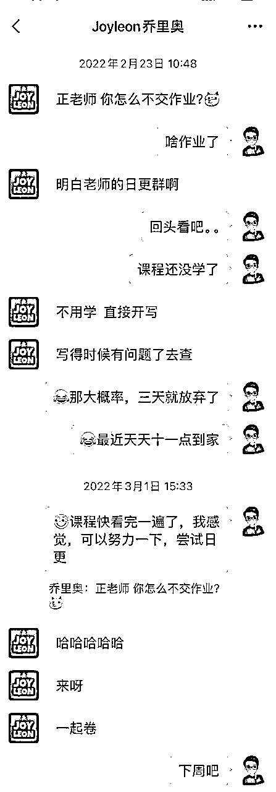 这一段就是标记，不要删掉我。

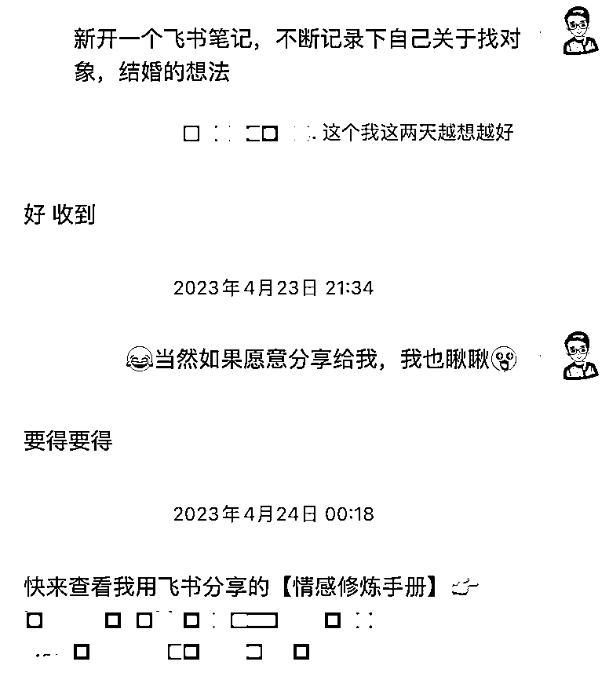 这也是特殊标记，注意保留哦。

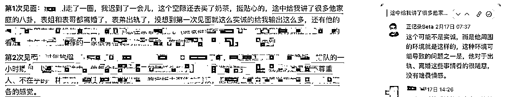 第三处标记，继续保留。

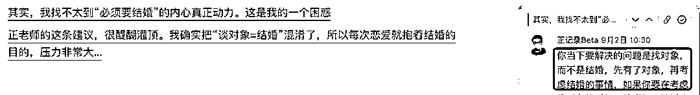 第四处标记，别漏了。

 第五个标记，原样放着。

 第六个标记，继续原样保留。

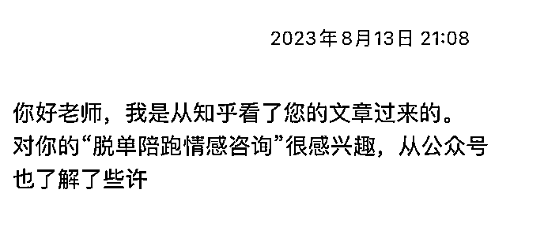 第七个标记，请勿改动。

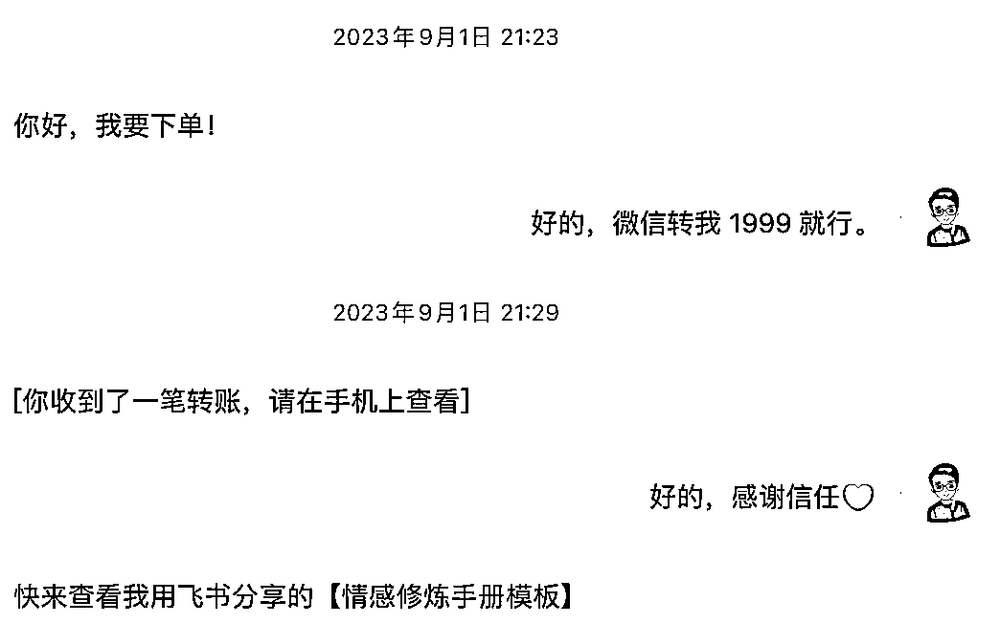 第八个标记，还在呢。

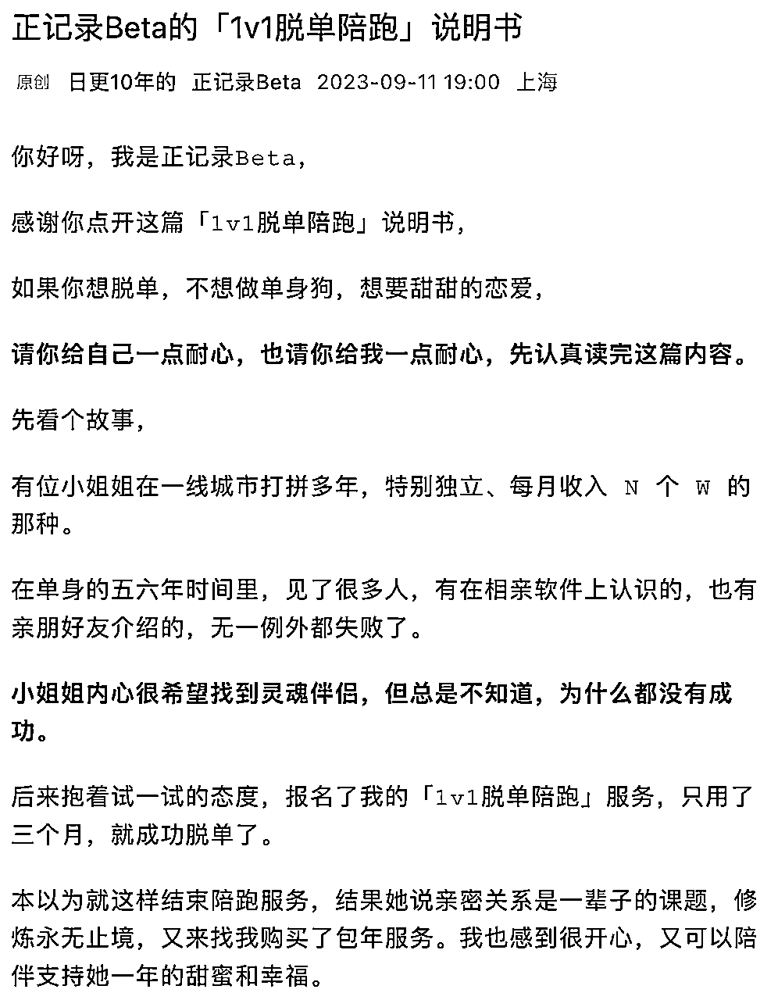 第九个标记，别弄丢。

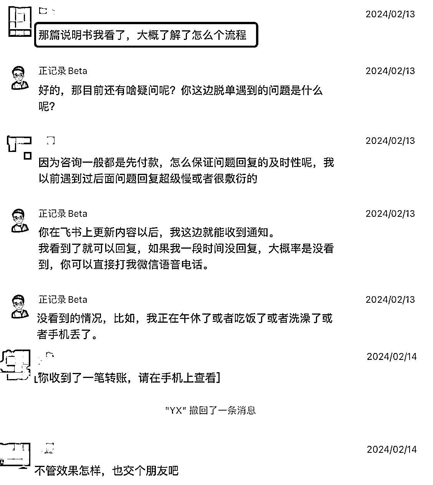 第十个标记，保留住。

 第十一个标记，原样不动。

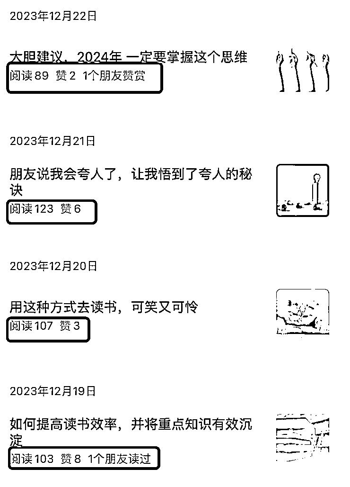 第十二个标记，继续保持。

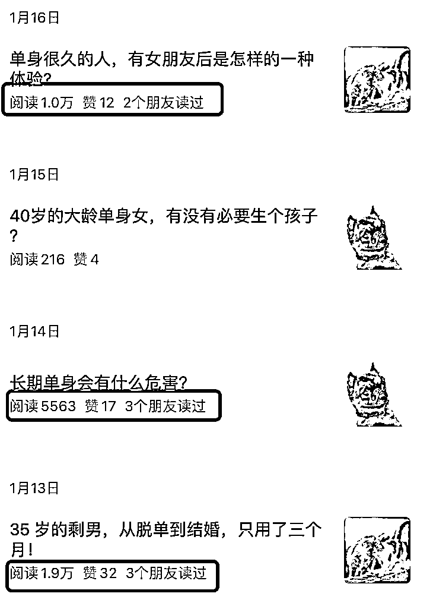 第十三个标记，记录一下。

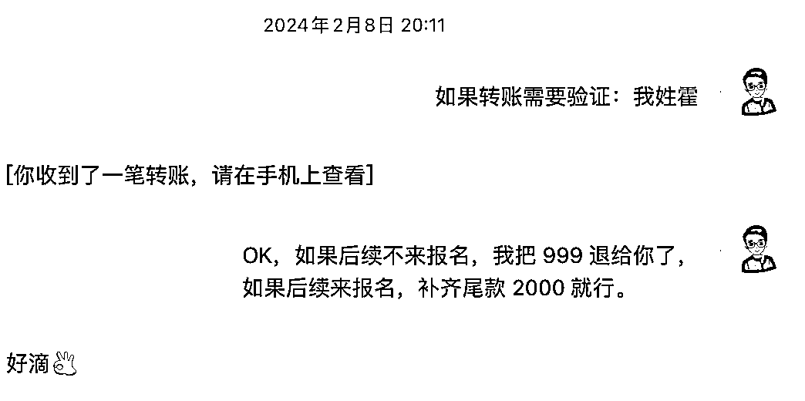 第十四个标记，还在。

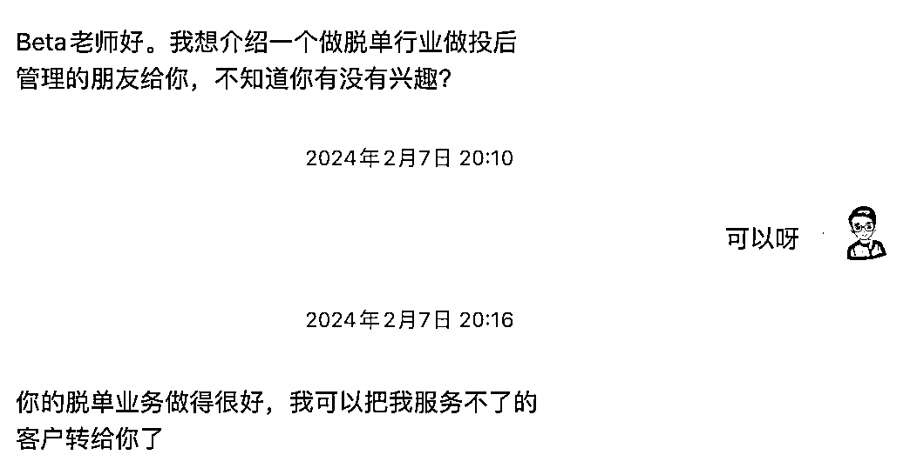 第十五个标记，注意别忽略。

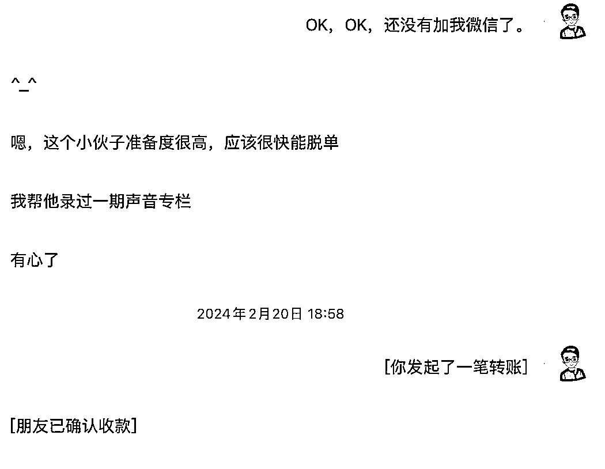 第十六个标记，保持原样。

 第十七个标记，继续保留。

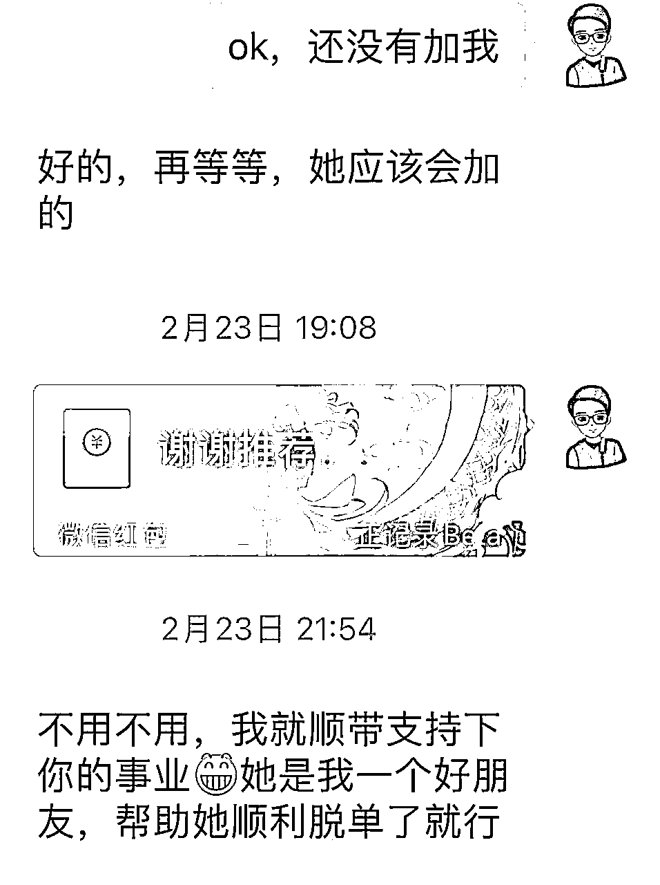 第十八个标记，原封不动。

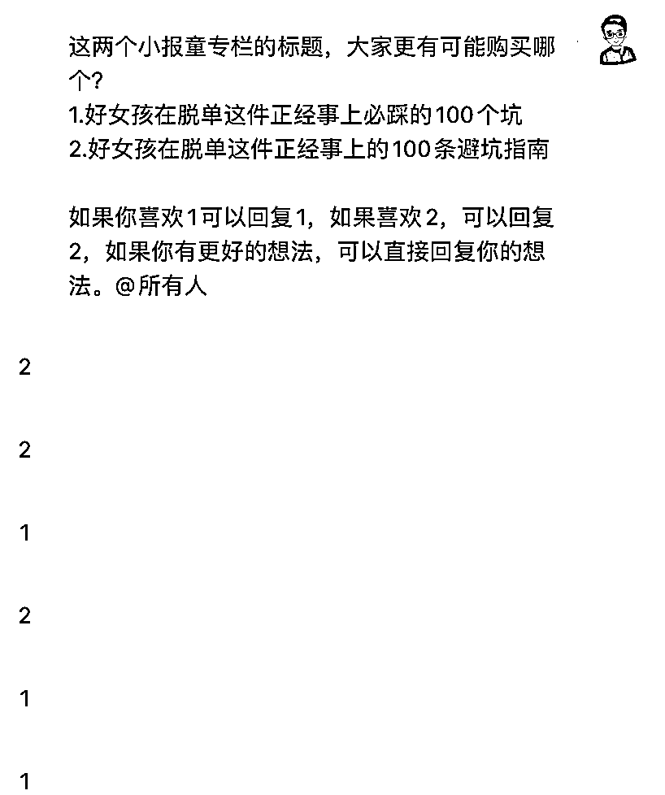 第十九个标记，已经保留。

之前写的那篇关于相亲、脱单的文章，拿到了3.7万阅读，微信上也加了不少朋友。后面项目能在二月份收入过三万，靠的就是那四点。

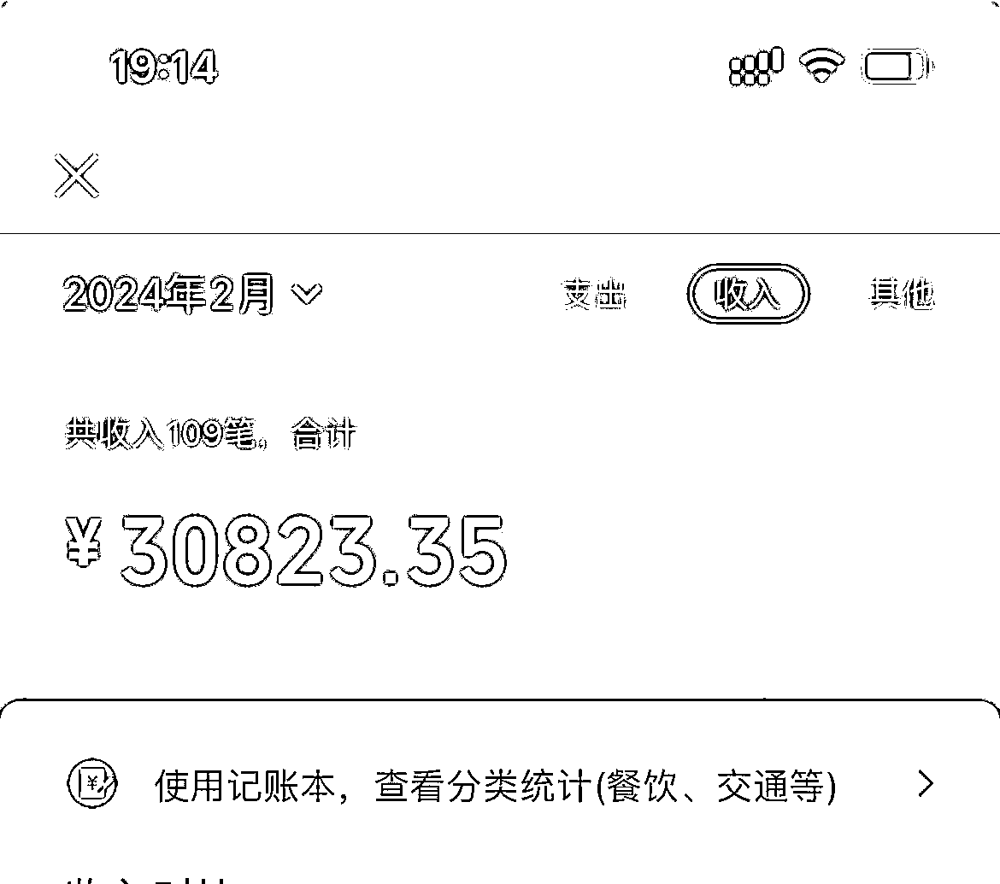

# 6. 转型路上，我踩过的四个坑

## 坑一：不敢把客单价定高

我一开始总想着先卖便宜点，再慢慢往上涨，从低价到中价再到高价，像在公司升职一样一步一步来。但创业根本不是这个逻辑，创业要先找需求，找到真正有付费意愿的人群，直接做高客单价的产品或服务。

低中高三档客单价，对应的用户很可能完全不是一批人，这也是很多人低价转不了高价的原因。而且走这条路，要么得靠用户慢慢长大，要么就得不断给用户制造焦虑。普通人做知识付费，做低价很难和机构竞争，最后只会天天为流量发愁，为用户没行动没结果焦虑。

## 坑二：没用透“十倍思维”

“十倍”不是闷头干十倍，而是思考十倍。没定位的时候，可以把“一个月读一本书”变成“一个月读十本书”，把“一个月写一篇”变成“一个月写十篇”。

有了定位以后，两个方向：一是价格能不能涨十倍。比如我2023年卖的印象笔记小报童专栏，79块，当时我能不能把它做到790甚至7900呢？后面我做脱单陪跑服务，女生2999、男生3499，价格比79高了三四十倍，但难度根本没高那么多。二是流量能不能十倍增长。比如在一个平台专注写垂直内容，别搞大杂烩；或者把内容分发给更多平台，也可以找人合作，你介绍客户我给你佣金。

## 坑三：别“找”定位，要“做”定位

很多人转型时第一反应是“我过去的能力能不能用上”，但其实应该想的是“做了这个选择之后，我能不能通过学习、实践掌握一门新能力”。你能力圈的边界，由你手里的工具决定。如果手里只有一把锤子，看什么都是钉子。职场产品经理的技能，和做个人事业需要的技能，很可能完全两样。

如果你只会当产品经理，那你能选的路就很少，而且还会和一堆同样在找转型方向的产品经理撞车。顺着这个思路走下去，你只会造出更快的马车，而不是发明汽车和飞机。

## 坑四：以为女生不需要脱单陪跑

我的客户里女生不少，她们的卡点大概有三类：

一个是择偶标准很模糊。有的说喜欢帅的，但前提是对方收入不能低于她。可这个前提她从来不主动说，总觉得别人“应该知道”。但你不说，别人怎么会知道呢？

一个是父母压力大。每次去相亲，父母都要问东问西，不知道怎么应对，也不知道爸妈给的择偶标准到底对不对。上一代人的爱情大部分产生于婚后，他们的恋爱经验真的不一定适合现在。

还有一类是之前感情总失败，自己也搞不清问题出在哪，总觉得是自己没做好，又不知道该怎么做好，这时候就需要有人陪着她一起梳理、处理感情里的问题。

# 7. 高客单价陪跑服务，交付时的两个建议

## 建议一：解决真问题，别堆权益

客单价越高，越不能把一堆权益和卖点叠上去。你要聚焦到一个核心痛点上，不断强化，让用户一眼就感受到你的专业和价值。反过来，低客单价才需要堆权益，让人有“花一百块买到一千块东西”的爽感。

## 建议二：客户群要足够精准，产品线不能散

比如我就不做相亲介绍的红娘服务。有人说“那没资源的人你怎么解决？”不好意思，这类人不是我的目标用户。恋爱中遇到的矛盾、分手挽回，这些我也能做，但我不做。因为恋爱涉及漫长的亲密关系维护，已经脱单的人不是我的核心用户。我希望五年十年后，大家想到我，是“脱单专家”，不是“恋爱专家”或“婚姻专家”。

一句话能讲明白，才算是好定位。比如我的那句话：“想脱单，找正正，打破限制信念、澄清若干问题，带你享受甜甜的💘恋爱。”再比如《30岁人生开挂7步法》里的自青，他找家教时特意写“专为中下游学生辅导”，同时晒出自己以前学得有多差、后来怎么提升英语和数学等级的具体细节。结果电话一个接一个，他读大学时，靠补课每月能赚150到200万韩元。

# 8. 几句总结

1. 家人这一关，必须在决定转型前就过好。否则等你崩溃的时候，家人再来拆台，你就真扛不住了。

2. 公开写作要持续做，它是每个普通人都能借力的杠杆。有位大佬说过，他打造个人品牌的方法特别简单：每天写一篇文章。这样专业能力会越来越强，认识你的人也越来越多。

3. 一次咨询往往解决不了根本问题。碰上值得帮的人，尤其是懂得感恩的，不妨持续主动联系，看看还能挖出什么需求。

4. 知乎把“活跃领域”分得很细，情感这个大类里，其实还装了个人成长和人际交往。难怪很多情感博主偶尔也会聊这些。我之前谈个人成长总觉得有点虚，因为什么都能扯上，找不到一个踏实的落脚点。

5. 有对象的一大好处，是你会更了解自己。虽然平时也在和人碰撞，但只有亲密关系里的碰撞，才触及最根本、最底层的东西，带来的成长也最快。甚至有人说成长的办法就是不停谈恋爱——谈对象可以，“不停谈”就不行了，不道德。

6. 别和定位死磕，先动起来。做着做着，定位自然就浮出来了。我以前是个程序员，2023年之前，你让我做情感领域、帮别人脱单，打死我都不信，因为我知道自己没那个能力。

7. 多去问那些已经拿到结果的人，能避开很多坑。感谢炮爷和傅超人，我没少找他们取经。

——

今天就聊到这里，希望没占用大家太多时间，祝你们龙哥盟！

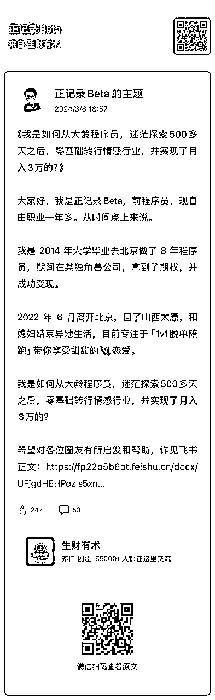

这篇复盘最早发在“龙哥盟”知识星球。如果你是从别的渠道看到的，想读到更多类似的文章，可以考虑付费加入，里面的内容对提升赚钱能力挺有帮助。加入后不满意，三天内可以无理由全额退款。