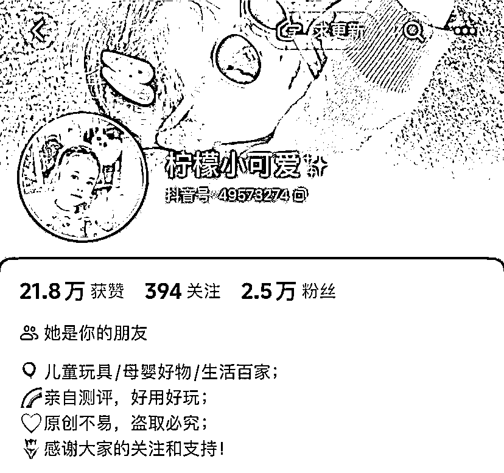
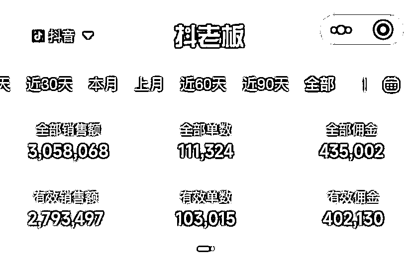
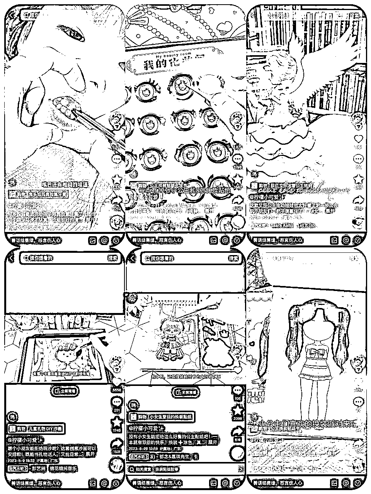
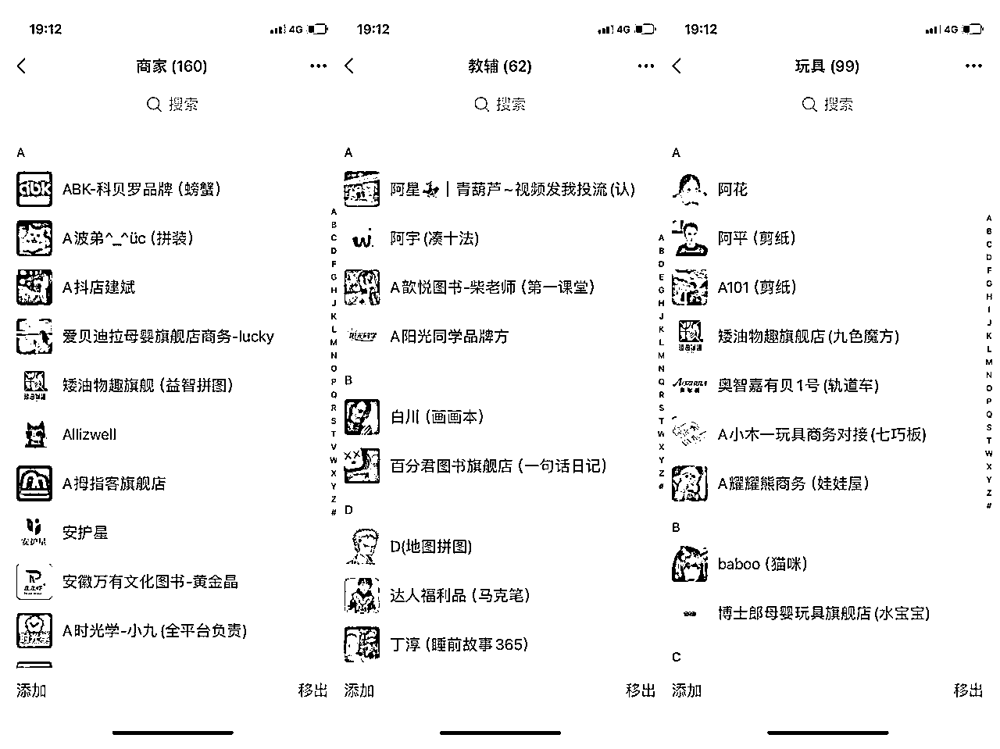

# 当了妈才懂：带娃也能把抖音橱窗做到一年11万单，我的实战复盘

> 来源：[https://oq06a188yq7.feishu.cn/docx/E5KpdR0WDo0guIx7RjKcFM66njK](https://oq06a188yq7.feishu.cn/docx/E5KpdR0WDo0guIx7RjKcFM66njK)

# 先自我介绍一下

大家好，我是书燃。2023年6月才正式进入星球，编号93967。

在星球里看了不少前辈的干货，认知、打法、实操细节都受益很多，特别感谢赚钱这个地方。

今天把自己做抖音的一年经历梳理成这篇长文，也是我在星球的首发。想把踩过的坑、摸到的路，都摊开给正在做或准备做抖音的宝妈宝爸们参考。

下面说说我是怎么在2023年2月这个时间点入局抖音，选定母婴赛道做纯短视频带货，一年把橱窗做到11万单的。

这个数字不是最终版，写到现在已经冲到12.7万单了

# 2023年了，为什么我还敢冲母婴

每年网络上总有人说抖音卷死了、没机会了、没钱别碰。但信息本身就是偏的。人家觉得难做，往往是因为过去随便发就能吃到流量，现在要靠内容、选品、投放一起打了，对他们而言变难了。真就等于普通人没戏了吗？我觉得不然。

只要把自己的优势搞清楚，踏实干下去，平台和赛道都能出结果，只是大小差异。

我选择2023年做抖音、做母婴，是基于这几点判断：

1、老人、女人、孩子，这三类人群向来最好变现，母婴一次就占了两个。
2、我本就是互联网从业者，面对的对手主要是家庭宝妈，在内容能力和平台规则理解上，我有天然优势。
3、母婴内容基本都需要真人出镜，尤其是娃。机构很难批量化生产，每个视频都要实拍，流水线化程度低，个人反而有机会。
4、自己带娃，对什么时候需要什么、哪些是刚需，判断很准。选品效率高。即便没做起来，拿到的样品一年也能给家里省下大几千。
5、母婴是长期复购生意。一个客户能从孕期跟到孩子成年。卖5年都算保守，比很多短期项目靠谱得多，生意会随娃年龄自然迁移。
6、坤哥那句话我一直记着：家有一娃，赚钱如麻。

# 我把2023年拆成三个阶段

第一个视频是2月8号发的。

第一阶段：2月-5月，黑洞期
这三个月橱窗大概也就3000单出头，还倒亏了1万5。前面是我和我老婆一起搞，我负责选品和投放，她负责文案剪辑。我们当时约定，如果3个月收入不到3000块，她就去上班。

这段是最磨人的。每天选品、剪辑、发布，播放量25、137、109轮番来，连续三个月没反馈，特别崩溃。我们一开始就走自然流+投流结合的路线，随心推和千川也在亏钱。一个人闭门做，基本撑不过去。

这段主要考验心态。普通人做带货，不可能上来就爆，也不是每天都有正反馈。但只要方向没错，不断迭代选品、内容和投放策略，在正确路子上反复试错，迟早会迎来拐点。

别信什么3天起号、7天打标签、15天出单的说法。那都是把SOP极致拆解后，大量验证才出现的少数案例，属于幸存者偏差。类似航海那样的打法确实存在，但配合极高执行力才能复现，并不是人人都能照搬。

第二阶段：5月-11月，爆发期
你能想象每个月都爆单是什么感觉吗？

就在我老婆面了好几家短视频公司，准备第二天就去入职的时候，单量起来了，而且是一直爆。

熬过最难的三个月后，数据开始正向，这也让我们更坚定地继续做下去。

能持续爆单，靠的是几件事叠加：选品、节点、内容、投放、商家关系。

第一个爆单品是沙画。3天卖了6000单，单利润只有1块钱，但这是我第一次真实感受到爆单的冲击，小程序消息一直响。

能跑起来的原因：
内容是商家认可的同品类里最优素材，我们自己也觉得拍得最好。
商家没跑千川，但给我们开了700多条随心推。700条，应该是靠人工配合出的量。之前沟通比较多，商家愿意放量，我们顺势降佣配合投放，直接起量。
时间点抓住了，5月9号发，临近六一儿童节，需求被点燃。

第二个爆单品是艾莎公主音乐电动玩具。
去玩具展时发现一个规律：女生向、颜值在线的玩具，展位人气特别高，后来选品就往这个方向走。艾莎就是代表作。我自己投千川，ROI最高到7，稳定在5左右，卖了4000-5000单。也就是投1块钱，能赚1块到1块5。当时胆子太小，没敢放大，现在想想很后悔。

爆的原因：
应季，5月下旬开始爆，正好赶上六一礼物需求。
大IP，几乎没有小女生会抗拒。
产品自带卖点：音乐、发光、旋转，不需要复杂讲解，几个镜头配主题曲就够。

这里也踩了个大坑：商家断货。最火的款突然没货，周末千川还在跑，ROI掉到4，后面系统判定效率低，流量就下来了。周一才知道断货。补货后热度也回不去。所以视频一旦起量，必须提前和商家锁货。

后面基本每个月都有爆品，且品类不同。根据自己女儿的情况，我后来总结了一套选品逻辑，从女生切入：

1、颜值优先。玩具自带流量，先看颜值。好看的品拍出来效果不会差。像沙画、艾莎、水画本、咕卡、贴纸这类，都属于一眼留住的。
2、佣金要够。早期定下30%以下不看，自己要投流，佣金太低千川打不起来，容易亏。
3、退货率要低。整体控制在6%-8%左右，到了10%就很伤，卖的越多退的越多。品质关必须严。
4、强时效性。季节爆款、节日爆款、热点爆款。立春后防晒、面霜这类季节品立刻起来。六一是母婴最大节点，38、教师节、国庆也能出品。常年四季卖的品，流量被大玩家占满，个人没抓手。
5、新奇特。能唤醒兴趣、让人想发朋友圈或抖音的解压类、新奇类产品，传播力强，自然出单。
6、价格锚点低的羊毛品。防晒衣原价299打到79，牙刷9.9十支，磁力片199到59。这种羊毛品不是天天有，遇到就冲。但价格低不等于品质低，不能卖自己都过不去的货。
7、易过审。尽量不碰儿童保健品和零食，账号风险高，千川审核也严。内容再好不能放大也没用。

第三阶段：平稳期
从11月开始，账号进入稳定运营期。收入和订单都趋于平稳，只要保持更新频率和内容质量，不作死，基本都能维持。

# 给新手宝妈宝爸的10条实操建议

都是花钱买来的经验，每条都建议记下来。

1、先定细分再扩品。母婴是大类，先在一个细分跑通再横向。 我是玩具起家，后来才做服装、好物、教辅。甚至牙膏视频都跑出2000万播放。先选教辅、玩具、辅食、服装里最契合自己娃特点的切入。
教辅有个降维打击思路：娃二年级就去卖一年级或幼小衔接的内容，娃会配合，拍摄效率高。

2、找对标。抖音上大量粉丝不到一万，带货十万级的达人，拍的就是最朴实的桌拍。找不到对标就别做。模仿再超越。
3、把账号基础信息填完整。太多次强调了，但新手最容易忽略。
4、加500个商务。别急着开拍，先加人。商家朋友圈每天都在发，有的能免费拿，有的给投流支持。500个商家同时推同类品，爆款线索就出来了。前期几乎所有品都拿来练手，样品钱都省了。拿品时多问一句：你们测流吗？很多人不敢问。
我目前两个微信加起来商家超1000人。

5、工具先行。买灯、买支架。视频暗、画面抖，滤镜救不了。500块以内的投入，能让坚持度提升很多。
6、抄就对了。找到爆款视频，1:1像素级复刻。45度角运镜就是45度，推镜头3秒就是3秒。新手不要乱发挥，先抄30条，培养手感。每个环节都60分，成片不可能高于60分。
7、薅商家投流。拿到投流支持的品就往死里发。不要有负罪感。那是商家预算。舒客牙膏当时商家投我1万千川，我跑了5000GMV。只要你能跑动，就甩开99%的人。商家通常有条件限制，比如出单后投100，销量达标才投。投流大气的商家，天天发。
8、天天刷榜单。爆品不是靠运气，是靠对榜单的敏感度。前面几个月我能背下24小时榜和周榜都发过什么品。看到新品出来，立刻跟进，把别人没做好的点补上，把做好的直接抄，抢流量窗口。
9、要有付费思维。2024年了，别想纯白嫖。每月发60条，挑30条数据好的投随心推，每条20块，也才600。最差亏300-400，但买到的是反馈。付费是穿越黑洞最快的方式，也是筛选千川素材的办法。
10、执行力拉满。坤哥提过的悠悠，2.1万条视频，橱窗400万单。内容没多花哨，就是靠数量和持续优化。只要选品和内容不断迭代，账号迟早起量。

# 2024年我的计划

IP化是长期赚钱的关键。我理解的IP不是大博主，而是抖音里的熟人。谁会在你线下办事、买东西时第一个想到你，你就是熟人。

所以2024年目标是每个视频都有3-5秒真人出镜，娃必须出镜。

目前橱窗接近13万单，年底冲击30万单。

以上都是真实经历，有不到位的地方欢迎指正，也欢迎同样做母婴的朋友交流。2024祝大家身体健康，生意兴隆。