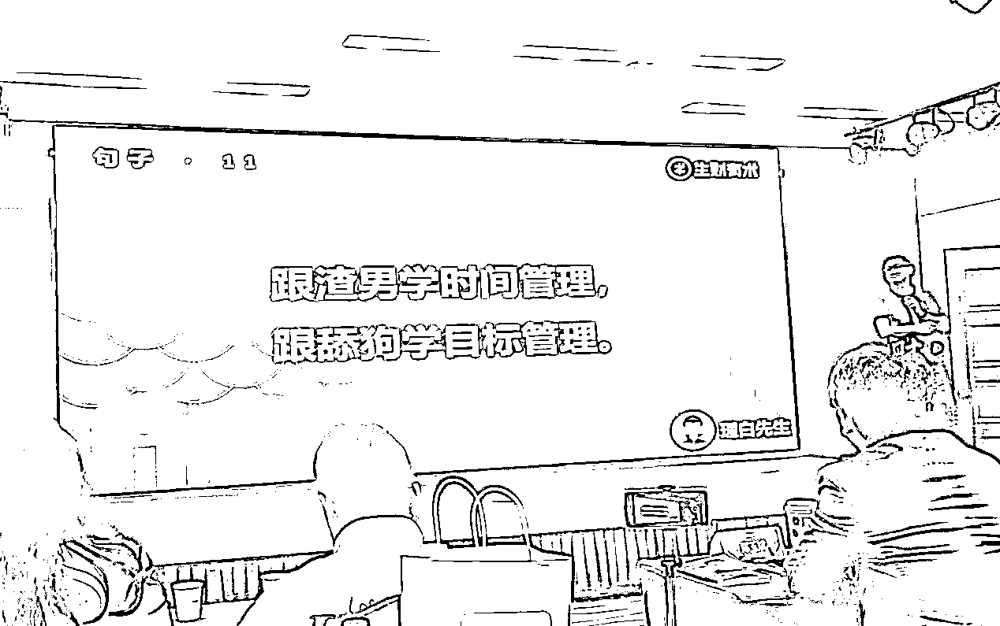

# 下班后只剩 4 小时，我如何把精力拉满 3 倍，带出 7 位数收入
作者：龙哥

## 用有限的下班时间做高杠杆副业，一名医生做到了 7 位数营收

作者：理白

日期：2024-03-28

白天三甲医院看诊，晚上做互联网副业。我是如何用下班后的 4 小时，撬动三倍效率，实现年入七位数。

各位朋友好，这里是航海家俱乐部的理白，也是上个月福建年会的主分享人。月初厦门那场线下交流，从组织到执行都做得很用心，现场氛围非常好。

当天我往返厦门，在路上意外收到反馈，我在演讲里提到的“生命第一位”、“向渣男借鉴时间管理，向舔狗借鉴目标管理”等金句，在圈子里被大量转载，甚至不少福建外的同好也通过朋友介绍联系到我，索要演讲 PPT 和逐字稿。

看来这次的内容确实戳中了一些人。很多伙伴平时被 deadline 死追，感觉时间永远不够，既想做好本职工作，又想发展副业兼顾生活，却总觉得顾此失彼。于是我把当天的脱稿分享重新整理成书面版，并把 PPT 一并附上，分享给赚钱的朋友们，希望能提供一套真正可落地的降本增效思路。

详细内容可戳这里查看：

最后要特别感谢从哈尔滨远道而来支持的伙伴，感谢在现场一直鼓励我的朋友，感谢主持人的开场给了我很好的灵感启发，感谢在现场提供大量案例素材的几位朋友，以及赚钱全体志愿者的专业付出，让这场线下活动如此精彩。

* * *

评论区：

张可粒 : 时间管理大师 yyds

阿甘｜汽车出口 : 谢谢白白的分享，很有收获。

微微 : 太棒了！理白老师 YYDS！[哇]学到了！

落薇 : 理白老师 YYDS！

老彭 : 真羡慕在圈子里有这么多好朋友的圈友

文少 : 时间管理大师 YYDS！

Coco 的小宇宙 : 分享太棒啦😊，金句好多啊

Yye-柏寒 : 理白老师牛逼！！

* * *