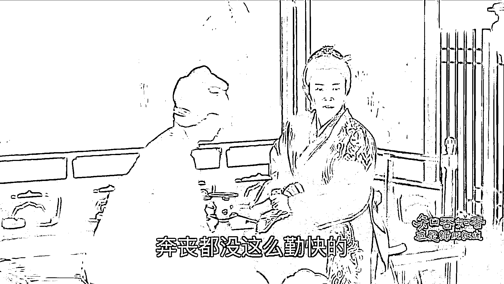
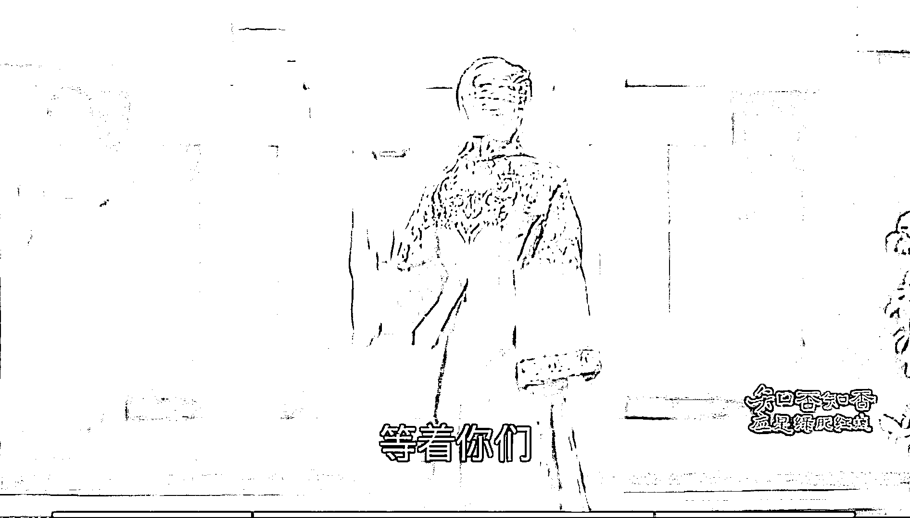

# 做赚钱的剧评👸号，不妨从“观众的嘴替”开始

最近重刷《知否》，常嬷嬷怒骂康姨妈那场戏，依然看得我忍不住拍大腿。弹幕里齐刷刷的“爽死了”“这就是我的互联网嘴替”。这段戏为什么这么顶？因为常嬷嬷句句不带脏字，却把康姨妈那副装模作样的嘴脸扒得底朝天。她这一顿输出，既护住了顾廷烨最放在心上的人，也让顾家大娘子的一贯威风折了大半。观众憋了许久的气，终于有人替自己撒了出来。

就是从这场戏开始，我慢慢咂摸出做剧评👸号的趣味。原来真正吸引人的内容，不需要高深解读，而是能精准戳中观众情绪的“名场面”。你替观众说出了心里话，观众自然愿意点进来看、转发、留言。

至于怎么把这些共鸣变成账号的收益，我把自己的经验整理成了几条，放在下面。

